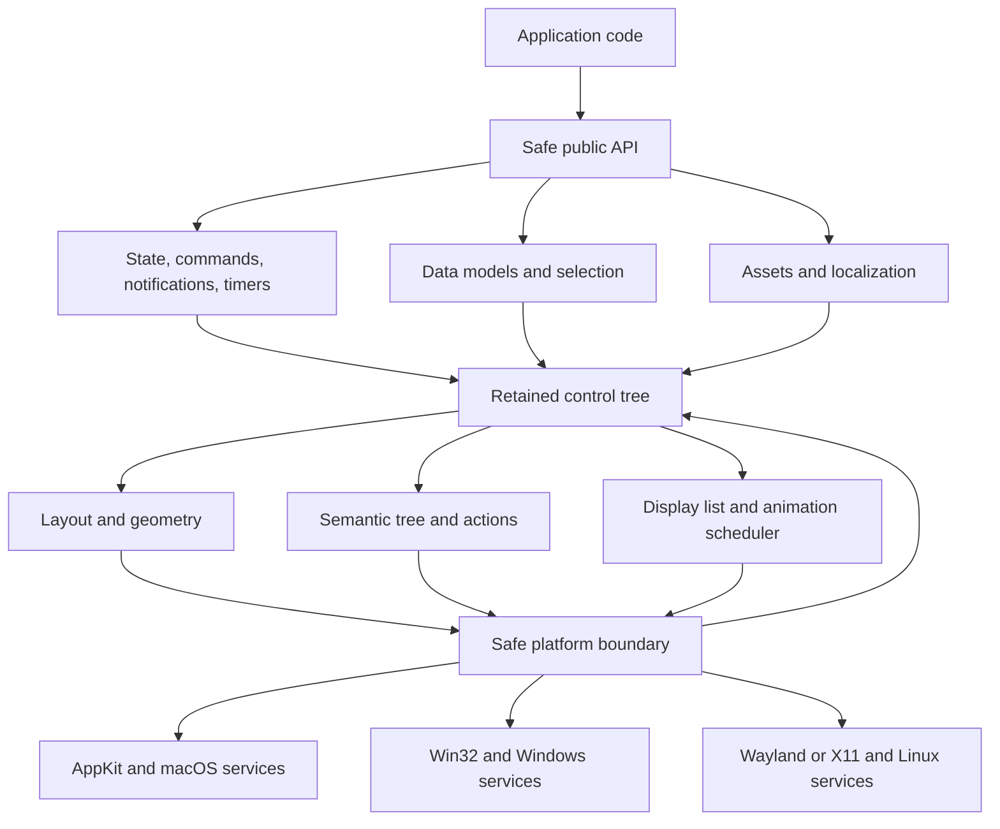
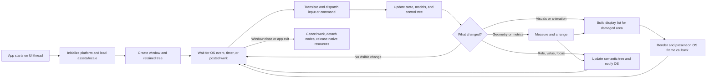

# choscorui: native Rust desktop UI roadmap

Status: implementation underway (2026-09-20). This remains the full product roadmap; the current prototype does not satisfy the phase gates yet.

**Current delivery scope (2026-10-08): macOS only.** Windows (phase 10) and Linux (phase 11) backends, and the Windows/Linux items inside other phases, are skipped for this delivery. Their existing contract crates stay compiling but receive no new work. Every remaining phase is implemented and gated on macOS alone. Each roadmap item lands as its own commit on `main`.

## Goal and boundary

Build a reusable, native-performance desktop UI toolkit in Rust with a Qt-like range of customization. Use the Rust standard library and direct foreign function interfaces (FFI) to operating-system APIs. Do not depend on iced, Slint, Qt, GTK, a webview, or another UI runtime. Platform SDKs and system libraries are unavoidable dependencies; the goal is to avoid installing a third-party UI framework in applications using choscorui-v2.

The first deliverable is a **native top-level window with a custom-drawn control tree**. Here, native means a real OS window, OS event loop, input methods, menus, dialogs, accessibility service, and packaging. Custom-drawn controls are not OS control instances and will not automatically inherit the OS appearance or accessibility behavior. Matching the host appearance is an optional style; a consistent custom appearance is the primary customization path.

Target desktop platforms: macOS, Windows, and Linux. Bring up macOS first because development is on macOS. Windows follows, then Linux Wayland and X11. Do not claim a platform is supported until it passes its acceptance suite on that platform. A backend may use C ABI libraries or Objective-C/COM interfaces through Rust FFI; the public UI API stays safe Rust.

**Scope against Qt:** target Qt-like capability for desktop application UI, not feature or API parity with all of Qt. Grid/form layouts, splitters, docking, validated and structured inputs, application settings, an interactive 2D canvas, and desktop integration are in scope. Networking, SQL, multimedia, WebEngine, PDF, 3D, mobile/embedded targets, and a visual designer are separate product decisions. Record each as in scope, deferred, or out of scope in the phase 0 support matrix. Rust `std` facilities may cover some application needs without becoming toolkit APIs.

The phase 0 matrix must account for every family in Qt's [widget class catalog](https://doc.qt.io/qt-6/widget-classes.html) and [module catalog](https://doc.qt.io/qt-6/qtmodules.html), as checked against Qt 6.11 on 2026-09-19. A class in that inventory is a comparison point, not a promise of a one-to-one Rust type or 1.0 delivery. For each family record `in scope`, `deferred`, or `out of scope`, the equivalent capability or reason for exclusion, target milestone, backend limits, and an acceptance scenario. Update the inventory when the Qt reference version changes.

### Qt capability inventory for the phase 0 matrix

| Family | Capabilities to account for |
| --- | --- |
| Basic widgets | Buttons and command-link buttons; labels; checkboxes and radio buttons; single-line input; combo boxes; date, time, and date-time editors; integer and decimal spin boxes; dial and slider; progress bar; scroll area and standalone scroll bar; size grip and external focus frame; font chooser combo; numeric/LCD display; tab bar and tab widget; toolbox; tool button; menus; generic widget/container. |
| Advanced widgets | Calendar; list, icon, column, tree, and table views; data-to-widget mapper; undo history view. |
| Abstract and organizer contracts | Shared button, slider, spin, scroll-area, dialog, and frame behavior; button groups; titled groups; splitters and handles; stacked containers; docking and floating panels; MDI/subwindows. |
| Main-window shell | Main window; menu bar and context menus; movable toolbars and embedded controls; status bar; size grip; window geometry and state; document/subwindow management. |
| Layout | Horizontal and vertical box, grid, form, stacked, spacer, size policy, custom layout items; graphics-scene linear, grid, and anchor layouts. |
| Model/view | Abstract list/table/tree models; stable indexes and persistent identity; roles and change notifications; shared selection and ranges; delegates and editor factories; sorting, filtering, identity, and table-concatenation proxies; generic item and string-list models; filesystem model; headers; convenience item-backed list/tree/table views; column view; data widget mapper. |
| Graphics View | Scene and item ownership; primitive line, rectangle, ellipse, polygon, path, image, text, and SVG items; item groups, transforms, stacking, selection, focus, hit testing, hover, context menu, help, drag/drop, wheel, resize, and move events; multiple views; culling and spatial indexing; graphics effects; layouts and widget embedding/proxy behavior. |
| Appearance | Style metrics, hints, options, painting, palettes, states, and style selection; fonts and installed-font lookup; color spaces and transforms; cursor shapes and custom cursors. |
| Dialogs and utilities | Open/save/directory, color, font, message, and single-value dialogs; dialog button ordering; completer; key-sequence capture; rich and plain text documents; validators and input masks; undo commands/stacks/groups; file icons and desktop services. |
| Declarative UI | Qt Quick/QML-equivalent decision: Rust composition syntax, observable properties and bindings, states, transitions, animation, dynamic component loading, and whether a separate declarative runtime is warranted. |
| Core application services | Signals/notifications, properties, object lifetimes, event dispatch, timers, tasks and concurrency, structured data (JSON/CBOR/XML), resource bundles, plugins, interprocess communication, D-Bus, state machines/SCXML, permissions, and test utilities. Decide explicitly which are ordinary Rust application concerns. |
| Graphics and media formats | Vector paths and SVG, raster/image formats, gradients, effects, offscreen rendering and export, printing/PDF, charts/graphs, OpenGL/shader access, 3D, animation formats, and multimedia. |
| Other Qt modules and targets | Network and protocols (HTTP, WebSockets, CoAP, MQTT, gRPC, Protobuf, OAuth); SQL; WebEngine/WebView/WebChannel and HTTP server; Bluetooth, NFC, serial/serial bus, sensors, positioning/location, speech/audio; help and designer/UI tools; ActiveX/COM; remote objects; virtual keyboard; Wayland compositor; mobile and embedded targets. Track each separately rather than grouping all as “Qt extras.” |

## Non-negotiable architecture decisions

1. **Separate behavior from appearance.** Controls own semantics, state transitions, focus, keyboard behavior, and accessibility. A style supplies metrics, colors, shapes, and visual parts. A custom visual must retain the control's behavior.
2. **Use a retained tree.** Stable node IDs preserve focus, text selection, scroll position, and accessibility identity between updates. A declarative Rust builder may reconcile descriptions into this tree later; the retained tree is the foundation.
3. **Keep one authoritative logical coordinate space.** Layout uses logical points. Each backend maps them to physical pixels at its current scale factor. Hit testing and accessibility bounds use the same geometry.
4. **Invalidate instead of repainting continuously.** Changes mark layout, paint, or semantics dirty. Request an OS frame only when required, except during active animation.
5. **Keep OS and GPU objects behind backend boundaries.** No raw pointer, Objective-C object, COM interface, or Wayland proxy escapes into safe control APIs. Document ownership, thread affinity, and callback lifetimes at every FFI boundary.
6. **Define a small display list.** Controls emit clipping, fills, strokes, images, and shaped text into a renderer-neutral list. Rendering and text shaping may have separate platform implementations. This prevents platform graphics APIs from leaking into widgets.
7. **Build accessibility and IME into the core contracts early.** A text field cannot be considered complete merely because characters can be painted and clicked.

Suggested workspace shape once implementation begins:

```text
crates/
  choscorui-core/       # geometry, tree, events, layout, semantics, theme contracts
  choscorui-platform/   # safe platform traits and backend selection
  choscorui-macos/      # AppKit, Core Text/Graphics or Metal FFI
  choscorui-windows/    # Win32, Direct2D/DirectWrite, UI Automation FFI
  choscorui-linux/      # Wayland/X11, rendering, AT-SPI integration
  choscorui-controls/   # reusable controls and style recipes
  choscorui/            # public facade
examples/
  gallery/              # same app and test scenarios on every platform
```

The exact crate split can change. Keep public contracts small until the first two backends prove them.

## Architecture and lifecycles

The diagrams show intended contracts, not a fixed crate dependency layout. Only the backend owns native handles; the application and control APIs remain safe Rust.





Composition and accessibility actions enter at dispatch. Posted work and timers must return to the UI thread before mutating the tree. A theme or locale change can invalidate layout, paint, and semantics together. Removing a focused node cancels its pointer capture and IME composition before its native accessibility identity is retired.

## Build sequence

Each phase has a concrete exit gate. Finish its gate before building the next layer. Add regression tests at the public seam of each feature, plus a manual platform matrix for behavior that cannot be meaningfully tested headlessly.

### 0. Contract, support matrix, and benchmarks

- Specify target OS versions, CPU architectures, minimum Rust version, supported window types, and whether sandboxed distribution is in scope.
- Write a public API sketch for `Application`, `Window`, `Node`, `Event`, `Theme`, `Control`, and `Style`. Mark unstable APIs as experimental.
- Sketch state-change notifications, commands/actions, timers, posted UI-thread work, data models and selection, resource lookup, and localization. Decide which belong in the toolkit versus ordinary Rust application code.
- Classify Qt-adjacent capabilities as in scope, deferred, or out of scope: networking, SQL, multimedia, web content, PDF/printing, 3D, mobile/embedded targets, and designer tooling. State the intended desktop UI parity boundary.
- Fill every row of the Qt capability inventory above, including each named widget and module family. Record equivalent behavior, milestone, platform limits, or exclusion rationale; leave no unclassified catalog entry. Explicitly decide on reactive bindings/declarative composition, plugins, IPC/D-Bus, state machines, structured data, testing utilities, SVG, graphics effects, and native control embedding.
- Record the in-scope desktop contracts and platform capability limits for grid/form layouts, splitters and docking, validated and structured inputs, persistent application settings, an interactive 2D canvas, and system tray/status items, notifications, URL opening, and application activation.
- Define reference scenarios: gallery startup, idle window, resize, scrolling a large list, typing a long multilingual document, theme switch, and multiple windows.
- Capture baseline measurements on named machines: startup time, idle CPU and memory, resize latency, input-to-paint latency, scroll frame time, and build size. Set release thresholds after measuring a prototype; do not invent performance numbers now.
- Decide the dependency rule precisely: `std` and system SDK FFI only, or whether build-time binding generation and test tooling are allowed. If strict zero-crate source is required, maintain small hand-written ABI declarations and verify them against each SDK.

**Gate:** a reviewed API sketch, support matrix, benchmark harness design, and explicit dependency policy.

### 1. macOS process, window, and event loop

- Bind the minimum AppKit/Objective-C runtime surface needed for `NSApplication`, `NSWindow`, and an `NSView` or layer.
- Start and stop the app on the main thread; create, show, resize, close, and reopen a window.
- Translate pointer, keyboard, modifiers, focus, window size, and scale changes into owned Rust events. Provide safe wake-up from worker threads.
- Define timer scheduling, cancellation, and posted-work ordering on the UI thread; neither callbacks nor background threads may mutate the tree directly.
- Make callback ownership and panic containment explicit: Rust panics must not unwind through Objective-C or C callbacks.
- Support proper teardown, including releasing native resources after the final callback.

**Gate:** the gallery opens, receives input, resizes correctly across displays with different scaling, closes cleanly, and idles without a busy loop.

### 2. Geometry, retained tree, and event routing

- Implement logical units, rectangles, transforms, clipping bounds, and stable node IDs.
- Add parent/child ownership, attach/detach, lifetime rules, and per-node dirty flags.
- Route pointer events by hit testing and z order; support capture, enter/leave, wheel input, keyboard focus, and cancellation when a node disappears.
- Define input device capabilities and fallback behavior for touch, precision scrolling/trackpad gestures, pen/tablet input, and drag-and-drop. Add backend-specific support claims only after testing.
- Specify propagation, cancellation, reentrancy, and ordering for events and state-change notifications. Give controls a safe way to report value changes and request commands without retaining invalid node references.
- Keep state transitions deterministic and independent of platform APIs.

**Gate:** unit tests cover nested hit testing, clipping, capture, focus transfer, removal during dispatch, and scale-independent coordinates.

### 3. Layout engine

- Define measure and arrange passes with constraints, intrinsic size, min/max size, padding, and baseline alignment.
- Implement stack/row/column, fixed and flexible sizing, spacing, alignment, and scroll viewport primitives.
- Add grid and form layout primitives with spanning, label alignment, and predictable behavior when content grows or shrinks. Define the geometry and keyboard behavior of resizable splitters; phase 12 supplies their complete controls.
- Define layout-direction inheritance and mirroring, including RTL ordering, alignment, keyboard navigation, and directional icons; locale changes invalidate affected measurements.
- Detect cycles or unsatisfiable constraints and fail predictably in debug builds.
- Cache measurement only when inputs are unchanged; invalidate ancestors correctly when text, style metrics, or size changes.

**Gate:** deterministic layout fixtures cover tiny and huge windows, long labels, nested flexibility, RTL direction, and dynamic type scaling.

### 4. First display list and macOS painter

- Define renderer-neutral commands for rectangles, rounded paths, borders, opacity, clipping, images, and text runs.
- Resolve vector paths, gradients, SVG import, image formats, effects, offscreen rendering/export, and cursor assets against the inventory; include chosen primitives in shared rendering fixtures.
- Define an asset contract for packaged icons, images, fonts, and translations, with stable lookup and clear missing-asset errors. Decide whether vector icons and arbitrary paths are required before the display list becomes stable.
- Implement a macOS painter using system drawing APIs; choose a software/Core Graphics path for initial correctness. Add Metal only when profiling justifies it.
- Handle color spaces, alpha blending, image decoding, resize, occlusion, and display scale. Recreate device resources after loss or surface changes.
- Introduce damage regions and frame scheduling; avoid redrawing hidden or unchanged windows.

**Gate:** golden render fixtures and on-screen checks pass at 1x and 2x scaling, and an idle window stops drawing.

### 5. Text measurement, shaping, and display

- Create one text-layout contract for font selection/fallback, Unicode shaping, line breaking, bidirectional text, glyph positions, and hit testing.
- Implement the macOS backend with Core Text. Put measurement and drawing behind the same shaped-run data so layout matches pixels.
- Cache font and layout results with bounded memory; invalidate on font, size, locale, or scale changes.
- Test Vietnamese diacritics, CJK, emoji sequences, combining marks, RTL text, and mixed-script lines.

**Gate:** text selection geometry, caret positions, wrapping, and rendered glyphs agree in the gallery across the language fixtures.

### 6. Input, focus, clipboard, and basic controls

- Add semantic actions (`activate`, `set value`, `select`) independent of pointer events.
- Define application commands with enabled/checked state, shortcut context and conflict rules, and a shared source of truth for buttons, menus, toolbars, and context menus.
- Implement button, label, checkbox, radio, slider, separator, and scroll container with disabled, hover, pressed, focus, and selected states.
- Define keyboard navigation order, tab/shift-tab, mnemonics or shortcuts, default actions, and visible focus indicators.
- Expose clipboard read/write and drag payload types through the platform interface; introduce drag-and-drop when the basic path is stable.
- Specify clipboard and drag payload formats, copy/move/link negotiation, cancellation, and cross-application behavior. Cover at least text, files, and images where supported.
- Make each basic control's semantic role, name/value/state changes, and keyboard actions part of its own gate; phase 9 validates the OS accessibility bridge.

**Gate:** every control works with keyboard alone and has deterministic state tests; pointer capture behaves correctly when dragging outside its bounds.

### 7. Text editing and input methods

- Implement a text model with UTF-8 storage and explicit mappings among byte offsets, grapheme boundaries, and platform text ranges.
- Support caret movement, selection, word movement, undo/redo, copy/paste, multiline editing, scrolling to caret, and password masking.
- Define validation states and commit behavior separately from editing, including intermediate input, error feedback, and accessibility announcements. Add input masks and locale-aware numeric/date input contracts; phase 12 supplies their complete controls.
- Define whether undo/redo is text-only or a reusable command stack for application actions; include selection and composition boundaries in that decision.
- Integrate native IME composition and candidate placement through AppKit text-input protocols; distinguish marked text from committed text.
- Preserve composition across redraws and reject edits safely when the focused field is removed.

**Gate:** manual and automated scenarios cover Vietnamese input methods, Japanese/Chinese composition, emoji, dead keys, paste, undo, selection, and screen reader editing.

### 8. Theme and customization API

- Define design tokens for color, typography, spacing, radii, borders, elevation, and motion. Resolve light/dark, contrast, and user overrides in a documented order.
- Give each control a visual recipe or slot API for background, content, icon, indicator, and overlay. Preserve semantics and focus behavior when recipes change.
- Support per-instance overrides, scoped themes, application-wide themes, and hot theme changes. Make metric changes trigger layout; paint-only changes should not.
- Define animation clocks, easing, interruption, reduced-motion behavior, lifecycle when nodes disappear, and frame scheduling. Keep animation state from triggering unrelated layout work.
- Supply two intentionally distinct themes in the gallery to prove customization is structural, not merely palette substitution.
- Treat native-looking themes as best-effort emulation; document where system UI is used directly, such as menus and file dialogs.

**Gate:** one application switches themes at runtime and replaces a button's visuals without replacing activation, focus, keyboard, or accessibility behavior.

### 9. Accessibility foundation

- Give every node semantic role, name, value, description, state, bounds, relationships, and supported actions.
- Implement a stable accessibility tree on macOS using AppKit accessibility APIs, including notifications for focus/value/tree changes.
- Link semantic nodes to layout coordinates and action dispatch; virtualized content needs a defined accessibility representation.
- Test VoiceOver navigation and actions, high contrast, reduced motion, and larger text.
- Verify localized names/descriptions, RTL reading order, live updates, and accessible actions from menus, dialogs, and virtualized data controls as those features land.

**Gate:** the gallery's core controls are operable with VoiceOver and expose correct roles, labels, states, focus, and values. No control ships without an accessibility contract.

### 10. Windows backend

- Implement Win32 window creation, message pump, DPI changes, input, clipboard, drag/drop, menus, and dialogs behind the same platform traits.
- Render with Direct2D and shape/layout text with DirectWrite. Match display-list semantics before optimizing.
- Implement text services/IME and UI Automation providers for custom controls. Handle COM ownership, apartment/thread rules, and device loss explicitly.
- Run the same gallery and test scenarios; add Windows-specific tests for scaling, shortcuts, window activation, and screen readers.
- Validate touch/pen and precision wheel input, file-open handoff, drag format negotiation, and application menu/shortcut behavior on Windows where supported.

**Gate:** the macOS gallery source runs on Windows with equivalent behavior, theme switching, text editing, and accessibility. Platform-specific code stays outside core and controls.

### 11. Linux backend

- Implement Wayland first: connect to the compositor, create an `xdg_toplevel`, honor configure/acknowledge/commit order, process seat input and frame callbacks, and handle clipboard and IME protocols where available.
- Add X11 as a separate backend for desktops without Wayland. Do not assume that a Wayland surface or protocol feature exists on X11.
- Select a Linux renderer and text stack through system libraries or owned implementations; document required runtime libraries and font/IME behavior. This is a separate engineering decision, not a free port of Direct2D or Core Text.
- Integrate desktop portals for file dialogs and other sandbox-sensitive services, and expose the semantic tree through the Linux accessibility system.
- Test at least one major Wayland compositor and an X11 session, different scales, keyboard layouts, and desktop themes.
- Record protocol-dependent support for touch, tablet, gestures, clipboard formats, and drag-and-drop separately for Wayland and X11.

**Gate:** the shared gallery passes the cross-platform suite on both Wayland and X11, with documented runtime dependencies and accessibility coverage.

### 12. Advanced controls and large-data behavior

- Add combo box, menus, dialogs, tabs, tree view, table, rich text, and popup/tooltip positioning in usage-driven order.
- Complete the basic-widget inventory with progress/indeterminate progress, explicit scroll bars, integer and decimal spin boxes, date/time/date-time editors, calendar, dial, command-link and tool buttons, tab bar, toolbox, font chooser, numeric display, focus frame, size grip, button groups, titled groups, and stacked containers. Document each control's value, focus, keyboard, and accessibility contract; record intentional exclusions in the phase 0 matrix.
- Cover the dialog and utility inventory: open/save/directory, color, font, message, and single-value dialogs; platform button ordering; completion and key-sequence capture; and undo-history presentation. Distinguish native dialogs from custom-drawn ones.
- Cover main-window composition and model/view variants: movable toolbars with embedded controls, status bar, column/icon views, header behavior, data-to-widget mapping, filesystem browsing, item-backed convenience models, editor delegates/factories, selection ranges, and proxy composition. Decide MDI/subwindow support explicitly.
- Add validated text, numeric, and date inputs, plus resizable splitters and dockable panels. Exercise keyboard resizing, focus restoration, validation feedback, and accessible values/actions.
- Add a main-window composition contract for menu bar, toolbar, status area, context menus, modal and modeless dialogs, focus restoration, file-open events, and persistent window geometry/state.
- Provide persistent application settings with documented per-user storage, read/write errors, defaults, and migration/versioning behavior; use them to restore window and dock state across launches.
- Add desktop integration for system tray/status items, notifications, opening URLs with the system handler, and application activation/reopen events. Specify supported behavior and permission or portal requirements per backend.
- Add an interactive 2D canvas contract with zoom and pan, hit testing and selection in transformed coordinates, clipping, large-scene culling, and accessible representations for interactive items. Keep its drawing path compatible with the renderer-neutral display list.
- Extend the canvas decision to primitive and SVG items, grouping, transforms, multiple views, scene events, spatial indexing, graphics effects, scene layouts, and embedding interactive controls. Record unsupported operations and rendering/export behavior in the support matrix.
- Define reusable list/tree/table model interfaces before implementing their views: stable item identity, change notifications, lazy fetch, sorting/filtering proxies, shared selection, and per-cell editing/delegates.
- Implement virtualization for long lists and tables, stable selection identity, incremental updates, and keyboard navigation.
- Define locale-aware data presentation and sorting for model views; keep view state and selection stable across model updates and filtering.
- Make popup windows and native menus obey platform focus, modality, and dismissal rules.
- Provide custom-control extension points for measure, event, paint, and semantics without requiring application code to call FFI.

**Gate:** a stress gallery scrolls and searches large datasets without unbounded node creation or memory growth; every new control passes keyboard and screen-reader scenarios. The gallery also restores settings and dock state after restart, validates structured input, exercises zoom/selection on a large canvas, and checks supported desktop integration on each backend.

### 13. Performance and reliability engineering

- Profile startup, frame scheduling, text shaping, layout invalidation, allocations, and GPU/CPU paths on each platform.
- Add automated leak, resource-lifetime, fuzz/property, and stress checks at safe public seams. Test resize storms, rapid theme switches, window churn, device loss, and worker-thread wakeups.
- Set and enforce platform-specific release budgets from measured baselines; record hardware, OS, workload, and percentile with each result.
- Keep a safe software fallback only if a target platform actually needs one and its maintenance cost is justified.

**Gate:** measured release budgets pass on representative machines and no known crash, leak, or input-loss issue remains in core scenarios.

### 14. Developer experience and stable API

- Publish an API guide, customization cookbook, control behavior contract, FFI safety notes, and platform-support table.
- Make examples build and run with standard Cargo commands and documented OS SDK prerequisites.
- Document resource packaging and localization: translatable strings, plural forms, locale-aware number/date formatting, runtime language switch, RTL layout, translation validation, and asset lookup failures.
- Define versioning, deprecation policy, feature flags, backend capability queries, and error reporting.
- Add a compatibility suite so backend additions and refactors cannot silently change focus, layout, semantics, or theme behavior.

**Gate:** an external sample app can build a themed multi-window desktop UI using safe Rust APIs alone, with no direct native API calls.

### 15. Packaging, release, and maintenance

- Produce signed/notarized macOS builds, signed Windows packages, and appropriate Linux packages for the stated support matrix.
- Audit licenses of every linked system or third-party library, generated binding source, fonts, and bundled assets.
- Run CI on all supported OS/architecture combinations; keep separate manual gates for IME, assistive technology, compositor, and packaging tests.
- Publish reproducible release notes, known limitations, vulnerability reporting, and an upgrade path for app developers.

**Gate:** a fresh machine can install the gallery, run every core scenario, and uninstall it cleanly on each supported platform.

## Dependency order and release milestones


This is the critical path for staged support, not a ban on parallel experiments. Semantic contracts begin with the first control; phase 9 completes and validates their macOS OS bridge. Windows and Linux accessibility bridges are part of their own backend gates. Data-model design begins in phase 0 and must be settled before phase 12 views.

- **Prototype:** phases 0–4 on macOS. Proves the FFI and drawing architecture.
- **Usable macOS alpha:** phases 5–9. Includes text editing, customization, and accessibility.
- **Cross-platform beta:** phases 10–12, with explicit Wayland/X11 support status.
- **Production 1.0:** phases 13–15 and all platform gates. Features with incomplete IME or accessibility remain experimental or outside 1.0.

## Risks to resolve early

| Risk                                        | Early experiment or decision                                                                                      |
| ------------------------------------------- | ----------------------------------------------------------------------------------------------------------------- |
| “No dependencies” increases FFI maintenance | Agree whether generated bindings are allowed; inventory ABI surface before committing to strict handwritten FFI.  |
| Different graphics stacks diverge           | Lock display-list semantics with shared fixtures and cross-platform screenshots.                                  |
| Text and IME are larger than basic drawing  | Build text layout and composition before promising text fields.                                                   |
| Custom controls lack built-in accessibility | Require semantic metadata and action routing in the first control API.                                            |
| Linux is not one desktop API                | Validate Wayland and X11 separately and document required protocols/services.                                     |
| Native appearance changes with OS releases  | Treat visual matching as a style-specific goal, not a guarantee of custom-drawn controls.                         |
| Toolkit scope expands toward all of Qt      | Keep a capability ledger with explicit in-scope, deferred, and out-of-scope decisions and a 1.0 acceptance suite. |
| Models and commands arrive after controls   | Define their minimal contracts early and prove them with a small control before advanced views and menus.         |
| Localization changes more than text         | Test runtime language changes, plural forms, locale formatting, RTL geometry, and accessibility order together.   |

## Primary platform references

- Qt's useful precedent: [Widgets and styles](https://doc.qt.io/qt-6/qtwidgets-index.html), [Qt Quick control customization](https://doc.qt.io/qt-6/qtquickcontrols-customize.html), [platform abstraction](https://doc.qt.io/qt-6/qpa.html), [Core facilities](https://doc.qt.io/qt-6/qtcore-index.html), [model/view](https://doc.qt.io/qt-6/modelview.html), [internationalization](https://doc.qt.io/qt-6/internationalization.html), and [module scope](https://doc.qt.io/qt-6/qtmodules.html).
- Apple: [NSApplication](https://developer.apple.com/documentation/appkit/nsapplication), [AppKit accessibility](https://developer.apple.com/documentation/AppKit/accessibility-for-appkit).
- Microsoft: [Win32 window creation](https://learn.microsoft.com/en-us/windows/win32/learnwin32/creating-a-window), [Direct2D](https://learn.microsoft.com/en-us/windows/win32/direct2d/direct2d-quickstart), [DirectWrite](https://learn.microsoft.com/en-us/windows/win32/directwrite/getting-started-with-directwrite), [UI Automation providers](https://learn.microsoft.com/en-us/windows/win32/winauto/uiauto-providersoverview).
- Linux/Wayland: [Wayland core protocol](https://wayland.app/protocols/wayland), [XDG shell](https://wayland.app/protocols/xdg-shell).
