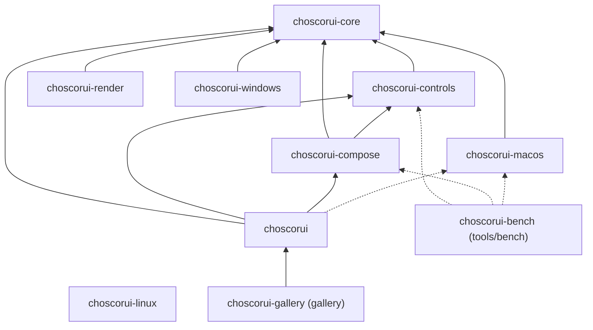
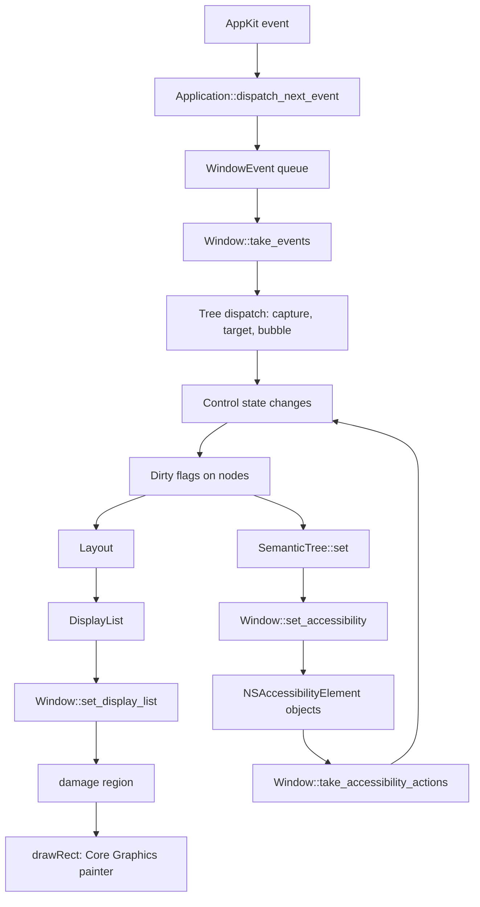

# Architecture

This document tells how ChoscorUI works. It describes the crates, the rules between them, the frame pipeline, the threading model, and the dependency rule. To build an application, read the [guide](guide.md).

## Crates

The workspace has a safe facade, four platform-independent crates, and one crate for each platform backend.

### choscorui (facade)

`choscorui` is the crate that applications depend on. It has `#![forbid(unsafe_code)]` and exposes no native handles. It has these modules:

| Module | Contents |
| --- | --- |
| `choscorui::prelude` | The views, their modifiers and state, and `App` |
| `choscorui::core` | All of `choscorui-core` |
| `choscorui::controls` | All of `choscorui-controls` |
| `choscorui::compose` | All of `choscorui-compose` |
| `choscorui::platform` | All of `choscorui-macos`, only when the target OS is macOS |
| `choscorui::capabilities()` | What the current backend supports |

On macOS the facade also has `App`, the view-based entry point. `App` opens each window with a `ViewHost` that shares one `Runtime` with the other windows. Each turn of the event loop does these steps:

1. Wait for a native event until the next timer or frame is due.
2. Send menu commands to the `commands` handler.
3. Route window events and accessibility requests to the views.
4. Advance the timers. Then lay out, paint, and publish semantics for each window that needs a frame.

The `platform` module has the attribute `#[cfg(target_os = "macos")]`. On other targets the module does not exist, and `capabilities()` returns `BackendCapabilities::none("headless")`. The crate root also re-exports a set of common types directly, and the aliases `Node` (for `NodeId`) and `Theme` (for `DesignTokens`).

Dependencies: `choscorui-core`, `choscorui-controls`, `choscorui-compose`, and, on macOS only, `choscorui-macos`. The tests also use `choscorui-render` on macOS, as a dev-dependency.

### choscorui-core

`choscorui-core` is the base of the workspace. It contains all behavior and policy that do not need an operating system. Its main types are:

- **Retained tree:** `Tree`, `NodeId`, `Dirty`, `EventPhase`, and `EventReply`.
- **Geometry and input:** `Point`, `Size`, `Rect`, `Transform`, `PointerEvent`, `KeyEvent`, and `DragEvent`.
- **Painting:** `DisplayList`, `DisplayCommand`, `Path`, `Image`, `blur_pixels`, and the `damage` function.
- **Layout:** `LinearLayout`, `GridLayout`, `FormLayout`, `ScrollViewport`, `UniformStack`, `LayoutEngine`, `Constraints`, `LeafMeasure`, and the `CustomLayout` trait for containers that the built-in kinds cannot express.
- **Text:** `TextBuffer`, `TextLayoutCache`, the `TextShaper` trait, `RichDocument`, and `RichLayout`.
- **Models:** `ItemModel`, `ListStore`, `TreeStore`, `Selection`, `SortFilterProxy`, and `FileSystemModel`.
- **Theme and motion:** `DesignTokens`, `ThemeResolver`, `AccessibilityPreferences`, and `AnimationClock`.
- **Semantics:** `SemanticTree`, `SemanticNode`, `SemanticRole`, and `SemanticChange`.
- **Application services:** `Settings`, `Locale`, `Localizer`, `ResourceBundle`, `Scene`, and `BackendCapabilities`.

Dependencies: `unicode-segmentation` only. See [Dependency rule](#dependency-rule).

### choscorui-controls

`choscorui-controls` contains the behavior of each control: input, focus, value, validation, and semantics. Painting is separate. The `style` module resolves a `ResolvedStyle` for each control kind, slot, variant, size, and visual state through a cached `Recipe`, and `paint_slot` paints it. The crate also has `CommandRegistry` with shortcut scopes, the item views, dialogs, popups, the toolbar and status bar, `DockLayout`, `CanvasView`, and the `CustomControl` extension point. The [controls reference](controls.md) lists each control.

Many controls are `CustomControl` types that mount through `ControlHost`. They are in these modules:

| Module | Controls |
| --- | --- |
| `form` | `Switch`, `Toggle`, `ToggleGroup`, `Kbd`, `Select`, `Input`, `InputGroup`, `Textarea`, `InputOtp`, `Field`, `DatePicker`, `RangeSlider` |
| `overlay` | `ContextMenu`, `Menubar`, `Popover`, `Dialog`, `Command` |
| `nav` | `Breadcrumb`, `Pagination`, `NavigationMenu`, `Sidebar` |
| `data` | `Card`, `Badge`, `Avatar`, `Carousel`, `DataTable`, `Chart` |
| `feedback` | `Alert`, `Spinner`, `Skeleton`, `Empty`, `Toaster` |
| `layout` | `AspectRatio`, `Collapsible`, `Accordion`, `ItemGroup` |
| `chat` | `Message`, `Attachment`, `Marker`, `MessageScroller`, `Questionnaire` |

The `hosted` module has the shared press, roving focus, tab stop, and reveal helpers of these controls.

Dependencies: `choscorui-core` only.

### choscorui-compose

`choscorui-compose` gives declarative composition in Rust. `Reconciler` applies a keyed `Element` description to a `Tree` and keeps each `NodeId` when a keyed element stays. An `Element` can have a `ControlKind` and a `Properties` set. When the kind of a key changes, the key gets a new node. When only its properties change, the key keeps its node and the `ReconcileReport` counts it as updated.

`plan_keyed` is the keyed diff of one child list. It finds the children to keep, create, and remove, finds duplicate keys, and counts the minimum number of moves. `Reconciler` uses it for each child list. `ForEach` uses it for its items, so both paths keep nodes, focus, and semantics for the keys that stay.

`Runtime` holds typed `Property` values and `PropertyBinding` connections. `Runtime::track` records the properties that a closure reads. `Runtime::computed` and `Runtime::effect` use it to compute again only when a value that they read changes. `StateMachine` applies named states and animated transitions through `AnimationClock`.

The `view` module is the declarative view layer:

- A `View` returns other views from `body`, or creates nodes in its hidden `mount`. The tree is built once.
- `Cx` creates `State`, `Memo`, and effects. `State`, `Binding`, and `Memo` are `Copy` handles. A stale handle reports `ReactiveError::Disposed` and does not panic.
- A live property is a `Live` value: a fixed value or a closure. A closure runs again only when a value that it read changes, and it updates only its own node.
- `Styled` holds the modifiers of a view in one ordered list. A layout modifier after a paint modifier wraps the view in a new node.
- Every visual leaf is a `CustomControl` in a `ControlHost`. Environment modifiers become `ThemeResolver` scopes. Local paint modifiers on a control become a recipe set for that instance.
- `Dynamic` and `Branch` are the scopes of `Option`, `Either`, and `AnyView`: keyed scopes with one child that go through `plan_keyed`. The key of a `Branch` child is the value of its key closure, so the child stays while the key stays. A view value has no identity to compare, so the key of a `Dynamic` child is each run, and each run replaces that child.
- `ForEach` compares its item keys with `plan_keyed`. An item can make many nodes, so the plan moves the nodes of each item as one fragment, without a wrapper node.
- Presentation modifiers mount a modal layer above the window content. The layer keeps focus inside, closes on Escape, and returns focus. Menus use the same layer, next to the view or at the pointer.
- A hover card uses a layer that is not modal. The layer takes no focus and no pointer input. The wrapper of the view reports the card's bounds as its overlay, so the pointer on the card keeps the view hovered.
- The layer and its panel animate through the controls' `Reveal`. On close, the layer leaves hit testing, focus traversal, and the semantic tree at once. It unmounts when its close motion ends.
- The `tooltip`, `hover_card`, and `context_menu` modifiers wrap the view in a control that watches its hover, presses, and keys. The wrapper publishes no semantic node. A child of a tooltip wrapper publishes the `Tooltip` node while the tooltip shows.
- The `toaster` modifier mounts a `Toaster` above the window content and puts its queue in the environment.
- `Form` lowers onto the two-column form grid of the core layout engine.
- `Field` and `Resizable` lower onto `LayoutKind::Custom` nodes. The controls' `FieldLayout` places the parts of a field for the width at each layout. The pane rectangles of the hosted panel group place the panes. With three or more panes, the handle rectangles place a node for each handle, before the panes.
- `ViewHost` runs layout, paint, semantics, and input for a mounted view. A window backend calls it for each frame, and tests drive it without a window.

Dependencies: `choscorui-core` and `choscorui-controls`.

### choscorui-render

`choscorui-render` is a reference software renderer. `Raster::render` turns a `DisplayList` into RGBA8 pixels, and `compare` measures the difference between two pixel buffers. The facade test [render_parity.rs](../crates/choscorui/tests/render_parity.rs) compares it with the macOS painter. It does not draw text and returns `RenderError::UnsupportedText` for a text command. It paints `BackdropBlur` and `BackdropBlurCorners` with the same `blur_pixels` as the macOS painter.

Dependencies: `choscorui-core` only.

### choscorui-macos

`choscorui-macos` is the supported backend. It contains all hand-written AppKit, Core Foundation, Core Graphics, Core Text, ImageIO, and UserNotifications FFI. All of its `unsafe` code is in the `ffi` module, which declares each message, C function, SDK constant, struct, and callback class. The rest of the crate is safe code. Its main types are `Application`, `Window`, `WindowEvent`, `Poster`, `Timer`, `MainMenu`, `ContextMenu`, `Clipboard`, `CoreTextShaper`, and the dialog specs. The whole crate has `#![cfg(target_os = "macos")]`, so it is empty on other targets. [platform-macos.md](platform-macos.md) describes the backend, and [ffi.md](ffi.md) records each FFI boundary.

Dependencies: `choscorui-core` only.

### choscorui-windows

`choscorui-windows` is not a supported backend. It contains a Win32 window shell and platform-independent message translation (`InputTranslator`, `DpiState`, `RenderPlan`). The native types `Application`, `Window`, and `Poster` compile only for Windows targets. See [platform-windows.md](platform-windows.md).

Dependencies: `choscorui-core` only.

### choscorui-linux

`choscorui-linux` is not a supported backend. It contains state machines for the Wayland and X11 window lifecycles, backend selection (`select_backend`), seat input, frame scheduling, and clipboard ownership. It has no native bindings. See [platform-linux.md](platform-linux.md).

Dependencies: none.

### Gallery and benchmark

- `gallery` (`choscorui-gallery`) shows each public control on a page. It also shows large data, a large canvas, docking, and settings restore. See [main.rs](../gallery/src/main.rs).
- `tools/bench` (`choscorui-bench`) runs the benchmark scenarios. See [performance.md](performance.md).

The gallery depends only on the facade, as an external application does. A test in [coverage.rs](../gallery/src/coverage.rs) reads `gallery/Cargo.toml` and makes sure that `choscorui` is the only dependency. The gallery also has `#![forbid(unsafe_code)]`.

The benchmark depends directly on `choscorui-core`, `choscorui-controls`, `choscorui-compose`, and `choscorui-macos`, for macOS targets only. The `views` scenario uses compose to measure view updates.

## Layering rules

`bylaw.toml` defines the rules between crates, and `cargo bylaw check` enforces them:

- `choscorui-core` is the lowest layer.
- `choscorui-controls`, `choscorui-render`, `choscorui-macos`, `choscorui-windows`, and `choscorui-linux` can depend only on `choscorui-core`.
- `choscorui-compose` can depend only on core and controls. Its views configure and mount controls.
- The facade can depend only on core, controls, compose, and macos.
- No library crate depends on the gallery.
- The workspace crates have no dependency cycles.

The graph shows the dependencies that the `Cargo.toml` files declare. A dotted arrow is a target-specific (macOS) dependency.

To keep the graph legible, it does not show the arrow from `choscorui-bench` to `choscorui-core`.

## Frame pipeline

The application owns the main loop. Each turn of the loop moves one native event through these steps:

1. `Application::dispatch_next_event` waits for one AppKit event, up to a timeout, and sends it to `NSApplication`.
2. The window delegate and the content view put owned `WindowEvent` values in a queue for the window.
3. `Window::take_events` drains that queue.
4. The application sends pointer and key events into the `Tree`. `Tree::dispatch_pointer` and `Tree::dispatch_key` visit the capture, target, and bubble phases.
5. The controls change their state and mark nodes with `Dirty::LAYOUT`, `Dirty::PAINT`, or `Dirty::SEMANTICS`.
6. Layout writes new bounds into the tree for the changed nodes.
7. The application paints into a new `DisplayList` and gives it to `Window::set_display_list`.
8. `set_display_list` calls `choscorui_core::damage` with the old and the new list. It invalidates only the changed region. An identical list schedules no frame.
9. AppKit calls `drawRect:`, and the backend replays the display list through Core Graphics and Core Text.

In each frame, the application also updates its `SemanticTree` and sends the snapshot and the changes to `Window::set_accessibility`. The backend reconciles them into `NSAccessibilityElement` objects and posts the notifications. The application reads actions from assistive technology with `Window::take_accessibility_actions`.

## Threading model

All UI types belong to the main thread. `Application` and `Window` contain a `PhantomData<Rc<()>>` marker, so they are not `Send` and not `Sync`. `Application::new` returns `Error::WrongThread` when you call it on a different thread.

- **Work from other threads.** `Application::poster` returns a `Poster`, which is `Send` and `Clone`. `Poster::post` puts a closure in a FIFO queue, and the main run loop runs it. After the `Application` drops, `post` returns `PostError::Stopped`.
- **Timers.** `Application::schedule_once` and `Application::schedule_repeating` return a `Timer`. When you drop or cancel the `Timer`, no more callbacks occur, also from inside the callback. Timers fire in all common run-loop modes, for example during live resize and menu tracking.
- **Panic containment.** Every native callback runs inside `catch_unwind`. Thus a panic stops at the FFI boundary and does not unwind into AppKit. `Application::posted_panic_count`, `Application::timer_panic_count`, and `MainMenu::callback_panic_count` count the panics of posted tasks, timers, and menu actions.

The source for posted work and timers is [runloop.rs](../crates/choscorui-macos/src/runloop.rs). [ffi.md](ffi.md) gives the safety invariants.

## Capability queries

An application asks `choscorui::capabilities()` what the backend supports. It does not check the OS version or `cfg!(target_os)`. The function returns a `BackendCapabilities` struct with one `Support` value for each feature. A `Support` value is `Supported`, `Unsupported`, or `Conditional(reason)`.

`BackendCapabilities` has the attribute `#[non_exhaustive]`, so a minor release can add a field. [versioning.md](versioning.md) gives the stability rules, and [platform-macos.md](platform-macos.md) gives the macOS values.

## Dependency rule

Runtime code uses only these sources:

- The Rust standard library.
- Hand-written FFI to the system SDKs. The ABI shapes come from the SDK headers, and [ffi.md](ffi.md) records each FFI boundary. In `choscorui-macos`, `macro_rules!` macros in the `ffi` module declare this FFI.
- One audited crate, `unicode-segmentation`. `choscorui-core` uses it for extended grapheme cluster boundaries.

The UAX #29 segmentation tables are versioned Unicode data. The toolkit does not keep a copy of these tables by hand, so it uses `unicode-segmentation`. That crate has no dependencies of its own.

The workspace has no build scripts, no binding generators, and no procedural macro crates. A `choscorui-macos` test makes Objective-C++ checks from the `ffi` declarations and compiles them against the SDK headers with `xcrun clang++`. This step runs only in the test, outside the build graph. Test code uses the standard library and the built-in Cargo test harness. The developer tools (clippy, rustquty, cargo-machete, and cargo-bylaw) run outside the build graph and are never crate dependencies.

To add a crate to the build graph, do these steps:

1. Change this rule to name the crate.
2. Give the reason in the rule.
3. Add a license entry for the crate in [licenses.md](licenses.md).
4. Run `cargo tree --workspace`.
5. Make sure that the output shows no other new crates.

## Error policy

A fallible public operation returns `Result` with a domain error enum, for example `TreeError`, `SettingsError`, or `choscorui::platform::Error`. It does not panic on bad input. Each error type implements `Debug`, `Display`, and `std::error::Error`, and is `Send + Sync + 'static`. A `Display` message is lowercase and has no period at the end.

A condition that the toolkit can repair is a report value, not an error. For example, `Settings::load_or_recover` returns a `LoadReport`. [versioning.md](versioning.md) gives the full error policy.
