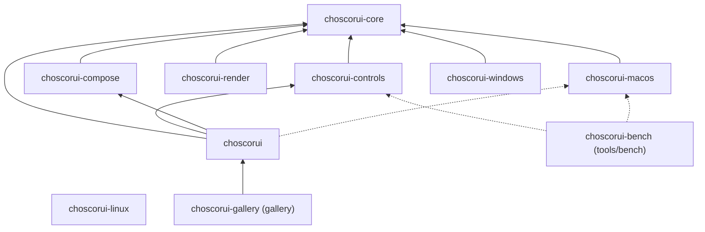
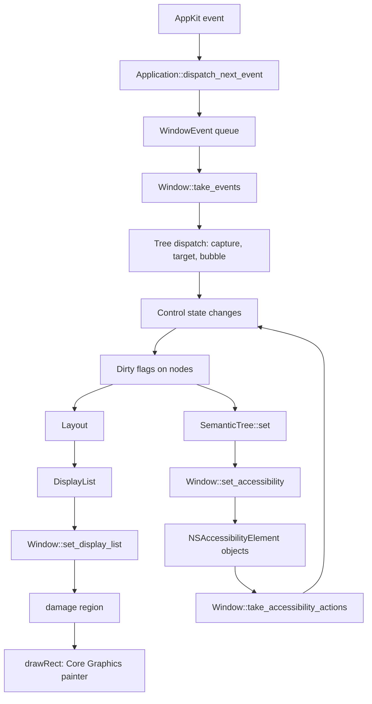

# Architecture

This document tells how ChoscorUI works. It describes the crates, the rules between them, the frame pipeline, the threading model, and the dependency rule. To build an application, read the [guide](guide.md).

## Crates

The workspace has a safe facade, four platform-independent crates, and one crate for each platform backend.

### choscorui (facade)

`choscorui` is the crate that applications depend on. It has `#![forbid(unsafe_code)]` and exposes no native handles. It has these modules:

| Module | Contents |
| --- | --- |
| `choscorui::prelude` | The types that most applications use first |
| `choscorui::core` | All of `choscorui-core` |
| `choscorui::controls` | All of `choscorui-controls` |
| `choscorui::compose` | All of `choscorui-compose` |
| `choscorui::platform` | All of `choscorui-macos`, only when the target OS is macOS |
| `choscorui::capabilities()` | What the current backend supports |

The `platform` module has the attribute `#[cfg(target_os = "macos")]`. On other targets the module does not exist, and `capabilities()` returns `BackendCapabilities::none("headless")`. The crate root also re-exports a set of common types directly, and the aliases `Node` (for `NodeId`) and `Theme` (for `DesignTokens`).

Dependencies: `choscorui-core`, `choscorui-controls`, `choscorui-compose`, and, on macOS only, `choscorui-macos`. The tests also use `choscorui-render` on macOS, as a dev-dependency.

### choscorui-core

`choscorui-core` is the base of the workspace. It contains all behavior and policy that do not need an operating system. Its main types are:

- **Retained tree:** `Tree`, `NodeId`, `Dirty`, `EventPhase`, and `EventReply`.
- **Geometry and input:** `Point`, `Size`, `Rect`, `Transform`, `PointerEvent`, `KeyEvent`, and `DragEvent`.
- **Painting:** `DisplayList`, `DisplayCommand`, `Path`, `Image`, and the `damage` function.
- **Layout:** `LinearLayout`, `GridLayout`, `FormLayout`, `ScrollViewport`, `LayoutEngine`, `Constraints`, and `LeafMeasure`.
- **Text:** `TextBuffer`, `TextLayoutCache`, the `TextShaper` trait, `RichDocument`, and `RichLayout`.
- **Models:** `ItemModel`, `ListStore`, `TreeStore`, `Selection`, `SortFilterProxy`, and `FileSystemModel`.
- **Theme and motion:** `DesignTokens`, `ThemeResolver`, `AccessibilityPreferences`, and `AnimationClock`.
- **Semantics:** `SemanticTree`, `SemanticNode`, `SemanticRole`, and `SemanticChange`.
- **Application services:** `Settings`, `Locale`, `Localizer`, `ResourceBundle`, `Scene`, and `BackendCapabilities`.

Dependencies: `unicode-segmentation` only. See [Dependency rule](#dependency-rule).

### choscorui-controls

`choscorui-controls` contains the behavior of each control: input, focus, value, validation, and semantics. Painting is separate. The `style` module resolves a `ResolvedStyle` for each control kind, slot, variant, size, and visual state through a cached `Recipe`, and `paint_slot` paints it. The crate also has `CommandRegistry` with shortcut scopes, the item views, dialogs, popups, the toolbar and status bar, `DockLayout`, `CanvasView`, and the `CustomControl` extension point. The [controls reference](controls.md) lists each control.

Dependencies: `choscorui-core` only.

### choscorui-compose

`choscorui-compose` gives declarative composition in Rust. `Reconciler` applies a keyed `Element` description to a `Tree` and keeps each `NodeId` when a keyed element stays. `Runtime` holds typed `Property` values and `Binding` connections. `StateMachine` applies named states and animated transitions through `AnimationClock`.

Dependencies: `choscorui-core` only.

### choscorui-render

`choscorui-render` is a reference software renderer. `Raster::render` turns a `DisplayList` into RGBA8 pixels, and `compare` measures the difference between two pixel buffers. The facade test [render_parity.rs](../crates/choscorui/tests/render_parity.rs) compares it with the macOS painter. It does not draw text and returns `RenderError::UnsupportedText` for a text command.

Dependencies: `choscorui-core` only.

### choscorui-macos

`choscorui-macos` is the supported backend. It contains all hand-written AppKit, Core Foundation, Core Graphics, Core Text, ImageIO, and UserNotifications FFI. Its main types are `Application`, `Window`, `WindowEvent`, `Poster`, `Timer`, `MainMenu`, `ContextMenu`, `Clipboard`, `CoreTextShaper`, and the dialog specs. The whole crate has `#![cfg(target_os = "macos")]`, so it is empty on other targets. [platform-macos.md](platform-macos.md) describes the backend, and [ffi.md](ffi.md) records each FFI boundary.

Dependencies: `choscorui-core` only.

### choscorui-windows

`choscorui-windows` is not a supported backend. It contains a Win32 window shell and platform-independent message translation (`InputTranslator`, `DpiState`, `RenderPlan`). The native types `Application`, `Window`, and `Poster` compile only for Windows targets. See [platform-windows.md](platform-windows.md).

Dependencies: `choscorui-core` only.

### choscorui-linux

`choscorui-linux` is not a supported backend. It contains state machines for the Wayland and X11 window lifecycles, backend selection (`select_backend`), seat input, frame scheduling, and clipboard ownership. It has no native bindings. See [platform-linux.md](platform-linux.md).

Dependencies: none.

### Gallery and benchmark

- `gallery` (`choscorui-gallery`) shows each public control on a page. It also shows large data, a large canvas, docking, and settings restore. See [main.rs](../gallery/src/main.rs).
- `tools/bench` (`choscorui-bench`) runs the benchmark scenarios. See [performance.md](performance.md).

The gallery depends only on the facade, as an external application does. A test in [coverage.rs](../gallery/src/coverage.rs) reads `gallery/Cargo.toml` and makes sure that `choscorui` is the only dependency. The gallery also has `#![forbid(unsafe_code)]`.

The benchmark depends directly on `choscorui-core`, `choscorui-controls`, and `choscorui-macos`, for macOS targets only.

## Layering rules

`bylaw.toml` defines the rules between crates, and `cargo bylaw check` enforces them:

- `choscorui-core` is the lowest layer.
- `choscorui-controls`, `choscorui-compose`, `choscorui-render`, `choscorui-macos`, `choscorui-windows`, and `choscorui-linux` can depend only on `choscorui-core`.
- The facade can depend only on core, controls, compose, and macos.
- No library crate depends on the gallery.
- The workspace crates have no dependency cycles.

The graph shows the dependencies that the `Cargo.toml` files declare. A dotted arrow is a target-specific (macOS) dependency.

To keep the graph legible, it does not show the arrow from `choscorui-bench` to `choscorui-core`.

## Frame pipeline

The application owns the main loop. Each turn of the loop moves one native event through these steps:

1. `Application::dispatch_next_event` waits for one AppKit event, up to a timeout, and sends it to `NSApplication`.
2. The window delegate and the content view put owned `WindowEvent` values in a queue for the window.
3. `Window::take_events` drains that queue.
4. The application sends pointer and key events into the `Tree`. `Tree::dispatch_pointer` and `Tree::dispatch_key` visit the capture, target, and bubble phases.
5. The controls change their state and mark nodes with `Dirty::LAYOUT`, `Dirty::PAINT`, or `Dirty::SEMANTICS`.
6. Layout writes new bounds into the tree for the changed nodes.
7. The application paints into a new `DisplayList` and gives it to `Window::set_display_list`.
8. `set_display_list` calls `choscorui_core::damage` with the old and the new list. It invalidates only the changed region. An identical list schedules no frame.
9. AppKit calls `drawRect:`, and the backend replays the display list through Core Graphics and Core Text.

In each frame, the application also updates its `SemanticTree` and sends the snapshot and the changes to `Window::set_accessibility`. The backend reconciles them into `NSAccessibilityElement` objects and posts the notifications. The application reads actions from assistive technology with `Window::take_accessibility_actions`.

## Threading model

All UI types belong to the main thread. `Application` and `Window` contain a `PhantomData<Rc<()>>` marker, so they are not `Send` and not `Sync`. `Application::new` returns `Error::WrongThread` when you call it on a different thread.

- **Work from other threads.** `Application::poster` returns a `Poster`, which is `Send` and `Clone`. `Poster::post` puts a closure in a FIFO queue, and the main run loop runs it. After the `Application` drops, `post` returns `PostError::Stopped`.
- **Timers.** `Application::schedule_once` and `Application::schedule_repeating` return a `Timer`. When you drop or cancel the `Timer`, no more callbacks occur, also from inside the callback. Timers fire in all common run-loop modes, for example during live resize and menu tracking.
- **Panic containment.** Posted tasks, timer callbacks, and the native menu action run inside `catch_unwind`. Thus a panic in them stops at the FFI boundary and does not unwind into AppKit. `Application::posted_panic_count`, `Application::timer_panic_count`, and `MainMenu::callback_panic_count` count these panics.

The source for posted work and timers is [runloop.rs](../crates/choscorui-macos/src/runloop.rs). [ffi.md](ffi.md) gives the safety invariants.

## Capability queries

An application asks `choscorui::capabilities()` what the backend supports. It does not check the OS version or `cfg!(target_os)`. The function returns a `BackendCapabilities` struct with one `Support` value for each feature. A `Support` value is `Supported`, `Unsupported`, or `Conditional(reason)`.

`BackendCapabilities` has the attribute `#[non_exhaustive]`, so a minor release can add a field. [versioning.md](versioning.md) gives the stability rules, and [platform-macos.md](platform-macos.md) gives the macOS values.

## Dependency rule

Runtime code uses only these sources:

- The Rust standard library.
- Hand-written FFI to the system SDKs. The ABI shapes come from the SDK headers, and [ffi.md](ffi.md) records each FFI boundary.
- One audited crate, `unicode-segmentation`. `choscorui-core` uses it for extended grapheme cluster boundaries.

The UAX #29 segmentation tables are versioned Unicode data. The toolkit does not keep a copy of these tables by hand, so it uses `unicode-segmentation`. That crate has no dependencies of its own.

The workspace has no build scripts, no binding generators, and no procedural macro crates. Test code uses the standard library and the built-in Cargo test harness. The developer tools (clippy, rustquty, cargo-machete, and cargo-bylaw) run outside the build graph and are never crate dependencies.

To add a crate to the build graph, do these steps:

1. Change this rule to name the crate.
2. Give the reason in the rule.
3. Add a license entry for the crate in [licenses.md](licenses.md).
4. Run `cargo tree --workspace`.
5. Make sure that the output shows no other new crates.

## Error policy

A fallible public operation returns `Result` with a domain error enum, for example `TreeError`, `SettingsError`, or `choscorui::platform::Error`. It does not panic on bad input. Each error type implements `Debug`, `Display`, and `std::error::Error`, and is `Send + Sync + 'static`. A `Display` message is lowercase and has no period at the end.

A condition that the toolkit can repair is a report value, not an error. For example, `Settings::load_or_recover` returns a `LoadReport`. [versioning.md](versioning.md) gives the full error policy.
