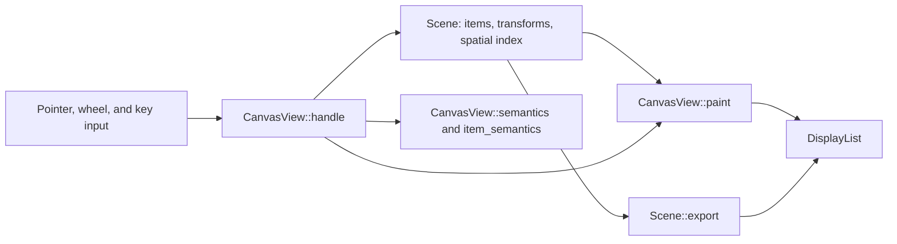

# Canvas

`choscorui_core::Scene` is a retained 2D scene graph.
`choscorui_controls::CanvasView` is an interactive view of a scene. More than
one view can show the same scene. Each view keeps its own zoom, pan,
selection, and focus.

All drawing uses the renderer-neutral `DisplayList`. Thus a scene
paints the same on the screen, in an offscreen bitmap, and in an export.

The tests in [scene.rs](../crates/choscorui-core/tests/scene.rs) and
[canvas.rs](../crates/choscorui-controls/tests/canvas.rs) pin the behavior in
this document.

## Scene

### Items

A `SceneItem` has an `ItemShape`, an `ItemStyle`, and some flags. The shapes
are these:

- `Rect`, `Ellipse`, `Line`, `Polygon`, and `Path`
- `Text`, one line of text
- `Image` and `Svg`, drawn into a rectangle
- `Group`, which paints nothing and has the bounds of its children

An `ItemStyle` has these fields:

- `fill`, a `Paint`: a solid color, a linear gradient, or a radial gradient
- `stroke`, a `Paint` and a `StrokeStyle` with width, caps, joins, and dashes
- `opacity`, which also applies to the children
- `text_color`, for text and SVG items

The flags of a `SceneItem` are `visible`, `selectable`, `movable`, and
`clip_children`. The `name` and `role` fields give the accessibility name
and role. The `data` field holds an application value.

### Hierarchy and transforms

- `add` adds a root item, and `add_child` adds a child item.
- Each item has an item-to-parent `Transform`. A transform must be finite
  and invertible, or the call returns `SceneError::InvalidTransform`.
- `set_parent` moves an item to a new parent and keeps its position in world
  space. It returns `SceneError::Cycle` when the new parent is the item or a
  descendant of the item.
- `z` sets the paint order among siblings. Siblings with the same `z` paint
  in the order that you added them.
- `update` edits an item. `move_by` moves items by a delta in scene space. It
  does not move an item when it also moves an ancestor of that item.

### Spatial index

The scene keeps the world bounds of each item in a uniform grid of 256-unit
cells. The bounds include the stroke width. The scene keeps an item that covers
more than 1024 cells in a separate list.

`items_in_rect` and `hit_test` use the index. Thus the time of a query
follows the queried area, not the size of the scene. The test
`large_scene_queries_scale_with_area` in
[scene.rs](../crates/choscorui-core/tests/scene.rs) compares a small query
with a full query on a large scene.

### Hit testing

`hit_test` returns the topmost visible, selectable item at a point:

- A fill hits on the exact path with the nonzero rule.
- A stroke or a line hits within half of the stroke width plus 2 units.
- A text, image, or SVG item hits anywhere in its box.
- A point outside an ancestor with `clip_children` does not hit.

### Culling and clipping

`Scene::paint(list, visible)` paints the items that intersect the visible
rectangle, in paint order. It does not paint a group and its descendants
when the group is outside the visible rectangle. When an item has
`clip_children`, the scene clips its descendants to the shape of the item.

### Change tracking and export

- `take_changes` returns the `SceneChange` values since the previous call:
  `Added`, `Removed` with the old bounds, and `Changed` with the old and new
  bounds. Use them to repaint only the damaged area.
- `revision()` increases on each edit.
- `export(rect, scale)` returns a clipped `DisplayList` of a scene area. Any
  rasterizer can draw it, for example `MacBitmap`, and then `encode_png`. The
  export uses the same commands as the screen.

## CanvasView

### Zoom and pan

- `zoom_at` zooms about a view point and keeps the scene point under it
  fixed. The zoom stays between `MIN_ZOOM` (0.05) and `MAX_ZOOM` (32).
- `pan` moves the view by a delta in view space.
- `fit` puts a scene rectangle in the center of the viewport, with a margin.
- `ensure_visible` pans the minimum distance that shows an item.

### Input

Send input to `CanvasView::handle` as `CanvasInput` values. `handle` returns
a `CanvasResponse` that tells you what to repaint, what moved, and what the
user asked for.

| Input | Result |
| --- | --- |
| `Press` on an item | Focuses the item. If the item is not selected, it becomes the only selected item. |
| `Press` with `extend: true` | Toggles the item in the selection, for example on Command-click or Shift-click. |
| `Press` on empty space, then `Drag` | Draws a rubber band. Items fully inside the band become the selection, or with `BandMode::Intersect`, items that the band touches. With `extend: true`, the band toggles them. |
| `Drag` after a press on a selected item | Moves the selected movable items. The item follows the pointer at each zoom. |
| `Wheel` | Pans the view. With `zoom: true`, for example on Command-scroll, it zooms about the pointer. |
| `Magnify` | Zooms about the pointer by the gesture factor. |
| Arrow keys | Move the selected items by 1 unit, or 10 units with Shift. With no movable selection, they pan the view. |
| Tab and Shift-Tab | Move focus and selection to the next or previous selectable item in paint order, and show it. |
| Space | Toggles the focused item in the selection. |
| Return | Reports the focused item in `activated`. |
| Escape | Clears the selection. |
| Delete and Backspace | Report the selection in `delete_requested`. Your application removes the items. |
| `+` or `=`, `-`, `0` | Zoom in, zoom out, and set the zoom to 1. |

After you remove items from the scene, call `prune`. It removes those items
from the selection and from the focus of the view.

### Canvas view

The `Canvas` view of `choscorui-compose` draws with a closure on a
`CanvasView` that has no scene items. It sets the viewport to the bounds of
its node and pushes the view transform, so the closure draws in canvas
coordinates. A canvas with `.zoomable(true)` sends the wheel and the keys to
`handle`, and a drag pans the view. [guide.md](guide.md) shows how to use it.

### Painting

`CanvasView::paint` clips to the viewport and applies the view transform. It
paints the visible items through the spatial index. Then it paints the
selection outlines, the focus ring, and the rubber band.

### Accessibility

- `semantics` returns a `List` node and a `SemanticCollection`. The item
  count is the number of items that have a role and are not hidden.
- `item_semantics` returns only the items in the view, as list rows do. Each
  item has its index among all accessible items, its bounds in view space,
  and its selected state.
- Each item has the `Focus` action. A selectable item also has `Activate`.
- `perform` with `Focus` focuses the item and shows it. `perform` with
  `Activate` focuses the item and selects it.

The accessibility rules for all controls are in [controls.md](controls.md).

## Not supported

- Layouts inside the scene, such as anchor, grid, or linear layouts. Use
  transforms to put items in position.
- Interactive controls as scene items. Put controls above the view, in
  window coordinates.
- Blur or shadow effects on an item. The item effects are opacity, gradients,
  and clipping.
- Multiline or rich text items. Lay the text out with `TextLayout`, then use
  a path item or an image item. See [text.md](text.md).
- Exact bounds for text items. The scene estimates the box of a text item
  from the font size and the number of characters.
- Hit testing that ignores transparent pixels in image or SVG items. These
  items hit anywhere in their box.
- Vector export formats, such as PDF or SVG. An export gives a display list,
  which a rasterizer converts to a bitmap.
