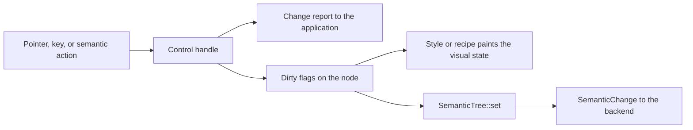

# Controls

A control owns its behavior and its accessibility semantics. It reacts to
pointer, keyboard, and assistive input, keeps its value, and reports
changes. Painting is separate. A style or a recipe reads the control's
visual state and paints it. You can replace the look and keep the behavior
(see [theming.md](theming.md)).

The behavior in this document is public API.
[compatibility.rs](../crates/choscorui/tests/compatibility.rs) and the tests
in [crates/choscorui-controls/tests](../crates/choscorui-controls/tests)
pin it. A change in behavior must update this document in the same change.

All types in this document come from `choscorui::controls`. Roles come from
`SemanticRole` in
[semantics.rs](../crates/choscorui-core/src/semantics.rs). The AppKit role
in parentheses is the role that the macOS backend gives to that
`SemanticRole`.

## Control catalog

| Group | Control | Purpose |
| --- | --- | --- |
| Basic | [`Button`](#button) | Momentary push button that returns a `CommandId`. |
| Basic | [`CommandLink`](#button) | Command-link look for a `Button`: arrow, title, and description. |
| Basic | [`Checkbox`](#checkbox) | Independent on or off value. |
| Basic | [`RadioGroup`](#radiogroup-and-tabs) | One choice from a group of options. |
| Basic | [`Tabs`](#radiogroup-and-tabs) | Tabs that show one panel at a time. |
| Basic | [`ToolButton`](#toolbutton-and-buttongroup) | Toolbar button with an optional check state and menu. |
| Basic | [`ButtonGroup`](#toolbutton-and-buttongroup) | Exclusive or non-exclusive group of checkable commands. |
| Basic | [`CommandRegistry`](#commandregistry-and-shortcuts) | Shared command state and keyboard shortcuts. |
| Basic | [`MnemonicTable`](#mnemonictable-and-parse_mnemonic) | Mnemonic keys for the labels in a window or dialog. |
| Basic | [`Label`](#label-and-separator) | Static text. |
| Basic | [`Separator`](#label-and-separator) | Decorative line. |
| Basic | [`Progress`](#progress) | Determinate or indeterminate progress. |
| Basic | [`NumericDisplay`](#numericdisplay) | Seven-segment number display. |
| Basic | [`KeySequenceEdit`](#keysequenceedit) | Records a keyboard shortcut. |
| Basic | [`GroupBox`](#groupbox-and-stackedcontainer) | Titled group of related controls. |
| Basic | [`StackedContainer`](#groupbox-and-stackedcontainer) | Shows one page of a stack at a time. |
| Basic | [`ToolBox`](#toolbox) | Accordion with one open page. |
| Text | [`TextField`](#textfield) | Single-line text input, also for passwords. |
| Text | [`TextEditor`](#texteditor) | Multiline plain-text editor. |
| Text | [`Combobox`](#combobox-and-fontchooser) | List choice with optional typed text and completion. |
| Text | [`FontChooser`](#combobox-and-fontchooser) | Font family combobox with a fallback. |
| Range | [`Slider`](#slider) | Integer value along a track. |
| Range | [`RangeSlider`](#rangeslider) | Low and high values along one track. |
| Range | [`SpinBox`](#spinbox) | Integer value with step buttons. |
| Range | [`DecimalSpinBox`](#decimalspinbox) | Locale-aware decimal value with text editing. |
| Range | [`Dial`](#dial) | Rotary integer value. |
| Range | [`ScrollBar`](#scrollbar) | Standalone scroll position. |
| Range | [`ScrollArea`](#scrollarea) | Scroll container with overlay scroll bars. |
| Range | [`Resizable`](#resizable) | Two panels with a movable handle between them. |
| Range | [`DateTimeEdit`](#datetimeedit-and-calendar) | Date or time in sections. |
| Range | [`Calendar`](#datetimeedit-and-calendar) | Month grid for date choice. |
| Data and item views | [`ItemView`](#itemview) | Virtualized list, tree, table, or grid. |
| Data and item views | [`HeaderView`](#headerview) | Table header that sorts and resizes columns. |
| Data and item views | [`CellEdit`](#celledit-and-datamapper) | Edits one model cell with a typed editor. |
| Data and item views | [`DataMapper`](#celledit-and-datamapper) | Binds form fields to the current model item. |
| Data and item views | [`ColumnBrowser`](#columnbrowser-and-undo-history) | Column (Miller) browser for a tree model. |
| Data and item views | [`undo_history`](#columnbrowser-and-undo-history) | Rows for an undo history list. |
| Popups and dialogs | [`DropdownMenu`](#dropdownmenu) | Custom-drawn menu backed by commands. |
| Popups and dialogs | [`PopupStack`](#popupstack) | Open popups, dismissal, and focus restore. |
| Popups and dialogs | [`TooltipController`](#tooltipcontroller) | Hover tooltips with delay and grace time. |
| Popups and dialogs | [`DialogStack`](#dialogstack-and-dialogkeys) | Modal and modeless dialogs in a window. |
| Popups and dialogs | [`DialogKeys`](#dialogstack-and-dialogkeys) | Default and cancel keys for a window or dialog. |
| Popups and dialogs | [`AlertDialog`](#alertdialog-and-inputdialog) | Alert with ordered buttons. |
| Popups and dialogs | [`InputDialog`](#alertdialog-and-inputdialog) | One validated value. |
| Popups and dialogs | [`ColorPicker`](#colorpicker-and-fontdialog) | Color model with HSV, hex, and alpha. |
| Popups and dialogs | [`FontDialog`](#colorpicker-and-fontdialog) | Font family, size, weight, and slant. |
| Window chrome | [`Toolbar`](#toolbar) | Toolbar with roving focus and overflow. |
| Window chrome | [`StatusBar`](#statusbar) | Status text, timed messages, and sections. |
| Window chrome | [`DockLayout`](#docklayout) | Dockable panels around a central area. |
| Window chrome | [`FocusFrame`](#focusframe-and-sizegrip) | Focus ring outside the focused node. |
| Window chrome | [`SizeGrip`](#focusframe-and-sizegrip) | Window resize grip. |
| Canvas | [`CanvasView`](#canvasview) | Interactive view of a `Scene`. |
| Validators | [`NumberInput`](#numberinput-inputmask-and-dateinput) | Locale-aware number validation. |
| Validators | [`InputMask`](#numberinput-inputmask-and-dateinput) | Fixed-format text mask. |
| Validators | [`DateInput`](#numberinput-inputmask-and-dateinput) | Locale-aware short date validation. |
| Form | [`Switch`](#switch) | On or off setting with a sliding thumb. |
| Form | [`Toggle`](#toggle-and-togglegroup) | Button that stays on or off. |
| Form | [`ToggleGroup`](#toggle-and-togglegroup) | Row or column of toggles with one or many on. |
| Form | [`Kbd`](#kbd) | Keyboard key caps for shortcuts. |
| Form | [`Select`](#select-and-listentry) | Trigger with a popup list of options; `Select::native` has the native-select look. |
| Form | [`Input`](#input-and-inputgroup) | Hosted single-line text input. |
| Form | [`InputGroup`](#input-and-inputgroup) | Text input with text, icon, and button addons. |
| Form | [`Textarea`](#textarea) | Hosted multiline text input that grows with its lines. |
| Form | [`InputOtp`](#inputotp) | One-time code input with one character per slot. |
| Form | [`FieldText`](#field-and-fieldtext) | Legend, label, title, description, error, or separator of a form field. |
| Form | [`Field`](#field-and-fieldtext) | Stacked, side-by-side, or responsive layout of a form field. |
| Form | [`DatePicker`](#datepicker) | Button with a calendar popover for one date, several dates, or a range. |
| Overlay | [`ContextMenu`](#contextmenu-and-menubar) | Area that opens a menu at the pointer on a secondary click. |
| Overlay | [`Menubar`](#contextmenu-and-menubar) | Row of menu titles inside the window. |
| Overlay | [`Popover`](#popover) | Button with a floating panel; `Popover::hover_card` opens it on hover. |
| Overlay | [`Dialog`](#dialog) | Button with a modal panel; `Dialog::sheet` and `Dialog::drawer` slide it in from an edge. |
| Overlay | [`Command`](#command-and-commanditem) | Search input over grouped commands, inline or in a modal dialog. |
| Navigation | [`Breadcrumb`](#breadcrumb) | Trail of links to the current page, with an optional collapsed middle. |
| Navigation | [`Pagination`](#pagination) | Page links with previous and next buttons. |
| Navigation | [`NavigationMenu`](#navigationmenu-and-navigationlink) | Row of site links whose triggers open panels of described links. |
| Navigation | [`Sidebar`](#sidebar) | Grouped navigation items that collapse, and become a sheet in a narrow window. |
| Data | [`Card`](#card) | Surface with a header, content, and footer buttons. |
| Data | [`Badge`](#badge) | Short status label, optionally a link. |
| Data | [`Avatar`](#avatar-and-avatargroup) | Round user image with a text fallback. |
| Data | [`AvatarGroup`](#avatar-and-avatargroup) | Overlapping avatars with a count. |
| Data | [`Carousel`](#carousel) | Slides that move one at a time and snap. |
| Data | [`DataTable`](#datatable) | Sorted, filtered, selectable, and paged rows of an item model. |
| Data | [`Chart`](#chart) | Area, bar, line, pie, radar, and radial charts of app data. |
| Feedback | [`Alert`](#alert) | Callout with an icon, a title, and actions. |
| Feedback | [`Spinner`](#spinner-and-skeleton) | Spinning loader icon. |
| Feedback | [`Skeleton`](#spinner-and-skeleton) | Pulsing placeholder block. |
| Feedback | [`Empty`](#empty) | Centered empty state with media and actions. |
| Feedback | [`Toaster`](#toast-and-toaster) | Stack of toasts at a window corner. |
| Layout | [`AspectRatio`](#aspectratio) | Box with a fixed ratio, filled with an image. |
| Layout | [`Collapsible`](#collapsible) | Section that shows or hides its items. |
| Layout | [`Accordion`](#accordion) | Stacked sections that open under their headers. |
| Layout | [`ItemGroup`](#item-and-itemgroup) | Rows of media, text, and actions. |
| Chat | [`Message`](#message-and-bubble) | Avatar, header, bubbles, and footer of one chat message. |
| Chat | [`Attachment`](#attachment) | File with media, a detail line, and a progress state. |
| Chat | [`Marker`](#marker) | Muted line between messages. |
| Chat | [`MessageScroller`](#messagescroller-and-conversation) | Virtualized messages that stick to the bottom. |
| Chat | [`Questionnaire`](#questionnaire-and-question) | One question at a time with choices or a typed answer. |
| Custom controls | [`CustomControl`](#customcontrol-and-controlhost) | Trait for an application-defined control. |
| Custom controls | [`ControlHost`](#customcontrol-and-controlhost) | Mounts custom controls on retained nodes. |

## Shared rules

Some controls take the retained `Tree` and a `NodeId` in `handle`. These
are `Button`, `Checkbox`, `RadioGroup`, `Tabs`, `TextField`,
`TextEditor`, `Slider`, `SpinBox`, `ScrollArea`, and `Resizable`. The rules
below apply to them, unless a section gives a different rule.

`ItemView::handle` also takes the `Tree` and a `NodeId`. For `ItemView`,
only the missing-node rule below applies, with `TreeError`. The
[ItemView](#itemview) section gives its other rules.

- **Missing node.** `handle` returns a missing-node error and does not
  change the value. The error type is `TreeError` for most controls.
  `ScrollArea` uses `LayoutError`, `RadioGroup` and `Tabs` use
  `SelectionError`, and `Resizable` uses `ContainerError`.
- **Primary button only.** Pointer presses and releases act only for
  `PointerButton::Primary`.
- **Keys need focus.** A key event acts only when the control's node has
  focus. For `Resizable`, the handle node must have focus. Semantic actions
  and external setters do not need focus.
- **Change reporting.** `handle` reports a change only when the value
  changed. A selection of the current option, or a step past a bound,
  reports nothing.
- **Invalidation.** A value change invalidates `PAINT` and `SEMANTICS`,
  but not `LAYOUT`. A hover or press change on `Button` and `Checkbox`
  invalidates `PAINT`. A `TextEditor` edit also invalidates `LAYOUT`.
  `Resizable` sets the bounds of its panes and its handle.
- **Disabled.** A disabled control ignores input. On `Button`,
  `Checkbox`, `Slider`, and `ScrollArea`, `set_enabled(false)` cancels a
  press or drag and releases pointer capture. Text controls drop IME
  marked text. `RadioGroup` and `Tabs` disable single options.
- **Cancel.** `Button`, `Checkbox`, `Slider`, and `ScrollArea` accept a
  `Cancel` input. It clears an armed press or drag and releases capture. It
  never activates and never restores an earlier value.

**In a control host.** A built-in control also implements
`CustomControl`, so a `ControlHost` and the views can mount it. The host
routes pointer and key events to `handle` at the target phase. A loss of
focus or a `Dismiss` event becomes a `Cancel` input. The control reports
changes as `ControlMessage` values:

| Control | Message | `set_value` takes |
| --- | --- | --- |
| `Button` | `Activated` | - |
| `Checkbox` | `Changed(Bool)` | `Bool`, or `Mixed` for the mixed state |

Other controls take a plain `Key` with no key-up event. The host delivers
the key-down event and checks focus. `Label`, `Separator`, and
`Progress` take no input.

## Control sections

Each section gives the behavior, then the semantics of the node that the
control publishes. A dash means that the field is empty.

### Button

| Input | Behavior |
| --- | --- |
| Primary press on the node | Takes focus, captures the pointer, and arms. |
| Pointer move while armed | Shows `pressed` only while the pointer is inside. |
| Primary release | Activates only with capture and inside. A release outside cancels. |
| Enter key-down | Activates at once. Repeats do nothing. |
| Space key-down, then key-up | Key-down arms, and repeats do nothing. Key-up activates if armed and still focused. |
| `Semantic(Activate)` | Activates. |
| `Cancel` | Disarms the pointer and Space, and releases capture. |

- Activation returns the button's `CommandId`.
- `handle_with_commands` reads the enabled state from the
  `CommandRegistry` first. A command that becomes disabled during a press
  cancels the press.
- **Look.** `with_variant` takes a `ButtonVariant`: `Default`,
  `Destructive`, `Outline`, `Secondary`, `Ghost`, or `Link`. `with_size`
  takes a `ControlSize`. `with_icon` and `with_trailing_icon` add icons.
- `paint` resolves the `Button` recipe for the `visual_state` and paints
  the box, the icons, and the label. A recipe reads only the style query and
  the tokens, so a recipe swap does not change behavior.
- `set_expanded` keeps the open look while a popup is open. `set_invalid`
  shows the invalid ring.
- `CommandLink` paints an arrow, a title, and a description in an outline
  item row. A `Button` on the same node gives the behavior.

| Size | Height | Inline padding | Gap | Radius | Icon |
| --- | --- | --- | --- | --- | --- |
| `Xs` | 24 | 8 | 4 | min(md, 8) | 12 |
| `Sm` | 32 | 10 | 4 | min(md, 10) | 16 |
| `Default` | 36 | 10 | 6 | md | 16 |
| `Lg` | 40 | 10 | 6 | md | 16 |
| `IconXs`, `IconSm`, `Icon`, `IconLg` | 24, 32, 36, 40 square | 0 | 0 | as the text size | 12, 16, 16, 16 |

| Variant | Rest | Hover |
| --- | --- | --- |
| `Default` | `primary` fill, `primary-foreground` text | `primary` at 80% |
| `Outline` | `background` fill, `border` edge, extra-small shadow; dark: `input` at 30%, `input` edge | `muted`; dark: `input` at 50% |
| `Secondary` | `secondary` fill | `secondary` mixed with 5% `foreground` |
| `Ghost` | transparent | `muted`; dark: `muted` at 50% |
| `Destructive` | `destructive` at 10% (dark 20%), `destructive` text | 20% (dark 30%) |
| `Link` | `primary` text | underline |

All variants use the small medium text. A pressed button moves down 1 pt.
A disabled button has 50% opacity.

| Field | `semantics(tree, id).shared()` |
| --- | --- |
| Role | `Button` (AXButton) |
| Name / value | label / - |
| State | disabled |
| Actions | `Activate`, `Focus` while enabled |

[button.rs](../crates/choscorui-controls/tests/button.rs),
[commands.rs](../crates/choscorui-controls/tests/commands.rs),
[recipe.rs](../crates/choscorui-controls/tests/recipe.rs), and
[widgets.rs](../crates/choscorui-controls/tests/widgets.rs) pin this behavior.

### Checkbox

- Pointer, Space, and `Cancel` work as on `Button`. Activation toggles the
  value.
- Enter does nothing.
- `Semantic(Activate)` toggles. `Semantic(SetValue(v))` sets `v`.
- `handle` returns `Some(value)` only when the value changed.
- A pointer press focuses without the focus ring. Keyboard focus shows it.
- `set_indeterminate(true)` shows the mixed state. The next activation or
  `SetValue` clears it and reports the value, also when the value is the
  same.
- `set_invalid(true)` shows the invalid ring and sets the invalid
  semantic state.
- **Look.** `paint` draws the box at the start of the bounds and the label
  after it. In right-to-left layouts, the box is at the right.

| Part | Value |
| --- | --- |
| Box | 16 square, radius 4, `input` edge, extra-small shadow; dark: `input` at 30% fill |
| Checked or mixed | `primary` fill and edge, `primary-foreground` check or minus icon at 14 |
| Label | small medium text, 8 after the box |
| Focus ring | `ring` edge and 3 pt ring at 50% |
| Invalid | `destructive` edge and ring at 20% (dark 40%) |
| Disabled | 50% opacity |

| Field | `semantics(tree, id).shared()` |
| --- | --- |
| Role | `Checkbox` (AXCheckBox) |
| Name / value | label / `true`, `false`, or `mixed` |
| State | disabled, invalid, checked (none while mixed) |
| Actions | `Activate`, `SetValue`, `Focus` while enabled |

[checkbox.rs](../crates/choscorui-controls/tests/checkbox.rs) pins this
behavior.

### RadioGroup and Tabs

- **Roving focus.** After `install`, only the selected option is
  focusable.
- **Selection follows focus.** An arrow key selects the target option and
  focuses it.
- ArrowRight and ArrowDown go to the next enabled option. ArrowLeft and
  ArrowUp go to the previous enabled option. Both wrap and skip disabled
  options.
- Home and End select the first and the last enabled option.
- Space or Enter on key-down selects the focused option. The control
  also accepts repeats.
- `Activate` (a host pointer click) and `Semantic(Activate)` select without
  focus. `Semantic(Focus)` focuses the option and does not select it.
- Input on a disabled option does nothing.
- A selection of the current option reports nothing and does not move
  focus.
- Right-to-left layouts do not mirror the arrow keys.
- `new` rejects an empty list, a duplicate node, an unknown selection, and
  a disabled selection.
- `TabSet` is a deprecated alias of `Tabs`.
- **Radio look.** `paint_option` draws a 16 pt circle with the same edge,
  focus, invalid, and disabled values as `Checkbox`. The selected option
  has a `primary` fill and an 8 pt `primary-foreground` dot.
- **Tabs look.** `with_variant` takes a `TabsVariant`: `Default` or
  `Line`. `with_orientation` takes an `Orientation`. Paint the list with
  `paint_list`, then each tab with `paint_tab`.

| Tabs part | `Default` | `Line` |
| --- | --- | --- |
| List | `muted` fill, radius lg, padding 3, height 36 | transparent, gap 4 |
| Tab | small medium text, padding 8 by 4, radius md; `foreground` at 60% (dark: `muted-foreground`) | same |
| Selected tab | `background` fill, small shadow, `foreground` text; dark: `input` at 30% fill and `input` edge | `foreground` text and a 2 pt `foreground` line 5 pt outside the tab |

| Field | Group node | Option or tab node | Tab panel node |
| --- | --- | --- | --- |
| Role | `RadioGroup` or `TabList` (AXGroup) | `RadioButton` or `Tab` (AXRadioButton) | `TabPanel` (AXGroup) |
| Name / value | label / selected label | label / `true` or `false` | tab label / - |
| State | - | disabled; checked (radio) or selected (tab) | hidden when not selected |
| Actions | - | `Activate`, `Focus` while enabled | - |

The group node has a `Controls` relation to each option or tab. A tab has
a `Controls` relation to its panel. A panel has a `LabelledBy` relation to
its tab.

[selection_controls.rs](../crates/choscorui-controls/tests/selection_controls.rs)
pins this behavior.

### ToolButton and ButtonGroup

- **`ToolButton::click`.** An `Instant` menu opens the menu. On a `Split`
  button, a click in the trailing `arrow_width` opens the menu. Any other
  click runs the command.
- **Keys.** Space or Enter runs the command, or opens an `Instant` menu.
  ArrowDown opens the menu of a button that has one.
- The button runs only a known command that is enabled. A checkable button flips
  the command's checked state and returns `Toggled`.
- Menu opening does not read the command state.
- **`ToolButton` look.** `paint` uses the `Toggle` look: transparent, and
  `muted` on hover or while checked. `visual_state` adds the command's
  checked and disabled state to the host's flags.
- An `Instant` menu adds a chevron at the end. A `Split` menu adds a 1 pt
  divider and a chevron in `arrow_width`.
- **`ButtonGroup::toggle`.** A member that is not in the group, or that is
  disabled, does nothing. An exclusive group checks only the clicked
  member. A click on the checked member does nothing.
- A non-exclusive group toggles the clicked member.
- **`ButtonGroup::step`.** Moves the check to the next or previous enabled
  member, and wraps. With no checked member, the search starts at the
  first member.
- **`ButtonGroup` look.** `paint_member` draws a member with the outline
  `ToggleGroup` item look: an `input` border, sm medium text, and a 36 pt
  height. A checked member fills `muted`. `member_state` adds the
  command's checked and disabled state to the host's flags.
- Inner corners are square. Each member after the first overlaps the border
  before it. `with_orientation` joins the members in a row or a column.

| Field | `ToolButton::semantics` |
| --- | --- |
| Role | `Button` (AXButton), or `Checkbox` (AXCheckBox) when checkable |
| Name / value | label / - |
| State | disabled; checked when checkable |
| Actions | `Activate`, and `ShowMenu` with a menu, while enabled |

`ButtonGroup` has no node of its own. Its members publish their own
semantics.

[widgets.rs](../crates/choscorui-controls/tests/widgets.rs) pins this behavior.

### CommandRegistry and shortcuts

- `insert` fails with `CommandError::DuplicateId` for a known identifier.
  `state`, `set_enabled`, and `set_checked` fail with `UnknownId` for an
  unknown identifier.
- `activate` returns `None` for a disabled command. A disabled command
  never runs.
- `bind_shortcut` rejects a second binding of a chord in the same scope.
  Different scopes can bind the same chord.
- `resolve_shortcut` tries the focused scope, then the window scope, then
  the application scope.
- If the winning binding has a disabled command, the chord resolves to
  `None`. A less specific binding does not run.
- `unbind_scope` removes the bindings of one scope. `unbind_window` removes
  the window and focused bindings of a window.

The registry has no semantic node. Controls that use it show the command
state in their own semantics.

[commands.rs](../crates/choscorui-controls/tests/commands.rs) and
[shortcuts.rs](../crates/choscorui-controls/tests/shortcuts.rs) pin this
behavior.

### MnemonicTable and parse_mnemonic

- **`parse_mnemonic`** removes the `&` markers from a label and returns the
  display text and the mnemonic. `&Save` gives `Save` and `s`.
- The first `&` before a letter or a digit gives the mnemonic, in
  lowercase. `&&` gives a literal `&`. A trailing `&` stays in the text.
- **`MnemonicTable::register`** parses a label, records the mnemonic for a
  node, and returns the display text. It replaces the earlier entry of that
  node.
- `remove` deletes the entry of a node. `conflicts` returns the nodes that
  share a character, in registration order.
- **`resolve`** ignores case. It skips each node for which `available`
  returns `false`, for example a hidden or disabled node.
- If one node remains, the `MnemonicHit` has `activate` set to `true`.
- If more nodes share the character, the hit gives the node after
  the focused node, and `activate` is `false`. A second press then reaches
  the next node.
- The table does not choose the key chord. The application decides which
  chord sends the mnemonic character.

The table and the parser publish no semantic node.

The `mnemonics_parse_escape_and_cycle_on_conflict` test in
[navigation.rs](../crates/choscorui-controls/tests/navigation.rs) pins this
behavior.

### Label and Separator

- `Label` takes no input. `Label::set_text` invalidates `LAYOUT`, `PAINT`,
  and `SEMANTICS`, and returns whether the text changed. It fails when the
  node is not in the tree.
- `Separator` takes no input and publishes no semantic node, because it is
  decorative. `paint` centers a 1 pt `border` line in either orientation.
- `Label::paint` draws the small medium text at the start of the bounds.
  A `DISABLED` state in the context gives 50% opacity.

| Field | `Label::semantics` |
| --- | --- |
| Role | `StaticText` (AXStaticText) |
| Name / value | text / - |
| State | - |
| Actions | - |

[static_controls.rs](../crates/choscorui-controls/tests/static_controls.rs) pins
this behavior.

### Progress

- `new` fails with `RangeError::InvalidMaximum` when the maximum is zero.
  The value clamps to the maximum.
- `set_value` and `set_indeterminate` invalidate `PAINT` and `SEMANTICS`
  only when the value changed.
- `needs_frame(visible)` is true only for a visible indeterminate bar.
- `ProgressBar` is a deprecated alias of `Progress`.
- **Look.** `paint` draws a 6 pt `muted` track with full rounding, and a
  `primary` indicator from the start in reading order. An indeterminate
  bar sweeps a segment of 30% of the width once every
  `INDETERMINATE_PERIOD` seconds at the context time. With reduced
  motion, the segment stays in the middle.

| Field | `Progress::semantics` |
| --- | --- |
| Role | `ProgressIndicator` (AXProgressIndicator) |
| Name / value | label / whole percent, for example `30%`; none when indeterminate |
| State | - |
| Actions | - |

[range_controls.rs](../crates/choscorui-controls/tests/range_controls.rs) and
[widgets.rs](../crates/choscorui-controls/tests/widgets.rs) pin this behavior.

### NumericDisplay

- The display shows a value in decimal, hexadecimal, octal, or binary
  `NumberBase`.
- `text` aligns the number to the right. A value with more characters than
  `digits` shows as dashes, and `overflow` is true.
- **Look.** `paint` draws the `NumericDisplay` box: the input border, radius
  lg, and 12 pt padding. Lit segments use the `Value` color, `foreground`.
  Unlit segments use the `Track` color, `muted`. Keyboard focus adds the
  focus ring.

| Field | `NumericDisplay::semantics` |
| --- | --- |
| Role | `StaticText` (AXStaticText) |
| Name / value | name / the plain number |
| State | description "Value too large to display" on overflow |
| Actions | - |

[widgets.rs](../crates/choscorui-controls/tests/widgets.rs) pins this behavior.

### KeySequenceEdit

- Recording starts only after `start`. Each `press` adds one chord.
- Recording finishes at `max_chords` (1 to 4), or on `finish`. Call
  `finish` after a pause or on focus loss.
- Plain Escape cancels and keeps the old sequence.
- Plain Backspace or Delete as the first key clears the sequence.
- `finish` with nothing recorded cancels.
- A `Key::Other` key does nothing. This includes a press of a modifier key
  only.
- **Look.** `paint` draws the `Input` box with one `Kbd` key cap per
  chord. While it records, the chords so far show. An empty sequence
  shows the placeholder in the `Input` placeholder style.

| Field | `KeySequenceEdit::semantics` |
| --- | --- |
| Role | `TextField` (AXTextField) |
| Name / value | name / the sequence, for example `⌘K, ⇧⌘S` |
| State | read-only; a description while it records |
| Actions | `Activate`, `Focus` |

[widgets.rs](../crates/choscorui-controls/tests/widgets.rs) pins this behavior.

### GroupBox and StackedContainer

- **`GroupBox`.** `new` rejects an empty member list and duplicate nodes.
  `install` checks that the members and the title are descendants of the
  container.
- **`GroupBox` look.** `paint` draws the small `Card` surface and the
  title. `content_rect` returns the members' area under the title, inside
  the card padding.
- **`StackedContainer`.** `install` shows the current page and hides the
  others.
- `select(panel)` hides the old page and shows the new page. It fails for
  a node that is not a page.
- If focus was in the old page, `select` remembers that focus. It then
  focuses the remembered node of the new page, or its `initial_focus`.
- If focus was not in the old page, `select` does not move focus.
- A detached focus target makes `select` fail. The page and focus then
  stay as they were.

| Field | `GroupBox` | `StackedContainer` | Page |
| --- | --- | --- | --- |
| Role | `Group` (AXGroup) | `Group` (AXGroup) | `Group` (AXGroup) |
| Name / value | label / - | label / page number, from 1 | - / - |
| State | - | - | hidden when not current |
| Actions | - | - | - |

A group box has a `LabelledBy` relation to its title and a `Controls`
relation to each member. A stack has a `Controls` relation to each page.

[containers.rs](../crates/choscorui-controls/tests/containers.rs) pins this
behavior.

### ToolBox

- One page is open at a time. `open(page)` opens a page and focuses its
  header.
- ArrowUp and ArrowDown move the header focus and stop at the ends. Home
  and End go to the first and the last header.
- Space or Enter opens the focused page.
- **Look.** `paint` uses the `Accordion` recipe: a bottom border under each
  item, the title, and a chevron that points up on the open page.
  `header_height` is one line of text and 16 pt above and below. The host
  paints the page.

| Field | `ToolBox::header_semantics`, one node per header |
| --- | --- |
| Role | `Button` (AXButton) |
| Name / value | page title / - |
| State | expanded for the open page |
| Actions | `Activate`, `Expand` |

`ToolBox` has no handler for these actions. The host maps them to `open`.

[widgets.rs](../crates/choscorui-controls/tests/widgets.rs) pins this behavior.

### TextField

- **Focus.** Editing needs focus. `SetValue` and `SetValidation` do not.
- **Disabled.** All input except `SetValidation` does nothing.
- **Pointer.** The field has no pointer input. The host hit-tests the
  layout and sends `SetCaret`.
- **Keys (key-down).** Backspace and Delete remove one grapheme cluster.
  ArrowLeft and ArrowRight move one grapheme, or one word with
  `word: true`.
- `extend: true` extends the selection. Home and End go to the start and
  the end of the text. The arrow keys are logical, not mirrored.
- **Line breaks.** The field removes `\n` and `\r` from all incoming text.
- **Commit.** The application sets the validation. Enter (not a repeat) returns
  `Committed` only when the state is `Valid`, else `CommitRejected`.
- **IME.** Marked text does not change the value. `CommitMarkedText` is
  one undoable edit. `CancelMarkedText` discards the marked text with no
  edit. `UnmarkMarkedText` keeps the marked text.
- **Edit commands.** `Undo`, `Redo`, `SelectAll`, and `Cut` need focus.
- **Password.** `TextField::password` masks the value. `Cut` does
  nothing, and `selected_text` is empty.
- The field has no `Cancel` input and no Escape behavior.
- **Look.** `paint` uses the `Input` recipe. `with_placeholder` sets the
  muted text that shows while the value is empty. A focused field always
  shows the focus ring and the caret. The text scrolls so the caret stays
  visible. The selection has a `primary` fill at 25%, and marked text is
  underlined. An `Invalid` validation shows the invalid ring.
- `InputText` paints the same look for other single-line fields.

| Part | Value |
| --- | --- |
| Box | height 36, radius md, `input` edge, extra-small shadow, padding 10 by 4; dark: `input` at 30% fill |
| Text | small text in `foreground`; placeholder in `muted-foreground` |
| Focus | `ring` edge and 3 pt ring at 50% |
| Invalid | `destructive` edge and ring at 20% (dark 40%) |
| Disabled | 50% opacity |

| Field | `semantics(tree, id).shared()` |
| --- | --- |
| Role | `TextField` (AXTextField), or `PasswordField` (AXTextField, AXSecureTextField subrole) |
| Name / value | label / text, masked for a password |
| State | disabled, invalid; the error message is the description |
| Actions | `SetValue`, `Focus` while enabled |

The node also carries the UTF-16 length and selection of the text.

[text_field.rs](../crates/choscorui-controls/tests/text_field.rs) pins this
behavior.

### TextEditor

- Focus and disabled rules are the same as on `TextField`. `SetValue`
  works without focus and on a read-only editor.
- **Pointer.** The host sends `PointerDown { clicks, extend }`,
  `PointerDrag`, and `PointerUp`. The editor does not capture the pointer.
- One click places the caret. Two clicks select a word, and three or more
  select a paragraph. A drag extends the selection by that unit.
- A press while IME text is marked only commits the marked text.
- **Keys (key-down, repeats accepted).** Enter inserts a newline. Tab
  inserts a tab only after `set_tab_inserts(true)`.
- ArrowUp and ArrowDown move by visual line and keep the column. PageUp
  and PageDown move by `page_height`.
- Home and End go to the ends of the visual line. With `word: true`, they
  go to the ends of the text.
- **Read-only.** Typing, marked text, Enter, Tab, Backspace, Delete, `Cut`,
  `Undo`, `Redo`, and semantic `SetValue` do nothing. Navigation works.
- Undo and redo skip marked text. Typed `\r\n` becomes `\n`.
- **Look.** `paint` uses the `TextEditor` recipe: the textarea box, a
  `primary` selection at 25%, and a 1 pt caret while focused. The layout
  starts at `content_origin`, inside the padding.

| Field | `TextEditor::semantics` |
| --- | --- |
| Role | `TextField` with multiline text (AXTextArea) |
| Name / value | label / text |
| State | disabled, read-only |
| Actions | `SetValue`, `Focus`; only `Focus` when read-only; none when disabled |

The node also carries the UTF-16 length and selection of the text.

[text_editor.rs](../crates/choscorui-controls/tests/text_editor.rs) pins this
behavior.

### Combobox and FontChooser

- **Press** toggles the popup. **`Choose(index)`** commits that
  suggestion.
- **Closed, not editable.** ArrowUp and ArrowDown select and commit the
  previous or the next item. Space or Alt+ArrowDown opens the popup.
- **Closed, editable.** ArrowDown opens the popup. Enter commits the typed
  text and selects the item with the same text, or no item.
- **Open.** ArrowUp and ArrowDown move the highlight and stop at the ends.
  PageUp and Home go to the first suggestion. PageDown and End go to the
  last suggestion.
- When open, Enter commits the highlight. Space also commits it when the
  combobox is not editable.
- **Typing** (editable) filters the items by prefix or by substring
  (`CompletionMode`). Matches ignore case and diacritics.
- Typing opens the popup when an item matches, and closes it when no item
  matches. **Tab** accepts the inline completion in `Prefix` mode.
- **Escape** (open) closes the popup and restores the text from when the
  popup opened.
- **`Dismiss`** (an outside press or window deactivation) closes the popup.
  It keeps the edited text and commits nothing.
- **Semantic actions.** `ShowMenu` and `Expand` open the popup.
  `Collapse` and `Dismiss` close it.
- Semantic `SetValue` commits the item with the same text. Only an
  editable combobox accepts free text.
- **Disabled.** All input does nothing, and `set_enabled(false)` closes
  the popup.
- `set_items` keeps the selection and the highlight by `ItemKey`.
- **`FontChooser`** is an editable combobox named "Font". A family that
  the system does not have resolves to the fallback family.
- `ComboBox` is a deprecated alias of `Combobox`.
- **Look.** `paint` draws the trigger and `paint_popup` draws the open
  list. `popup_rect` places the list below the anchor, and `suggestion_at`
  maps a point to a row. `set_metrics` reads the row height from the
  `Combobox` recipe:

| Part | Slot | Value |
| --- | --- | --- |
| Trigger | `Trigger` | the input box: `input` border, radius md, shadow xs, 36 pt high; the focus ring while focus is visible |
| Text | `Value` | sm `foreground` text |
| Placeholder, completion, chevron | `Placeholder` | sm `muted-foreground` text; a 16 pt chevron at the end |
| Popup | `Content` | `popover` fill, 1 pt ring at 10% `foreground`, radius md, shadow md, padding 4 pt, 4 pt below the anchor |
| Suggestion | `Item` | 32 pt high, radius sm; `accent` fill while highlighted |
| Selected mark | `ItemIndicator` | a 16 pt check in the end padding of the selected item |

| Field | `Combobox::semantics` | Suggestion |
| --- | --- | --- |
| Role | `ComboBox` (AXComboBox) | `ListItem` (AXGroup) |
| Name / value | label / text | item text / - |
| State | disabled, expanded | selected when highlighted |
| Actions | `ShowMenu`, `SetValue`, `Focus` while enabled | `Activate` |

For a missing family, `FontChooser::semantics` adds the invalid state and
the description "Not installed; using" with the fallback name.

[popup.rs](../crates/choscorui-controls/tests/popup.rs) pins this behavior.

### Slider

| Input | Behavior |
| --- | --- |
| Primary press on the node | Takes focus, captures the pointer, starts a drag, and jumps to the pointer. |
| Pointer move during a drag | The value follows the pointer and clamps. |
| Primary release | Sets the value at the release point. A release outside does not cancel. |
| ArrowRight or ArrowUp | Steps up. Repeats are accepted. |
| ArrowLeft or ArrowDown | Steps down. Repeats are accepted. |
| Home, End | Goes to the minimum or the maximum. |
| `Semantic(SetValue(v))`, `Increment`, `Decrement` | Sets or steps the value. |
| `Cancel` | Ends the drag and releases capture. The value stays. |

- PageUp and PageDown do nothing. Right-to-left layouts do not mirror
  the arrow keys.
- A vertical slider has its minimum at the bottom.
- `set_direction(Rtl)` puts the minimum of a horizontal slider at the
  right for pointer input. `paint` mirrors from the context direction.
- A pointer press focuses without the focus ring.
- **Look.** `paint` draws a 6 pt `muted` track, a `primary` range, and a
  16 pt white thumb with a `primary` edge and a small shadow. On hover,
  drag, or keyboard focus, the thumb has a 4 pt ring in `ring` at 50%. The
  thumb stays inside the bounds at both ends. A disabled slider has 50%
  opacity.

| Field | `Slider::semantics` |
| --- | --- |
| Role | `Slider` (AXSlider) |
| Name / value | label / the integer value |
| State | disabled; the description is "Range min to max" |
| Actions | `SetValue`, `Increment`, `Decrement`, `Focus` while enabled |

[range_controls.rs](../crates/choscorui-controls/tests/range_controls.rs) pins
this behavior.

### RangeSlider

- A `RangeSlider` has a low and a high thumb on one track. Values snap to
  the step and stay inside the bounds. The thumbs do not cross.
- Each thumb is a tab stop. Tab moves from the low thumb to the high thumb,
  and Shift+Tab moves back. Tab from the high thumb leaves the slider.
- **Keys.** The arrow keys move the active thumb by one step. In a row,
  ArrowRight (ArrowLeft in right-to-left layouts) and ArrowUp move it up.
  PageUp and PageDown move ten steps. Home and End go to the bounds.
- A press moves the nearer thumb to the press, and a drag moves it. Each
  change emits `Changed(Range(low, high))`.
- The track and the thumbs use the `Slider` recipe. The `primary` band
  runs between the thumbs. The active thumb shows the hover and focus ring.

| Field | `RangeSlider::semantics` |
| --- | --- |
| Role | `Slider` (AXSlider) |
| Name / value | name / low and high joined with an en dash |
| Description | value of the active thumb |
| State | disabled |
| Actions | `Increment`, `Decrement`, and `Focus` while enabled; they move the active thumb |

[range_slider.rs](../crates/choscorui-controls/tests/range_slider.rs) pins this behavior.

### SpinBox

- A primary press focuses the spin box. A press in the stepper column
  increments in the top half or decrements in the bottom half. It steps
  once, on the press.
- The stepper column is `STEPPER_WIDTH` wide at the end of the bounds.
  `set_direction(Rtl)` puts it at the left.
- **Look.** `paint` uses the `Input` look: the value at the start, and up
  and down chevrons in `muted-foreground` in the stepper column.
- ArrowUp and ArrowDown step. Home and End go to the bounds. PageUp and
  PageDown do nothing.
- Values clamp and do not wrap.
- Semantic `SetValue(v)`, `Increment`, and `Decrement` set or step the
  value.
- The spin box has no `Cancel` input, and `set_enabled` has no press to
  cancel.

| Field | `SpinBox::semantics` |
| --- | --- |
| Role | `SpinButton` (AXIncrementor) |
| Name / value | label / the integer value |
| State | disabled; the description is "Range min to max" |
| Actions | `SetValue`, `Increment`, `Decrement`, `Focus` while enabled |

[range_controls.rs](../crates/choscorui-controls/tests/range_controls.rs) pins
this behavior.

### DecimalSpinBox

- ArrowUp and ArrowDown step. PageUp and PageDown step ten times. Home and
  End go to the bounds.
- Results clamp and round to `fraction_digits`.
- A step starts from the committed value and replaces the edited text.
- `set_text` changes only the text. Enter, or `commit`, applies the text
  only when it is valid. Invalid text stays for correction.
- Escape restores the text of the committed value.
- `handle_semantic` maps `Increment` and `Decrement` to the arrow keys.
  `SetValue` replaces the text, then commits.
- `set_locale` formats the text again and keeps the value.
- The control has no disabled state.
- **Look.** `paint` uses the `Input` look of `SpinBox`: the text at the
  start and the steppers at the end. `stepper_rect` returns the stepper
  column. An invalid text sets the `invalid` flag.

| Field | `DecimalSpinBox::semantics` |
| --- | --- |
| Role | `SpinButton` (AXIncrementor) |
| Name / value | name / the text |
| State | invalid; the error message is the description |
| Actions | `Increment`, `Decrement`, `SetValue`, `Focus` |

[widgets.rs](../crates/choscorui-controls/tests/widgets.rs) pins this behavior.

### Dial

- `point_to` sets the value from the angle, clockwise from up.
- A wrapping dial uses a full turn. A dial that does not wrap uses 270
  degrees, and a point in the dead zone snaps to the nearer end.
- ArrowUp and ArrowRight increment. ArrowDown and ArrowLeft decrement. A
  wrapping dial wraps at the ends.
- PageUp and PageDown step by `page_step`. Home and End go to the bounds.
- The dial has no disabled state.
- **Look.** `paint` uses the `Dial` recipe. A 6 pt `muted` track arc follows
  the sweep, and a 6 pt `primary` arc runs to the value. A 16 pt white thumb
  with a `primary` border sits at the value. Hover or keyboard focus rings
  the thumb.

| Field | `Dial::semantics` |
| --- | --- |
| Role | `Slider` (AXSlider) |
| Name / value | name / the integer value; the description is "Dial" |
| State | - |
| Actions | `Increment`, `Decrement`, `SetValue`, `Focus` |

`Dial` has no handler for these actions. The host maps them to
`handle_key` and `point_to`.

[widgets.rs](../crates/choscorui-controls/tests/widgets.rs) pins this behavior.

### ScrollBar

- A press on the thumb starts a drag. A press on the track pages one
  viewport toward the press.
- A drag follows the thumb travel. `Release` ends the drag. The scroll bar
  has no capture and no cancel.
- The arrow keys on the bar's axis step `line_step` (default 16 points).
  PageUp and PageDown page one viewport. Home and End go to the ends.
- Semantic `Increment` and `Decrement` page one viewport.
- The value stays in `0..=content - viewport`. The scroll bar has no focus
  and no disabled state.
- **Look.** `paint` uses the `ScrollArea` thumb, inset 1 pt in the bar. A
  drag changes the thumb to `muted-foreground` at 50% alpha. A bar that is
  not needed paints nothing.

| Field | `ScrollBar::semantics` |
| --- | --- |
| Role | `ScrollBar` (AXScrollBar) |
| Name / value | name / position in whole percent |
| State | hidden when the content fits |
| Actions | `Increment`, `Decrement` |

[widgets.rs](../crates/choscorui-controls/tests/widgets.rs) pins this behavior.

### ScrollArea

- A press on a thumb captures the pointer. The drag works outside the
  area.
- A press on the vertical track pages. A press on the horizontal track
  scrolls one line.
- A press does not focus the area.
- The wheel scrolls only over the area, or while the area holds capture.
- **Keys (focused).** The arrow keys scroll one line. PageUp and PageDown
  scroll one page, and Space pages down. Home and End go to the top and
  the bottom.
- A page keeps one line of overlap.
- Semantic `Increment` pages down, and `Decrement` pages up. Semantic
  `Focus` focuses the area.
- `Cancel`, a primary release, and `set_enabled(false)` end the drag.
- **Look.** `paint` draws each thumb inset 1 pt in its bar, with a full
  radius and the `border` color. Hover or a drag changes the thumb to
  `muted-foreground` at 50% alpha. Keyboard focus adds the focus ring
  around the area. Paint it after the content.

| Field | `ScrollArea::semantics` |
| --- | --- |
| Role | `ScrollArea` (AXScrollArea) |
| Name / value | name / vertical position in whole percent |
| State | disabled |
| Actions | `Increment`, `Decrement`, `Focus` while enabled |

[navigation.rs](../crates/choscorui-controls/tests/navigation.rs) pins this
behavior.

### Resizable

- After `install`, the handle is focusable. The control has no pointer
  input.
- The arrow keys along the split axis move the handle by 10 points.
- Home and End go to the smallest and the largest position that both pane
  minimums allow.
- Positions clamp to that range. `set_position` outside the range fails
  with `InvalidPosition` and changes nothing.
- Semantic `Increment` and `Decrement` use the same step. Semantic `Focus`
  focuses the handle.
- The control has no disabled state.
- `Splitter` and `SplitterInput` are deprecated aliases of `Resizable` and
  `ResizableInput`.
- **Look.** `paint_handle` draws a 1 pt `border` line across the split,
  centered in the handle node. Keyboard focus adds a 1 pt `ring` ring.
  `with_grip(true)` adds a 4 by 24 pt `border` grip with radius lg.

| Field | `Resizable::semantics` |
| --- | --- |
| Role | `Slider` (AXSlider) |
| Name / value | label / position in points |
| State | - |
| Actions | `Increment`, `Decrement`, `Focus` |

The node has a `Controls` relation to each pane.

[containers.rs](../crates/choscorui-controls/tests/containers.rs) pins this
behavior.

### DateTimeEdit and Calendar

**DateTimeEdit:**

- The locale sets the order of the date sections. A time has an hour and a
  minute section.
- ArrowLeft and ArrowRight move between sections and stop at the ends.
- The locale's date separator and the characters `/ . - :` and space go to
  the next section.
- ArrowUp and ArrowDown step by 1, and PageUp and PageDown step by 10.
  Each field wraps, but the year clamps to 1..9999.
- Home and End set the field to its bounds.
- Digits type into the section. The section advances when it is full, or
  when no more digits can fit. A year applies after four digits.
- The day clamps to the month, so the value is always a real date.
- A value outside the range is `Intermediate`. Enter (or `commit`) clamps
  it into the range.
- `set_locale` keeps the focused field.
- **Look.** `paint` uses the `Input` look of `SpinBox`: the text at the
  start and the steppers at the end. A value out of range sets the
  `invalid` flag.

**Calendar:**

- ArrowLeft and ArrowRight move one day. ArrowUp and ArrowDown move one
  week. PageUp and PageDown move one month.
- Home and End go to the start and the end of the week. The locale sets
  the first weekday.
- A move to a date outside the range does nothing. The arrow keys are not
  mirrored in right-to-left layouts.
- The host chooses the date, for example on Enter. `show_month` changes the
  shown month and keeps the selection.
- **Look.** `layout` places a caption row, a weekday row, and six weeks of
  32 pt cells. Columns follow reading order. `paint` uses the `Calendar`
  recipe.
- The selected day fills `primary`, and today fills `muted`. Days outside
  the month are muted. `CalendarFocus` names the part that rings.
- **Modes.** `with_mode` sets the `CalendarMode`. In `Single` mode the
  selected day is the value. In `Multiple` and `Range` modes the selected
  day is the keyboard cursor, and `activate` or Enter or Space chooses.
- `Multiple` adds or removes the day. `Range` sets the start, then the end.
  A day before the start, or a third activation, starts a new range.
- Chosen days fill `primary`. A range's middle days fill `muted` with
  square corners, and a muted band joins its two ends. The ring follows the
  cursor.

| Field | `DateTimeEdit::semantics` | `Calendar::semantics` | `Calendar::cell_semantics` |
| --- | --- | --- | --- |
| Role | `SpinButton` (AXIncrementor) | `Table` (AXTable) | `Cell` (AXCell) |
| Name / value | name / long date, short time, or both | name / chosen long dates (a range joins its ends with an en dash) | long date / day number |
| State | invalid when out of range; the description names the focused field | the description is the month title | selected when chosen; disabled outside the range |
| Actions | `Increment`, `Decrement`, `Focus` | `Focus` | `Activate` when enabled |

`DateTimeEdit` has no handler for these actions. The host maps them to
`handle_key`.

[widgets.rs](../crates/choscorui-controls/tests/widgets.rs) pins this behavior.

### ItemView

- Only rows in the viewport, plus a small overscan, own retained nodes.
  Scrolling reuses them.
- **Press** focuses the view. One click on the disclosure area of a tree
  row toggles expansion.
- Any other press changes the selection. A plain press replaces it, Shift
  extends it, and Command toggles the row. `clicks >= 2` also activates.
- **Context menu** focuses the view and selects the row alone if it is not
  selected. It reports `context_menu`.
- **Wheel** scrolls, clamps, and requests more rows near the end.
- **Keys.** The host checks focus. The arrow keys move the current item;
  in a grid, ArrowUp and ArrowDown move by a row.
- PageUp and PageDown move one page, and Home and End go to the ends.
  Moves clamp at the ends.
- With no current item, forward keys go to the first item and backward keys
  go to the last item.
- Shift extends the selection. Command moves only the current item. In
  single mode, neither modifier has an effect.
- Enter activates. Space selects, or toggles with Command or in multi mode.
  Command+A selects all, except in single mode.
- **Tree keys (list layout).** ArrowRight expands the item, or moves to the
  first child if expanded. ArrowLeft collapses the item, or moves to the
  parent.
- Right-to-left layouts do not mirror the tree keys.
- **Type-ahead.** Characters build a prefix that resets after
  `TYPE_AHEAD_TIMEOUT` (1 second). Matches ignore case and diacritics, and
  the search wraps.
- A new search starts after the current item.
- **Semantic actions.** `Activate` selects the item and activates it.
  `Focus` focuses the view and moves only the current item. `Expand`,
  `Collapse`, and `ShowMenu` act on the item.
- The view keeps the selection by `ItemKey` across sort and filter. It has
  no disabled state.
- **Look.** `paint` calls the delegate once per realized cell with a
  context for the cell. `TextItemDelegate` uses the `ListView` recipe, and
  `TextItemDelegate::table()` uses the `Table` recipe:

| Part | Slot | List value | Table value |
| --- | --- | --- | --- |
| Row | `Row` | radius sm; `muted` fill when selected, `accent` fill and `accent-foreground` text when selected in a focused view | 1 pt `border` bottom line; `muted` fill when selected |
| Text | `Cell` | sm `foreground` text, 8 pt padding | as list |
| Disclosure | `Indicator` | 16 pt `muted-foreground` chevron, one indent per depth | as list |
| Focus | `Root` | the focus ring on the current item while focus is visible | as list |

| Field | `ItemView::semantics` | `ItemView::item_semantics` |
| --- | --- | --- |
| Role | `List` (AXList), `Tree` (AXOutline), or `Table` (AXTable) | `ListItem` (AXGroup), `TreeItem` (AXRow), or `Row` (AXRow) |
| Name / value | name / - | accessibility or display text of column 0 / other columns, joined |
| State | - | selected; expanded when the item has children |
| Actions | `Focus` | `Activate`, `Focus`, `Expand` or `Collapse`, `ShowMenu` |

`sync_semantics` publishes the container and the realized items. It also
declares the full item count and the index of each realized item (see
[Virtualized content](#virtualized-content)).

[item_view.rs](../crates/choscorui-controls/tests/item_view.rs) pins this
behavior.

### HeaderView

- **Press** within 4 points of a column edge starts a resize.
- Any other press focuses the column and toggles its sort, on the press. A
  new column sorts ascending, then descending.
- **Drag** resizes the column, never below `min_width`. **Release** ends the
  resize.
- **Keys.** ArrowLeft and ArrowRight move the focused column and stop at
  the ends. Space or Enter toggles the sort of the focused column.
- `+` or `=` widens the focused column by 10 points, and `-` narrows it.
- **Look.** `paint` uses the `Table` recipe. The `Header` slot draws a
  bottom `border` line. Each `HeaderCell` draws its title in sm medium
  `foreground` text with 8 pt inline padding. The sorted column shows a
  16 pt `muted-foreground` chevron at the end. A 1 pt `border` divider marks
  each resize edge. `focus_visible` rings the focused column.

| Field | `HeaderView::column_semantics` |
| --- | --- |
| Role | `ColumnHeader` (AXButton) |
| Name / value | title / `ascending` or `descending` on the sorted column |
| State | selected for the focused column; the width is the description |
| Actions | `Activate`, `Focus` |

[item_view.rs](../crates/choscorui-controls/tests/item_view.rs) pins this
behavior.

### CellEdit and DataMapper

- `CellEdit::begin` asks an `EditorFactory` for an `EditorKind`. It returns
  `None` for a cell that the model cannot edit.
- `DefaultEditorFactory` chooses the editor from the cell's `Role::Edit`
  value type.
- `parse` validates the text for the editor kind and the locale. `commit`
  writes only a valid value. On an error, the edit stays open.
- `DataMapper` binds form fields to columns of the current item. `edit`
  keeps pending text for each item and column.
- `values` returns the pending text, or the model value. `submit` writes
  the valid fields and keeps the invalid fields pending with their
  messages.
- `retain_existing` drops pending text for items that the model removed.

These types have no semantic node. The form fields publish their own
semantics.

[item_view.rs](../crates/choscorui-controls/tests/item_view.rs) pins this
behavior.

### ColumnBrowser and undo history

- `ColumnBrowser::columns` lists the root, then one column for each item
  on the path that has children.
- `select(column, key)` removes the deeper columns.
- ArrowRight moves into the first child. ArrowLeft moves to the previous
  column. ArrowUp and ArrowDown move in the column and stop at the ends.
- `retain_existing` cuts the path at the first item that the model
  removed.
- **Look.** `paint_entry` uses the `ListView` row. A selected entry fills
  `muted`, and in the active column it fills `accent`. An entry with
  children ends in a chevron that mirrors in right-to-left layouts.
- `undo_history` returns one row for the initial state, then one row for
  each undo group. Each row has `current` and `redoable` flags.
- `undo_steps_to` returns the signed number of undo or redo steps to a
  row.

These types have no semantic node. Show the rows in an `ItemView`.

[item_view.rs](../crates/choscorui-controls/tests/item_view.rs) pins this
behavior.

### DropdownMenu

- Hover highlights an enabled item. Hover on a submenu opens it at once.
  A release over an enabled action activates it.
- ArrowDown and ArrowUp move between enabled items and wrap. Home and End
  go to the first and the last enabled item.
- ArrowRight, Enter, or Space on a submenu opens it. Enter or Space on an
  action activates it.
- ArrowLeft or Escape closes one submenu level. At the root, they return
  `Closed`.
- A character highlights the next enabled item that starts with it.
- The menu skips disabled or unknown commands, separators, and empty
  submenus. These items never activate.
- Right-to-left layouts do not mirror ArrowLeft and ArrowRight.
- `PopupMenu` is a deprecated alias of `DropdownMenu`.
- **Items.** `MenuItem::action` makes an action. `with_shortcut` adds the
  shortcut text, and `destructive` sets the destructive look.
  `with_check(MenuCheck::Checkbox)` or `with_check(MenuCheck::Radio)`
  shows the checked state of the command.
- **Metrics.** `set_metrics` reads the row heights from the `Menu`
  recipe. `level_size` and `item_rect` use them.
- **Look.** `paint` draws the `Root` panel, then each row in the context's
  bounds. The values come from the `Menu` recipe:

| Part | Slot | Value |
| --- | --- | --- |
| Panel | `Root` | `popover` fill, 1 pt ring at 10% `foreground`, radius md, shadow md, padding 4 pt |
| Action | `Item` | 32 pt high, padding 8 by 6 pt, radius sm; `accent` fill while highlighted |
| Destructive action | `Item` | `destructive` text; `destructive` fill at 10% (20% dark) while highlighted |
| Submenu | `Trigger` | as `Item`, with a chevron at the end; `accent` fill while open |
| Check or dot | `ItemIndicator` | 16 pt column before the label in a level with a checkable item |
| Shortcut | `Shortcut` | xs `muted-foreground` text with widest tracking, at the end |
| Separator | `Separator` | 1 pt `border` line with 4 pt above and below, across the panel |

| Field | `DropdownMenu::semantics(level, commands)`, one node per item |
| --- | --- |
| Role | `MenuItem` (AXMenuItem) |
| Name / value | label / -; the shortcut text is the description |
| State | disabled, checked for a checkable action, selected when highlighted, expanded for an open submenu |
| Actions | `Activate` while enabled |

Separators have no node.

[popup.rs](../crates/choscorui-controls/tests/popup.rs) pins this behavior.

### PopupStack

- `open` saves the current focus. `close(id)` closes that popup and all
  later popups. It restores the saved focus if the node still exists.
- `escape` closes only the topmost popup.
- A press in a popup routes to the topmost popup that contains it. A press
  outside all popups closes them all, and the press goes no further.
- `window_deactivated` closes all popups. `prune` closes the popups whose
  owner left the tree.
- `place_popup` puts a popup on the preferred side of its anchor. It flips
  to the other side when only that side fits.
- `place_popup` then moves the popup into the bounds, and does not resize
  it. In right-to-left layouts, `After` means to the left.

`PopupStack` has no semantic node.

[popup.rs](../crates/choscorui-controls/tests/popup.rs) pins this behavior.

### TooltipController

- A tooltip shows `TOOLTIP_DELAY` (600 ms) after the pointer enters a
  target. `poll` returns the absolute time of the next check.
- While a tooltip shows, or within `TOOLTIP_GRACE` (400 ms) after it
  hides, a new target shows at once.
- A hover on the same target does not start the delay again. Empty text
  counts as a leave.
- `interrupt` (a press, a key, or a scroll) hides the tooltip until the
  pointer goes to another target.
- **Look.** `VisibleTooltip::place` centers the bubble above the anchor,
  and flips it below when it does not fit. `paint` uses the `Tooltip`
  recipe. The bubble has a `foreground` fill and xs `background` text. It
  has radius md and 12 by 6 pt padding, and is at most 320 pt wide. A 10 pt
  wide arrow points to the anchor.

| Field | `TooltipController::semantics`, while visible |
| --- | --- |
| Role | `Tooltip` (AXHelpTag) |
| Name / value | text / - |
| State | - |
| Actions | - |

The node has a `DescribedBy` relation to its target.

[popup.rs](../crates/choscorui-controls/tests/popup.rs) pins this behavior.

### DialogStack and DialogKeys

- **`DialogStack::open`** saves the focus and focuses `initial`.
- While a modal dialog is open, `accepts_input` allows only the subtree of
  the topmost modal dialog. `focus_next` cycles in that subtree.
- A modeless dialog does not restrict input.
- `close` restores the saved focus if the node still exists.
- **`DialogKeys::route`** acts on key-down only, with no repeats. A key is
  plain when Command, Control, and Option are up.
- Plain Enter runs the default command, unless the focused control uses
  Enter (`focus_uses_enter`).
- Plain Escape and Command+period run the cancel command. A disabled
  command consumes the key and does not run.

| Field | `DialogStack::semantics(id, title)` |
| --- | --- |
| Role | `Dialog` (AXGroup) |
| Name / value | title / -; the description is "Modal" for a modal dialog |
| State | - |
| Actions | `Dismiss` |

[dialogs.rs](../crates/choscorui-controls/tests/dialogs.rs) and
[navigation.rs](../crates/choscorui-controls/tests/navigation.rs) pin this
behavior.

### AlertDialog and InputDialog

- **Button keys.** Enter triggers the `Accept` button and Escape triggers
  the `Reject` button (`dialog_key_button`). Enter never triggers a
  `Destructive` button.
- **Button order.** `order_dialog_buttons` follows macOS. Help is at the
  far left, then Discard, a flexible gap, other actions, Reject, and the
  default button.
- In right-to-left layouts, `order_dialog_buttons` mirrors the whole row.
- `MessageDialog` is a deprecated alias of `AlertDialog`.
- **Look.** `measure` sizes the panel, and `button_rects` places the
  buttons in platform order. `paint_overlay` draws the scrim, and `paint`
  draws the panel and its text. The host paints each button with
  `button_variant`: default for `Accept`, destructive for `Destructive`,
  and outline for the rest.

| Part | Slot | Value |
| --- | --- | --- |
| Scrim | `Overlay` | black at 10% |
| Panel | `Root` | `popover` fill, 1 pt ring at 10% `foreground`, radius xl, padding 24 pt, at most 512 pt wide (320 pt at size sm) |
| Title | `Title` | lg medium `foreground` text |
| Message and detail | `Description` | sm `muted-foreground` text, 6 pt apart |
| Buttons | `Footer` | 8 pt apart, 24 pt below the text, at the end of the row |
- **`InputDialog`.** Enter returns the value only when it is valid. Escape
  returns `Err(())`. `can_accept` is true only for a valid value.
- For the text, integer, and decimal kinds, empty text is `Intermediate`.
  A lone `-` in an integer field is also `Intermediate`.
- The text kind accepts empty text only with `allow_empty`.
- An integer outside the range is `Invalid`. A choice must match one
  option exactly.

| Field | `AlertDialog::semantics` |
| --- | --- |
| Role | `Dialog` (AXGroup) |
| Name / value | title / -; the message and the detail are the description |
| State | - |
| Actions | `Dismiss` |

`InputDialog` has no semantic node. Its field and buttons publish their
own semantics.

[dialogs.rs](../crates/choscorui-controls/tests/dialogs.rs) pins this behavior.

### ColorPicker and FontDialog

- **`ColorPicker::set_hex`** accepts `#RGB`, `#RRGGBB`, and `#RRGGBBAA`.
  The `#` is optional.
- A shorter run of hex digits is `Intermediate`. Any other text is
  `Invalid` and changes nothing.
- A gray keeps the previous hue. `accept` puts the color at the front of
  the recent list.
- `channel` and `set_channel` edit one `ColorChannel` as a fraction from 0
  to 1. The hue stops short of a full turn.
- **Look.** `paint_channel` draws a stepped gradient of the channel in an
  `Input` border, with the `Slider` thumb at the value. The gradient
  fills from the end in right-to-left layouts.
- `paint_swatch` fills the color in the `Input` frame.
- **`FontDialog::set_size`** accepts 1 to 4096 points. Other sizes are
  `Invalid`.
- `FontDialog` uses a `FontChooser`. A missing family resolves to
  Helvetica.

| Field | `ColorPicker::semantics` |
| --- | --- |
| Role | `Group` (AXGroup) |
| Name / value | name / hex value |
| State | the description gives red, green, blue, and opacity |
| Actions | `SetValue`, `Focus` |

`FontDialog` has no semantic node. Its family combobox publishes the
`FontChooser` semantics.

[dialogs.rs](../crates/choscorui-controls/tests/dialogs.rs) pins this behavior.

### Toolbar

- **Focus** roves over placed (not overflowed) embedded controls and
  enabled commands.
- A horizontal toolbar uses ArrowRight for next and ArrowLeft for previous.
  Right-to-left layouts swap them.
- A vertical toolbar uses ArrowDown and ArrowUp. Focus wraps, and Home and
  End go to the ends.
- When Tab enters the toolbar, the host sends Home.
- Enter or Space on a focused enabled command returns the command. On an
  embedded control, it returns nothing.
- **Layout.** Items that do not fit go to an overflow chevron.
  `overflow_menu` lists them. Right-to-left layouts mirror a horizontal
  toolbar.
- `save` and `restore` keep the area, the order, and the item visibility.
- `compose_main_window` places the toolbars, the status bar, and the
  content area.
- **Look.** `paint` uses the `Toolbar` recipe: the bar has a border on
  the edge that faces the content. Commands are ghost buttons, and
  separators are 1 pt `border` lines.
- The overflow chevron is a ghost button. The host paints the embedded
  controls.

| Field | `Toolbar::semantics` |
| --- | --- |
| Role | `Toolbar` (AXToolbar) |
| Name / value | name / - |
| State | - |
| Actions | - |

The items publish their own semantics.

[shell.rs](../crates/choscorui-controls/tests/shell.rs) pins this behavior.

### StatusBar

- `show_message` shows a message and queues one announcement.
  `take_announcement` returns that announcement once.
- A timed message expires on `poll`. `poll` returns the time that remains,
  not an absolute time.
- A message with no timeout stays until a new message replaces it or
  `clear_message` removes it.
- Permanent sections sit on the trailing side. Right-to-left layouts mirror
  them.
- **Look.** `paint` uses the `StatusBar` recipe: a top border, xs muted
  text, and a 1 pt rule before each section.

| Field | `StatusBar::semantics` |
| --- | --- |
| Role | `StatusBar` (AXGroup) |
| Name / value | "Status" / the message and the sections, joined |
| State | - |
| Actions | `Focus` |

[shell.rs](../crates/choscorui-controls/tests/shell.rs) pins this behavior.

### DockLayout

- `close` hides a closable panel and remembers its place. It returns the
  panel that gets focus next. A panel that is not closable fails.
- `show` restores a hidden panel at its place and makes it active.
- `dock` moves a panel and makes it visible and active.
- **Splitter keys.** The arrow keys move the area's edge by 10 points in
  the arrow's direction. For example, ArrowRight grows the left area.
- Home shrinks the area to 80 points. End does nothing.
- `arrange` keeps the center at least 80 points wide and high.
- `save` and `restore` keep the layout as text. `restore` reports unknown
  keys and changes nothing on an error.
- **Look.** `paint` draws each group with the `Dock` frame, a `card` fill
  and a `border` outline, and a line-variant `Tabs` bar. The active tab is underlined. Splitters use
  the `Resizable` handle. `DockFocus` names the part that rings.
- `GroupFrame::tab_rect` shares the tab bar equally, in reading order.

| Field | `DockLayout::panel_semantics` | `DockLayout::splitter_semantics` |
| --- | --- | --- |
| Role | `TabPanel` (AXGroup) | `Slider` (AXSlider) |
| Name / value | panel title / - | area name and "panel size" / extent in points |
| State | selected when active; the description is "Floating" for a floating panel | - |
| Actions | `Focus`, and `Dismiss` when closable | `Increment`, `Decrement` |

[shell.rs](../crates/choscorui-controls/tests/shell.rs) pins this behavior.

### FocusFrame and SizeGrip

- `FocusFrame::rect` returns the bounds of the focused node. It returns
  `None` when nothing has focus or the focused node is hidden.
- `FocusFrame` paints the theme's focus ring outside the node, at radius
  md. A container that clips its children still shows focus. The ring
  shows only while focus is visible.
- `SizeGrip::press` records the start. `drag` returns a new content size,
  clamped to the minimum and the maximum. `release` ends the drag.
- In right-to-left layouts, the grip sits at the bottom-left and grows to
  the left.
- `SizeGrip::paint` strokes three diagonal lines toward the corner in the
  `SizeGrip` foreground.

These types have no semantic node.

[widgets.rs](../crates/choscorui-controls/tests/widgets.rs) pins this behavior.

### CanvasView

- **Press on an item.** A plain press selects the item alone, unless it is
  already selected. `extend` toggles it.
- The item becomes the focus. If the item is selected, a drag moves all
  selected movable items.
- **Press on empty space.** A plain press clears the selection, then starts
  a rubber band. With `extend`, the band toggles items against the old
  selection.
- **Drag** moves items at once, with no threshold, or changes the band.
  **Release** ends it. A move has no cancel.
- **Wheel** pans. With `zoom`, it zooms about the pointer. **Magnify**
  zooms about the pointer.
- Zoom clamps to `MIN_ZOOM`..`MAX_ZOOM`.
- **Keys.** The arrow keys nudge selected movable items by 1 point, or 10
  with Shift. With no movable selection, they pan the view.
- Tab and Shift+Tab move focus and selection through the visible
  selectable items, and wrap.
- Space toggles the focused item. Enter activates it. Escape clears the
  selection, and does not undo a move.
- Delete and Backspace request deletion of the selection. `+` or `=` increases
  the zoom, `-` decreases the zoom, and `0` sets the zoom to 100%.
- The view has no disabled state. The host checks focus.
- **Semantic actions.** `perform` with `Focus` focuses the item and
  scrolls it into view. `Activate` focuses the item and selects it alone.
- **Look.** `paint` outlines each selected item with the `Canvas`
  `Indicator` border, 1 pt `primary`, 2 pt outside the item. The focused
  item gets a dashed outline. The rubber band fills with the `Range`
  background, `primary` at 15%.

| Field | `CanvasView::semantics` | `CanvasView::item_semantics` |
| --- | --- | --- |
| Role | `List` (AXList) | the item's role |
| Name / value | name / -; the description is the zoom, for example "Zoom 100%" | item name / - |
| State | - | selected |
| Actions | `Focus` | `Focus`, and `Activate` when selectable |

The container declares the count of accessible items. Only items in view
get a node, with their index among all accessible items.

[canvas.rs](../crates/choscorui-controls/tests/canvas.rs) pins this behavior.

### NumberInput, InputMask, and DateInput

These types validate text. They hold no focus and no value, and have no
semantic node. A `TextField` shows their `ValidationState`.

- **`NumberInput`** uses the locale separators. Empty or partial numeric
  text is `Intermediate`.
- Too many fraction digits, or a value above the maximum, is `Invalid`.
- A value below the minimum is `Invalid`, with one exception. For a
  positive minimum, a non-negative value with no decimal separator is
  `Intermediate`.
- **`InputMask`** inserts literals. It skips an optional slot when the
  next character fits only a later slot.
- A rejected character makes the text `Invalid`. An empty required slot
  makes it `Intermediate`.
- **`DateInput`** uses the locale's short date order. Empty or partial
  dates are `Intermediate`. A date outside the range is `Invalid`.

| Mask symbol | Accepts | Required |
| --- | --- | --- |
| `0` / `9` | digit | yes / no |
| `A` / `a` | letter | yes / no |
| `N` / `n` | letter or digit | yes / no |
| `X` / `x` | any character | yes / no |
| `\c` | the literal `c` | - |

[input_rules.rs](../crates/choscorui-controls/tests/input_rules.rs) and
[properties.rs](../crates/choscorui-controls/tests/properties.rs) pin this
behavior.

### Switch

- A click anywhere on the control, Space, or Enter flips the value. Each
  flip emits `Changed(Bool)`.
- The track comes first and the label after it. In a right-to-left layout,
  the track is at the right edge.
- The thumb rests at the start of the track while off, and at the end while
  on. In a right-to-left layout, the ends change places.
- `with_size` takes `Default` or `Sm`.

| Size | Track | Thumb |
| --- | --- | --- |
| `Default` | 32 × 18.4 pt | 16 pt |
| `Sm` | 24 × 14 pt | 12 pt |

| State | Track fill |
| --- | --- |
| Off | `input` (80% in dark themes) |
| On | `primary` |
| Disabled | 50% opacity on the track and the thumb |

| Field | `Switch::semantics` |
| --- | --- |
| Role | `Checkbox` (AXCheckBox), description "switch" |
| Name / value | label / - |
| State | checked, disabled |
| Actions | `Activate` and `Focus` while enabled |

### Toggle and ToggleGroup

- **`Toggle`.** A click, Space, or Enter flips the value and emits
  `Changed(Bool)`. `with_icon` adds an icon before the label.
- **`ToggleGroup`.** A single-selection group keeps at most one item on. A
  flip of the on item turns it off. A multiple-selection group flips each
  item on its own. Each flip emits `Changed(Indices)`.
- **Keys.** The group is one tab stop. The arrow keys along the orientation
  move focus over the enabled items and wrap. Home and End go to the first
  and the last item. In a right-to-left row, ArrowLeft moves forward.
- Space or Enter flips the focused item. A disabled item gets no focus and
  no clicks.
- `with_spacing(0.0)` joins the items: inner corners are square and the
  borders overlap. Other values leave that gap between items.

| Size | Height and minimum width |
| --- | --- |
| `Sm` | 32 pt |
| `Default` | 36 pt |
| `Lg` | 40 pt |

| Variant | Look |
| --- | --- |
| `Default` | Transparent; `muted` on hover and while on |
| `Outline` | `input` border and an extra-small shadow; `muted` on hover and while on |

| Field | `Toggle::semantics` | `ToggleGroup::semantics` |
| --- | --- | --- |
| Role | `Button` (AXButton), description "toggle" | `RadioGroup` for single selection, `Group` for multiple |
| Name / value | label / - | name / labels of the on items, joined with ", " |
| Description | "toggle" | label of the focused item |
| State | checked, disabled | disabled |
| Actions | `Activate` and `Focus` while enabled | `SetValue` and `Focus` while enabled |

`SetValue` with an item label flips that item. An unknown label returns
false.

### Kbd

- `Kbd::new` shows one key cap. `Kbd::group` shows one cap for each key,
  4 pt apart.
- A `Kbd` takes no focus and gets no input.

| Variant | Fill | Text |
| --- | --- | --- |
| `Default` | `muted` | `muted-foreground` |
| `Inverted` | `background` at 20% (10% in dark themes) | `background` |

Each cap is 20 pt high and at least 20 pt wide, with 4 pt side padding and
extra-small medium text.

| Field | `Kbd::semantics` |
| --- | --- |
| Role | `StaticText` (AXStaticText) |
| Name / value | keys joined with spaces / - |
| Actions | none |

[form.rs](../crates/choscorui-controls/tests/form.rs) pins this behavior.

### Select and ListEntry

- A `ListEntry` is an option, a disabled option, a group caption, or a
  separator.
- A primary press on the trigger opens or closes the list. A release on an
  enabled option chooses it and closes the list.
- The list opens 4 pt below the trigger, aligned with its leading edge. It
  is at least as wide as the trigger. Past eight options it scrolls.
- **Keys while closed.** ArrowDown, ArrowUp, Enter, or Space opens the
  list. Typed text chooses the first matching option.
- **Keys while open.** ArrowUp and ArrowDown move the highlight over the
  enabled options and stop at the ends. Home and End go to the first and
  the last option.
- Enter or Space chooses the highlighted option. Escape closes the list and
  emits `Dismissed`. Tab closes the list and moves focus.
- Typed text highlights the first matching option after the highlight.
  Characters typed within 1 second build one search. A repeated character
  cycles through the options that start with it.
- The highlight scrolls into view. The wheel and the scroll buttons at the
  ends also scroll the list.
- The list fades in, zooms from 95%, and slides 8 pt down over 100 ms,
  the content `motion_ms`. It fades out the same way. Reduced motion shows and hides it
  at once.
- Messages: `OpenChanged` when the list opens or closes, and
  `Changed(Index)` when the choice changes.

| Part | Value |
| --- | --- |
| Trigger height | 36 pt (`Default`), 32 pt (`Sm`) |
| Trigger | `input` border, extra-small shadow, chevron at the end |
| List | `popover` fill, 1 pt `foreground` ring at 10%, medium shadow, 4 pt padding, at least 144 pt wide |
| Option | 32 pt high; `accent` fill while highlighted; check mark at the end when chosen |
| Group caption | extra-small `muted-foreground` text |

| Field | `Select::semantics` |
| --- | --- |
| Role | `ComboBox` (AXComboBox) |
| Name / value | name / chosen label, or the placeholder |
| Description | highlighted label while open |
| State | expanded, invalid, disabled |
| Actions | `ShowMenu`, `Expand` or `Collapse`, `SetValue`, and `Focus` while enabled |

`SetValue` with the label of an enabled option chooses it.

`Select::native` gives the trigger the native-select look: a plain input
box with the chevron 10 pt inside its 32 pt end padding. Its behavior and
list are the same.

[select.rs](../crates/choscorui-controls/tests/select.rs) pins this behavior.

### Input and InputGroup

- `Input` mounts a `TextField` model through the control host. A press
  focuses it and puts the caret at the nearest caret stop. A drag extends
  the selection.
- **Keys.** The arrow keys, Home, End, Backspace, and Delete edit as in
  `TextField`. Shift extends the selection and Option moves by word.
  Command+A selects all, Command+Z undoes, Shift+Command+Z redoes, and
  Command+X cuts.
- Committed text from `ControlHost::dispatch_text` is typed in. The host
  does not route IME marked text. Use `TextField` directly for IME
  composition.
- Each edit emits `Changed(Text)`. Enter on a valid value emits
  `Activated`.
- `set_validation` marks the input invalid. The border and ring become
  `destructive`, and the message becomes the semantic description.
- Without a width constraint, an input is 60 spacing units (240 pt) wide.
  With one, it fills the width.
- **`InputGroup`.** One box holds the text and its addons. Inline-start
  addons sit before the text and inline-end addons after it, in reading
  order. Inline addons do not change the 36 pt height.
- Block-start addons sit above the text row and block-end addons below it.
  Each adds its own height.
- A button addon is a ghost button. A click on it emits
  `ItemActivated(index)` with the addon index. A press anywhere else
  focuses the text. Button addons take no keyboard focus. Give each one a
  keyboard path too, such as a command shortcut.

| Part | Value |
| --- | --- |
| Box | 36 pt high, `input` border, extra-small shadow, `md` radius |
| Text padding | 10 pt sides, 4 pt top and bottom |
| Addon | small medium `muted-foreground` text; 8 pt padding at the outer edge |
| Button addon | `Xs` 24 pt, `IconXs` 24 × 24 pt, `Sm` 32 pt, `IconSm` 32 × 32 pt |

| Field | `Input::semantics` | `InputGroup::semantics` |
| --- | --- | --- |
| Role | `TextField` (AXTextField), or `PasswordField` | as `Input` |
| Name / value | name / value (bullets for a password) | name / value |
| Description | validation message | text of the text addons |
| State | invalid, disabled | invalid, disabled |
| Actions | `SetValue` and `Focus` while enabled | `SetValue` and `Focus` while enabled |

[input.rs](../crates/choscorui-controls/tests/input.rs) pins the behavior of
`Input`, `InputGroup`, `Textarea`, and `InputOtp`.

### Textarea

- `Textarea` mounts a `TextEditor` model through the control host. Keys,
  modifiers, and pointer presses and drags edit as in `Input`.
- Lines break after spaces and at line breaks. The textarea grows with its
  lines from a 64 pt minimum, and requests layout after each edit.
- Each edit emits `Changed(Text)`. `set_invalid` gives it the invalid
  border and ring.
- The placeholder shows in `muted-foreground` while the value is empty.

| Part | Value |
| --- | --- |
| Box | `input` border, extra-small shadow, `md` radius, 64 pt minimum height |
| Padding | 10 pt sides, 8 pt top and bottom |

| Field | `Textarea::semantics` |
| --- | --- |
| Role | `TextField`, with multiline text |
| Name / value | name / value |
| State | invalid, disabled |
| Actions | `SetValue` and `Focus` while enabled |

### InputOtp

- `InputOtp::new` makes a code of a given length in one group.
  `with_groups` splits the slots into groups with a minus separator
  between them.
- Typed or pasted text fills the empty slots in order. Characters that are
  not digits are ignored, or not letters or digits after `alphanumeric`.
- Backspace or Delete clears the last character. The caret is always after
  the last character.
- Each change emits `Changed(Text)`. Filling the last slot also emits
  `Activated`.
- While focused, the first empty slot (or the last slot) shows the `ring`
  border and the focus ring. An empty active slot shows a 1 × 16 pt caret.

| Part | Value |
| --- | --- |
| Slot | 36 × 36 pt, `input` border; the first and last slot of a group round to `md` |
| Separator | 16 pt minus icon, 8 pt from each group |
| Invalid | `destructive` border; the group gets the destructive ring |

| Field | `InputOtp::semantics` |
| --- | --- |
| Role | `TextField` (AXTextField) |
| Name / value | name / the characters entered |
| State | invalid, disabled |
| Actions | `SetValue` and `Focus` while enabled |

`SetValue` keeps the accepted characters of the value, cut to the length.

### Field and FieldText

- `FieldText` shows one text part of a field: `Legend`, `Label`, `Title`,
  `Description`, `Error`, or `Separator`. It takes no focus.
- Descriptions and other parts wrap to the width they are given, and
  break after spaces. Without a width, they take one line.
- A `Separator` paints a 1 pt rule across its width. Its text, if any,
  sits on a background chip in the middle.
- **`Field::layout`.** A `Vertical` field stacks its parts in order. Each
  fills the width, with the 12 pt field gap between them.
- A `Horizontal` field puts the first part at the leading edge. The other
  parts stack beside it, 12 pt away, with the 4 pt content gap. One other
  part centers on the first; more align to its top.
- A `Responsive` field is horizontal at 448 pt wide or more, and vertical
  when narrower. In a right-to-left layout, the parts mirror.
- **`Field::stack`.** `FieldGap::Group` stacks whole fields 28 pt apart.
  `FieldGap::Set` stacks the legend, description, and group of a field
  set 24 pt apart.

| Part | Value |
| --- | --- |
| `Legend` | base medium text (`Sm`: small), 12 pt below |
| `Label` | small medium `foreground` text |
| `Title` | small medium `foreground` text |
| `Description` | small `muted-foreground` text |
| `Error` | small `destructive` text |
| `Separator` | 20 pt high; 1 pt `border` rule; small muted text on a `background` chip with 8 pt sides |

| Field | `FieldText::semantics` |
| --- | --- |
| Role | `StaticText` (AXStaticText) |
| Name / value | text / - |
| State | invalid for `Error`; hidden for a separator without text |
| Actions | none |

[field.rs](../crates/choscorui-controls/tests/field.rs) pins this behavior.

### DatePicker

- The trigger is an outline button with a calendar icon and the chosen
  dates, or the placeholder. It is at least 240 pt wide.
- A press on the trigger, Enter, Space, or ArrowDown opens the calendar 4
  pt below the trigger. It fades, zooms, and slides in like a select list.
- **Keys while open.** The calendar keys move the cursor and do not choose.
  Enter or Space chooses the cursor day. Escape closes and emits
  `Dismissed`. Tab closes and moves focus.
- A press on a day chooses it, and the month buttons change the shown
  month.
- A `Single` picker closes after a choice and emits `Changed(Date)`.
  `Multiple` and `Range` pickers stay open and emit `Changed(Dates)`.
- `with_today` marks today. `set_dates` sets the value; a single picker
  keeps the first date.

| Part | Value |
| --- | --- |
| Trigger | outline button, 36 pt high, 8 pt gap after the icon |
| Popover | `popover` fill, `lg` radius, medium shadow, no padding |
| Calendar | 12 pt padding, 32 pt cells |

| Field | `DatePicker::semantics` |
| --- | --- |
| Role | `Button` (AXButton) |
| Name / value | name / chosen dates, or the placeholder |
| Description | the cursor day while open |
| State | expanded, disabled |
| Actions | `Activate`, `Expand` or `Collapse`, and `Focus` while enabled |

[date_picker.rs](../crates/choscorui-controls/tests/date_picker.rs) pins this behavior.

### ContextMenu and Menubar

Both controls own a `DropdownMenu` and the states of its commands. The
[DropdownMenu](#dropdownmenu) keys, hover, and type-ahead apply.

- Every action command starts enabled and unchecked. `set_command`
  changes a state before you mount the control.
- An activated action emits `Command(id)`, then `OpenChanged(false)`.
- A checkbox action flips its check. A radio action checks itself and
  clears the other radio actions between the same separators.
- Escape at the root closes the menu and emits `Dismissed`. Tab closes the
  menu and moves focus. A press outside the menu closes it.
- A submenu opens beside its row, toward the end of the line. In
  right-to-left layouts, the menus open toward the left.
- **`ContextMenu`.** A secondary press or a Control-press in the area
  opens the menu with its top-start corner at the pointer. Enter, Space,
  or `ShowMenu` opens it at the center of the area. A release over an
  action after the press activates the action.
- **`Menubar`.** ArrowLeft and ArrowRight move between the titles in
  reading order, and wrap. Home and End go to the ends.
- Enter, Space, ArrowDown, or a press opens the menu of a title 4 pt below
  it. A press on the open title closes it.
- While a menu is open, ArrowLeft and ArrowRight at the root open the next
  title in reading order. Hover on another title opens its menu.

| Part | Kind and slot | Value |
| --- | --- | --- |
| Context area | `Menu` `Placeholder` | 300 by 150 pt minimum, 1 pt `border`, radius md, sm `muted-foreground` text |
| Menu panel | `Menu` `Root` | as [DropdownMenu](#dropdownmenu); at least 128 pt wide, 144 pt in a menu bar |
| Bar | `Menubar` `Root` | 36 pt high, 1 pt `border`, radius md, 4 pt padding and gap, shadow xs |
| Title | `Menubar` `Trigger` | sm medium text, padding 8 by 4 pt, radius sm; `muted` fill while hovered, open, or highlighted |

| Field | `ContextMenu::semantics` | `Menubar::semantics` |
| --- | --- | --- |
| Role | `Group` (AXGroup) | `Menu` (AXMenu) |
| Name / value | name / hint text | name / current title |
| Description | the highlighted item while open | the highlighted item while open |
| State | expanded, disabled | expanded, disabled |
| Actions | `ShowMenu` and `Focus` while enabled | `ShowMenu`, `Expand` or `Collapse`, and `Focus` while enabled |

[menus.rs](../crates/choscorui-controls/tests/menus.rs) pins this behavior.

### Popover

- The trigger is an outline button. A press, Enter, or Space opens or
  closes the panel. Escape closes it and emits `Dismissed`. A press
  outside the panel closes it.
- The panel is 4 pt below the trigger and centered on it. It moves to stay
  inside the window, and opens above the trigger when only that side
  fits. It fades, zooms, and slides in like a select list.
- **`Popover::hover_card`.** The trigger is a link. Enter or Space emits
  `Activated`. The panel opens when the pointer rests on the link for
  `HOVER_CARD_OPEN_DELAY` (0.7 s). It closes
  `HOVER_CARD_CLOSE_DELAY` (0.3 s) after the pointer leaves the link and
  the panel.

| Part | Kind and slot | Value |
| --- | --- | --- |
| Trigger | `Button` `Root` | outline, or link for a hover card; default size |
| Panel | `Popover` `Content` | `popover` fill, 1 pt ring at 10% `foreground`, radius md, shadow md, 288 pt wide, 16 pt padding |
| Hover card panel | `HoverCard` `Content` | as the popover panel, radius lg, 256 pt wide |
| Title | `Title` | sm medium `foreground` text |
| Description | `Description` | sm `muted-foreground` text, 4 pt below the title |

| Field | `Popover::semantics` |
| --- | --- |
| Role | `Button` (AXButton), or `Link` (AXLink) for a hover card |
| Name / value | trigger text / - |
| Description | the title and the description while open |
| State | expanded (not for a hover card), disabled |
| Actions | `Activate`, `Expand` or `Collapse` (not for a hover card), and `Focus` while enabled |

[overlays.rs](../crates/choscorui-controls/tests/overlays.rs) pins this behavior.

### Dialog

- The trigger is an outline button. A press, Enter, Space, or `Activate`
  opens the panel. The control is modal while the panel is open.
- **Focus.** The first footer button has focus when the panel opens. Tab
  and Shift+Tab cycle through the footer buttons and the close button.
  Enter or Space activates the focused part. Focus stays on the control,
  so it returns to the trigger when the panel closes.
- A footer button emits `ItemActivated(index)` and closes the panel. The
  close button, Escape, a press outside the panel, and `Dismiss` close it
  and emit `Dismissed`.
- `with_close(label)` shows the close button with `label` as its name. A
  drawer has no close button.
- **`Dialog::new`.** The panel is centered in the window. It is 448 pt
  wide, or the window width less 32 pt. The footer buttons are a row at the
  end. The panel fades and zooms in.
- **`Dialog::sheet(side, …)`.** The panel fills the window along `side`.
  A left or right sheet is 75% of the window width, at most 384 pt. The
  footer buttons stack at the bottom. The panel slides in from its edge.
- **`Dialog::drawer(side, …)`.** As a sheet, but a top or bottom drawer is
  only as tall as its content, at most 80% of the window. A bottom drawer
  has a handle. A drag toward the edge moves the panel. A release after
  more than a quarter of its size dismisses it; a shorter drag snaps back.
- A scrim at 10% black covers the window behind the panel and fades with
  it.

| Part | Kind and slot | Value |
| --- | --- | --- |
| Dialog panel | `Dialog` `Root` | `popover` fill, 1 pt ring at 10% `foreground`, radius xl, 24 pt padding and gap |
| Sheet panel | `Sheet` `Root` | `popover` fill, 1 pt `border` on the inner side, shadow lg, 200 ms |
| Drawer panel | `Drawer` `Root` | as the sheet panel, radius xl on the inner corners, no shadow, 450 ms |
| Header | `Header` | 16 pt padding in a sheet or drawer |
| Footer | `Footer` | 8 pt gap; 16 pt padding in a sheet or drawer |
| Close | `Close` | ghost icon-sm button, 16 pt inside the top-end corner |
| Handle | `Drawer` `Handle` | 100 by 6 pt `muted` bar, 16 pt below the top |
| Scrim | `Overlay` | black at 10%, 4 pt backdrop blur |

| Field | `Dialog::semantics` closed | `Dialog::semantics` open |
| --- | --- | --- |
| Role | `Button` (AXButton) | `Dialog` (AXGroup) |
| Name / value | trigger text / - | title / the focused part's label |
| Description | - | the description |
| State | expanded false, disabled | expanded |
| Actions | `Activate` and `Focus` while enabled | `Activate` (the focused part), `Dismiss`, and `Focus` |

[overlays.rs](../crates/choscorui-controls/tests/overlays.rs) pins this behavior.

### Command and CommandItem

- Typing filters the commands. A command shows when its label contains
  the search text, compared without case and accents. A group with no
  shown command is hidden, and separators sit between shown groups.
- The first enabled command that shows is highlighted after each change.
  ArrowDown and ArrowUp move the highlight over enabled commands and stop
  at the ends. Hover highlights a command.
- Enter or a click runs the highlighted command and emits
  `ItemActivated(index)`. The index counts every command of every group in
  order. A disabled command does not run.
- The list grows with its rows up to 300 pt, then scrolls. It keeps the
  highlight in view. `with_empty(text)` shows `text` when nothing matches.
- **`Command::dialog`.** An outline button opens the palette centered in a
  modal dialog, with an empty search. Running a command closes it. Escape,
  a press outside the palette, or `Dismiss` closes it and emits
  `Dismissed`.
- `CommandItem::with_icon` adds a leading icon, `with_shortcut` adds the
  shortcut text at the end, and `disabled` shows the command without
  letting it run.

| Part | Slot | Value |
| --- | --- | --- |
| Palette | `Root` | `popover` fill, radius xl, 4 pt padding; in a dialog, a 1 pt ring at 10% `foreground` and at most 448 pt wide |
| Input | `Input` | 32 pt high, `input` fill and border at 30%, radius lg, 8 pt side padding and gap |
| Search icon | `Icon` | 16 pt at 50% opacity |
| Group | `Group` | 4 pt padding |
| Group label | `GroupLabel` | xs medium `muted-foreground` text |
| Command | `Item` | 32 pt high, radius sm; `muted` fill while highlighted |
| Shortcut | `Shortcut` | xs `muted-foreground` text with widest tracking |
| Separator | `Separator` | 1 pt `border` line |
| Empty text | `Description` | sm text, 24 pt above and below, centered |
| Scrim | `Overlay` | black at 10% behind the dialog form |

| Field | `Command::semantics` |
| --- | --- |
| Role | `ComboBox` (AXComboBox); `Button` for a closed dialog form |
| Name / value | name / search text |
| Description | the highlighted command, or the empty text |
| State | expanded, disabled |
| Actions | `Activate` while a command is highlighted, `SetValue`, `Focus`, and `Dismiss` in the dialog form |

[command.rs](../crates/choscorui-controls/tests/command.rs) pins this behavior.

### Breadcrumb

- Every item but the last is a link. The last item is the current page and
  is not a link. Chevrons separate the items and point along the reading
  order.
- Each link is a tab stop inside the control. Tab and Shift+Tab move
  between the links, and leave the control after the last or the first.
- Enter, Space, a click, or `Activate` on a link emits
  `ItemActivated(index)`.
- `with_collapsed(range)` hides those items behind an ellipsis. The first
  and the last item always show. Activating the ellipsis opens a menu of
  the hidden items. A choice emits `ItemActivated(index)`.

| Part | Slot | Value |
| --- | --- | --- |
| Trail | `Root` | sm `muted-foreground` text, 10 pt gap |
| Link | `Link` | sm `muted-foreground` text; `foreground` while hovered |
| Current page | `Item` | sm `foreground` text |
| Separator | `Separator` | 14 pt chevron in `muted-foreground` |
| Ellipsis | `Ellipsis` | 20 by 20 pt box with a 16 pt icon |

| Field | `Breadcrumb::semantics` |
| --- | --- |
| Role | `Group` (AXGroup) |
| Name / value | name / current page |
| Description | the focused link, or the hidden items for the ellipsis |
| State | expanded with a collapsed range, disabled |
| Actions | `Activate` and `Focus` while enabled |

[nav.rs](../crates/choscorui-controls/tests/nav.rs) pins this behavior.

### Pagination

- At most seven page slots show. With more pages, the first and the last
  page show around the current page and its neighbors, and ellipses stand
  for the rest.
- Each enabled part is a tab stop inside the control. Previous is disabled
  on the first page, and Next on the last.
- Enter, Space, or a click on a page shows it and emits
  `Changed(Index(page))`. Focus stays on the part that shows the page.
- `Increment` and `Decrement` show the next and the previous page.
- The chevrons of Previous and Next point along the reading order.

| Part | Slot | Value |
| --- | --- | --- |
| Row | `Root` | 4 pt gap |
| Page | `Link` | 36 pt icon button; ghost, outline for the current page |
| Previous, Next | `Previous`, `Next` | ghost default button with 8 pt padding on the icon side |
| Ellipsis | `Ellipsis` | 36 by 36 pt with a 16 pt icon |

| Field | `Pagination::semantics` |
| --- | --- |
| Role | `Group` (AXGroup) |
| Name / value | name / current page number |
| Description | the label of the focused part |
| State | disabled |
| Actions | `Activate`, `Increment`, `Decrement`, and `Focus` while enabled |

[nav.rs](../crates/choscorui-controls/tests/nav.rs) pins this behavior.

### NavigationMenu and NavigationLink

- A trigger with links opens a panel below the row, aligned with its
  start. A trigger without links is a link itself.
- **Pointer.** A click on a trigger opens or closes its panel. Rest on a
  trigger for `NAVIGATION_OPEN_DELAY` (0.2 s) to open its panel. While a
  panel is open, hover on another trigger switches at once. The panel
  closes `NAVIGATION_CLOSE_DELAY` (0.3 s) after the pointer leaves the menu
  and the panel.
- **Keys.** ArrowLeft and ArrowRight move between the triggers in reading
  order and close the panel. ArrowDown opens the panel and focuses its
  first link. ArrowDown and ArrowUp move between the links; ArrowUp from
  the first link goes back to the trigger.
- Tab stops are each trigger, then the links of its open panel. Tab past
  the panel closes it.
- Enter or Space on a link, or on a trigger without links, emits
  `ItemActivated(index)` and closes the panel. Links count in order, and a
  trigger without links counts as one link. Escape closes the panel and
  emits `Dismissed`.
- A panel with more than three links shows them in two 240 pt columns.

| Part | Slot | Value |
| --- | --- | --- |
| Trigger | `Trigger` | 36 pt high, sm medium text, padding 16 by 8 pt, radius md; `muted` fill while hovered or focused, 50% while open |
| Chevron | `Icon` | 12 pt; points up while open |
| Panel | `Content` | `popover` fill, 1 pt ring at 10% `foreground`, radius lg, shadow sm, 8 pt padding (10 pt at the end) |
| Link | `Link` | radius md, 8 pt padding; `muted` fill while hovered or focused |
| Link title | `Title` | sm medium `foreground` text |
| Link description | `Description` | sm `muted-foreground` text, 4 pt below the title |

| Field | `NavigationMenu::semantics` |
| --- | --- |
| Role | `Group` (AXGroup) |
| Name / value | name / focused trigger or link title |
| Description | the focused link's description |
| State | expanded, disabled |
| Actions | `Activate`, `Expand` or `Collapse`, and `Focus` while enabled |

[nav.rs](../crates/choscorui-controls/tests/nav.rs) pins this behavior.

### Sidebar

- The sidebar shows a toggle, then groups of items with icons, labels, and
  optional badges. The selected item takes the accent look.
- ArrowDown and ArrowUp move focus between the toggle and the items, and
  wrap. Home and End go to the ends.
- Enter, Space, or a click on an item selects it and emits
  `Changed(Index(item))`. Items count in order across the groups.
- The toggle, Command+B while the sidebar has focus, `Expand`, and
  `Collapse` open or collapse it and emit `OpenChanged`.
- **`SidebarCollapse`.** `Offcanvas` collapses to the toggle alone.
  `Icon` collapses to 48 pt with the item icons. `None` never collapses
  and shows no toggle.
- **Narrow window.** Below `SIDEBAR_MOBILE_BREAKPOINT` (768 pt), only the
  toggle shows. Opening the sidebar shows it as a modal sheet, 288 pt wide,
  at its side. Tab cycles inside the sheet. Choosing an item, Escape, or a
  press outside closes it; the last two emit `Dismissed`.
- `with_side(SheetSide::Right)` puts the border on the left edge and the
  sheet at the right edge of the window.

| Part | Slot | Value |
| --- | --- | --- |
| Panel | `Root` | `sidebar` fill, 256 pt wide (48 pt collapsed to icons); 1 pt `sidebar-border` at the inner edge |
| Floating panel | `Root` | 1 pt `sidebar-border` ring, radius lg, shadow sm, 8 pt padding |
| Toggle | `Button` `Root` | ghost icon-sm button with the panel icon |
| Header | `Header` | 8 pt padding |
| Group | `Group` | 8 pt padding, 4 pt gap |
| Group label | `GroupLabel` | 32 pt high, xs medium text at 70% `sidebar-foreground` |
| Item | `Item` | 32 pt high, 8 pt padding, radius md; `sidebar-accent` fill while hovered or selected |
| Badge | `Badge` | xs medium text at the end |

| Field | `Sidebar::semantics` |
| --- | --- |
| Role | `Group` (AXGroup) |
| Name / value | name / selected item |
| Description | the focused item, or the toggle name |
| State | expanded, disabled |
| Actions | `Activate`, `Expand` or `Collapse` when it collapses, and `Focus` while enabled |

[sidebar.rs](../crates/choscorui-controls/tests/sidebar.rs) pins this behavior.

### Card

- The header shows the title and the description. An optional header
  action sits at the header end. Content text wraps to the card width.
  Footer buttons sit in a row at the end.
- Without constraints, the card is 384 pt wide.
- The header action and the footer buttons are tab stops inside the card.
  Tab and Shift+Tab move between them, and leave the card at the ends.
- Enter, Space, a click, or `Activate` on a button emits
  `ItemActivated(index)`. The header action is index 0.
- A card without buttons takes no focus.

| Part | Slot | Value |
| --- | --- | --- |
| Surface | `Root` | `card` fill, 1 pt ring at 10% `foreground`, radius xl, shadow xs, 24 pt gap and vertical padding (16 pt for `Sm`) |
| Header | `Header` | 4 pt gap, 24 pt horizontal padding (16 pt for `Sm`) |
| Title | `Title` | base medium `card-foreground` text, 1.5 line height; sm for `Sm` |
| Description | `Description` | sm `muted-foreground` text |
| Content, footer | `Content`, `Footer` | `card-foreground`, 24 pt horizontal padding (16 pt for `Sm`), 12 pt gap |
| Buttons | `Button` `Root` | default-size buttons in their variants |

| Field | `Card::semantics` |
| --- | --- |
| Role | `Group` (AXGroup) |
| Name / value | title / description and content text |
| Description | the label of the focused button |
| State | disabled |
| Actions | `Activate` and `Focus` with buttons while enabled |

[data.rs](../crates/choscorui-controls/tests/data.rs) pins this behavior.

### Badge

- A badge shows a label with an optional leading icon in a `BadgeVariant`:
  `Default`, `Secondary`, `Destructive`, `Outline`, `Ghost`, or `Link`.
- A plain badge is static text. It takes no focus and shows no hover look.
- `as_link()` makes the badge a link. It takes focus and shows the hover
  look. Enter, Space, a click, or `Activate` emits `ItemActivated(0)`.

| Part | Slot | Value |
| --- | --- | --- |
| Badge | `Root` | 20 pt high, radius 4xl, padding 8 by 2 pt, xs medium text, 12 pt icon, 4 pt gap |
| Default, Secondary | `Root` | `primary` or `secondary` fill; 80% while a link is hovered |
| Destructive | `Root` | 10% `destructive` fill (20% dark), `destructive` text |
| Outline | `Root` | 1 pt `border`; `muted` fill while a link is hovered |
| Ghost, Link | `Root` | no fill; `Link` has `primary` text, underlined while hovered |

| Field | `Badge::semantics` |
| --- | --- |
| Role | `StaticText`, or `Link` (AXLink) for a link |
| Name / value | label / none |
| State | disabled |
| Actions | `Activate` and `Focus` for an enabled link |

[data.rs](../crates/choscorui-controls/tests/data.rs) pins this behavior.

### Avatar and AvatarGroup

- An avatar shows its image clipped to a circle. Without an image, it
  shows the fallback text, such as initials, on a muted circle.
- `with_badge(icon)` adds a badge at the bottom end. The `Sm` size shows
  no badge icon.
- An avatar group overlaps its avatars in reading order. Each avatar has a
  2 pt ring in the background color. `with_count` ends the group with a
  circle that shows the count of people not shown.
- Avatars take no focus.

| Part | Slot | Value |
| --- | --- | --- |
| Avatar | `Root` | 32 pt circle (24 pt `Sm`, 40 pt `Lg`); in a group, 2 pt `background` ring and -8 pt gap |
| Fallback | `Fallback` | `muted` fill, sm `muted-foreground` text (xs for `Sm`) |
| Badge | `Badge` | 10 pt `primary` circle (8 pt `Sm`, 12 pt `Lg`), 2 pt `background` ring, 8 pt icon |
| Count | `Group` | as the fallback |

| Field | `Avatar::semantics` | `AvatarGroup::semantics` |
| --- | --- | --- |
| Role | `Image` (AXImage) | `Group` (AXGroup) |
| Name / value | person's name / none | name / the names and the count |
| Actions | none | none |

[data.rs](../crates/choscorui-controls/tests/data.rs) pins this behavior.

### Carousel

- Each slide is a card surface that shows its label. Previous and Next
  buttons sit outside the slides, at the ends of the orientation.
- `with_per_view(count)` shows more slides at once. Horizontal slides are
  square. Vertical slides are half as tall as they are wide. Without
  constraints, the slides are 320 pt wide.
- Arrow keys along the orientation, the buttons, `Increment`, and
  `Decrement` move one slide. Horizontal keys and buttons follow the
  reading order. Each move emits `Changed(Index(slide))` and animates.
- The enabled buttons are tab stops inside the carousel. Enter or Space
  activates the focused button.
- A drag moves the slides with the pointer. A wheel scrolls them. When
  the drag ends, or 0.15 s after the last wheel event, the carousel snaps
  to the nearest slide.

| Part | Slot | Value |
| --- | --- | --- |
| Carousel | `Root` | 16 pt gap to the buttons, 250 ms motion |
| Slide | `Item` | 16 pt gap before each slide; `Card` `Root` surface with the `Card` `Title` text |
| Previous, Next | `Previous`, `Next` | outline icon-sm button, fully round |

| Field | `Carousel::semantics` |
| --- | --- |
| Role | `Group` (AXGroup) |
| Name / value | name / label of the first visible slide |
| Description | the label of the focused button |
| State | disabled |
| Actions | `Focus`; `Activate`, `Increment`, and `Decrement` when a move is possible |

[carousel.rs](../crates/choscorui-controls/tests/carousel.rs) pins this behavior.

### DataTable

- The table reads rows from an `ItemModel` through a `SortFilterProxy`.
  A keyed `Selection` holds the selected rows, so the selection stays
  correct when the sort or the filter changes.
- **Filter.** `with_filter(placeholder, column)` adds an input above the
  table. Typing filters the rows, goes to the first page, and emits
  `Changed(Text(filter))`.
- **Columns.** `with_column_menu(label)` adds a menu button at the toolbar
  end. Each menu item shows or hides one column. `with_hidden(column)`
  hides a column at the start.
- **Sort.** A click on a header, or Enter or Space on a header cell,
  sorts by that column. Each activation goes from ascending to
  descending to source order. An arrow after the label shows the order.
- **Selection.** The first column holds checkboxes. A row checkbox, or
  Space on a row, toggles the row. The header checkbox toggles every row
  on the page, and shows a mixed mark when some are selected. Each change
  emits `Changed(Indices(rows))` with the selected source rows.
- **Pages.** `with_page_size(rows)` sets the rows per page; the default is
  10. Previous, Next, `Increment`, and `Decrement` change the page.
- **Keys.** The filter, the column menu, the grid, and the enabled page
  buttons are tab stops. In the grid, arrow keys move between cells and
  follow the reading order. Home and End go to the first and the last
  column.
- `with_empty(text)` shows text when no row matches. `with_status(format)`
  shows a status line from the selected and the filtered row counts.
- Paint reads only the rows on the page.

| Part | Slot | Value |
| --- | --- | --- |
| Frame | `Group` | 1 pt `border`, radius md |
| Header row | `Header` | 1 pt `border` at the bottom |
| Header cell | `HeaderCell` | 40 pt high, sm medium text, 8 pt horizontal padding; 50% `muted` fill while hovered |
| Row | `Row` | 1 pt `border` at the bottom; 50% `muted` fill while hovered, `muted` while selected |
| Cell | `Cell` | sm text, 8 pt padding |
| Focused cell | `Root` | focus ring |
| Status | `Caption` | sm `muted-foreground` text |
| Filter | `Input` `Root` | input box, at most 384 pt wide |
| Column menu, page buttons | `Button` `Root` | outline buttons; the page buttons are small |
| Toolbar and footer gap | none | 16 pt from the spacing token |

| Field | `DataTable::semantics` |
| --- | --- |
| Role | `Table` (AXTable) |
| Name / value | name / status line |
| Description | the focused header, row cells, button, or filter placeholder |
| State | expanded with a column menu, disabled |
| Actions | `Activate`, `Focus`, `Increment` and `Decrement` when a page applies, `SetValue` on the filter |

[data_table.rs](../crates/choscorui-controls/tests/data_table.rs) pins this
behavior.

### Chart

- The app gives the categories and the series. `ChartKind` sets the shape:
  - `Area`, `Bar`, and `Line` are cartesian. Categories sit along the
    bottom in reading order, and a grid marks the value axis.
  - `Pie` shows a slice per category from the first series. `donut()`
    cuts a hole.
  - `Radar` shows a polygon per series over an axis per category.
  - `Radial` shows an arc per category from the first series.
- Series colors are `chart-1` through `chart-5`, then again from
  `chart-1`. Pie and radial charts color each category.
- The value axis goes from zero to a round value above the largest value.
- **Tooltip.** Hover picks the category under the pointer. Arrow keys,
  Home, and End pick a category while the chart has focus. The tooltip
  shows the category and its values beside the pick. Escape hides it.
- `with_legend()` shows the series names, or the category names for pie
  and radial charts, under the chart.
- `with_format(format)` formats values in the tooltip and in semantics.
- Polar charts go clockwise from the top in both directions.

| Part | Slot | Value |
| --- | --- | --- |
| Plot | `Root` | 200 pt high; 480 pt wide without constraints |
| Grid, radial track | `Track` | 1 pt lines in `border` |
| Series mark | `Item` | 2 pt lines, radius sm bar tops, 40% fill for areas and radar shapes |
| Axis labels, legend | `Label`, `Legend` | xs `muted-foreground` text, 6 pt gap |
| Tooltip | `Content` | `background` fill, 1 pt border at 50% `border`, radius lg, padding 10 by 6 pt, shadow xl, xs text |
| Tooltip value | `Value` | xs medium `foreground` text |
| Swatch | `Indicator` | 10 pt square, radius 2 pt |

| Field | `Chart::semantics` |
| --- | --- |
| Role | `Image` (AXImage) |
| Name / value | name / the picked category and its values |
| Description | the legend entries |
| Actions | `Focus` |

[chart.rs](../crates/choscorui-controls/tests/chart.rs) pins this behavior.

### Alert

- The icon sits at the start, and the title and the description wrap
  beside it. `AlertVariant::Destructive` colors the text and the icon.
- `with_action(label, variant)` adds a button at the top end. The buttons
  are tab stops. Enter, Space, a click, or `Activate` emits
  `ItemActivated(index)`.
- An alert without actions takes no focus.

| Part | Slot | Value |
| --- | --- | --- |
| Box | `Root` | `card` fill, 1 pt `border`, radius lg, padding 16 by 12 pt, 2 pt gap |
| Icon | `Icon` | 16 pt in the text color, 2 pt down; 12 pt from the text |
| Title | `Title` | sm medium text; `destructive` for `Destructive` |
| Description | `Description` | sm `muted-foreground` text; 90% `destructive` for `Destructive` |
| Actions | `Action` | 10 pt from the top, 12 pt from the end; 8 pt apart |

| Field | `Alert::semantics` |
| --- | --- |
| Role | `Group` (AXGroup) |
| Name / value | title / description |
| Description | the label of the focused action |
| State | disabled |
| Actions | `Activate` and `Focus` with actions while enabled |

[feedback.rs](../crates/choscorui-controls/tests/feedback.rs) pins this
behavior.

### Spinner and Skeleton

- A spinner turns the loader icon once per second.
- A skeleton is a muted block that pulses between full and half opacity
  every 2 s. `Skeleton::new(label, width, height)` with a zero width fills
  the width it is given. `circle()` rounds it fully.
- With reduced motion, the recipe motion is zero: the spinner does not
  turn and the skeleton does not pulse. Neither asks for animation frames
  then.
- Neither takes focus.

| Part | Slot | Value |
| --- | --- | --- |
| Spinner | `Spinner` `Root` | 16 pt icon, 1000 ms turn |
| Skeleton | `Skeleton` `Root` | `muted` fill, radius md, 2000 ms pulse |

| Field | `Spinner::semantics`, `Skeleton::semantics` |
| --- | --- |
| Role | `ProgressIndicator` (AXProgressIndicator) |
| Name / value | label / none |
| Actions | none |

[feedback.rs](../crates/choscorui-controls/tests/feedback.rs) pins this
behavior.

### Empty

- The media, the title, the description, and the buttons sit centered in
  a column. The text wraps at 384 pt.
- `with_icon(icon)` shows the icon in a muted box. `with_avatar(avatar)`
  shows an avatar.
- The buttons are tab stops. Enter, Space, a click, or `Activate` emits
  `ItemActivated(index)`.

| Part | Slot | Value |
| --- | --- | --- |
| Box | `Root` | 48 pt padding, 16 pt gap, radius lg |
| Header | `Header` | 8 pt gap, at most 384 pt wide |
| Icon media | `Media` | 40 pt `muted` box, radius lg, 24 pt icon, 8 pt below |
| Title | `Title` | lg medium text, tight tracking |
| Description | `Description` | sm `muted-foreground` text, 1.625 line height |
| Buttons | `Content` | 16 pt below the header; buttons 8 pt apart |

| Field | `Empty::semantics` |
| --- | --- |
| Role | `Group` (AXGroup) |
| Name / value | title / description |
| Description | the label of the focused button |
| State | disabled |
| Actions | `Activate` and `Focus` with buttons while enabled |

[feedback.rs](../crates/choscorui-controls/tests/feedback.rs) pins this
behavior.

### Toast and Toaster

- The app pushes a `Toast` through a `Toasts` handle. Clones of the handle
  share one queue. `push` returns a `ToastId` for `update` and `dismiss`.
- A `Toaster` made with the handle shows the queued changes at the next
  `ControlHost::advance`. It asks for that advance through its deadline.
- **Stack.** The newest toast is at the front, at the window edge of the
  `ToastPosition`. Start and end follow the reading order. While
  collapsed, at most three toasts show; the ones behind the front toast
  are 5% smaller per step and peek out by the gap. `expanded()` always
  lists every toast.
- **Timers.** A toast closes after `TOAST_DURATION` (4 s) or its own
  duration. A `Loading` toast stays until it is updated or dismissed. An
  update starts the timer again.
- **Hover and focus.** While the pointer rests on the stack, or the stack
  has focus, the stack expands and the timers pause. They resume with the
  time that was left.
- **Keys.** The action and the close buttons are tab stops, top first.
  Enter, Space, or a click on an action emits `ItemActivated(id)` and
  closes the toast. The close button emits `Dismissed`.
- Toasts slide in from the window edge and fade. With reduced motion,
  they show and close at once.
- The toaster takes focus only while it shows toasts.

| Part | Slot | Value |
| --- | --- | --- |
| Stack | `Group` | 16 pt from the window edges, 12 pt gap, 500 ms motion |
| Toast | `Root` | `popover` fill, 1 pt `border`, radius 2xl, shadow lg, 16 pt padding, 12 pt gap, at most 384 pt wide |
| Icon | `Icon` | 16 pt; check, info, alert, error, or a turning loader |
| Title | `Title` | sm medium `popover-foreground` text |
| Description | `Description` | sm `muted-foreground` text, 2 pt below the title |
| Close | `Close` | 16 pt icon in `muted-foreground`; `foreground` while hovered |
| Action | `Button` `Root` | default button |

| Field | `Toaster::semantics` |
| --- | --- |
| Role | `Group` (AXGroup) |
| Name / value | name / the title and the description of the newest toast |
| Description | the label of the focused button |
| Actions | `Activate` and `Focus` while toasts show |

[toast.rs](../crates/choscorui-controls/tests/toast.rs) pins this behavior.

### AspectRatio

- The height follows the width at a fixed ratio, such as 16 by 9. A ratio
  that is not positive counts as 1.
- `with_image(image)` covers the box with the image. The image keeps its
  own ratio and is cropped at the center.
- Without a bounded width, the box is 448 pt wide. It takes no focus.

| Part | Slot | Value |
| --- | --- | --- |
| Box | `Root` | `muted` fill, radius lg; the image is clipped to the radius |

| Field | `AspectRatio::semantics` |
| --- | --- |
| Role | `Image` (AXImage) |
| Name | the name from `new` |
| Actions | none |

[layout.rs](../crates/choscorui-controls/tests/layout.rs) pins this
behavior.

### Collapsible

- The header shows the title and a ghost icon button at the end. The
  summary item always shows. The other items show while the section is
  open.
- The toggle, Enter, Space, `Activate`, `Expand`, and `Collapse` open or
  close the section and emit `OpenChanged`. A click on the title does
  nothing.
- The items fade in with the content motion. The height changes at once.
- The toggle sits at the left in a right-to-left layout.

| Part | Slot | Value |
| --- | --- | --- |
| Title | `Collapsible` `Trigger` | sm medium text |
| Toggle | `Button` `Root`, `Ghost`, `IconSm` | ghost icon button with a chevron |
| Item box | `Item` `Root`, `Outline`, `Xs` | outlined item row, 8 pt apart |
| Fade | `Collapsible` `Content` | 200 ms motion |

| Field | `Collapsible::semantics` |
| --- | --- |
| Role | `Group` (AXGroup) |
| Name / value | title / summary |
| Description | the toggle label |
| State | expanded, disabled |
| Actions | `Activate`, `Expand` or `Collapse`, and `Focus` while enabled |

[layout.rs](../crates/choscorui-controls/tests/layout.rs) pins this
behavior.

### Accordion

- Each item has a header and content text. By default, opening an item
  closes the open one. `multiple()` lets items open together.
- Each header is a tab stop. ArrowDown, ArrowUp, Home, and End move
  between the headers.
- Enter, Space, a click, or `Activate` toggles the focused item and emits
  `Changed(Indices(open))`. `Expand` and `Collapse` act on the focused
  item.
- The chevron turns over while the item opens. The content fades in. With
  reduced motion, both change at once.
- The chevron sits at the left in a right-to-left layout.

| Part | Slot | Value |
| --- | --- | --- |
| Item | `Item` | 1 pt `border` line below |
| Header | `Trigger` | sm medium text, 16 pt padding above and below, underline on hover, focus ring |
| Chevron | `Icon` | 16 pt `muted-foreground` icon |
| Content | `Content` | sm text, 16 pt below, 200 ms motion |

| Field | `Accordion::semantics` |
| --- | --- |
| Role | `Group` (AXGroup) |
| Name / value | name / titles of the open items |
| Description | the title of the focused item |
| State | expanded (focused item), disabled |
| Actions | `Activate`, `Focus`, and `Expand` or `Collapse` while enabled |

[layout.rs](../crates/choscorui-controls/tests/layout.rs) pins this
behavior.

### Item and ItemGroup

- An `Item` row shows media, a title, a description, and actions at the
  end. Mount rows through an `ItemGroup`.
- `ItemMedia` is an icon, an image in a rounded square, or an avatar.
- `as_link()` makes the whole row a link with a chevron at the end. A link
  row shows the hover look.
- `ItemVariant` selects `Default`, `Outline`, or `Muted`. The size is
  `Default`, `Sm`, or `Xs`.
- Link rows and action buttons are tab stops, in order. Enter, Space, a
  click, or `Activate` emits `ItemActivated(stop)`.
- `with_separators()` draws a line between rows instead of the group gap.
- The media sits at the right in a right-to-left layout. The chevron
  points left.

| Part | Slot | Value |
| --- | --- | --- |
| Row | `Root` | sm text, radius md, 16 by 14 pt padding, 14 pt gap; `Sm` 12 by 10, `Xs` 10 by 8 |
| Outline | `Root`, `Outline` | 1 pt `border` |
| Muted | `Root`, `Muted` | `muted` fill at 50% |
| Link hover | `Root`, hovered | `muted` fill |
| Image media | `Media`, image | 40 pt square, radius sm; `Sm` 32, `Xs` 24 |
| Icon media | `Media`, icon | 16 pt icon |
| Title | `Title` | sm medium text |
| Description | `Description` | sm `muted-foreground` text; `Xs` uses xs text |
| Group | `Group` | 16 pt gap; `Sm` 10, `Xs` 8 |
| Separator | `Separator` | 1 pt `border` line, 8 pt above and below |

| Field | `ItemGroup::semantics` |
| --- | --- |
| Role | `List` (AXList) |
| Name / value | name / row titles |
| Description | the label of the focused stop |
| State | disabled |
| Actions | `Activate` and `Focus` with stops while enabled |

[layout.rs](../crates/choscorui-controls/tests/layout.rs) pins this
behavior.

### Message and Bubble

- A `Message` stacks a header, its bubbles, and a footer beside an
  optional avatar. The author names the message.
- `align_end()` puts the avatar and the bubbles at the end, such as for
  the messages of the current user. A right-to-left layout mirrors both
  alignments.
- A `Bubble` wraps its text. It is at most 80% of the content width,
  except a ghost bubble.
- `with_reactions(text)` shows a pill over the bottom end of the bubble.
- `BubbleVariant` selects `Default`, `Secondary`, `Muted`, `Tinted`,
  `Outline`, `Ghost`, or `Destructive`. A bubble under the pointer shows
  the hover look.
- A message takes no focus.

| Part | Slot | Value |
| --- | --- | --- |
| Avatar gap | `Message` `Root` | 8 pt between the avatar and the content |
| Content | `Message` `Content` | 10 pt between the header, the bubbles, and the footer |
| Bubbles | `Message` `Group` | 8 pt between bubbles |
| Header and footer | `Message` `Header`, `Footer` | xs medium `muted-foreground` text, 12 pt inline padding |
| Bubble | `Bubble` `Content` | sm text, 1.625 line height, radius xl, 12 by 8 pt padding |
| Default | `Bubble` `Content`, `Default` | `primary` fill, `primary-foreground` text; 80% fill on hover |
| Tinted | `Bubble` `Content`, `Tinted` | `primary` hue at OKLCH lightness 0.93, 40% chroma |
| Ghost | `Bubble` `Content`, `Ghost` | no box; full width |
| Destructive | `Bubble` `Content`, `Destructive` | `destructive` text on a 10% `destructive` fill |
| Reactions | `Bubble` `Badge` | `muted` pill, 3 pt `card` ring, 6 by 2 pt padding |
| Width | `Bubble` `Root` | at most 80% of the content width |

| Field | `Message::semantics` |
| --- | --- |
| Role | `Group` (AXGroup) |
| Name / value | author / bubble texts |
| Description | header and footer |
| Actions | none |

[chat.rs](../crates/choscorui-controls/tests/chat.rs) pins this
behavior.

### Attachment

- The media box, the file name, and the detail line sit in a row.
  `vertical()` stacks the media box over the text.
- `AttachmentMedia` is an icon or an image that covers the media box.
- `AttachmentState` selects `Idle`, `Uploading`, `Processing`, `Error`, or
  `Done`. An uploading attachment shows a progress line from
  `with_progress`. A processing one spins a loader in its media box. An
  error shows the destructive border and detail text.
- `with_remove(label)` adds a ghost remove button at the end. It is the
  only tab stop. Enter, Space, a click, or `Dismiss` emits `Dismissed`.
- The size is `Default`, `Sm`, or `Xs`.

| Part | Slot | Value |
| --- | --- | --- |
| Box | `Root` | 1 pt `border`, radius xl, 10 by 8 pt padding, 8 pt gap; at least 160 pt wide, or 96 pt vertical |
| Error | `Root`, `Error` | `destructive` border |
| Media | `Media` | 40 pt `muted` box, radius lg, 16 pt icon; `Sm` 32, `Xs` 28; 60% while busy |
| Name | `Title` | sm medium text; xs for `Sm` and `Xs` |
| Detail | `Description` | xs `muted-foreground` text, 2 pt above; `destructive` for an error |
| Progress | `Progress` | 2 pt `primary` line |
| Remove | `Button` `Root`, `Ghost`, `IconXs` | ghost icon button with an X |

| Field | `Attachment::semantics` |
| --- | --- |
| Role | `Group` (AXGroup) |
| Name / value | file name / detail |
| Description | the remove label |
| State | invalid for an error, disabled |
| Actions | `Dismiss` and `Focus` with a remove button while enabled |

[chat.rs](../crates/choscorui-controls/tests/chat.rs) pins this
behavior.

### Marker

- A marker is a short muted line between messages, such as a date.
- The default and `Border` markers show an optional icon and the label at
  the start. `Border` adds a line below.
- The `Separator` marker centers the label between two lines.
- It takes no focus.

| Part | Slot | Value |
| --- | --- | --- |
| Marker | `Root` | sm `muted-foreground` text, 8 pt gap, at least 16 pt tall |
| Border | `Root`, `Border` | 1 pt `border` line below, 8 pt padding below |
| Icon | `Icon` | 16 pt `muted-foreground` icon |
| Lines | `Separator` | 1 pt `border` lines, 4 pt from the label |

| Field | `Marker::semantics` |
| --- | --- |
| Role | `StaticText` (AXStaticText) |
| Name | the label |
| Actions | none |

[chat.rs](../crates/choscorui-controls/tests/chat.rs) pins this
behavior.

### MessageScroller and Conversation

- The app pushes messages through a `Conversation` handle. Clones of the
  handle share one queue. The scroller shows new messages at the next
  `advance`.
- Only the messages in view are measured and painted. A message keeps an
  estimated height until it comes into view. Heights are in a Fenwick
  tree, so a scroll does not scale with the conversation.
- The scroller sticks to the bottom. While it shows the last message, new
  messages and size changes keep the last message in view. After a scroll
  up, the view stays put.
- The wheel, ArrowUp, ArrowDown, Page Up, Page Down, Home, and End scroll
  it. `Increment` and `Decrement` scroll one page.

| Part | Slot | Value |
| --- | --- | --- |
| Messages | `MessageScroller` `Viewport` | 32 pt between messages |
| Focus ring | `ScrollArea` `Root` | focus ring while focus is visible |

| Field | `MessageScroller::semantics` |
| --- | --- |
| Role | `ScrollArea` (AXScrollArea) |
| Name / value | name / author and text of the last message |
| State | disabled |
| Actions | `Increment`, `Decrement`, and `Focus` while enabled |

[chat.rs](../crates/choscorui-controls/tests/chat.rs) pins this
behavior.

### Questionnaire and Question

- A questionnaire shows one `Question` at a time, under an optional
  progress line from `with_progress`.
- `Question::choice` takes one option and `Question::multiple` takes any
  number. Each row shows a check box, the option, and its number key.
- `Question::freeform` takes typed text. Enter in the text runs Next or
  Submit.
- The answer and the buttons are tab stops. ArrowUp and ArrowDown move
  between choices. Space, Enter, a click, or the number keys 1 to 9 pick
  one.
- Previous sits at the start. Skip, and Next or Submit, sit at the end.
- A `required()` question has no Skip button. Next or Submit on an
  unanswered required question shows the error line from
  `QuestionnaireLabels`.
- Picking emits `Changed(Indices)`, and typing emits `Changed(Text)`.
  Moving to a question emits `Changed(Index(question))`. Submit, or Skip
  on the last question, emits `Activated`.

| Part | Slot | Value |
| --- | --- | --- |
| Buttons gap | `Root` | 24 pt above the buttons |
| Progress | `Progress` | xs `muted-foreground` text, 20 pt above the title (`Item` gap) |
| Title | `Title` | base semibold text, 20 pt below |
| Choices | `Group` | 12 pt between rows |
| Choice row | `Choice` | sm text, 1 pt `input` border, radius md, 16 by 14 pt padding, shadow xs; `muted` fill when checked |
| Check box | `Indicator` | 16 pt box, radius 4 pt, `primary` fill when checked |
| Number key | `Shortcut` | 20 pt key cap, 10 pt mono text |
| Text answer | `Input` | input box, 36 pt tall |
| Error | `Error` | sm `destructive` text |
| Buttons | `Action` | 8 pt gap, 36 pt tall |

| Field | `Questionnaire::semantics` |
| --- | --- |
| Role | `Group` (AXGroup) |
| Name / value | name / current question |
| Description | the focused option, button, or typed text |
| State | invalid, disabled |
| Actions | `Activate` and `Focus` while enabled; `SetValue` for a freeform question |

[chat.rs](../crates/choscorui-controls/tests/chat.rs) pins this
behavior.

### CustomControl and ControlHost

- `ControlHost::mount` creates a child node for the control. The node is
  focusable when the control's `focusable` returns true.
- `dispatch_pointer` routes a pointer event through the capture, target,
  and bubble phases. A press on a focusable control focuses it.
- `dispatch_key` routes a key event through the tree and returns whether a
  control stopped it. `dispatch_text` gives committed text to the focused
  control.
- `move_focus` sends `FocusChanged` to the old and the new control.
- The host sends `Hover(true)` and `Hover(false)` to each control on the
  path under the pointer when the path changes.
- An open overlay gets pointer events inside its rectangle first. A press
  outside the overlay sends `Dismiss` to its control.
- While a control is modal, pointer events outside its subtree go to it,
  and focus traversal stays inside its subtree.
- A disabled control gets no input, leaves keyboard traversal, paints with
  `DISABLED`, and publishes no actions.
- `paint` clips each control to its bounds in tree order. Then it paints
  each open overlay without a clip. It also paints the overlay of a control
  that animates, so a closing popup can fade out.
- `layout` runs the layout engine with the controls as leaves, then calls
  `arrange` on each control.
- `take_messages` returns the `ControlMessage` values that controls
  emitted, in order.
- `sync_semantics` publishes the semantics of controls with a `SEMANTICS`
  flag, or of all controls with `force`.
- `perform` routes an assistive action only when the control's
  `semantics()` lists that action.
- `set_modifiers` sets the modifier keys that `ControlContext::modifiers`
  reports with later events.
- `advance(tree, time)` sets the host time. It sends `Timer` to each
  control whose `deadline` is at or before `time`. `next_deadline` returns
  the earliest deadline, so the frame loop can wait for it.
- `MeasureContext::viewport` is the root node's bounds. Overlays fit their
  panels in it.

The semantics come from the control's own `semantics`. The
[guide](guide.md) shows how to write a custom control.

[custom.rs](../crates/choscorui-controls/tests/custom.rs) pins this behavior.

## Accessibility semantics

These rules are platform-independent. A backend reads the semantic tree
and gives it to the platform accessibility API.

### Semantic tree

- `SemanticTree` keeps one `SemanticNode` for each retained `NodeId`. A
  node has a role, a name, a description, a value, a state, relations,
  actions, and text metrics.
- The `NodeId` is stable across updates, so a backend keeps the same native
  element for the node.
- `set(id, node, tree)` fails for a node that is not in the tree. It also
  fails for a relation to a missing node.
- `sync_focus` compares the tree focus with the last focus and reports a
  change. `prune` removes the nodes of detached tree nodes.
- `snapshot` walks the retained tree in order. Each entry has its semantic
  parent, layout bounds, focus, collection size, and item index.
- `supports(id, action)` is true only when the node lists the action.

### Notifications

`set`, `set_collection`, `set_item_index`, and `sync_focus` return a
`SemanticChange`. The macOS backend maps each kind to an AppKit
notification (see [platform-macos.md](platform-macos.md)).

| `SemanticChange` | Cause |
| --- | --- |
| `None` | Nothing changed. |
| `Tree` | A new node, or a change of role, relations, or actions. A name change together with a value or state change. A change of collection size or item index. |
| `Label(id)` | Only the name or the description changed. |
| `Value(id)` | The value or the text metrics changed. |
| `State(id)` | The state changed. |
| `ValueAndState(id)` | The value and the state changed. |
| `Focus { old, new }` | Focus moved or cleared. |

For a live message with no focused element, the application uses an announcement.
`AnnouncementPriority::High` interrupts current speech.

### Assistive actions

Each node lists the actions that it supports. On macOS, the backend queues
an assistive action only when the node lists it.
`Window::take_accessibility_actions` returns the queued requests (see
[platform-macos.md](platform-macos.md)). Route each request into the same
control input that the keyboard or the pointer uses, for example
`ButtonInput::Semantic`.

### Virtualized content

Only realized items exist as semantic nodes. The container declares the
full size with `set_collection(id, Some(SemanticCollection { .. }))`. Each
realized item declares its absolute position with `set_item_index`. When
scrolling reuses a row, the application updates its index. `prune` also drops the
collection data of a removed node. Assistive technology can then read
"row 4,001 of 10,000" without a node for each row.

The `virtualized_collections_report_total_size_and_absolute_item_index` test in
[semantics.rs](../crates/choscorui-core/tests/semantics.rs) pins this behavior.

### Reading order in right-to-left layouts

`snapshot` follows the logical order of the retained tree, not the painted
geometry. A mirrored row still reads from the first item to the last item.
Names, descriptions, and values are application strings. The toolkit
keeps them unchanged as UTF-8.

The `rtl_snapshot_keeps_logical_reading_order_after_mirrored_layout` test in
[semantics.rs](../crates/choscorui-core/tests/semantics.rs) pins this behavior.

### Preferences

`AccessibilityPreferences` has `high_contrast`, `reduced_motion`, and
`text_scale`. `ThemeResolver::set_accessibility_preferences` applies them
after all other theme values:

- `high_contrast` sets `Contrast::High`.
- `reduced_motion` sets reduced motion with a duration of zero.
- `text_scale` multiplies the font size. A scale that is not finite and
  positive fails with `ThemeError::InvalidPreferences`.

On macOS, `system_accessibility_preferences` reads Increase Contrast and
Reduce Motion from the system. See [theming.md](theming.md) and
[platform-macos.md](platform-macos.md).
