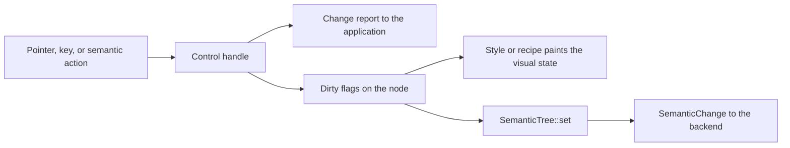

# Controls

A control owns its behavior and its accessibility semantics. It reacts to
pointer, keyboard, and assistive input, keeps its value, and reports
changes. Painting is separate. A style or a recipe reads the control's
visual state and paints it. You can replace the look and keep the behavior
(see [theming.md](theming.md)).

The behavior in this document is public API.
[compatibility.rs](../crates/choscorui/tests/compatibility.rs) and the tests
in [crates/choscorui-controls/tests](../crates/choscorui-controls/tests)
pin it. A change in behavior must update this document in the same change.

All types in this document come from `choscorui::controls`. Roles come from
`SemanticRole` in
[semantics.rs](../crates/choscorui-core/src/semantics.rs). The AppKit role
in parentheses is the role that the macOS backend gives to that
`SemanticRole`.

## Control catalog

The catalog covers each component in the reference sidebar. Two sidebar
entries are rules, not controls. Direction is `LayoutDirection` (see
[right-to-left layout](localization.md#right-to-left-layout)). Typography
is the `TextPreset` styles in [Label and Separator](#label-and-separator).
The form entry beside the components links to form library guides, not
to a control. [`Field`](#field-and-fieldtext) and the compose
[`Form`](guide.md#form-fields) view cover it.

| Group | Control | Purpose |
| --- | --- | --- |
| Basic | [`Button`](#button) | Momentary push button that returns a `CommandId`. |
| Basic | [`CommandLink`](#button) | Command-link look for a `Button`: arrow, title, and description. |
| Basic | [`Checkbox`](#checkbox) | Independent on or off value. |
| Basic | [`RadioGroup`](#radiogroup-and-tabs) | One choice from a group of options. |
| Basic | [`Tabs`](#radiogroup-and-tabs) | Tabs that show one panel at a time. |
| Basic | [`ToolButton`](#toolbutton-and-buttongroup) | Toolbar button with an optional check state and menu. |
| Basic | [`ButtonGroup`](#toolbutton-and-buttongroup) | Joined toggles, buttons, separators, and text parts. |
| Basic | [`CommandRegistry`](#commandregistry-and-shortcuts) | Shared command state and keyboard shortcuts. |
| Basic | [`MnemonicTable`](#mnemonictable-and-parse_mnemonic) | Mnemonic keys for the labels in a window or dialog. |
| Basic | [`Label`](#label-and-separator) | Static text. |
| Basic | [`Separator`](#label-and-separator) | Decorative line. |
| Basic | [`Progress`](#progress) | Determinate or indeterminate progress. |
| Basic | [`NumericDisplay`](#numericdisplay) | Seven-segment number display. |
| Basic | [`KeySequenceEdit`](#keysequenceedit) | Records a keyboard shortcut. |
| Basic | [`GroupBox`](#groupbox-and-stackedcontainer) | Titled group of related controls. |
| Basic | [`StackedContainer`](#groupbox-and-stackedcontainer) | Shows one page of a stack at a time. |
| Basic | [`ToolBox`](#toolbox) | Accordion with one open page. |
| Text | [`TextField`](#textfield) | Single-line text input, also for passwords. |
| Text | [`TextEditor`](#texteditor) | Multiline plain-text editor. |
| Text | [`Combobox`](#combobox-and-fontchooser) | List choice with optional typed text and completion. |
| Text | [`FontChooser`](#combobox-and-fontchooser) | Font family combobox with a fallback. |
| Range | [`Slider`](#slider) | Integer value along a track. |
| Range | [`RangeSlider`](#rangeslider) | Low and high values along one track. |
| Range | [`SpinBox`](#spinbox) | Integer value with step buttons. |
| Range | [`DecimalSpinBox`](#decimalspinbox) | Locale-aware decimal value with text editing. |
| Range | [`Dial`](#dial) | Rotary integer value. |
| Range | [`ScrollBar`](#scrollbar) | Standalone scroll position. |
| Range | [`OverlayScrollBar`](#overlayscrollbar) | Scroll bar on the edge of a viewport that another layer scrolls. |
| Range | [`ScrollArea`](#scrollarea) | Scroll container with overlay scroll bars. |
| Range | [`Resizable`](#resizable) | Panels with a movable handle between each two neighbors. |
| Range | [`DateTimeEdit`](#datetimeedit-and-calendar) | Date or time in sections. |
| Range | [`Calendar`](#datetimeedit-and-calendar) | Month grid for date choice. |
| Data and item views | [`ItemView`](#itemview) | Virtualized list, tree, table, or grid. |
| Data and item views | [`HeaderView`](#headerview) | Table header that sorts and resizes columns. |
| Data and item views | [`CellEdit`](#celledit-and-datamapper) | Edits one model cell with a typed editor. |
| Data and item views | [`DataMapper`](#celledit-and-datamapper) | Binds form fields to the current model item. |
| Data and item views | [`ColumnBrowser`](#columnbrowser-and-undo-history) | Column (Miller) browser for a tree model. |
| Data and item views | [`HostedColumnBrowser`](#columnbrowser-and-undo-history) | Column browser that owns its model and mounts in a control host. |
| Data and item views | [`undo_history`](#columnbrowser-and-undo-history) | Rows for an undo history list. |
| Popups and dialogs | [`DropdownMenu`](#dropdownmenu) | Custom-drawn menu backed by commands. |
| Popups and dialogs | [`PopupStack`](#popupstack) | Open popups, dismissal, and focus restore. |
| Popups and dialogs | [`TooltipController`](#tooltipcontroller) | Hover tooltips with delay and grace time. |
| Popups and dialogs | [`DialogStack`](#dialogstack-and-dialogkeys) | Modal and modeless dialogs in a window. |
| Popups and dialogs | [`DialogKeys`](#dialogstack-and-dialogkeys) | Default and cancel keys for a window or dialog. |
| Popups and dialogs | [`AlertDialog`](#alertdialog-and-inputdialog) | Alert with ordered buttons. |
| Popups and dialogs | [`InputDialog`](#alertdialog-and-inputdialog) | One validated value. |
| Popups and dialogs | [`ColorPicker`](#colorpicker-and-fontdialog) | Color model with HSV, hex, and alpha. |
| Popups and dialogs | [`FontDialog`](#colorpicker-and-fontdialog) | Font family, size, weight, and slant. |
| Window chrome | [`Toolbar`](#toolbar) | Toolbar with roving focus and overflow. |
| Window chrome | [`StatusBar`](#statusbar) | Status text, timed messages, and sections. |
| Window chrome | [`DockLayout`](#docklayout) | Dockable panels around a central area. |
| Window chrome | [`FocusFrame`](#focusframe-and-sizegrip) | Focus ring outside the focused node. |
| Window chrome | [`SizeGrip`](#focusframe-and-sizegrip) | Window resize grip. |
| Canvas | [`CanvasView`](#canvasview) | Interactive view of a `Scene`. |
| Validators | [`NumberInput`](#numberinput-inputmask-and-dateinput) | Locale-aware number validation. |
| Validators | [`InputMask`](#numberinput-inputmask-and-dateinput) | Fixed-format text mask. |
| Validators | [`DateInput`](#numberinput-inputmask-and-dateinput) | Locale-aware short date validation. |
| Form | [`Switch`](#switch) | On or off setting with a sliding thumb. |
| Form | [`Toggle`](#toggle-and-togglegroup) | Button that stays on or off. |
| Form | [`ToggleGroup`](#toggle-and-togglegroup) | Row or column of toggles with one or many on. |
| Form | [`Kbd`](#kbd) | Keyboard key caps for shortcuts. |
| Form | [`Select`](#select-and-listentry) | Trigger with a popup list of options; `Select::native` has the native-select look. |
| Form | [`Input`](#input-and-inputgroup) | Hosted single-line text input. |
| Form | [`InputGroup`](#input-and-inputgroup) | Text input with text, icon, and button addons. |
| Form | [`Textarea`](#textarea) | Hosted multiline text input that grows with its lines. |
| Form | [`InputOtp`](#inputotp) | One-time code input with one character per slot. |
| Form | [`FieldText`](#field-and-fieldtext) | Legend, label, title, description, error, or separator of a form field. |
| Form | [`Field`](#field-and-fieldtext) | Stacked, side-by-side, or responsive layout of a form field. |
| Form | [`DatePicker`](#datepicker) | Button with a calendar popover for one date, several dates, or a range. |
| Overlay | [`ContextMenu`](#contextmenu-and-menubar) | Area that opens a menu at the pointer on a secondary click. |
| Overlay | [`Menubar`](#contextmenu-and-menubar) | Row of menu titles inside the window. |
| Overlay | [`Popover`](#popover) | Button with a floating panel; `Popover::hover_card` opens it on hover. |
| Overlay | [`Dialog`](#dialog) | Button with a modal panel; `Dialog::sheet` and `Dialog::drawer` slide it in from an edge. |
| Overlay | [`Command`](#command-and-commanditem) | Search input over grouped commands, inline or in a modal dialog. |
| Navigation | [`Breadcrumb`](#breadcrumb) | Trail of links to the current page, with an optional collapsed middle. |
| Navigation | [`Pagination`](#pagination) | Page links with previous and next buttons. |
| Navigation | [`NavigationMenu`](#navigationmenu-and-navigationlink) | Row of site links whose triggers open panels of described links. |
| Navigation | [`Sidebar`](#sidebar) | Grouped navigation items that collapse, and become a sheet in a narrow window. |
| Data | [`Card`](#card) | Surface with a header, content, and footer buttons. |
| Data | [`Badge`](#badge) | Short status label, optionally a link. |
| Data | [`Avatar`](#avatar-and-avatargroup) | Round user image with a text fallback. |
| Data | [`AvatarGroup`](#avatar-and-avatargroup) | Overlapping avatars with a count. |
| Data | [`Carousel`](#carousel) | Slides that move one at a time and snap. |
| Data | [`DataTable`](#datatable) | Sorted, filtered, selectable, and paged rows of an item model. |
| Data | [`Chart`](#chart) | Area, bar, line, pie, radar, and radial charts of app data. |
| Feedback | [`Alert`](#alert) | Callout with an icon, a title, and actions. |
| Feedback | [`Spinner`](#spinner-and-skeleton) | Spinning loader icon. |
| Feedback | [`Skeleton`](#spinner-and-skeleton) | Pulsing placeholder block. |
| Feedback | [`Empty`](#empty) | Centered empty state with media and actions. |
| Feedback | [`Toaster`](#toast-and-toaster) | Stack of toasts at a window corner. |
| Layout | [`AspectRatio`](#aspectratio) | Box with a fixed ratio, filled with an image. |
| Layout | [`Collapsible`](#collapsible) | Section that shows or hides its items. |
| Layout | [`Accordion`](#accordion) | Stacked sections that open under their headers. |
| Layout | [`ItemGroup`](#item-and-itemgroup) | Rows of media, text, and actions. |
| Chat | [`Message`](#message-and-bubble) | Avatar, header, bubbles, and footer of one chat message. |
| Chat | [`Attachment`](#attachment) | File with media, a detail line, and a progress state. |
| Chat | [`Marker`](#marker) | Muted line between messages. |
| Chat | [`MessageScroller`](#messagescroller-and-conversation) | Virtualized messages that stick to the bottom. |
| Chat | [`Questionnaire`](#questionnaire-and-question) | One question at a time with choices or a typed answer. |
| Custom controls | [`CustomControl`](#customcontrol-and-controlhost) | Trait for an application-defined control. |
| Custom controls | [`ControlHost`](#customcontrol-and-controlhost) | Mounts custom controls on retained nodes. |

## Shared rules

Some controls take the retained `Tree` and a `NodeId` in `handle`. These
are `Button`, `Checkbox`, `RadioGroup`, `Tabs`, `TextField`,
`TextEditor`, `Slider`, `SpinBox`, `ScrollArea`, and `Resizable`. The rules
below apply to them, unless a section gives a different rule.

`ItemView::handle` also takes the `Tree` and a `NodeId`. For `ItemView`,
only the missing-node rule below applies, with `TreeError`. The
[ItemView](#itemview) section gives its other rules.

- **Missing node.** `handle` returns a missing-node error and does not
  change the value. The error type is `TreeError` for most controls.
  `ScrollArea` uses `LayoutError`, `RadioGroup` and `Tabs` use
  `SelectionError`, and `Resizable` uses `ContainerError`.
- **Primary button only.** Pointer presses and releases act only for
  `PointerButton::Primary`.
- **Keys need focus.** A key event acts only when the control's node has
  focus. For `Resizable`, the handle node must have focus. Semantic actions
  and external setters do not need focus.
- **Change reporting.** `handle` reports a change only when the value
  changed. A selection of the current option, or a step past a bound,
  reports nothing.
- **Invalidation.** A value change invalidates `PAINT` and `SEMANTICS`,
  but not `LAYOUT`. A hover or press change on `Button` and `Checkbox`
  invalidates `PAINT`. A `TextEditor` edit also invalidates `LAYOUT`.
  `Resizable` sets the bounds of its panes and its handle.
- **Disabled.** A disabled control ignores input. On `Button`,
  `Checkbox`, `Slider`, and `ScrollArea`, `set_enabled(false)` cancels a
  press or drag and releases pointer capture. Text controls drop IME
  marked text. `RadioGroup` and `Tabs` disable single options.
- **Cancel.** `Button`, `Checkbox`, `Slider`, `ScrollArea`, and
  `Resizable` accept a `Cancel` input. It clears an armed press or drag and
  releases capture. It never activates and never restores an earlier
  value.

**In a control host.** A built-in control also implements
`CustomControl`, so a `ControlHost` and the views can mount it. The host
routes pointer and key events to `handle` at the target phase. A loss of
focus or a `Dismiss` event becomes a `Cancel` input. The control reports
changes as `ControlMessage` values:

| Control | Message | `set_value` takes |
| --- | --- | --- |
| `Button` | `Activated` | - |
| `Checkbox` | `Changed(Bool)` | `Bool`, or `Mixed` for the mixed state |
| `Label`, `Separator`, `Progress` | - | - |
| `Slider`, `SpinBox` | `Changed(Number)` | `Number`, rounded and clamped to the range |
| `TextField` | `Changed(Text)` on an edit, `Activated` on Enter | `Text` |
| `HostedRadioGroup`, `HostedTabs` | `Changed(Index(Some(i)))` | `Index(Some(i))` for an enabled option |
| `ItemView` | `Changed(Indices)` of selected visible positions, `ItemActivated(i)` | `Indices` |
| `HeaderView` | `ItemActivated(column)` on a sort change, `Changed(Index(Some(column)))` on a resize | - |
| `HostedColumnBrowser` | `Changed(Indices)`: the row of each path item among its siblings | `Indices` |
| `Calendar` | `Changed(Date)` and `Activated` in single mode, `Changed(Dates)` in the other modes | `Date` in single mode, `Dates` in the other modes |
| `DateTimeEdit` | `Changed(Date)` for a date, `Changed(Text)` for a time or a date and time | the same kind |
| `HostedDropdownMenu` | `Command(id)`, `Dismissed` | - |
| `HostedAlertDialog` | `ItemActivated(button)`, `OpenChanged(false)`, `Dismissed` | - |
| `ColorPicker` | `Changed(Text)` with the hex value, `Activated` on Enter | `Text` with a hex value |
| `HostedToolbar` | `Command(id)`, `OpenChanged` for the overflow menu, `ItemActivated(index)` for an overflowed embedded control | - |
| `DockLayout` | `ItemActivated(panel)` on a tab, `Changed(Number)` on a splitter, `Changed(Text)` with the saved layout after a tab drop, `Dismissed` when a panel closes | - |
| `HostedCanvas` | `Changed(Indices)` of item ids, `ItemActivated(id)` on Enter | `Indices` of live items |
| `HostedResizable` | `Changed(Number)` with the size of the pane before the active handle; `active` names that handle | `Number` |
| `HostedStack` | - | `Index(Some(page))` |
| `StatusBar`, `ScrollArea`, `HostedGroupBox` | - | - |
| `Combobox`, `FontChooser` | `Changed(Index)`, `Changed(Text)` when editable, `OpenChanged`, `Dismissed` on a close without a choice | `Index`, or `Text` when editable |
| `TextEditor` | `Changed(Text)` | `Text` |
| `ScrollBar`, `DecimalSpinBox` | `Changed(Number)` | `Number` |
| `HostedDial` | `Changed(Number)` | `Number`, rounded |
| `HostedToolButton` | `Command(id)` of the button or of a menu row, `Changed(Bool)` when checkable, `OpenChanged` for a menu, `Dismissed` on a close without a choice | `Bool` when checkable |
| `HostedButtonGroup` | `Changed(Indices)` of toggle members, `ItemActivated(member)` for a button member | `Indices` of toggle members, exactly one when exclusive |
| `HostedCommandLink` | `Activated` | - |
| `ToolBox` | `Changed(Index)` | `Index` |
| `HostedNumericDisplay` | - | a whole `Number` |
| `KeySequenceEdit` | `Changed(Text)`, for example `⌘K, ⇧⌘S` | `Text` in that form |
| `SizeGrip` | `Changed(Range(width, height))` | - |

Other controls take a plain `Key` with no key-up event. The host delivers
the key-down event and checks focus. `Label`, `Separator`, and
`Progress` take no input.

**Keys in a control host.** These rules apply to the hosted controls:

- A button-like control activates on Enter key-down and on Space key-up.
  Space key-down shows the pressed look.
- A held key does not activate or toggle again. The control consumes
  the repeats.
- A control lets a key with Command or Control go on to the shortcuts,
  unless the control uses that chord, such as Command+A in text. Menus,
  tab lists, toggle groups, the range slider, and the canvas use no
  chords.
- A link, such as a link badge, activates on Enter only. Space is for
  buttons.

**State transitions.** In a `ControlHost`, a change of visual state eases.
The background, foreground, border, ring, and shadows of each slot go from
the old resolved style to the new one. The blend uses the slot's
`motion_ms` and the `motion.easing` curve. The other values change at once.
[Theming](theming.md#state-transitions) gives the rules.

**Inner parts.** A control with inner buttons or rows tracks the hovered
part from pointer moves and the pressed part during a press. The pressed
look shows only while the pointer is on the pressed part, and a release
away from it does nothing. Each part also gets the disabled state of the
control. One shared helper does this for every such control. Some of
the parts that use it:

- the `AlertDialog` buttons and the `Attachment` remove button
- the `Carousel` previous and next buttons
- the `Calendar` and `DatePicker` month buttons and enabled days
- the `InputGroup` button addons and the `ButtonGroup` members
- the `Toolbar` commands, the `Menubar` titles, and the `ToolBox` headers
- the `HeaderView` cells and the `HostedColumnBrowser` rows
- the `ItemView` rows in the viewport
- the `Collapsible` toggle and the `Sidebar` rows
- the `NavigationMenu` triggers and links, and the `Pagination` links
- the `SpinBox` and `DecimalSpinBox` steppers
- the `HostedToolButton` label and split arrow

**Disabled look.** In a `ControlHost`, a disabled control paints under one
group opacity, the opacity of a disabled `Button` `Root`. Its disabled
slots do not fade again. The group opacity eases like a slot.

**Cursor.** The host records the `cursor` of each slot that the hovered
control paints under the pointer. The topmost slot that sets a cursor wins,
and `Cursor::Auto` sets none. `ControlHost::cursor` gives the result of the
last paint, and the window shows it. A control that holds the pointer for
a drag keeps its cursor while the pointer leaves the part.

| Cursor | Parts |
| --- | --- |
| `Text` | text fields and text areas |
| `Pointer` | link badges, link `Item` rows, `CommandLink`, `Breadcrumb` links |
| `ResizeHorizontal`, `ResizeVertical` | `Resizable` handles and `DockLayout` splitters, across the split; `HeaderView` column edges, from the handle recipe |
| `ResizeDiagonalEnd` | `SizeGrip`; the window shows the diagonal of the bottom end corner |
| `Arrow` | disabled slots; `SpinBox` and `DecimalSpinBox` steppers; `InputGroup` buttons |

**Text that does not fit.** `draw_text` and `PaintContext::label` draw
one line in a rectangle:

- A line that is too wide truncates at its end. `truncate_end` cuts it at
  a grapheme boundary and puts `ELLIPSIS` ("…") in place of the rest. The
  ellipsis follows the text, so in right-to-left text it is at the left.
- `TextLine::overflow(TextOverflow::Clip)` keeps the whole line and cuts
  it at the edges of the rectangle.
- A label next to a trailing part keeps room for it. Examples are a
  shortcut, a badge, a count, a chevron, and a sort arrow.
- `Content::draw` keeps its icons and truncates its label.

`wrapped_height` measures a paragraph that wraps in a width, and
`paint_wrapped` paints it, one line for each line height. Each line fits,
so wrapped text does not truncate. A `measure` that has a natural width
honors the constraints that it gets, and its labels truncate in less room.

**Replacing a control.** `ControlHost::replace` puts a new control on a
mounted node. The node keeps its identity, focus, and disabled state. A view
uses it to build a control again, for example after a locale change.

## Control sections

Each section gives the behavior, then the semantics of the node that the
control publishes. A dash means that the field is empty.

The [contract tests](../crates/choscorui-controls/tests/contract.rs) play
the same keys on every hosted control under two recipes, and the results
must be equal. The `control_semantics.txt` and `focus_order.txt` golden
files record the semantics and the Tab order of every hosted control.

The value tables give the default recipe of each `ControlKind`. Sizes are in
points, and colors are theme roles. Each default fill is a solid `Paint`. A
custom recipe can give a gradient fill, as
[Theming](theming.md#style-recipes) tells. A `<kind>_matches_its_reference_table`
test in a `styles_*.rs` file of
[the controls tests](../crates/choscorui-controls/tests/) pins each table.
The `painted_<group>.txt` golden files of the
[compatibility suite](versioning.md#compatibility-suite) pin the painted
output of each kind, variant, size, slot, and key state.

### Button

| Input | Behavior |
| --- | --- |
| Primary press on the node | Takes focus, captures the pointer, and arms. |
| Pointer move while armed | Shows `pressed` only while the pointer is inside. |
| Primary release | Activates only with capture and inside. A release outside cancels. |
| Enter key-down | Activates at once. Repeats do nothing. |
| Space key-down, then key-up | Key-down arms, and repeats do nothing. Key-up activates if armed and still focused. |
| `Semantic(Activate)` | Activates. |
| `Cancel` | Disarms the pointer and Space, and releases capture. |

- Activation returns the button's `CommandId`.
- `handle_with_commands` reads the enabled state from the
  `CommandRegistry` first. A command that becomes disabled during a press
  cancels the press.
- **Look.** `with_variant` takes a `ButtonVariant`: `Default`,
  `Destructive`, `Outline`, `Secondary`, `Ghost`, or `Link`. `with_size`
  takes a `ControlSize`. `with_icon` and `with_trailing_icon` add icons.
- `paint` resolves the `Button` recipe for the `visual_state` and paints
  the box, the icons, and the label. A recipe reads only the style query and
  the tokens, so a recipe swap does not change behavior.
- `set_expanded` keeps the open look while a popup is open.
- **Loading.** `with_loading(true)` (compose: `.loading(live)`) replaces
  the leading icon with the loader icon. The loader turns at the
  `Spinner` recipe motion, and it stays still with reduced motion. While
  it loads, the button has the disabled look and semantics, and it
  ignores activation.
- A button is not a field, so it has no invalid state. Put the error of a
  form on the field.
- `CommandLink` paints an arrow, a title, and a description in an outline
  item row. It resolves through `ControlKind::Item` with the `Outline`
  variant and the `HIGHLIGHTED` state, as a link row. A `Button` on the
  same node gives the behavior.
- The description line sits one spacing unit under the title, with the
  line height of the `Description` slot.
- `CommandLink::hosted` puts the link and a `Button` for a command on one
  hosted node. The node adds the link description to the button semantics.
  The pressed look comes from the button: it shows while the pointer that
  pressed the link is inside it, or while Space holds it down. Hover and
  press fill the row with `muted`.

| Size | Height | Inline padding | Gap | Radius | Icon |
| --- | --- | --- | --- | --- | --- |
| `Xs` | 24 | 8 | 4 | min(md, 8) | 12 |
| `Sm` | 32 | 10 | 4 | min(md, 10) | 16 |
| `Default` | 36 | 10 | 6 | md | 16 |
| `Lg` | 40 | 10 | 6 | md | 16 |
| `IconXs`, `IconSm`, `Icon`, `IconLg` | 24, 32, 36, 40 square | 0 | 0 | as the text size | 12, 16, 16, 16 |

| Variant | Rest | Hover |
| --- | --- | --- |
| `Default` | `primary` fill, `primary-foreground` text | `primary` at 80% |
| `Outline` | `background` fill, `border` edge, extra-small shadow; dark: `input` at 30%, `input` edge | `muted`; dark: `input` at 50% |
| `Secondary` | `secondary` fill | `secondary` mixed with 5% `foreground` |
| `Ghost` | transparent | `muted`; dark: `muted` at 50% |
| `Destructive` | `destructive` at 10% (dark 20%), `destructive` text | 20% (dark 30%) |
| `Link` | `primary` text | underline |

All variants use medium text: extra-small at size `Xs`, small at the
other sizes.

| State | Value |
| --- | --- |
| Pressed | 1 pt down, except while open |
| Open | `Outline` and `Ghost` keep the `muted` fill |
| Focus visible | `ring` edge and 3 pt ring at 50%; `Destructive`: `destructive` edge at 40% and a `destructive` ring at 20% (dark 40%) |
| Disabled | 50% opacity and no hover look |

| Field | `semantics(tree, id).shared()` |
| --- | --- |
| Role | `Button` (AXButton) |
| Name / value | label / - |
| State | disabled |
| Actions | `Activate`, `Focus` while enabled |

[button.rs](../crates/choscorui-controls/tests/button.rs),
[commands.rs](../crates/choscorui-controls/tests/commands.rs),
[recipe.rs](../crates/choscorui-controls/tests/recipe.rs), and
[widgets.rs](../crates/choscorui-controls/tests/widgets.rs) pin this behavior.

**As a view.** `Button::new(label, action)` runs `action` on activation.
`CommandLink::new(title, description, action)` mounts a `HostedCommandLink`
and runs `action` when it reports `Activated`.

### Checkbox

- Pointer, Space, and `Cancel` work as on `Button`. Activation toggles the
  value.
- Enter does nothing.
- `Semantic(Activate)` toggles. `Semantic(SetValue(v))` sets `v`.
- `handle` returns `Some(value)` only when the value changed.
- A pointer press focuses without the focus ring. Keyboard focus shows it.
- `set_indeterminate(true)` shows the mixed state. The next activation or
  `SetValue` clears it and reports the value, also when the value is the
  same.
- `set_invalid(true)` shows the invalid look and sets the invalid
  semantic state. `with_invalid` sets it before the checkbox has a node,
  for a control host. The invalid flag of the host also shows the invalid
  look.
- **Look.** `paint` draws the box at the start of the bounds and the label
  after it. In right-to-left layouts, the box is at the right.
- In a control host, only the box and the label take pointer input. A
  press in the bounds after the label goes to the parent node, so a wide
  frame does not make a large target.

| Part | Value |
| --- | --- |
| Box | 16 square, radius 4, `input` edge, extra-small shadow; dark: `input` at 30% fill |
| Checked or mixed | `primary` fill and edge, `primary-foreground` check or minus icon at 14 |
| Label | small medium text, 8 after the box |
| Focus ring | `ring` edge and 3 pt ring at 50% |
| Invalid | `destructive` edge, also on a checked box; no ring and no shadow; the label in `destructive`; the focus ring still shows while focus is visible |
| Disabled | 50% opacity |

| Field | `semantics(tree, id).shared()` |
| --- | --- |
| Role | `Checkbox` (AXCheckBox) |
| Name / value | label / `true`, `false`, or `mixed` |
| State | disabled, invalid, checked (none while mixed) |
| Actions | `Activate`, `SetValue`, `Focus` while enabled |

[checkbox.rs](../crates/choscorui-controls/tests/checkbox.rs) pins this
behavior.

**As a view.** `Checkbox::new(label, checked)` edits a `Binding<bool>`.
`Checkbox::mixed(label, checked)` edits a `Binding<Option<bool>>` through
the `Mixed` value, where `None` is the mixed state. A press sets
`Some(value)`.

### RadioGroup and Tabs

- **Roving focus.** After `install`, only the selected option is
  focusable.
- **Selection follows focus.** An arrow key selects the target option and
  focuses it.
- ArrowRight and ArrowDown go to the next enabled option. ArrowLeft and
  ArrowUp go to the previous enabled option. Both wrap and skip disabled
  options. Tabs take only the arrows along their orientation: ArrowLeft
  and ArrowRight in a horizontal list, ArrowUp and ArrowDown in a
  vertical list.
- Home and End select the first and the last enabled option.
- Space or Enter on key-down selects the focused option. The control
  also accepts repeats.
- `Activate` (a host pointer click) and `Semantic(Activate)` select without
  focus. `Semantic(Focus)` focuses the option and does not select it.
- Input on a disabled option does nothing.
- A selection of the current option reports nothing and does not move
  focus.
- Right-to-left layouts swap ArrowLeft and ArrowRight, so ArrowLeft goes
  to the next option. `set_direction(Rtl)` sets this, and a hosted control
  takes the host direction.
- `new` rejects an empty list, a duplicate node, an unknown selection, and
  a disabled selection.
- `TabSet` is a deprecated alias of `Tabs`.
- **In a control host.** `RadioGroup::hosted` and `Tabs::hosted` make a
  one-node form that names each option by its index. Its node has the group
  role, the selected label as value, and the `SetValue`, `Increment`,
  `Decrement`, and `Focus` actions.
- **Disabled options.** `with_disabled` and `disable` reject an index out
  of range and the selected option. As a view,
  `RadioGroup::disabled_option` and `Tabs::disabled_tab` keep the option
  enabled for such an index and report one `ViewError::Clamped`.
- **Invalid radio group.** `HostedRadioGroup::set_invalid(true)` or
  `with_invalid(true)` gives each option the invalid look of `Checkbox`.
  The group node then has the invalid semantic state. `option_state`
  returns the recipe flags of one option.
- **Radio look.** `paint_option` draws a 16 pt circle with the same edge,
  focus, invalid, and disabled values as `Checkbox`. The selected option
  has a `primary` fill and an 8 pt `primary-foreground` dot.
- **Tabs look.** `with_variant` takes a `TabsVariant`: `Default` or
  `Line`. `with_orientation` takes an `Orientation`. Paint the list with
  `paint_list`, then each tab with `paint_tab`.
- **Vertical tabs.** ArrowUp, ArrowDown, Home, and End move the selection.
  `HostedTabs` stacks the tabs in one column from the top, and each
  tab fills the list width. The list height fits the tabs. A vertical tab
  starts its label at the start edge. The line indicator is at the inline
  end, so right-to-left layouts mirror it.

| Radio part | Slot | Value |
| --- | --- | --- |
| Circle | `RadioGroup` `Root` | 16 pt, radius full; edge, fill, focus, invalid, and disabled as `Checkbox` |
| Selected | `RadioGroup` `Root`, checked | `primary` fill and edge |
| Dot | `RadioGroup` `Indicator` | 8 pt `primary-foreground` circle |
| Options | `RadioGroup` `Group` | 12 pt gap |
| Label | `RadioGroup` `Label` | small medium text, 8 pt after the circle; `destructive` while invalid |

| Tabs part | `Default` | `Line` |
| --- | --- | --- |
| List | `muted` fill, radius lg, padding 3, height 36 (horizontal) | transparent, gap 4 |
| Tab | small medium text, padding 8 by 4, radius md; `foreground` at 60% (dark: `muted-foreground`) | same |
| Selected tab | `background` fill, small shadow, `foreground` text; dark: `input` at 30% fill and `input` edge | `foreground` text and a 2 pt `foreground` line, 5 pt under a horizontal tab or 4 pt beyond the inline end of a vertical tab |

| Field | Group node | Option or tab node | Tab panel node |
| --- | --- | --- | --- |
| Role | `RadioGroup` or `TabList` (AXGroup) | `RadioButton` or `Tab` (AXRadioButton) | `TabPanel` (AXGroup) |
| Name / value | label / selected label | label / - | tab label / - |
| State | - | disabled; checked (radio) or selected (tab) | hidden when not selected |
| Actions | - | `Activate`, `Focus` while enabled | - |

The group node has a `Controls` relation to each option or tab. A tab has
a `Controls` relation to its panel. A panel has a `LabelledBy` relation to
its tab.

**As a view.** `Tabs::new(name, labels, selected)` mounts a `HostedTabs`.
Show the content of the selected tab next to it, and give that view
`.accessibility_role(SemanticRole::TabPanel)`.

[selection_controls.rs](../crates/choscorui-controls/tests/selection_controls.rs)
pins this behavior.

### ToolButton and ButtonGroup

- **`ToolButton::click`.** An `Instant` menu opens the menu. On a `Split`
  button, a click in the trailing `arrow_width` opens the menu. Any other
  click runs the command.
- **Keys.** Space or Enter runs the command, or opens an `Instant` menu.
  ArrowDown opens the menu of a button that has one.
- The button runs only a known command that is enabled. A checkable button flips
  the command's checked state and returns `Toggled`.
- A disabled command does nothing. Its menu does not open.
- **`ToolButton` look.** `paint` uses the `Toggle` look: transparent, and
  `muted` on hover, on press, while the menu is open, or while checked.
  `visual_state` adds the command's checked and disabled state to the
  host's flags.
- An `Instant` menu adds a chevron at the end. A `Split` menu adds a 1 pt
  divider and a chevron in `arrow_width`.
- In a control host, the label and the split arrow of a `Split` button
  show the hover and press fill one at a time. The split arrow shows the
  open fill. A press that ends on the other segment does nothing.
- **`ButtonGroup` members.** `ButtonGroup::new` makes one `Toggle`
  member for each command. `from_members` takes `ButtonGroupMember`
  values: `Toggle(command)`, `Button(command, variant)`, `Separator`, and
  `Text`.
- **`ButtonGroup::toggle`.** A command that is not a toggle member, or
  that is disabled, does nothing. An exclusive group checks only the
  clicked member. A click on the checked member does nothing.
- A non-exclusive group toggles the clicked member.
- **`ButtonGroup::step`.** Moves the check to the next or previous enabled
  toggle member, and wraps. With no checked member, the search starts at
  the first toggle member.
- **`ButtonGroup` look.** `paint_member` draws a toggle member with the
  outline `ToggleGroup` item look. A checked toggle member fills `muted`.
  A button member has the `Button` look of its variant and never paints
  the check. `member_state` adds the command's checked and disabled state
  to the host's flags.
- A separator is a 1 pt line across the group. A text part has the `Text`
  look at its natural width. Neither takes focus.
- Inner corners are square. Each member after the first overlaps the border
  before it, but a member after a separator does not overlap it.
  `with_orientation` joins the members in a row or a column.

| Part | Kind and slot | Value |
| --- | --- | --- |
| Group | `ButtonGroup` `Root` | radius md, 8 pt gap |
| Text part | `ButtonGroup` `Text` | 36 pt high, `muted` fill, 1 pt `input` edge as the toggle members, radius md, 10 pt sides, sm medium text, shadow xs |
| Separator | `ButtonGroup` `Separator` | 1 pt `input` line |
| Toggle member | `ToggleGroup` `Item`, `Outline` | the toggle look |
| Button member | `Button` `Root`, its variant | the button look, `Outline` in the gallery |

| Field | `ToolButton::semantics` |
| --- | --- |
| Role | `Button` (AXButton), or `Checkbox` (AXCheckBox) when checkable |
| Name / value | label / - |
| State | disabled; checked when checkable |
| Actions | `Activate`, and `ShowMenu` with a menu, while enabled |

`ButtonGroup` has no node of its own. Its members publish their own
semantics.

| Field | `HostedButtonGroup::semantics` |
| --- | --- |
| Role | the focused member: `RadioButton` (AXRadioButton) for a toggle in an exclusive group, else `Button` (AXButton) |
| Name / value | the member label / - |
| Description | the labels of the text parts |
| State | disabled; checked for a toggle member, as on a `Toggle` |
| Actions | `Activate`, `Focus`, while the member is enabled |

**In a control host.** `ToolButton::hosted` keeps the command state
itself, because the host has no `CommandRegistry`. In right-to-left
layouts, the split arrow is at the left. `ButtonGroup::hosted` gives one
node for the whole group, with a label for each member. It paints the
`Root` slot, then each member. While focus is visible, the focused member
paints last, so no neighbour covers its ring. That node publishes the
focused member.
Arrow keys, Home, and End move the focus among the enabled toggle and
button members. They skip disabled members, separators, and text parts.
In an exclusive group, a toggle member that gets the focus also gets the
check, and focus enters the group at the checked member.
- In a non-exclusive group, each toggle and button member is a tab stop.
  Tab and Shift+Tab move the focus in the group, and leave it after the
  last or the first member.
- Space, Enter, or a click runs the focused member. A toggle member
  reports `Changed(Indices)`, and a button member `ItemActivated(member)`.
- Each member gets its natural width, so each label shows whole at the
  natural width of the group. The toggle and button members share the
  rest of the width evenly. Separators and text parts keep their natural
  width.
- `with_enabled(index, false)` disables a member: it takes no press, key,
  action, or focus.
- `ButtonGroup::with_size` sets the size of the toggle, button, and text
  members: `Sm`, `Default`, or `Lg`.
- The compose `ButtonGroup` view takes a `ButtonGroup`, the labels, and a
  binding for the checked toggle members. Button members report through
  `.on_item`.

[widgets.rs](../crates/choscorui-controls/tests/widgets.rs) and
[builtin_hosting_widgets.rs](../crates/choscorui-controls/tests/builtin_hosting_widgets.rs)
pin this behavior.

`HostedToolButton::with_checkable` and `HostedToolButton::with_menu` set the
check state and the menu of a hosted button. `with_items` gives the menu
its rows, and `set_command` sets the state of a row.

- The menu opens below the button as a dropdown menu, with the menu keys,
  hover, and type-ahead. A keyboard open highlights the first row.
- A chosen row reports its `Command(id)` and closes the menu.
- Escape, a press outside, Tab, and focus loss close the menu and report
  `Dismissed`.
- The node adds `Focus` to the actions. With a menu, it publishes
  `expanded`, and the highlighted row in `description` while the menu is
  open.

**As a view.** `ToolButton::new(label, action)` runs `action` when the
button reports its own `Command`. `.checked(binding)` makes it checkable
and edits a `Binding<bool>` through the `Bool` value. `.menu(menu, items)`
adds an instant or a split menu of `MenuChoice` rows, which reports
`OpenChanged`.

### CommandRegistry and shortcuts

- `insert` fails with `CommandError::DuplicateId` for a known identifier.
  `state`, `set_enabled`, and `set_checked` fail with `UnknownId` for an
  unknown identifier.
- `activate` returns `None` for a disabled command. A disabled command
  never runs.
- `bind_shortcut` rejects a second binding of a chord in the same scope.
  Different scopes can bind the same chord.
- `resolve_shortcut` tries the focused scope, then the window scope, then
  the application scope.
- If the winning binding has a disabled command, the chord resolves to
  `None`. A less specific binding does not run.
- `unbind_scope` removes the bindings of one scope. `unbind_window` removes
  the window and focused bindings of a window.

The registry has no semantic node. Controls that use it show the command
state in their own semantics.

[commands.rs](../crates/choscorui-controls/tests/commands.rs) and
[shortcuts.rs](../crates/choscorui-controls/tests/shortcuts.rs) pin this
behavior.

### MnemonicTable and parse_mnemonic

- **`parse_mnemonic`** removes the `&` markers from a label and returns the
  display text and the mnemonic. `&Save` gives `Save` and `s`.
- The first `&` before a letter or a digit gives the mnemonic, in
  lowercase. `&&` gives a literal `&`. A trailing `&` stays in the text.
- **`MnemonicTable::register`** parses a label, records the mnemonic for a
  node, and returns the display text. It replaces the earlier entry of that
  node.
- `remove` deletes the entry of a node. `conflicts` returns the nodes that
  share a character, in registration order.
- **`resolve`** ignores case. It skips each node for which `available`
  returns `false`, for example a hidden or disabled node.
- If one node remains, the `MnemonicHit` has `activate` set to `true`.
- If more nodes share the character, the hit gives the node after
  the focused node, and `activate` is `false`. A second press then reaches
  the next node.
- The table does not choose the key chord. The application decides which
  chord sends the mnemonic character.

The table and the parser publish no semantic node.

The `mnemonics_parse_escape_and_cycle_on_conflict` test in
[navigation.rs](../crates/choscorui-controls/tests/navigation.rs) pins this
behavior.

### Label and Separator

- `Label` takes no input. `Label::set_text` invalidates `LAYOUT`, `PAINT`,
  and `SEMANTICS`, and returns whether the text changed. It fails when the
  node is not in the tree.
- `Label::hosted(text)` makes a label for a control host. It has no node, so
  `set_text` returns `MissingNode`.
- `Separator` takes no input and publishes no semantic node, because it is
  decorative. `paint` centers a 1 pt `border` line in either orientation.
  In a control host, its node is a hidden `Group`.
- `Label::paint` draws the small medium text at the start of the bounds.
  A `DISABLED` state in the context gives 50% opacity.

| Part | Kind and slot | Value |
| --- | --- | --- |
| Label | `Label` `Root` | sm medium `foreground` text, line height equal to the size, 8 pt gap; 50% opacity while disabled |
| Separator | `Separator` `Root` | 1 pt `border` line |
| Text preset | `Typography` `Root` | the text and the color of a `TextPreset`; the variant is the index in `TextPreset::ALL` |
| `H2` | `Typography` `Root` | 1 pt `border` line below, 8 pt under the text |
| `Blockquote` | `Typography` `Root` | 2 pt `border` line at the start, 24 pt start padding |
| `InlineCode` | `Typography` `Root` | `muted` fill, radius sm, padding 4.8 by 3.2 pt |
| `List` | `Typography` `Root` | 24 pt start padding, 8 pt between items |

| Field | `Label::semantics` |
| --- | --- |
| Role | `StaticText` (AXStaticText) |
| Name / value | text / - |
| State | - |
| Actions | - |

**As a view.** `Label::new(text)` mounts a `Label::hosted` label with
literal or catalog text. The view builds a new label when the locale
changes. `Divider` mounts a `Separator` across its stack: horizontal in
a vertical stack, and vertical in a horizontal stack. The `Separator`
recipe gives its thickness and color, so
`.recipe(ControlKind::Separator, recipe)` changes it.

[static_controls.rs](../crates/choscorui-controls/tests/static_controls.rs) and
[views.rs](../crates/choscorui-compose/tests/views.rs) pin this behavior.

### Progress

- `new` fails with `RangeError::InvalidMaximum` when the maximum is zero.
  The value clamps to the maximum.
- `set_value` and `set_indeterminate` invalidate `PAINT` and `SEMANTICS`
  only when the value changed.
- `needs_frame(visible)` is true only for a visible indeterminate bar. In a
  control host, the same bar animates.
- `ProgressBar` is a deprecated alias of `Progress`.
- **Look.** `paint` draws a 6 pt `muted` track with full rounding, and a
  `primary` indicator from the start in reading order. An indeterminate
  bar sweeps a segment of 30% of the width once every
  `INDETERMINATE_PERIOD` seconds at the context time. With reduced
  motion, still stripes cover the whole track, so that the bar shows no
  value.
- In a control host, a new value moves the fill from its current width
  over the `motion_ms` of the `Indicator` recipe. With reduced motion, the
  fill moves at once.

| Part | Slot | Value |
| --- | --- | --- |
| Track | `Track` | 6 pt `muted` bar, radius full |
| Indicator | `Indicator` | `primary` fill, 150 ms motion |
| Label | `Label` | sm medium `foreground` text |
| Value | `Value` | sm `muted-foreground` text |
| Stack | `Root` | 12 pt gap |

| Field | `Progress::semantics` |
| --- | --- |
| Role | `ProgressIndicator` (AXProgressIndicator) |
| Name / value | label / whole percent, for example `30%`; none when indeterminate |
| State | `range`: the value, 0, and the maximum, when determinate |
| Actions | - |

The macOS bridge publishes the `range` value and bounds as numbers, so
assistive technology reads the value as a part of the whole. In a control
host, `set_value` takes a whole `Number` from 0 to the maximum of a
determinate bar.

**As a view.** `Progress::new(name, value).maximum(10)` shows a live `u32`
value. The maximum is 100 by default. A maximum of zero becomes 1, and a
value above the maximum shows a full bar. Each reports a
`ViewError::Clamped`. `Progress::indeterminate(name)` shows work of unknown
length.

[range_controls.rs](../crates/choscorui-controls/tests/range_controls.rs) and
[widgets.rs](../crates/choscorui-controls/tests/widgets.rs) pin this behavior.

### NumericDisplay

- The display shows a value in decimal, hexadecimal, octal, or binary
  `NumberBase`.
- `text` aligns the number to the right. A value with more characters than
  `digits` shows as dashes, and `overflow` is true.
- **Look.** `paint` draws the `NumericDisplay` box: the input border, radius
  lg, and 12 pt padding. Lit segments use the `Value` color, `foreground`.
  Unlit segments use the `Track` color, `muted`. Keyboard focus adds the
  focus ring.
- In a control host, `NumericDisplay::hosted` adds the name. The hosted
  node does not take focus. It takes and reports the value as `Text` with
  the decimal digits, so that each `i64` value stays exact. It also takes
  a whole `Number`.

| Part | Slot | Value |
| --- | --- | --- |
| Box | `Root` | input box: `input` border, shadow xs, radius lg, 12 pt padding; focus ring while focus is visible |
| Lit segment | `Value` | `foreground`, xl2 medium mono text |
| Unlit segment | `Track` | `muted` |

| Field | `NumericDisplay::semantics` |
| --- | --- |
| Role | `StaticText` (AXStaticText) |
| Name / value | name / the plain number |
| State | description "Value too large to display" on overflow |
| Actions | - |

**As a view.** `NumericDisplay::new(name, digits, base, value)` mounts a
`HostedNumericDisplay`. The view gives the live `i64` value as `Text`. A
change of `base` builds the display again.

`HostedNumericDisplay::counter` makes the display a counter, and
`NumericDisplay::counter(name, digits, base, value)` is its view. A counter
is a tab stop that edits a `Binding<i64>`. ArrowUp and ArrowRight add 1, and
ArrowDown and ArrowLeft subtract 1. PageUp multiplies by 10, and PageDown
divides by 10. Each change saturates at the `i64` bounds and emits
`Changed(Text)`. A counter has the `SpinButton` role and the `Increment`,
`Decrement`, and `Focus` actions, which step by 1.

[widgets.rs](../crates/choscorui-controls/tests/widgets.rs) pins this behavior.

### KeySequenceEdit

- Recording starts only after `start`. Each `press` adds one chord.
- Recording finishes at `max_chords` (1 to 4), or on `finish`. Call
  `finish` after a pause or on focus loss.
- The first chord must have Command, Control, or Option. A function key
  is the exception. Shift alone is not sufficient. `press` returns
  `Rejected` for a key that cannot start a chord. The next chords can have
  no modifier.
- Plain Return commits the chords so far. Plain Return with no chord does
  nothing. Tab with no modifier or with Shift only finishes the recording.
  Return and Tab are never chords in these cases.
- Plain Escape cancels and keeps the old sequence.
- Plain Backspace or Delete as the first key clears the sequence.
- `finish` with nothing recorded cancels.
- A `Key::Other` key does nothing. This includes a press of a modifier key
  only.
- A function key shows as `F1` to `F24`, and the Menu key shows as `Menu`.
  `set_value` reads these names.
- **Look.** `paint` draws the `Input` box with one `Kbd` key cap per
  chord. While it records, the chords so far show. A recording with no
  chord shows the `choscorui.shortcut.prompt` message ("Type a shortcut").
  An empty sequence shows the placeholder in the `Input` placeholder style.
- **In a control host.** A click, Space, Enter, or `Activate` starts the
  recording. While it records, the control takes every key, repeats and
  key-up events included, except a Tab that finishes. A pause of 1 s
  after a chord commits the chords so far. A loss of focus calls
  `finish`. A rejected key beeps.
- While it records, `captures_keys` is true. The window then gives it the
  key equivalents of the menus, so a shortcut such as ⌘S does not run a
  menu command.
- Plain Backspace or Delete clears a set sequence when it does not record.
- `with_name` and `with_placeholder` set the name and the placeholder.
  `with_clear_button(true)` shows an `X` icon at the end of a set
  sequence. A click on it clears the sequence.

| Field | `KeySequenceEdit::semantics` |
| --- | --- |
| Role | `TextField` (AXTextField) |
| Name / value | name / the sequence, for example `⌘K, ⇧⌘S` |
| State | read-only; the `choscorui.shortcut.recording` description while it records |
| Actions | `Activate`, `Focus` |

**As a view.** `KeySequenceEdit::new(name, max_chords, sequence)` edits a
`Binding<String>` through the `Text` value in both directions, for example
`⌘K, ⇧⌘S`. `.placeholder(text)` sets the placeholder from a catalog
string, and `.clear_button()` shows the clear button.

[widgets.rs](../crates/choscorui-controls/tests/widgets.rs) pins this behavior.

### GroupBox and StackedContainer

- **`GroupBox`.** `new` rejects an empty member list and duplicate nodes.
  `install` checks that the members and the title are descendants of the
  container.
- **`GroupBox` look.** `paint` draws the small `Card` surface and the
  title. `content_rect` returns the members' area under the title, inside
  the card padding.
- **`StackedContainer`.** `install` shows the current page and hides the
  others.
- `select(panel)` hides the old page and shows the new page. It fails for
  a node that is not a page.
- If focus was in the old page, `select` remembers that focus. It then
  focuses the remembered node of the new page, or its `initial_focus`.
- If focus was not in the old page, `select` does not move focus.
- A detached focus target makes `select` fail. The page and focus then
  stay as they were.

| Field | `GroupBox` | `StackedContainer` | Page |
| --- | --- | --- | --- |
| Role | `Group` (AXGroup) | `Group` (AXGroup) | `Group` (AXGroup) |
| Name / value | label / - | label / page number, from 1 | - / - |
| State | - | - | hidden when not current |
| Actions | - | - | - |

A group box has a `LabelledBy` relation to its title and a `Controls`
relation to each member. A stack has a `Controls` relation to each page.

**In a control host.** `GroupBox::hosted(label)` makes a group box with
no member nodes. It paints the card and the title, and it takes no input
or focus. `content_rect` gives the members' area from the last arranged
bounds, and the view layer places the members there.
`StackedContainer::hosted(label, pages, current)` makes a stack with no
page nodes. It paints nothing and takes no focus. `set_value` with
`Index(Some(page))` selects the page, and the view layer shows page
`current` in the stack's bounds.

[containers.rs](../crates/choscorui-controls/tests/containers.rs) pins this
behavior.

**As a view.** `GroupBox::new(title)` mounts a `HostedGroupBox`. Put the
members over it in a `ZStack`, with padding that clears the title.
`StackedContainer::new(name, pages, current)` mounts a `HostedStack` and
gives it the live page as `Index`. Show the view of the current page next
to it in a `ZStack`. No pages report a build error.

### ToolBox

- One page is open at a time. `open(page)` opens a page and focuses its
  header.
- ArrowUp and ArrowDown move the header focus and stop at the ends. Home
  and End go to the first and the last header.
- Space or Enter opens the focused page.
- **Look.** `paint` uses the `Accordion` recipe: a bottom border under each
  item, the title, and a chevron that points up on the open page.
  `header_height` is one line of text and 16 pt above and below. The host
  paints the page.
- In a control host, one node publishes the focused header. A click on a
  header opens its page.

| Field | `ToolBox::header_semantics`, one node per header |
| --- | --- |
| Role | `Button` (AXButton) |
| Name / value | page title / - |
| State | expanded for the open page |
| Actions | `Activate`, `Expand` |

`ToolBox` has no handler for these actions. The host maps them to `open`.

[widgets.rs](../crates/choscorui-controls/tests/widgets.rs) pins this behavior.

**As a view.** `ToolBox::new(titles, open)` edits a `Binding<usize>`
through the `Index` value in both directions. The application paints the
open page in the area under the headers.

### Text editing

The hosted text controls share one key map, one set of Edit commands, and
one click rule. `Input`, `InputGroup`, `Textarea`, `TextEditor`, the
editable `Combobox`, and the filter of `Command` and `DataTable` use all of
them. The value fields use the Edit commands as this section tells.

| Keys | Action |
| --- | --- |
| ArrowLeft, ArrowRight | One grapheme |
| Option+ArrowLeft, Option+ArrowRight | One word |
| Command+ArrowLeft, Command+ArrowRight | Start or end of the line |
| Command+ArrowUp, Command+ArrowDown | Start or end of the text |
| Home, End | Start or end of the line; with Option, of the text |
| Backspace, Delete | Delete one grapheme |
| Option+Backspace, Option+Delete | Delete to the word edge |
| Command+Backspace, Command+Delete | Delete to the line edge |

- Shift with a move key extends the selection. A key with Control goes to
  the ancestors and the shortcuts. In one line of text, the line edge is
  the text edge.
- **Clicks.** The host sends the click count of each press. One click
  places the caret, and Shift extends the selection. Two clicks select a
  word, and three clicks select the line (`TextEditor`: the paragraph). A
  drag after the press extends the selection by that unit.
- **Edit commands.** `ControlHost::dispatch_edit` sends an `EditCommand`
  to the focused control as `ControlEvent::Edit`. A Command-key chord that
  no control stops gives the same command: Command with X, C, V, A, or Z,
  and Shift+Command+Z for `Redo`.
- Copy, Cut, and Paste use the clipboard of `ControlHost::set_services`.
  When the backend has no clipboard support, they do nothing, and Cut does
  not delete.
- Cut is one undo step. Paste replaces the selection through the same
  path as typed text, so a single line drops its line breaks.
- A password field does not copy or cut. A read-only `TextEditor` copies
  and selects all, and does nothing for the other commands.
- **Value fields.** The text of `SpinBox` and `DecimalSpinBox` takes the
  Edit commands as an input does, through its filter. The editable
  `Combobox` cuts all of its text and pastes into it.
- `InputOtp` copies the code, cuts it, and pastes the accepted characters
  from the first slot. `DateTimeEdit` copies its text and types the pasted
  text into its sections.
- **Composition.** `ControlHost::dispatch_composition` sends a
  `CompositionEvent` to the focused control as `ControlEvent::Compose`.
  `Mark` shows the marked text underlined at the caret, and the value does
  not change.
- `Commit` replaces the marked text as one undoable edit. `Unmark` keeps
  the marked text. A press or a focus loss commits the marked text. Keys
  do nothing while text is marked.
- A control that does not use a `Commit` gets its text as typed text.
- `ControlHost::text_input` gives the selection, the marked range, and the
  caret rectangle of the focused text control. The window gives them to
  the input method, which places its candidate window at the caret.
- `ControlHost::captures_keys` is true while the focused control's
  `captures_keys` is true. The window then sends the key equivalents of
  the menus to the control as keys, before the menus.

[text_editing.rs](../crates/choscorui-controls/tests/text_editing.rs) pins
this behavior.

### TextField

- **Focus.** Editing needs focus. `SetValue` and `SetValidation` do not.
- **Disabled.** All input except `SetValidation` does nothing.
- **Pointer.** The field has no pointer input. The host hit-tests the
  layout and sends `SetCaret`.
- **Keys (key-down).** `Key { event, modifiers }` edits through the key map
  of [Text editing](#text-editing). The line edge is the text edge. The
  arrow keys are logical, not mirrored.
- `Paste` replaces the selection with text. `SetSelection` selects from an
  anchor to a caret.
- **Line breaks.** The field removes `\n` and `\r` from all incoming text.
- **Commit.** The application sets the validation. Enter (not a repeat) returns
  `Committed` only when the state is `Valid`, else `CommitRejected`.
  In a control host, Enter then goes on to the default button of a
  dialog.
- **IME.** Marked text does not change the value. `CommitMarkedText` is
  one undoable edit. `CancelMarkedText` discards the marked text with no
  edit. `UnmarkMarkedText` keeps the marked text.
- **Edit commands.** `Undo`, `Redo`, `SelectAll`, and `Cut` need focus.
- **Password.** `TextField::password` masks the value. `Cut` does
  nothing, and `selected_text` is empty.
- The field has no `Cancel` input and no Escape behavior.
- In a control host, a primary press puts the caret at the nearest
  grapheme boundary, and a drag extends the selection. More clicks select
  a word or all text.
- **Look.** `paint` uses the `Input` recipe. `with_placeholder` sets the
  muted text that shows while the value is empty. A focused field always
  shows the focus ring and the caret. The text scrolls so the caret stays
  visible. The selection has a `primary` fill at 25%, and marked text is
  underlined. An `Invalid` validation shows the invalid look.
- `InputText` paints the same look for other single-line fields.

| Part | Value |
| --- | --- |
| Box | height 36, radius md, `input` edge, extra-small shadow, padding 10 by 4; dark: `input` at 30% fill |
| Text | small text in `foreground`; placeholder in `muted-foreground` |
| Focus | `ring` edge and 3 pt ring at 50% |
| Invalid | `destructive` edge; ring at 20% (dark 40%) while focus does not show, else the focus ring |
| Disabled | 50% opacity |

| Field | `semantics(tree, id).shared()` |
| --- | --- |
| Role | `TextField` (AXTextField), `PasswordField` (AXTextField, AXSecureTextField subrole), or `SearchField` for `InputType::Search` (AXTextField, AXSearchField subrole) |
| Name / value | label / text, masked for a password |
| State | disabled, invalid; the error message is the description |
| Actions | `SetValue`, `Focus` while enabled |

The node also carries the UTF-16 length and selection of the text.

[text_field.rs](../crates/choscorui-controls/tests/text_field.rs) pins this
behavior.

### TextEditor

- Focus and disabled rules are the same as on `TextField`. `SetValue`
  works without focus and on a read-only editor.
- **Pointer.** The host sends `PointerDown { clicks, extend }`,
  `PointerDrag`, and `PointerUp`. The editor does not capture the pointer.
- One click places the caret. Two clicks select a word, and three or more
  select a paragraph. A drag extends the selection by that unit.
- A press while IME text is marked only commits the marked text.
- **Keys (key-down, repeats accepted).** Enter inserts a newline. Tab
  inserts a tab only after `set_tab_inserts(true)`.
- ArrowUp and ArrowDown move by visual line and keep the column. PageUp
  and PageDown move by `page_height`.
- Home and End go to the ends of the visual line. The other keys follow the
  key map of [Text editing](#text-editing).
- **Read-only.** Typing, marked text, Enter, Tab, Backspace, Delete, `Cut`,
  `Undo`, `Redo`, and semantic `SetValue` do nothing. Navigation works.
- Undo and redo skip marked text. Typed `\r\n` becomes `\n`.
- **Look.** `paint` uses the `TextEditor` recipe: the textarea box, a
  `primary` selection at 25%, and a 1 pt caret while focused. The layout
  starts at `content_origin`, inside the padding.
- **In a control host.** The editor lays out its text with the host text
  measurement and paints each line. Right-to-left layouts mirror the
  lines. Tab moves the focus, unless `set_tab_inserts(true)` is set.
- In a host, the Edit commands and the composition events work as in
  [Text editing](#text-editing). The host sends the click count with each
  press.
- In a host, the editor is as tall as its lines, up to the offered
  height. Taller text scrolls. The wheel scrolls it, and each change of
  the caret scrolls the caret into view. At a limit, the editor does not
  use the wheel, so an outer scroll view scrolls.
- In a host, an [`OverlayScrollBar`](#overlayscrollbar) at the trailing
  edge of the text shows the scroll position. Its thumb drag and track
  press scroll the text.

| Part | Slot | Value |
| --- | --- | --- |
| Box | `Root` | `input` border, shadow xs, radius md, padding 10 by 8 pt; dark: `input` at 30% fill |
| States | `Root` | focus, invalid, and disabled as `TextField` |
| Placeholder | `Placeholder` | sm `muted-foreground` text |
| Caret | `Indicator` | 1 pt `foreground` line |
| Selection | `Range` | `primary` at 25% |
| Code text | `Text` | sm mono text |

| Field | `TextEditor::semantics` |
| --- | --- |
| Role | `TextField` with multiline text (AXTextArea) |
| Name / value | label / text |
| State | disabled, read-only |
| Actions | `SetValue`, `Focus`; only `Focus` when read-only; none when disabled |

The node also carries the UTF-16 length and selection of the text.

[text_editor.rs](../crates/choscorui-controls/tests/text_editor.rs) pins this
behavior.

### Combobox and FontChooser

- **Press** toggles the popup. **`Choose(index)`** commits that
  suggestion. A press on the text of an editable combobox places the caret.
  Only the chevron toggles its popup.
- **Editable text.** The text uses the `TextField` editing model: the
  caret, the selection, the editing keys, Command+A, the clipboard, and
  input methods.
- **Closed, not editable.** ArrowUp and ArrowDown select and commit the
  previous or the next item. Space or Alt+ArrowDown opens the popup.
- **Closed, editable.** ArrowDown opens the popup. Enter commits the typed
  text and selects the item with the same text, or no item.
- **Open.** ArrowUp and ArrowDown move the highlight and stop at the ends.
  PageUp and PageDown move the highlight by one page of rows. Home and End
  go to the first and the last suggestion when the combobox is not
  editable. In editable text, they move the caret.
- When open, Enter commits the highlight. Space also commits it when the
  combobox is not editable.
- **Typing** (editable) filters the items by prefix or by substring
  (`CompletionMode`). Matches ignore case and diacritics.
- Typing clears the selection until the user commits a match. Typing
  opens the popup. When no item matches, the popup shows one muted
  "No results" row (`choscorui.combobox.no_results`).
- **Tab** (open) accepts the highlighted row, and the focus moves on.
- **Escape** closes the popup. An editable combobox also restores the text
  and the selection of the last commit, from before the first typed
  character.
- **`Dismiss`** (an outside press or window deactivation) closes the popup.
  It keeps the edited text and commits nothing. `set_enabled(false)`
  closes the popup through `Dismiss`.
- **`Blur`** (focus loss) closes the popup. An editable combobox commits
  the item whose text matches. Empty text commits no item. Other text goes
  back to the last commit.
- **Placeholder.** `with_placeholder` or `set_placeholder` gives the muted
  text that shows while the text is empty.
- **Semantic actions.** `ShowMenu` and `Expand` open the popup.
  `Collapse` and `Dismiss` close it.
- Semantic `SetValue` commits the item with the same text. Only an
  editable combobox accepts free text.
- **Disabled.** All input does nothing, and `set_enabled(false)` closes
  the popup.
- `set_items` keeps the selection and the highlight by `ItemKey`.
- **Invalid.** `set_invalid(true)` or `with_invalid(true)` gives the
  trigger the invalid look and the node the invalid semantic state. The
  host's invalid flag also shows the invalid look.
- **In a control host.** The popup shows at most eight rows, and it
  animates. A longer list scrolls with the wheel. The highlight scrolls
  into view.
- `place_popup` keeps the popup in the window. Near the bottom edge it
  opens above the trigger, and in a short window it shows fewer rows.
- A click on a suggestion commits it.
- `measure` measures the items one time for each item list and text
  style, so a long family list does not slow each layout.
- Escape, an outside press, focus loss, and disabling close the popup
  without a choice and report `Dismissed`.
- **`FontChooser`** is an editable combobox named "Font"
  (`choscorui.font`). A committed family that the system does not have
  resolves to the fallback family. Empty committed text means the
  fallback, and is not missing. Typed text that is not committed does not
  change the resolved family.
- `set_value(Index(None))` clears the text. The host's invalid flag adds
  to the missing-family state.
- `ComboBox` is a deprecated alias of `Combobox`.
- **Look.** `paint` draws the trigger and `paint_popup` draws the open
  list. `popup_rect` places the list with `place_popup`, below the anchor
  and inside the bounds. The list is as wide as the anchor, or as wide as
  the widest suggestion when that is wider. `suggestion_at` maps a point to a shown row. `set_metrics` reads the row height from the
  `Combobox` recipe:

| Part | Slot | Value |
| --- | --- | --- |
| Trigger | `Trigger` | the input box: `input` border, radius md, shadow xs, 36 pt high; the focus ring while focus is visible |
| Invalid trigger | `Trigger`, invalid | `destructive` edge; ring at 20% (dark 40%) while focus does not show, else the focus ring |
| Text | `Value` | sm `foreground` text |
| Placeholder, completion, chevron | `Placeholder` | sm `muted-foreground` text; a 16 pt chevron at the end |
| Popup | `Content` | `popover` fill, 1 pt ring at 10% `foreground`, radius md, shadow md, padding 4 pt, 4 pt below the anchor |
| Suggestion | `Item` | 32 pt high, radius sm; `accent` fill while highlighted |
| Selected mark | `ItemIndicator` | a 16 pt check in the end padding of the selected item |
| Search field | `Input` | 32 pt high, `input` fill and border at 30%, no shadow, 10 pt sides |
| Chip | `Badge` | 22 pt `muted` chip, radius sm, 6 pt sides, 4 pt gap, xs medium text |
| Chip remove | `Close` | 12 pt icon at 50% opacity; full opacity while hovered |
| Empty text | `Description` | sm `muted-foreground` text, 8 pt above and below |

| Field | `Combobox::semantics` | Suggestion |
| --- | --- | --- |
| Role | `ComboBox` (AXComboBox) | `ListItem` (AXGroup) |
| Name / value | label / text | item text / - |
| State | disabled, expanded, invalid | selected when highlighted |
| Actions | `ShowMenu`, `SetValue`, `Focus` while enabled | `Activate` |

For a missing family, `FontChooser::semantics` adds the invalid state and
the description `choscorui.font.fallback` with the fallback name.

[popup.rs](../crates/choscorui-controls/tests/popup.rs) and
[combobox.rs](../crates/choscorui-controls/tests/combobox.rs) pin this
behavior.

**As a view.** `Combobox::new(name, items, selected)` edits the chosen
index, and `Combobox::editable` edits the text.
`FontChooser::new(families, fallback, selected)` edits a
`Binding<Option<usize>>` through the `Index` value. A typed family that is
not in the list sets it to `None`.

### Slider

| Input | Behavior |
| --- | --- |
| Primary press on the node | Takes focus, captures the pointer, starts a drag, and jumps to the pointer. |
| Pointer move during a drag | The value follows the pointer, snaps to the step, and clamps. |
| Primary release | Sets the value at the release point. A release outside does not cancel. |
| ArrowRight or ArrowUp | Steps up. Repeats are accepted. |
| ArrowLeft or ArrowDown | Steps down. Repeats are accepted. |
| PageUp, PageDown | Steps up or down by `page_step`. |
| Home, End | Goes to the minimum or the maximum. |
| `Semantic(SetValue(v))`, `Increment`, `Decrement` | Sets or steps the value. `SetValue` snaps to the step. |
| `Cancel` | Ends the drag and releases capture. The value stays. |

- The step grid starts at the minimum. The maximum is always on the grid.
  `IntegerRange::snap` gives the nearest value on the grid.
- The thumb center travels from half a thumb inside the start to half a
  thumb inside the end. The pointer maps onto the same travel, so a
  press at an end of the bounds gives the minimum or the maximum. In a
  control host, `arrange` reads the thumb length from the recipe.
- A vertical slider has its minimum at the bottom.
- `set_direction(Rtl)` puts the minimum of a horizontal slider at the
  right for pointer input, and swaps ArrowLeft and ArrowRight: ArrowLeft
  steps up. `paint` mirrors from the context direction.
  In a control host, the host direction replaces `set_direction`.
- A pointer press focuses without the focus ring.
- **Look.** `paint` draws a 6 pt `muted` track, a `primary` range, and a
  16 pt white thumb with a `primary` edge and a small shadow. On hover,
  drag, or keyboard focus, the thumb has a 4 pt ring in `ring` at 50%. The
  range runs from the start of the track to the thumb center. A disabled
  slider has 50% opacity.

| Part | Slot | Value |
| --- | --- | --- |
| Area | `Root` | 16 pt high, at least 160 pt wide |
| Track | `Track` | 6 pt `muted` bar, radius full |
| Range | `Range` | `primary` fill, radius full |
| Thumb | `Thumb` | 16 pt white circle, 1 pt `primary` edge, shadow sm |
| Thumb ring | `Thumb`, hovered or focus visible | 4 pt `ring` ring at 50% |
| Disabled | `Track`, `Range`, `Thumb` | 50% opacity and no ring |

| Field | `Slider::semantics` |
| --- | --- |
| Role | `Slider` (AXSlider) |
| Name / value | label / the integer value |
| State | disabled; `range` gives the value, the bounds, and the step |
| Actions | `SetValue`, `Increment`, `Decrement`, `Focus` while enabled |

**As a view.** `Slider::new(name, value).range(0..=100).step(1).page(10)`
edits a `Binding<i32>` through the `Number` value in both directions.
`Slider::vertical` moves the thumb up and down. The builders are optional,
and these values are the defaults. A reversed range becomes
`start..=start`, and a zero step or page becomes 1. A bound value outside
the range shows the nearest bound. Each of these reports a
`ViewError::Clamped`, and the view never panics.

[range_controls.rs](../crates/choscorui-controls/tests/range_controls.rs) pins
this behavior.

### RangeSlider

- A `RangeSlider` has a low and a high thumb on one track. Values snap to
  the step and stay inside the bounds. The thumbs do not cross.
- Each thumb is a tab stop. Tab moves from the low thumb to the high thumb,
  and Shift+Tab moves back. Tab from the high thumb leaves the slider.
- **Keys.** The arrow keys move the active thumb by one step. In a row,
  ArrowRight (ArrowLeft in right-to-left layouts) and ArrowUp move it up.
  PageUp and PageDown move ten steps. Home and End go to the bounds.
- A press moves the nearer thumb to the press, and a drag moves it. Each
  change emits `Changed(Range(low, high))`.
- When the thumbs meet, a press on them picks no thumb. The first drag
  toward the start moves the low thumb, and toward the end the high thumb.
- Values round to the decimals of the step, so three steps of 0.1 give
  0.3. The pointer maps onto the thumb travel of `Slider`, so the thumbs
  stay inside the bounds.
- Disabling the slider ends a drag.
- The track and the thumbs use the `Slider` recipe. The `primary` band
  runs between the thumbs. The thumb under the pointer shows the hover
  ring, and the active thumb shows the focus ring.

| Field | `RangeSlider::semantics` |
| --- | --- |
| Role | `Slider` (AXSlider) |
| Name / value | name / low and high joined with an en dash |
| Description | value of the active thumb |
| State | disabled |
| Actions | `Increment`, `Decrement`, and `Focus` while enabled; they move the active thumb |

`set_value` takes `Range(low, high)` and clamps and snaps it. It rejects a
value that is not finite, and a low value above the high value. `set_open`
returns false.

**As a view.** `RangeSlider::new(name, values).range(0.0..=100.0).step(1.0)`
edits a `Binding<(f64, f64)>` through the `Range` value in both directions.
These limits are the defaults. Invalid limits and values clamp and report a
`ViewError::Clamped`, as for `Slider`.

[range_slider.rs](../crates/choscorui-controls/tests/range_slider.rs) pins this behavior.

### SpinBox

- A primary press focuses the spin box. A press in the stepper column
  increments in the top half or decrements in the bottom half. It steps
  on the press. In a control host, a held stepper steps again after
  0.4 seconds, and then every 0.06 seconds, until the release. The repeat
  stops while the pointer is off the stepper.
- The stepper column is `STEPPER_WIDTH` wide at the end of the bounds.
  `set_direction(Rtl)` puts it at the left. In a control host, the host
  direction replaces `set_direction`.
- **Look.** `paint` uses the `Input` look: the value at the start, and up
  and down chevrons in `muted-foreground` in the stepper column.
- In a control host, the stepper under the pointer gets a `muted` fill
  with radius sm and `foreground` chevrons. The `Input` `Icon` slot gives
  this look. The pressed stepper keeps it only while the pointer is on it.
  The up stepper dims at the maximum, and the down stepper dims at the
  minimum.
- ArrowUp and ArrowDown step. PageUp and PageDown step by `page_step`.
  Home and End go to the bounds.
- `with_locale` formats and reads the text with the digit grouping of a
  locale, for example `1,500`. The default is the root locale. The view
  uses the locale of the environment.
- Values clamp and do not wrap. A step past a bound beeps.
- **In a control host.** The field is editable, with a caret and a
  selection as in `Input`. Focus selects the text. ArrowLeft and
  ArrowRight move the caret. The integer rule refuses other keys, and a
  refused key beeps.
- Return and a loss of focus commit the typed number. The commit clamps
  it to the range. Escape restores the text of the value. A step first
  commits the typed number.
- Semantic `SetValue(v)`, `Increment`, and `Decrement` set or step the
  value.
- The spin box has no `Cancel` input, and `set_enabled` has no press to
  cancel.

| Field | `SpinBox::semantics` |
| --- | --- |
| Role | `SpinButton` (AXIncrementor) |
| Name / value | label / the integer value |
| State | disabled; `range` gives the value, the bounds, and the step |
| Actions | `SetValue`, `Increment`, `Decrement`, `Focus` while enabled |

**As a view.** `SpinBox::new(name, value).range(1..=99).step(1).page(10)`
edits a `Binding<i32>`. It has the defaults and the clamp rules of the
`Slider` view.

[range_controls.rs](../crates/choscorui-controls/tests/range_controls.rs) pins
this behavior.

### DecimalSpinBox

- `DecimalSpinBox::new` returns `RangeError::NotANumber` for a NaN bound,
  `RangeError::Reversed` when the minimum is greater than the maximum, and
  `RangeError::ZeroStep` for a step of 0 or less.
- ArrowUp and ArrowDown step. PageUp and PageDown step ten times. Home and
  End go to the bounds. A step past a bound beeps.
- Results round to `fraction_digits` and then clamp, so a value stays in
  the range.
- A step first commits valid typed text, and then steps from the committed
  value.
- `set_text` changes only the text. Enter, or `commit`, applies the text
  only when it is valid. Invalid text stays for correction.
- Escape restores the text of the committed value.
- `handle_semantic` maps `Increment` and `Decrement` to the arrow keys.
  `SetValue` replaces the text, then commits.
- `set_locale` formats the text again and keeps the value.
- **In a control host.** A press on the upper or the lower half of the
  steppers steps the value. A held stepper repeats as in `SpinBox`, and
  the steppers dim at the bounds. The field shows a caret and a selection
  as in `Input`, and focus selects the text. The `NumberInput` filter
  refuses other keys, and a refused key beeps.
- A loss of focus commits valid text. It restores the text of the
  committed value when the text is not valid.
- The control has no disabled state.
- **Look.** `paint` uses the `Input` look of `SpinBox`: the text at the
  start and the steppers at the end. `stepper_rect` returns the stepper
  column. An invalid text sets the `invalid` flag. The steppers show the
  hover and press of the `SpinBox` steppers.

| Field | `DecimalSpinBox::semantics` |
| --- | --- |
| Role | `SpinButton` (AXIncrementor) |
| Name / value | name / the text |
| State | invalid; the error message is the description |
| Actions | `Increment`, `Decrement`, `SetValue`, `Focus` |

**As a view.** `DecimalSpinBox::new(name, bounds, step, fraction_digits,
value)` edits a `Binding<f64>` through the `Number` value in both
directions. It formats numbers in the locale of the environment.

[widgets.rs](../crates/choscorui-controls/tests/widgets.rs) pins this behavior.

### Dial

- `point_to` sets the value from the angle, clockwise from up, and snaps
  it to the step.
- A wrapping dial uses a full turn with `span + 1` places, so the maximum
  is one step before the minimum. A dial that does not wrap uses 270
  degrees, and a press in the dead zone snaps to the nearer end.
- ArrowUp and ArrowRight increment. ArrowDown and ArrowLeft decrement.
  PageUp and PageDown step by `page_step`. A wrapping dial wraps these
  steps around the ends. Home and End go to the bounds.
- In a control host, `Dial::hosted` adds the name. A press on the dial
  circle or a drag points the dial at the pointer. A press outside the
  circle does nothing. During a drag, a dial that does not wrap stays at
  the end that the pointer left, and does not jump across the dead zone.
- A drag shows the pressed state. The host dims a disabled dial and
  stops its input.
- **Look.** `paint` uses the `Dial` recipe. A 6 pt `muted` track arc follows
  the sweep, and a 6 pt `primary` arc runs to the value. A 16 pt white thumb
  with a `primary` border sits at the value. Hover rings the thumb.
  Keyboard focus rings only the face, just inside the circle.

| Part | Slot | Value |
| --- | --- | --- |
| Face | `Root` | no fill, no border, radius full; focus ring while focus is visible |
| Track | `Track` | 6 pt `muted` arc |
| Value arc | `Range` | 6 pt `primary` arc |
| Thumb | `Thumb` | the `Slider` thumb; the ring only while hovered |
| Value text | `Value` | xl2 medium mono `foreground` text |

| Field | `Dial::semantics` |
| --- | --- |
| Role | `Slider` (AXSlider) |
| Name / value | name / the integer value; the description is "Dial" |
| State | - |
| Actions | `Increment`, `Decrement`, `SetValue`, `Focus` |

`Dial` has no handler for these actions. The host maps them to
`handle_key` and `point_to`.

**As a view.** `Dial::new(name, value).range(0..=359).wrapping(true)` mounts
a `HostedDial`. It edits a `Binding<i32>` through the `Number` value in both
directions. It takes `.step` and `.page` too, with the defaults and the
clamp rules of the `Slider` view.

[widgets.rs](../crates/choscorui-controls/tests/widgets.rs) pins this behavior.

### ScrollBar

- A press on the thumb starts a drag. A press on the track pages one
  viewport toward the press.
- A drag follows the thumb travel. `Release` ends the drag. Without a
  host, the scroll bar has no capture and no cancel.
- The arrow keys on the bar's axis step `line_step` (default 16 points).
  PageUp and PageDown page one viewport. Home and End go to the ends.
- `set_direction(Rtl)` starts a horizontal bar at the right. The thumb at
  value 0 is at the right edge, and presses measure from the right.
  ArrowLeft steps forward. A hosted bar takes the host direction.
- Semantic `Increment` and `Decrement` page one viewport. In a control
  host, `perform` returns false at the end of the range.
- The value stays in `0..=content - viewport`.
- In a control host, the bar is a tab stop, so its keys work. It captures
  the pointer during a thumb drag and a track press. A held track press
  repeats the paging as a held `SpinBox` stepper, until the thumb reaches
  the pointer.
- A disabled bar gets no input, paints dimmed, and publishes the
  disabled state with no actions.
- **Look.** `paint` fills the bar with the `ScrollArea` `Scrollbar`
  background, which is empty by default. Then it paints the `ScrollArea`
  thumb, inset 1 pt in the bar. A drag changes the thumb to
  `muted-foreground` at 50% alpha. A bar that is not needed paints
  nothing.

| Field | `ScrollBar::semantics` |
| --- | --- |
| Role | `ScrollBar` (AXScrollBar) |
| Name / value | name / position in whole percent |
| State | hidden when the content fits; disabled |
| Actions | `Increment`, `Decrement`, `Focus` while enabled |

[widgets.rs](../crates/choscorui-controls/tests/widgets.rs) pins this behavior.

**As a view.** `ScrollBar::new(name, orientation, content, viewport,
offset)` edits a `Binding<f64>` through the `Number` value in both
directions. `.line_step(step)` sets the distance of one arrow key.

### OverlayScrollBar

`OverlayScrollBar` is one scroll bar on the edge of a viewport. Another
layer keeps the scroll offset, for example a layout engine. A
`ScrollBar` gives the thumb geometry, the track paging, and the drag. The
work does not change with the content size.

- `arrange(cx, viewport)` records the viewport bounds, the direction, and
  the bar thickness from the `ScrollArea` `Scrollbar` slot. Call it from
  `CustomControl::arrange`.
- `set_scroll(content, offset)` sets the content length and the offset.
  The offset stays in `0..=maximum()`.
- A vertical bar is at the trailing edge: the right edge, or the left
  edge in a right-to-left layout. A horizontal bar is at the bottom.
- The bar shows only when the content is longer than the viewport by more
  than 0.5 pt. Then `track` and `thumb` return its rectangles.
- `pointer(event)` returns an `OverlayScrollReply`. A primary press on the
  thumb starts a drag, and a press on the track pages one viewport. A
  move sets the thumb hover and moves a drag. A primary release ends the
  drag.
- `consumed` tells the caller to stop the event, `scrolled` tells it to
  read `offset`, and `repaint` tells it that the look changed. The caller
  holds the pointer capture while `dragging` is true.
- `release` ends the drag and the hover. Call it when the pointer leaves
  the viewport or the input stops.
- **Look.** `paint` fills the bar and paints the thumb like `ScrollBar`.
  The thumb hover and the drag set `HOVERED` and `PRESSED` in place of
  the context flags. Paint it after the content.

| Part | Slot | Value |
| --- | --- | --- |
| Bar | `ScrollArea` `Scrollbar` | 10 pt wide, 1 pt inset, no fill |
| Thumb | `ScrollArea` `Thumb` | `border` fill, radius full |
| Active thumb | `ScrollArea` `Thumb`, hovered or pressed | `muted-foreground` at 50% |

The bar publishes no semantic node. The control that owns the viewport
publishes the scroll semantics.

The scroll view, the hosted `ItemView`, `MessageScroller`, the hosted
`TextEditor`, and `Textarea` use this bar. In a control host, a bar
takes a press, a drag, and a move before the content under it.

**As a view.** `ScrollView` paints its scroll bar with an
`OverlayScrollBar` (see [ScrollArea](#scrollarea)).

[widgets.rs](../crates/choscorui-controls/tests/widgets.rs) pins this behavior.

### ScrollArea

- A press on a thumb captures the pointer. The drag works outside the
  area.
- A press on the vertical track pages. A press on the horizontal track
  scrolls one line.
- A press does not focus the area.
- The wheel scrolls only over the area, or while the area holds capture.
- **Keys (focused).** The arrow keys scroll one line. PageUp and PageDown
  scroll one page, and Space pages down. Home and End go to the top and
  the bottom.
- A page keeps one line of overlap.
- Semantic `Increment` pages down, and `Decrement` pages up. Semantic
  `Focus` focuses the area.
- `Cancel`, a primary release, and `set_enabled(false)` end the drag.
- **Look.** `paint` draws each thumb inset 1 pt in its bar, with a full
  radius and the `border` color. Hover or a drag changes the thumb to
  `muted-foreground` at 50% alpha. Keyboard focus adds the focus ring
  around the area. Paint it after the content.

| Part | Slot | Value |
| --- | --- | --- |
| Area | `Root` | focus ring while focus is visible |
| Bar | `Scrollbar` | 10 pt wide, 1 pt inset, 150 ms motion |
| Thumb | `Thumb` | `border` fill, radius full |
| Active thumb | `Thumb`, hovered or pressed | `muted-foreground` at 50% |

| Field | `ScrollArea::semantics` |
| --- | --- |
| Role | `ScrollArea` (AXScrollArea) |
| Name / value | name / vertical position in whole percent |
| State | disabled |
| Actions | `Increment`, `Decrement`, `Focus` while enabled |

**In a control host.** The host's node takes focus and pointer capture.
Before each input, the area moves its viewport node to the host node's
bounds. The view layer puts the content node in the viewport node, and
the area scrolls it there. The wheel also scrolls over content controls.
A press focuses the area, because the host focuses a pressed control.
`with_name` sets the accessible name. The area sends no messages.

**As a view.** `ScrollView::new(content)` scrolls `content` along one
axis in the layout engine. An [`OverlayScrollBar`](#overlayscrollbar)
paints its scroll bar above the content with the `ScrollArea` recipe, so
`.recipe(ControlKind::ScrollArea, recipe)` changes it. Lazy stacks in the
scroll view use the same bar.

- The bar takes a press before the content under it. A thumb drag and a
  press on the track scroll the view, and the thumb hover changes its
  look.
- The wheel scrolls the view after the content had the event. At a limit
  the view does not use the wheel, so an outer scroll view scrolls.
- With `.focusable(true)`, the view takes focus. Then the arrow keys
  scroll 40 pt, PageUp, PageDown, and Space scroll one page, and Home and
  End go to the ends. Shift+Space scrolls one page back.
- Keyboard focus shows the ring of the `ScrollArea` `Root` slot just
  inside the viewport, above the content.
- A page is the viewport less 40 pt of overlap. Semantic `Increment` and
  `Decrement` page forward and back.
- A press does not focus the view.

| Field | `ScrollView` semantics |
| --- | --- |
| Role | `ScrollArea` (AXScrollArea) |
| Name / value | `.accessibility_label` / position along the axis in whole percent |
| State | - |
| Actions | `Increment`, `Decrement` |

[navigation.rs](../crates/choscorui-controls/tests/navigation.rs) and
[views.rs](../crates/choscorui-compose/tests/views.rs) pin this behavior.

### Resizable

- After `install`, the handle is focusable.
- A primary press on the handle node focuses the handle, captures the
  pointer, and starts a drag. The handle keeps its offset under the
  pointer.
- During a drag, a move sets the position, clamped to the pane minimums. A
  release or a `Cancel` input ends the drag, releases capture, and keeps
  the position.
- A press on a pane does not start a drag.
- The arrow keys along the split axis move the handle by 10 points.
- Home and End go to the smallest and the largest position that both pane
  minimums allow.
- Positions clamp to that range. `set_position` outside the range fails
  with `InvalidPosition` and changes nothing.
- Semantic `Increment` and `Decrement` use the same step. Semantic `Focus`
  focuses the handle.
- The control has no disabled state.
- `Splitter` and `SplitterInput` are deprecated aliases of `Resizable` and
  `ResizableInput`.
- **Look.** `paint_handle` draws a 1 pt `border` line across the split,
  centered in the handle node. Keyboard focus adds a 1 pt `ring` ring.
  `with_grip(true)` adds a 4 by 24 pt `border` grip with radius lg.

| Part | Slot | Value |
| --- | --- | --- |
| Handle | `Handle` | 1 pt `border` line in a 4 pt hit area, resize cursor across the split |
| Focus | `Handle`, focus visible | 1 pt `ring` ring |
| Grip | `Icon` | 4 by 24 pt `border` grip, radius lg |

| Field | `Resizable::semantics` |
| --- | --- |
| Role | `Slider` (AXSlider) |
| Name / value | label / position in points |
| State | - |
| Actions | `Increment`, `Decrement`, `Focus` |

The node has a `Controls` relation to each pane.

**In a control host.** `Resizable::hosted` makes a resizable with no pane
nodes. Its node covers both panes and the handle. The drag, keys, and
actions above move the handle and send `Changed(Number(position))`.
`panes` gives the pane and handle rectangles from the last arranged
bounds, and the view layer places the panes there. In a right-to-left
layout, a horizontal split puts the first pane on the right. It also
mirrors ArrowLeft, ArrowRight, and the drag. The hosted node has no
`Controls` relations.

- **Double click.** A double click on a handle collapses the pane before
  it to its minimum size. The next double click
  restores the position.

- **Hit area.** A press hits a handle in its rectangle, widened to the
  recipe hit area and to the grip width.
- **Panel group.** `Resizable::hosted_group` takes one minimum for each
  pane, two or more, and the sizes of all panes but the last. The last
  pane takes the rest. A handle sits between each two neighbor panes.
- **Neighbors.** A drag or a key moves one handle. It changes only the two
  panes next to that handle and keeps each pane at its minimum or more.
- **Active handle.** The keys and actions move the active handle. A press
  on a handle makes it active. Tab moves to the next handle and Shift+Tab
  to the previous one. At the last or first handle, the key goes to the
  host.
- **Value.** The message, the `set_value` value, and the semantic value
  give the size of the pane before the active handle. `sizes` gives each
  pane size, and `rects` gives each pane and handle rectangle.
- **Moved handle.** A press on a handle makes it active, so after a
  `Changed` message, `active` names the handle that moved. Read `sizes`
  then to get all the panes.
- **All sizes.** `set_sizes` takes the sizes of all panes but the last.
  It fails for a wrong count, or for a size that is not finite or is
  below its pane minimum. The layout keeps the sizes in the bounds.
- **Handle nodes.** `with_handle_nodes(true)` puts each handle on its
  own node. The group node then has the `Group` role and no value or
  actions. It takes no focus, paints nothing, and ignores input. The view
  layer mounts a node for each handle. That node sends its events to
  `handle_event` and its paint to `paint_handle`. It sends its semantics
  to `handle_semantics` and its actions to `handle_perform`. Each method
  takes the handle index. `handle_count` gives the number of handles.
- **Handle node input.** A press on a handle node starts a drag of that
  handle in the group bounds of the last arrange. The arrow keys, Home,
  and End move the handle. Focus or a press makes it the active handle.
  Tab goes to the next focus stop, so each handle is a stop of its own.
- **Handle node look.** `paint_handle` draws the divider and the grip in
  the bounds of the handle node, with the focus state of that node.
- **Handle node semantics.** Each handle node is a `Slider` with the group
  label. The value is the size of the pane before the handle. The
  description gives the range of that size, for example `50–150`.
- **Pane geometry.** `rects_in` gives the pane and handle rectangles in
  other bounds, before the control arranges. `minimum_extent` gives the
  pane minimums and the handles together. The `Resizable` view uses them
  to place its pane views. The [guide](guide.md#panel-groups) describes
  the view.
- **Errors.** `hosted_group` fails with `InvalidGeometry` for fewer than
  two panes or a wrong count of sizes. It fails with `InvalidPosition` for
  a size below its pane minimum.
- **Cancel.** A loss of focus or disabling the control ends a drag.

[containers.rs](../crates/choscorui-controls/tests/containers.rs) pins this
behavior.

### DateTimeEdit and Calendar

**DateTimeEdit:**

- The locale sets the order of the date sections. A time has an hour and a
  minute section. In a 12-hour locale, the hour goes from 1 to 12 and an
  AM/PM section follows the minute.
- ArrowLeft and ArrowRight move between sections and stop at the ends.
- The locale's date separator and the characters `/ . - :` and space go to
  the next section.
- ArrowUp and ArrowDown step by 1, and PageUp and PageDown step by 10.
  Each field wraps, but the year clamps to 1..9999. A step stops at the
  minimum and the maximum of the range.
- Home and End set the field to its bounds, clamped into the range.
- In the AM/PM section, the steps toggle AM and PM, and `a` and `p` set
  them.
- Digits type into the section. The section advances when it is full, or
  when no more digits can fit. A year applies after four digits, or when
  the section loses focus. A number below the lowest value of the field
  waits for the next digit.
- Backspace removes the last typed digit. With no typed digit, it clears
  the section, which shows dashes. A cleared section keeps its value.
- The day clamps to the month, so the value is always a real date.
- A typed value outside the range is `Intermediate`. Enter (or `commit`)
  applies the typed digits and clamps the value into the range.
- `set_locale` keeps the focused field.
- **Look.** `paint` uses the `Input` look of `SpinBox`: the text at the
  start and the steppers at the end. A value out of range sets the
  `invalid` flag. While focused, the focused section has the selection
  color of the text fields, and it shows its typed digits.
- **In a control host.** A click on the text focuses the section under
  the pointer. A click on the steppers steps the focused section.
- A loss of focus commits and clamps the value. Enter commits. When Enter
  changes nothing, it goes on to the window, for example to a default
  button.
- Escape drops the typed digits and restores the value from before the
  first change since focus or the last commit. When there is nothing to
  restore, Escape goes on to the window.
- The description is the focused section, from the built-in
  `choscorui.field.*` messages, for example "Hour field".

**Calendar:**

- ArrowLeft and ArrowRight move one day. ArrowUp and ArrowDown move one
  week. PageUp and PageDown move one month.
- Home and End go to the start and the end of the week. The locale sets
  the first weekday.
- A move to a date outside the range does nothing.
- Right-to-left layouts swap ArrowLeft and ArrowRight, so the arrow keys
  follow the mirrored columns. `set_direction(Rtl)` sets this, and a hosted
  calendar or date picker takes the host direction.
- The host chooses the date, for example on Enter. `show_month` changes the
  shown month and keeps the selection.
- **Look.** `layout` places a caption row, a weekday row, and six weeks of
  32 pt cells. Columns follow reading order. `paint` uses the `Calendar`
  recipe.
- The selected day fills `primary`, and today fills `muted`. Days outside
  the month are muted. `CalendarFocus` names the part that rings.
- **Modes.** `with_mode` sets the `CalendarMode`. In `Single` mode the
  selected day is the value. In `Multiple` and `Range` modes the selected
  day is the keyboard cursor, and `activate` or Enter or Space chooses.
- `Multiple` adds or removes the day. `Range` sets the start, then the end.
  A day before the start, or a third activation, starts a new range.
- Chosen days fill `primary`. A range's middle days fill `muted` with
  square corners, and a muted band joins its two ends. The ring follows the
  cursor.
- **Dropdown caption.** `with_dropdown_caption(first_year, last_year)`
  replaces the caption text with a month dropdown and a year dropdown. The
  year list runs from `first_year` to `last_year`, in either order, inside
  1..=9999.
- The month dropdown shows the localized month names of the locale. The
  triggers sit side by side between the month buttons, the month first in
  reading order. Right-to-left layouts mirror them.
- Each list is a [Select](#select-and-listentry) list below its trigger,
  with the same keys, type-ahead, scroll buttons, and hover scroll. A check
  mark shows the shown month or year.
- Months and years with no day in the range are disabled. A choice shows
  that month and keeps the selection. It emits no message.

| Calendar part | Slot | Value |
| --- | --- | --- |
| Grid | `Root` | `background` fill, 12 pt padding, 16 pt gap, at least 248 pt wide |
| Day | `Day` | 32 pt ghost icon button, radius md, sm text; no press offset |
| Today | `Day`, `Today` | `muted` fill, `foreground` text |
| Outside the month | `Day`, `Outside` | `muted-foreground` text |
| Chosen day, range ends | `Day`, selected, `RangeStart`, `RangeEnd` | `primary` fill, `primary-foreground` text |
| Range middle | `Day`, `RangeMiddle` | `muted` fill, square corners |
| Range band | `Range` | `muted` fill, radius md |
| Focus | `Day`, focus visible | `ring` edge and the focus ring |
| Disabled day | `Day`, disabled | `muted-foreground` text at 50% opacity |
| Weekday | `Weekday` | 12.8 pt `muted-foreground` text, 32 pt high |
| Caption | `Caption` | sm medium text, 32 pt high, 32 pt sides, 6 pt gap |
| Caption dropdown | `Trigger` | 32 pt input box with no fill, radius md, 8 pt start and 4 pt end padding, sm medium text, 4 pt gap; the focus ring while focused |
| Dropdown chevron | `Icon` | 14 pt `muted-foreground` chevron at the end of the trigger |
| Dropdown list | `Select` `Content`, `Item` | the select list |
| Month buttons | `Previous`, `Next` | 32 pt ghost icon buttons |

| Field | `DateTimeEdit::semantics` | `Calendar::semantics` | `Calendar::cell_semantics` |
| --- | --- | --- | --- |
| Role | `SpinButton` (AXIncrementor) | `Table` (AXTable) | `Cell` (AXCell) |
| Name / value | name / long date, short time, or both | name / chosen long dates (a range joins its ends with an en dash) | long date / day number |
| State | invalid when out of range; the description names the focused field | the description is the month title, or the month or year of a focused caption dropdown; expanded while a dropdown has focus | selected when chosen; disabled outside the range |
| Actions | `Increment`, `Decrement`, `Focus` | `Focus`; `ShowMenu` and `Expand` or `Collapse` while a dropdown has focus | `Activate` when enabled |

`DateTimeEdit` has no handler for these actions. The host maps them to
`handle_key`.

**In a control host.** A hosted `DateTimeEdit` maps `Increment` and
`Decrement` to ArrowUp and ArrowDown. Digits and separators arrive as text.
A press on the steppers steps the focused field. A date editor reports
`Date`. A time editor reports `HH:MM:SS` text, and a date and time editor
reports `YYYY-MM-DDTHH:MM:SS` text.

A hosted `Calendar` takes its name from `with_name` and its today from
`with_today`. A press on a month button shows the previous or the next
month. A press on an enabled day activates it. In `Single` mode, Enter or
Space reports `Activated`, and a selection change reports `Date`. The other
modes report `Dates`. Keyboard focus rings the cursor day.

With a dropdown caption, a hosted `Calendar` has three tab stops: the month
dropdown, the year dropdown, and the grid. Tab enters at the month and
Shift+Tab at the grid. Tab and Shift+Tab leave the calendar at the ends.

- On a focused dropdown, Enter, Space, ArrowDown, or ArrowUp opens its list.
  A press on a trigger focuses it and opens or closes its list.
- In the open list, Enter or Space chooses the highlight. Escape, Tab, a
  press outside the list, or a focus loss closes it.
- The description names the focused dropdown with its month or year, or the
  highlighted option while the list is open. `ShowMenu` and `Expand` open
  the list, and `Collapse` closes it.

**As a view.** `DateTimeEdit::new(name, kind, value)` edits a
`Binding<CivilDateTime>` in both directions. A date editor uses the `Date`
value, and the other kinds use ISO 8601 text. A date or time editor keeps
the other part of the bound value. The fields follow the locale of the
environment.

`Calendar::new(selected)` edits one `Binding<CivilDate>` in `Single` mode.
`Calendar::dates(month, mode, dates)` edits a `Binding<Vec<CivilDate>>` in
the other modes, and first shows `month`. A change to `dates` moves the
cursor to the first chosen day.

[widgets.rs](../crates/choscorui-controls/tests/widgets.rs),
[builtin_hosting_views.rs](../crates/choscorui-controls/tests/builtin_hosting_views.rs),
and [calendar_caption.rs](../crates/choscorui-controls/tests/calendar_caption.rs)
pin this behavior.

### ItemView

- Only rows in the viewport, plus a small overscan, own retained nodes.
  Scrolling reuses them.
- **Press** focuses the view. One click on the disclosure area of a tree
  row toggles expansion.
- Any other press changes the selection. A plain press replaces it, Shift
  extends it, and Command toggles the row. `clicks >= 2` also activates.
- A press on empty space below the rows clears the selection.
- **Context menu** focuses the view and selects the row alone if it is not
  selected. It reports `context_menu`.
- **Wheel** scrolls, clamps, and requests more rows near the end.
- **Keys.** The host checks focus. The arrow keys move the current item;
  in a grid, ArrowUp and ArrowDown move by a row.
- PageUp and PageDown move one page, and Home and End go to the ends.
  Moves clamp at the ends.
- With no current item, forward keys go to the first item and backward keys
  go to the last item.
- Shift extends the selection. Command moves only the current item. In
  single mode, neither modifier has an effect.
- Enter activates. Space selects, or toggles with Command or in multi mode.
  Command+A selects all, except in single mode.
- **Tree keys (list layout).** ArrowRight expands the item, or moves to the
  first child if expanded. ArrowLeft collapses the item, or moves to the
  parent.
- **Right to left.** `set_direction(Rtl)` swaps ArrowLeft and ArrowRight
  for the grid and tree keys. Grid cells then flow from the right, and the
  disclosure area of a tree row is at the right. A hosted view takes the
  host direction.
- **Type-ahead.** Characters build a prefix that resets after
  `TYPE_AHEAD_TIMEOUT` (1 second). Matches ignore case and diacritics, and
  the search wraps.
- A new search starts after the current item. A repeated character cycles
  through the items that start with it.
- A space never starts a prefix, because the Space key selects.
- **Rows change.** `sync` keeps the scroll offset when the rows change, for
  example after a filter. `set_layout` also keeps it. At the next arrange,
  the view scrolls the current item into view.
- **Semantic actions.** `Activate` selects the item and activates it.
  `Focus` focuses the view and moves only the current item. `Expand`,
  `Collapse`, and `ShowMenu` act on the item.
- The view keeps the selection by `ItemKey` across sort and filter. It has
  no disabled state.
- A view whose rows have no children reserves no disclosure area, so
  its text starts at the cell padding.
- **Look.** `paint` calls the delegate once per realized cell with a
  context for the cell. `TextItemDelegate` uses the `ListView` recipe, and
  `TextItemDelegate::table()` uses the `Table` recipe. `ItemState::pointer`
  gives the hover and press of the row and the disabled flag of the view.
  A hosted view tracks only the rows in the viewport, and a scroll clears
  the hover until the next pointer move:

| Part | Slot | List value | Table value |
| --- | --- | --- | --- |
| Row | `Row` | 32 pt high, 8 pt sides, radius sm; `muted` fill when selected, `accent` fill and `accent-foreground` text when selected in a focused view | 1 pt `border` bottom line; `muted` fill when selected |
| Text | `Cell` | sm `foreground` text, 8 pt padding | as list |
| Disclosure | `Indicator` | 16 pt `muted-foreground` chevron, one indent per depth | as list |
| Focus | `Root` | the focus ring on the current item while focus is visible | as list |
| Footer rows | `Footer` of `Table` | - | sm medium `foreground` text with the `Cell` padding, `muted` fill at 50%, 1 pt `border` top line |
| Caption | `Caption` | sm `muted-foreground` text, centered, 16 pt above | as list |

| Field | `ItemView::semantics` | `ItemView::item_semantics` |
| --- | --- | --- |
| Role | `List` (AXList), `Tree` (AXOutline), or `Table` (AXTable) | `ListItem` (AXGroup), `TreeItem` (AXRow), or `Row` (AXRow) |
| Name / value | name / - | accessibility or display text of column 0 / other columns, joined |
| Description | the caption, then the cells of each footer row | - |
| State | - | selected; expanded when the item has children |
| Actions | `Focus` | `Activate`, `Focus`, `Expand` or `Collapse`, `ShowMenu` |

`sync_semantics` publishes the container and the realized items. It also
declares the full item count and the index of each realized item (see
[Virtualized content](#virtualized-content)).

**In a control host.** `with_model` gives the view its own model and
delegate. A hosted view is one node: it realizes no child nodes and paints
only the rows in the viewport, plus the overscan. It takes the offered size.
A press with a click count of two or more activates the row. Typed text arrives as
text for type-ahead. A secondary press selects the row, but no message
reports the context menu. Rows that the model must fetch are not reported.
`with_styled_rows` makes a hosted view take its row height from the
`ListView` row recipe each time that it measures and arranges.

- When a hosted view gets focus with no current item, the first row in
  view becomes current. The selection does not change. With no selection,
  ArrowDown or ArrowUp then selects the current item.
- A hosted view with no rows shows the built-in message
  `choscorui.list.no_results` in the `Caption` style, centered.
- A hosted view paints an [`OverlayScrollBar`](#overlayscrollbar) at the
  trailing edge of its rows. A thumb drag and a track press scroll the
  rows, and the press selects no row.
- At a limit, a hosted view does not use the wheel, so an outer scroll
  view scrolls.
- `with_footer(rows)` adds footer rows, for example totals, with one cell
  for each column. A hosted view paints them right under the last row,
  or under the viewport when the rows fill it.
- Footer rows have the row height. They do not scroll, and they take no
  press or selection.
- `with_caption(text)` adds a caption under the footer rows. The caption
  describes the view.
- A hosted view publishes no row nodes. Thus its description reads the
  caption, then the cells of each footer row.

**As a view.** `List::new(name, model, selection)` mounts a hosted view
with a `TextItemDelegate` and styled rows. `selection` follows the
`Indices` value in both directions. `List::selection_mode` sets the
selection mode, and `on_item` receives `ItemActivated`.
`List::table(name, model, selection)` mounts a hosted table with
`TextItemDelegate::table` and the `Table` kind. Its selection binds in the
same way.

[item_view.rs](../crates/choscorui-controls/tests/item_view.rs),
[builtin_hosting_views.rs](../crates/choscorui-controls/tests/builtin_hosting_views.rs),
and [data_views.rs](../crates/choscorui-controls/tests/data_views.rs) pin
this behavior.

### HeaderView

- **Press** within 4 points of a column edge starts a resize.
- Any other press focuses the column. The release in the same column
  toggles its sort. A new column sorts ascending, then descending, then
  the sort clears.
- **Drag** resizes the column, never below `min_width`. **Release** ends the
  resize. Escape during a resize, or `Cancel`, gives the column its first
  width again.
- **Keys.** ArrowLeft and ArrowRight move the focused column and stop at
  the ends. Home and End go to the first and the last column. Space or
  Enter toggles the sort of the focused column.
- **Right to left.** `set_direction(Rtl)` runs the columns from the right
  edge for presses and drags. `set_origin_x` then sets the right edge of
  the first column. ArrowLeft moves to the next column. `paint` mirrors
  from the context direction. A hosted header takes the host direction.
- `+` or `=` widens the focused column by 10 points, and `-` narrows it.
- `restore_sort` sets a saved sort. A column past the last column clears the
  sort.
- **Look.** `paint` uses the `Table` recipe. The `Header` slot draws a
  bottom `border` line. Each `HeaderCell` draws its title in sm medium
  `foreground` text with 8 pt inline padding. The sorted column shows a
  16 pt `muted-foreground` chevron at the end. A 1 pt `border` divider marks
  each resize edge. `focus_visible` rings the focused column just inside
  its cell, so the next cell and the clip do not cut the ring. In a
  control host, the cell under the pointer gets a `muted` fill at 50%. A
  press near a resize edge presses no cell.

| Field | `HeaderView::column_semantics` |
| --- | --- |
| Role | `ColumnHeader` (AXButton) |
| Name / value | title / `ascending` or `descending` on the sorted column |
| State | selected for the focused column; the width is the description |
| Actions | `Activate`, `Focus` |

**In a control host.** A hosted header is one tab stop. Its node is the node
of the focused column. A sort change reports `ItemActivated(column)`, and
`sort` returns the order. A resize reports `Changed(Index(column))`, and
`widths` returns the widths. A press on a column edge captures the pointer
until the release. A press on a cell also captures the pointer, and the
release sorts only in the same cell. `Activate` sorts the focused column.

**As a view.** `HeaderView::new(columns, sort)` edits a
`Binding<Option<(usize, SortOrder)>>` in both directions. `restore_sort`
gives the header the bound sort. `on_resize` receives the widths after each
resize. The view keeps the widths when it builds the header again.

[item_view.rs](../crates/choscorui-controls/tests/item_view.rs),
[builtin_hosting_views.rs](../crates/choscorui-controls/tests/builtin_hosting_views.rs),
and [data_views.rs](../crates/choscorui-controls/tests/data_views.rs) pin
this behavior.

### CellEdit and DataMapper

- `CellEdit::begin` asks an `EditorFactory` for an `EditorKind`. It returns
  `None` for a cell that the model cannot edit.
- `DefaultEditorFactory` chooses the editor from the cell's `Role::Edit`
  value type.
- `parse` validates the text for the editor kind and the locale, and
  returns a `ValidationError`. `commit` writes only a valid value. On an
  error, the edit stays open.
- `filter` gives the `InputFilter` of the editor text: the number rule for
  a number column and the date rule for a date column.
- `with_range` limits a number column. With a minimum that is not
  negative, the editor refuses a minus sign. A value out of range gets a
  message that names the limit.
- A bool column edits with a checkbox and takes no typed text. `checked`
  and `set_checked` read and set its value. Space toggles the checkbox.
- `DataMapper` binds form fields to columns of the current item. `edit`
  keeps pending text for each item and column. Text that is equal to the
  model value, apart from the spaces around it, is not pending.
- `values` returns the pending text, or the model value. With
  `with_locale`, the model numbers use the number format of that locale.
- `is_pending` tells which field of the current item has pending text.
- `submit` writes the valid fields. It keeps the invalid fields pending,
  and `error` returns the `ValidationError` of each one. An error stays
  with its pending text when the current item changes. `check` parses a
  field with an error again, and a valid text clears the error.
- `retain_existing` drops pending text and errors for items that the model
  removed.

These types have no semantic node. The form fields publish their own
semantics.

[item_view.rs](../crates/choscorui-controls/tests/item_view.rs) pins this
behavior.

### ColumnBrowser and undo history

- `ColumnBrowser::columns` lists the root, then one column for each item
  on the path that has children.
- `select(column, key)` removes the deeper columns.
- ArrowRight moves into the first child. ArrowLeft moves to the previous
  column. ArrowUp and ArrowDown move in the column and stop at the ends.
- `retain_existing` cuts the path at the first item that the model
  removed.
- **Look.** `paint_entry` uses the `ListView` row. A selected entry fills
  `muted`, and in the active column it fills `accent`. An entry with
  children ends in a chevron that mirrors in right-to-left layouts.
- `undo_history` returns one row for the initial state, then one row for
  each undo group. Each row has `current` and `redoable` flags.
- `undo_steps_to` returns the signed number of undo or redo steps to a
  row.

These types have no semantic node. Show the rows in an `ItemView`.

**In a control host.** `ColumnBrowser::hosted` returns a
`HostedColumnBrowser` that owns the model and mounts as one node. It paints
one column for each level, and each column paints only the rows in view.
A 1 pt `Separator` divider marks the end of each column.

- Each column scrolls with the wheel and has an
  [`OverlayScrollBar`](#overlayscrollbar) when its rows overflow. A
  column scrolls to keep its path item visible.
- When the columns are wider than the browser, they scroll sideways to keep
  the focused column visible. A horizontal wheel also scrolls them.
- A press selects the row under the pointer, and a double click activates
  it. The row under the pointer shows the `ListView` hover fill.
- Home and End go to the first and the last row of the focused column, and
  PageUp and PageDown move one page. Typed text selects the next row that
  starts with it, as in [ItemView](#itemview). Enter activates the row.
- Activation reports `ItemActivated(row)` with the row among its siblings.
  `Changed` reports only a change of the path.
- `ColumnBrowser::hosted_lazy` takes an `EditableModel`. When a column
  opens whose parent can fetch more children, the browser calls
  `fetch_more`.
- Columns follow reading order, so ArrowLeft and ArrowRight mirror in
  right-to-left layouts. Keyboard focus rings the focused column just
  inside its edges.
- The node has the `Tree` role, the name, and the focused path item as its
  value. Its only action is `Focus`.

**As a view.** `ColumnBrowser::new(name, model, path)` mounts a
`HostedColumnBrowser`. `model` makes the tree model in the view's
environment. `path` follows the `Indices` value in both directions.

[item_view.rs](../crates/choscorui-controls/tests/item_view.rs),
[builtin_hosting_views.rs](../crates/choscorui-controls/tests/builtin_hosting_views.rs),
and [data_views.rs](../crates/choscorui-controls/tests/data_views.rs) pin
this behavior.

### DropdownMenu

- Hover highlights an enabled item. Hover on a submenu opens it at once.
  A release over an enabled action activates it.
- ArrowDown and ArrowUp move between enabled items and wrap. Home and End
  go to the first and the last enabled item.
- ArrowRight, Enter, or Space on a submenu opens it. Enter or Space on an
  action activates it.
- ArrowLeft or Escape closes one submenu level. At the root, they return
  `Closed`.
- `set_direction(Rtl)` swaps ArrowLeft and ArrowRight: the arrow toward
  the submenu side opens a submenu, and the other arrow closes one. A
  hosted menu takes the host direction.
- A character highlights the next enabled item that starts with it.
- The menu skips disabled or unknown commands, separators, and empty
  submenus. These items never activate.
- `PopupMenu` is a deprecated alias of `DropdownMenu`.
- **In a control host.** `hosted(name)` makes a `HostedDropdownMenu` with
  its own command states. The root level fills the node, and open
  submenus float beside it.
- An activated action reports `Command`. Escape or ArrowLeft at the root
  (ArrowRight in right-to-left layouts) reports `Dismissed`. The menu then closes its submenus and stays in
  place.
- **In a view.** The `context_menu` and `dropdown_menu` view modifiers
  show a `HostedDropdownMenu` in an anchored layer. `Command` runs the
  chosen action and closes the layer, and `Dismissed` closes it.
  `opened_from_keyboard(true)` highlights the first row when the arrange
  places the menu. A context menu that the keyboard or `ShowMenu` opens
  uses it.
  `MenuChoice::checkbox` and `MenuChoice::radio` make check rows. The
  command state of a check row follows its binding when the menu opens.
  Its `Command` sets the binding and closes the layer.
- **In the menu bar.** `CommandMenu` takes the same `MenuChoice` rows.
  The application lowers them to native menu items, so the system draws
  them and the recipe does not apply. `MenuChoice::keyboard_shortcut`
  chooses a row from any window. A menu that a view presents ignores it.
- **Items.** `MenuItem::action` makes an action. `with_shortcut` adds the
  shortcut text, and `destructive` sets the destructive look.
  `with_check(MenuCheck::Checkbox)` or `with_check(MenuCheck::Radio)`
  shows the checked state of the command.
- **Metrics.** `set_metrics` reads the row heights from the `Menu`
  recipe. `level_size` and `item_rect` use them.
- **Look.** `paint` draws the `Root` panel, then each row in the context's
  bounds. The values come from the `Menu` recipe:

| Part | Slot | Value |
| --- | --- | --- |
| Panel | `Root` | `popover` fill, 1 pt ring at 10% `foreground`, radius md, shadow md, padding 4 pt |
| Action | `Item` | 32 pt high, padding 8 by 6 pt, radius sm; `accent` fill while highlighted |
| Destructive action | `Item` | `destructive` text; `destructive` fill at 10% (20% dark) while highlighted |
| Submenu | `Trigger` | as `Item`, with a chevron at the end; `accent` fill while open |
| Check or dot | `ItemIndicator` | 16 pt column before the label in a level with a checkable item |
| Shortcut | `Shortcut` | xs `muted-foreground` text with widest tracking, at the end |
| Separator | `Separator` | 1 pt `border` line with 4 pt above and below, across the panel |

| Field | `DropdownMenu::semantic_parts(level, commands, rows, parent, parts)`, one part per item |
| --- | --- |
| Role | `MenuItem` (AXMenuItem) |
| Name / value | label / -; the shortcut text is the description |
| State | disabled, checked for a checkable action, selected when highlighted, expanded for an open submenu |
| Actions | `Activate` while enabled |

Separators have no part. `semantic_parts` returns the position of the
highlighted item. In a control host, the menu publishes one `Menu` node
with its name, and the actions `Activate` and `Focus`. Its items are
parts of the node, and the highlighted item has the focus. An open submenu
is a `Menu` part under its item.

[popup.rs](../crates/choscorui-controls/tests/popup.rs) pins this behavior.

**As a view.** `DropdownMenu::new(name, items)` mounts a
`HostedDropdownMenu` behind a trigger named `name`. A chosen action reports
its command through `.on_command`. The `dropdown_menu` modifier of
`choscorui-compose` gives menus with closures and bindings instead.

### PopupStack

- `open` saves the current focus. `close(id)` closes that popup and all
  later popups. It restores the saved focus if the node still exists.
- `escape` closes only the topmost popup.
- A press in a popup routes to the topmost popup that contains it. A press
  outside all popups closes them all, and the press goes no further.
- `window_deactivated` closes all popups. `prune` closes the popups whose
  owner left the tree.
- `place_popup` places every popup and menu of the toolkit. It puts a popup
  on the preferred side of its anchor, and flips it when only the other
  side fits.
- When no side fits, the popup goes on the side with more room and shrinks
  to that room. The popup then scrolls its content.
- The popup also shrinks to the width or height of the bounds, and moves
  into the bounds. In right-to-left layouts, `After` means to the left.
- `popup_bounds` gives the bounds: the window less a margin of
  `gap(Space::S2)` (8 pt) on each side.

`PopupStack` has no semantic node.

[popup.rs](../crates/choscorui-controls/tests/popup.rs) pins this behavior.

### TooltipController

- A tooltip shows `TOOLTIP_DELAY` (600 ms) after the pointer enters a
  target. `poll` returns the absolute time of the next check.
- While a tooltip shows, or within `TOOLTIP_GRACE` (400 ms) after it
  hides, a new target shows at once.
- A hover on the same target does not start the delay again. Empty text
  counts as a leave.
- `interrupt` (a press, a key, or a scroll) hides the tooltip until the
  pointer goes to another target.
- `target` gives the target of the current hover, also after `interrupt`.
  `pending` gives the target that waits for its delay, and the time at
  which its tooltip shows.
- **In a view.** The `tooltip` view modifier uses one controller for each
  view host, so the grace time applies between views. Keyboard focus in
  the view starts the delay as a hover does. Escape hides the tooltip and
  stops there, wherever the focus is.
  The bubble fades in, zooms from 95%, and slides 8 pt from its anchor,
  in the motion time of the `Tooltip` recipe. It goes out the same way.
  Reduced motion shows and hides it at once. While the bubble shows, a
  child of the wrapper publishes `semantics`, with the `DescribedBy`
  relation to the view.
- **Look.** `VisibleTooltip::place` centers the bubble above the anchor,
  and flips it below when it does not fit. `paint` uses the `Tooltip`
  recipe. The bubble has a `foreground` fill and xs `background` text. It
  has radius md and 12 by 6 pt padding, and is at most 320 pt wide. Longer
  text wraps, and `VisibleTooltip::size` adds one line height for each
  line. A 10 pt wide arrow points to the anchor.

| Part | Slot | Value |
| --- | --- | --- |
| Bubble | `Root` | `foreground` fill, xs `background` text, radius md, padding 12 by 6 pt, at most 320 pt wide, 100 ms motion |
| Arrow | `Indicator` | 10 pt `foreground` square, radius 2 pt |

| Field | `TooltipController::semantics`, while visible |
| --- | --- |
| Role | `Tooltip` (AXHelpTag) |
| Name / value | text / - |
| State | - |
| Actions | - |

The node has a `DescribedBy` relation to its target.

[popup.rs](../crates/choscorui-controls/tests/popup.rs) pins this behavior.

### DialogStack and DialogKeys

- **`DialogStack::open`** saves the focus and focuses `initial`. Without
  `initial`, it focuses the first focusable node in `root`. An `initial`
  that is not in `root` fails with `TreeError::MissingNode`.
- While a modal dialog is open, `accepts_input` allows only the subtree of
  the topmost modal dialog. `focus_next` cycles in that subtree.
- A modeless dialog does not restrict input.
- `close` restores the saved focus only for the top dialog, and only when
  the focus is empty or in the dialog. The saved node must still exist. A
  dialog above it that saved a focus in the closed dialog takes the saved
  focus of the closed dialog.
- **`DialogKeys::route`** acts on key-down only, with no repeats. A key is
  plain when Command, Control, and Option are up. It returns a
  `DialogKeyRoute`. `Run` gives the command to run, and `Disabled` gives a
  disabled command. `Ignored` is a key that is not for the dialog.
- Plain Enter runs the default command, unless the focused control uses
  Enter (`focus_uses_enter`).
- Plain Escape and Command+period run the cancel command. A disabled
  command consumes the key (`Disabled`) and does not run.

| Field | `DialogStack::semantics(id, title)` |
| --- | --- |
| Role | `Dialog` (AXGroup) |
| Name / value | title / -; the description is "Modal" for a modal dialog |
| State | - |
| Actions | `Dismiss` |

[dialogs.rs](../crates/choscorui-controls/tests/dialogs.rs) and
[navigation.rs](../crates/choscorui-controls/tests/navigation.rs) pin this
behavior.

### AlertDialog and InputDialog

- **Button keys.** Enter triggers the `Accept` button and Escape triggers
  the `Reject` button (`dialog_key_button`). Enter never triggers a
  `Destructive` button.
- **Button order.** `order_dialog_buttons` follows macOS. Help is at the
  far left, then Discard, a flexible gap, other actions, Reject, and the
  default button.
- In right-to-left layouts, `order_dialog_buttons` mirrors the whole row.
- `MessageDialog` is a deprecated alias of `AlertDialog`.
- **In a control host.** `hosted` makes a modal `HostedAlertDialog` that
  starts closed. `ControlHost::set_open` opens it over a scrim, centered
  in the window. The node takes no space.
- The control host moves focus into the alert when it opens, and gives it
  back to the earlier focus when it closes.
- Tab moves focus between the buttons in their logical order, also in
  right-to-left layouts. Space activates the focused button. A button
  reports `ItemActivated` with its index, then `OpenChanged(false)`.
- A `Help` button reports `ItemActivated` and keeps the alert open.
- Enter activates the `Accept` button. Without one, Enter activates the
  focused button, but never a `Destructive` button.
- Escape or Command+period activates the `Reject` button. Without one,
  these keys or the `Dismiss` action report `OpenChanged(false)` and
  `Dismissed`. A press outside the panel does
  nothing.
- **Look.** `measure` sizes the panel, and `button_rects` places the
  buttons in platform order. The title, the message, and the detail wrap
  in the panel width, and the panel grows for each line. `paint_overlay`
  draws the scrim, and `paint` draws the panel and its text. The host paints each button with
  `button_variant`: default for `Accept`, destructive for `Destructive`,
  and outline for the rest.
- When the button row is wider than the panel, the buttons stack at the
  full width. The default button is at the top.
- `with_size(ControlSize::Sm)` makes the panel at most 320 pt wide.
  `with_media(icon)` shows the icon in a muted box above the title.

| Part | Slot | Value |
| --- | --- | --- |
| Scrim | `Overlay` | black at 10% |
| Panel | `Root` | `popover` fill, 1 pt ring at 10% `foreground`, radius xl, padding 24 pt, at most 512 pt wide (320 pt at size sm) |
| Title | `Title` | lg medium `foreground` text |
| Message and detail | `Description` | sm `muted-foreground` text, 6 pt apart |
| Buttons | `Footer` | 8 pt apart, 24 pt below the text, at the end of the row |
| Media | `Media` | 64 pt `muted` box, radius md, 32 pt icon, 8 pt below |
- **`InputDialog`.** Enter returns the value only when it is valid. Escape
  returns `Err(())`. `can_accept` is true only for a valid value.
- For the text, integer, and decimal kinds, empty text is `Intermediate`.
  A lone `-` in an integer field is also `Intermediate`.
- The text kind accepts empty text only with `allow_empty`. Its value is
  the text without the spaces at its ends, which is the text that the
  dialog checks.
- The integer and decimal kinds use the same `NumberInput` rule and the
  same messages. `filter` gives the rule's filter. While the user types, a
  value below the minimum is `Intermediate`. `commit` makes it `Invalid`.
  A value above the maximum is `Invalid`.
- A choice must match one option exactly.

| Field | `AlertDialog::semantics` |
| --- | --- |
| Role | `Dialog` (AXGroup) |
| Name / value | title / -; the message and the detail are the description |
| State | modal while the hosted alert is open |
| Actions | `Dismiss` |

While closed, the hosted alert node is hidden and has no actions.

`InputDialog` has no semantic node. Its field and buttons publish their
own semantics. The control host has no `InputDialog` control.

**As a view.** The `InputDialog` view of `choscorui-compose` is a modal
dialog. It is open while its `Binding<bool>` is true. It shows the title,
the prompt, a field, the validation message, and the Cancel and accept
buttons. It edits a `Binding<String>` and validates the text in the
locale of the environment.

- The Choice kind uses a `Select` of the options. The other kinds use an
  `Input`.
- The accept button is enabled only while `can_accept` is true.
- The field refuses keys that cannot make a number in the integer and
  decimal kinds.
- Return in the field and the accept button call `commit`. The view runs
  its action only with a valid value, and then closes.
- Accept writes the value back to the binding: a number in the locale
  format, and text without the spaces at its ends.
- Cancel, Escape, and a press outside the dialog close it without a
  value. The Cancel label is the built-in `choscorui.cancel` message.
- Focus moves into the dialog when it opens, and returns to the control
  that had focus when it closes.
- The field shows the validation state and gives the message as its
  description. The message line shows only the message of an `Invalid`
  state. It is hidden from assistive technology, so the message is not
  read two times.
- The dialog has the title as its name. The title and prompt text are
  hidden, because the dialog and the field have these names.

[dialogs.rs](../crates/choscorui-controls/tests/dialogs.rs) pins this behavior.

`HostedAlertDialog::with_detail` sets the informative text of a hosted
alert.

**As a view.** `AlertDialog::new(title, message, buttons, presented)` mounts
a `HostedAlertDialog` that is open while the `Binding<bool>` is true.
`.detail(text)` adds the informative text. The chosen button reports its
index through `.on_item`, and Escape runs `.on_dismiss`.

### ColorPicker and FontDialog

- **`ColorPicker::set_hex`** accepts `#RGB`, `#RGBA`, `#RRGGBB`, and
  `#RRGGBBAA`. The one `#` is optional.
- A shorter run of hex digits is `Intermediate`. Any other text is
  `Invalid` and changes nothing. A second `#`, a space, or a character
  that is not a hex digit makes the text `Invalid`.
- A gray keeps the previous hue. A hex value of the current color keeps
  all the channels. `accept` puts the color at the front of the recent
  list.
- `channel` and `set_channel` edit one `ColorChannel` as a fraction from 0
  to 1. The hue stops short of a full turn.
- **Look.** `paint_channel` draws a stepped gradient of the channel in an
  `Input` border, with the `Slider` thumb at the value. The gradient
  fills from the end in right-to-left layouts.
- The hue, saturation, and value strips are opaque. The alpha strip shows
  a checkerboard of `background` and `muted` squares through the color.
- `paint_swatch` fills the color in the `Input` frame, over the same
  checkerboard.
- **In a control host.** `ColorPicker` shows the swatch and one strip for
  each channel in its picker box. `with_name` sets its accessible name.
- The picker box shows the focus ring just inside its bounds while focus
  is visible. The thumb of the focused channel also shows its ring.
- ArrowUp and ArrowDown move between the channels. ArrowLeft and
  ArrowRight change the channel by 1%. Right-to-left layouts swap them.
- PageUp and PageDown change the channel by 10%, and Home and End go to
  the ends. A press or a drag on a strip sets the channel.
- A change reports `Changed(Text)` with the hex value. Enter reports
  `Activated`. `SetValue` takes a hex value.
- **`FontDialog::set_size`** accepts 1 to 4096 points. Other sizes are
  `Invalid`.
- `FontDialog` uses a `FontChooser`. A missing family resolves to
  Helvetica.

| Part | Kind and slot | Value |
| --- | --- | --- |
| Strip and swatch frame | `Input` `Root` | the input box |
| Channel thumb | `Slider` `Thumb` | the slider thumb |
| Picker box | `ColorPicker` `Root` | input box, radius lg, 12 pt padding; focus ring while focus is visible; 50% opacity while disabled |

| Field | `ColorPicker::semantics` |
| --- | --- |
| Role | `Group` (AXGroup) |
| Name / value | name / hex value |
| State | the description gives red, green, blue, and opacity |
| Actions | `SetValue`, `Focus` |

`FontDialog` has no semantic node. Its family combobox publishes the
`FontChooser` semantics. The control host has no `FontDialog` control.
`into_chooser` gives the `FontChooser` to mount in a control host.

`FontChooser::with_name` sets the accessible name of the family chooser.
The name is "Font" until you set it.

**As a view.** The `FontDialog` view of `choscorui-compose` mounts the
family combobox, a size `DecimalSpinBox`, bold and italic toggles, and a
preview. It edits a `Binding<TextStyle>`. Its labels name the family,
size, bold, and italic controls.

- Each change goes through a `FontDialog` model. The view writes the
  family, size, weight, and slant back to the binding. The other fields
  of the style do not change.
- A typed family that is missing stays in the combobox with the invalid
  state. The binding gets the fallback family.
- A change of the binding from the application shows in the combobox.
- Bold sets weight 700, and its toggle is on from weight 600. Bold off
  sets the weight from before bold went on.
- The size field keeps one decimal, for example 10.5 points.
- The controls wrap to a new line when the width is too small.
- The preview draws the sample text in the chosen family, size, weight,
  and slant on the `Card` surface. The display list carries the slant to
  the backend, so italic text shows.
- The preview measures the sample in the chosen family, and wraps it to
  the width. It shows at most four lines, and at most a third of the
  window height. It clips the rest.
- The preview node has the `StaticText` role, the sample text as its
  name, and the family as its value.

**As a view.** `ColorPicker::new(name, hex)` edits a `Binding<String>`
through the `Text` value in both directions. Accept runs `on_activate`.

[dialogs.rs](../crates/choscorui-controls/tests/dialogs.rs) pins this behavior.

### Toolbar

- **Focus** roves over placed (not overflowed) embedded controls and
  enabled commands.
- A horizontal toolbar uses ArrowRight for next and ArrowLeft for previous.
  Right-to-left layouts swap them.
- A vertical toolbar uses ArrowDown and ArrowUp. Focus wraps, and Home and
  End go to the ends.
- When Tab enters the toolbar, the host sends Home.
- Enter or Space on a focused enabled command returns the command. On an
  embedded control, it returns nothing.
- **Layout.** Items that do not fit go to an overflow chevron.
  `overflow_menu` lists them. Right-to-left layouts mirror a horizontal
  toolbar.
- `save` and `restore` keep the area, the order, and the item visibility.
- `compose_main_window` places the toolbars, the status bar, and the
  content area. `ToolbarArea::start(direction)` and
  `ToolbarArea::end(direction)` give the side edge where lines start or
  end, so a side toolbar follows the layout direction.
- **Look.** `paint` uses the `Toolbar` recipe: the bar has a border on
  the edge that faces the content. Commands are ghost buttons, and
  separators are 1 pt `border` lines. A checked command has the `muted`
  fill. A command with an icon (`ToolbarItem::with_icon`) shows the icon
  in place of its label.
- The overflow chevron is a ghost button. The host paints the embedded
  controls. While focus is visible, the `Item` ring goes around the rect
  of a focused embedded control.
- **In a control host.** `hosted` makes a `HostedToolbar` with its own
  command states. It takes its thickness, its spacing, and the item
  lengths from the recipe. A command reports `Command`.
- Focus that enters the toolbar returns to the last focused item. The
  first time, it goes to the first item that is not an embedded control.
- The overflow chevron is the last roving stop. Enter, Space, and
  ArrowDown on it open the menu with its first row highlighted.
- An embedded control that gets the roving focus gets the keyboard focus
  of the window.
- An empty toolbar, or one with no enabled item, is not a Tab stop.
- A click on the chevron opens the overflowed items in a menu and
  reports `OpenChanged`. The menu opens away from the window edge of the
  bar: below a top bar, above a bottom bar, and beside a side bar. An
  overflowed embedded control is a menu row that reports
  `ItemActivated(index)` with its item index.
- The enabled commands show hover and press. While the menu is open, the
  bar shows no hover.
- A press on the bar outside the open menu only closes the menu. Each
  close without a choice emits `Dismissed`. The view layer places the embedded controls in
  the `layout()` rectangles.

| Part | Slot | Value |
| --- | --- | --- |
| Bar | `Root` | 40 pt high, `background` fill, 1 pt `border` toward the content, padding 8 by 4 pt, 4 pt gap |
| Command, overflow | `Item`, `Action` | ghost icon-sm button; `muted` fill when checked |
| Separator | `Separator` | 1 pt `border` line, 4 pt sides, 6 pt above and below |

| Field | `Toolbar::semantics` |
| --- | --- |
| Role | `Toolbar` (AXToolbar) |
| Name / value | name / - |
| State | - |
| Actions | - |

The items publish their own semantics.

**As a view.** `Toolbar::new(name, area, items)` mounts a `HostedToolbar` on
the `area` edge. A command runs `on_command`. `HostedToolbar::move_to` in
`.with_env` moves the bar to another edge, for example the right edge in a
right-to-left layout.

[shell.rs](../crates/choscorui-controls/tests/shell.rs) and
[toolbar.rs](../crates/choscorui-controls/tests/toolbar.rs) pin this behavior.

### StatusBar

- `show_message` shows a message and queues one announcement.
  `take_announcement` returns that announcement once. `announce(cx)` sends
  it to the screen reader at `Low` priority.
- A timed message expires on `poll`. `poll` returns the time that remains,
  not an absolute time.
- A message with no timeout stays until a new message replaces it or
  `clear_message` removes it.
- Permanent sections sit on the trailing side. Right-to-left layouts mirror
  them.
- **Look.** `paint` uses the `StatusBar` recipe: a top border, xs muted
  text, and a 1 pt rule before each section.
- **In a control host.** `StatusBar` takes no keyboard focus and has no
  actions. It measures the recipe height. Its deadline is the end of a timed message, so give `show_message` the
  host time as `now`. A queued announcement makes the deadline due at
  once, and the next timer sends it.

| Part | Slot | Value |
| --- | --- | --- |
| Bar | `Root` | 24 pt high, `background` fill, 1 pt `border` above, 12 pt sides, 12 pt gap after each section rule, xs `muted-foreground` text |
| Section rule | `Separator` | as the `Toolbar` separator |

| Field | `StatusBar::semantics` |
| --- | --- |
| Role | `StatusBar` (AXGroup) |
| Name / value | "Status" / the message and the sections, joined |
| State | - |
| Actions | - |

**As a view.** `StatusBar::new(message, sections)` shows the message as the
default text and the sections at the end. It has no binding.

[shell.rs](../crates/choscorui-controls/tests/shell.rs) pins this behavior.

### DockLayout

- `close` hides a closable panel and remembers its area and group, or its
  floating frame. It returns the panel that gets focus next. A panel that
  is not closable fails.
- `show` restores a hidden panel at its place and makes it active.
- `dock` moves a panel and makes it visible and active.
- **Splitter keys.** The arrow keys move the area's edge by 10 points in
  the arrow's direction. For example, ArrowRight grows the left area.
- Home shrinks the area to 80 points. End grows the area to the largest
  extent that the dock shows.
- `arrange` keeps the center at least 80 points wide and high. In a
  control host, `set_extent`, a drag, and the keys stop at the largest
  extent that `arrange` shows. The opposite area keeps its extent.
- A floating rectangle is relative to the origin of the bounds.
  `arrange` moves and shrinks it to stay inside the bounds.
  `floating_content` returns the part below its title bar.
- `save` and `restore` keep the layout as text, with the place of each
  hidden panel. `restore` reports unknown keys and changes nothing on an
  error.
- **Look.** `paint` draws each group with the `Dock` frame, a `card` fill
  and a `border` outline, and a line-variant `Tabs` bar. The active tab is
  underlined. A closable panel's tab has a close button at its end.
  Splitters use the `Resizable` handle. A floating panel has the popover
  surface and its title as one tab. `DockFocus` names the part that rings.
- `GroupFrame::tab_rect` shares the tab bar equally, in reading order.

| Part | Kind and slot | Value |
| --- | --- | --- |
| Frame | `Dock` `Root` | `card` fill, `card-foreground` text, 1 pt `border` outline |
| Tab bar | `Tabs` `Trigger`, `Indicator`, `Line` | line-variant tabs |
| Close button | `Dock` `Close` | ghost icon button, 12 pt X icon |
| Floating panel | `Dock` `Panel` | popover surface, md radius, md shadow |
| Drop target | `Dock` `Indicator` | `primary` fill at 15%, 1 pt `primary` border |
| Splitter | `Resizable` `Handle` | the resizable handle, with its cursor |

| Field | `DockLayout::panel_semantics` | `DockLayout::splitter_semantics` |
| --- | --- | --- |
| Role | `TabPanel` (AXGroup) | `Slider` (AXSlider) |
| Name / value | panel title / - | area name and "panel size" / extent in points that the dock shows |
| State | selected when active; the description is "Floating" for a floating panel | - |
| Actions | `Focus`, and `Dismiss` when closable | `Increment`, `Decrement` |

**In a control host.** The dock's node covers its whole area. It paints
the frames, the tab bars, the splitters, and the floating panels. A
floating panel is above the docked groups, and the last pressed floating
panel is on top.

- **Tab stops.** The active tab of each group and each splitter are tab
  stops in reading order, by their position. Each floating panel follows
  them. Tab moves between the stops.
- **Tabs.** A press or the arrow keys select a tab and send
  `ItemActivated(panel)`, with the `PanelId` number. A press on a
  floating panel selects it.
- **Close.** A click on the close button, Cmd+W, or `Dismiss` closes the
  focused closable panel and sends `Dismissed`.
- **Tab drag.** A drag of a tab, or of the title bar of a floating panel,
  shows the drop target under the pointer. An edge zone of 24 points
  starts a new group in that area. A group adds the panel as a tab.
  Another place makes a floatable panel float under the pointer. The drop
  sends `Changed(Text)` with the `save` text. Escape cancels the drag.
- **Splitters.** A splitter drag, the splitter keys, and `Increment` or
  `Decrement` send `Changed(Number(extent))`. Escape during a drag
  restores the extent from the press. A double click on a splitter
  collapses the area to its 80 pt minimum, and the next double click
  restores the extent.
- The tabs, the close buttons, and the splitters show hover and press.
- The node's semantics are those of the focused panel or splitter.

**As a view.** `Dock::new(layout)` mounts the `DockLayout` that `layout`
makes from the environment. `on_item` receives the id of an activated panel.
`on_dismiss` runs when a panel closes. The view paints the dock only, and
it does not place panel content. To show content, wrap the `DockLayout`
in a `CustomControl` and paint with `DockLayout::paint_hosted`. It calls
back with the content rectangle of each shown panel, in paint order.

[shell.rs](../crates/choscorui-controls/tests/shell.rs) and
[dock.rs](../crates/choscorui-controls/tests/dock.rs) pin this behavior.

### FocusFrame and SizeGrip

- `FocusFrame::rect` returns the bounds of the focused node. It returns
  `None` when nothing has focus or the focused node is hidden.
- `FocusFrame::paint` paints a focus ring outside the node. A container
  that clips its children still shows focus. The ring shows only while
  focus is visible.
- The ring is the ring that the focused control painted last, with its
  radius. Thus the frame does not cover the ring of an invalid field with
  another ring. A control that painted no ring gets the theme's focus ring
  at radius md.
- `SizeGrip::press` records the start. `drag` returns a new content size,
  clamped to the minimum and the maximum. `release` ends the drag.
- In right-to-left layouts, the grip sits at the bottom-left and grows to
  the left.
- `SizeGrip::paint` strokes three diagonal lines toward the corner in the
  `SizeGrip` foreground.
- In a control host, a `SizeGrip` drag reports the new size as
  `Changed(Range(width, height))`. The grip takes the direction of the
  host, and its hosted node is hidden.
- `FocusFrame` is not a hosted control. It paints outside its node, at
  the node that has the focus.
- **As a view.** The `FocusFrame` view of `choscorui-compose` paints the
  ring after its content, outside the clip of the containers in the
  content. It paints only for focus in its content.
- **As a view.** `SizeGrip::new(minimum, maximum, on_resize)` runs
  `on_resize` with the size of each `Changed(Range)` message.
- When frames are nested, the frame nearest to the focused node paints
  the ring. The layout mirrors the focused node in right-to-left layouts,
  and the ring follows it.

| Part | Kind and slot | Value |
| --- | --- | --- |
| Grip | `SizeGrip` `Root` | 16 by 16 pt, lines in `muted-foreground`, diagonal resize cursor |

These types have no semantic node.

[widgets.rs](../crates/choscorui-controls/tests/widgets.rs) pins this behavior.

### CanvasView

- **Press on an item.** A plain press selects the item alone, unless it is
  already selected. `extend` toggles it.
- The item becomes the focus. If the item is selected, a drag moves all
  selected movable items.
- **Press on empty space.** A plain press clears the selection, then starts
  a rubber band. With `extend`, the band toggles items against the old
  selection.
- **Drag** moves items at once, with no threshold, or changes the band.
  **Release** ends it. A move has no cancel.
- **Wheel** pans. With `zoom`, it zooms about the pointer. **Magnify**
  zooms about the pointer.
- Zoom clamps to `MIN_ZOOM`..`MAX_ZOOM`.
- **Keys.** The arrow keys nudge selected movable items by 1 point, or 10
  with Shift. With no movable selection, they pan the view.
- Tab and Shift+Tab move focus and selection through the visible
  selectable items, and wrap.
- Space toggles the focused item. Enter activates it. Escape clears the
  selection, and does not undo a move.
- Delete and Backspace request deletion of the selection. `+` or `=` increases
  the zoom, `-` decreases the zoom, and `0` sets the zoom to 100%.
- The view has no disabled state. The host checks focus.
- **Semantic actions.** `perform` with `Focus` focuses the item and
  scrolls it into view. `Activate` focuses the item and selects it alone.
- **Look.** `paint` outlines each selected item with the `Canvas`
  `Indicator` border, 1 pt `primary`, 2 pt outside the item. While the
  canvas has focus, the focused item gets a dashed outline. With no
  focused item, keyboard focus shows the focus ring just inside the
  viewport. The rubber band fills with the `Range` background, `primary`
  at 15%.

| Part | Slot | Value |
| --- | --- | --- |
| Selection outline | `Indicator` | 1 pt `primary` border |
| Rubber band | `Range` | `primary` fill at 15%, 1 pt `primary` border |

| Field | `CanvasView::semantics` | `CanvasView::item_semantics` |
| --- | --- | --- |
| Role | `List` (AXList) | the item's role |
| Name / value | name / -; the description is the zoom, for example "Zoom 100%" | item name / - |
| State | - | selected |
| Actions | `Focus` | `Focus`, and `Activate` when selectable |

The container declares the count of accessible items. Only items in view
get a node, with their index among all accessible items.

**In a control host.** `CanvasView::hosted(scene)` makes a control that
owns the scene. Its viewport follows the node's bounds. Shift or Command
extends a press, and Command makes the wheel zoom. A selection change
sends `Changed(Indices(ids))`, and Enter sends `ItemActivated(id)`, with
`SceneItemId` numbers. Delete and Backspace remove the selected items from
the scene. The hosted node publishes only the container.

**In a view.** The `Canvas` view of `choscorui-compose` holds a
`CanvasView` with no scene items and draws with a closure. Its node is an
`Image` with the `.label` name, and it is hidden without a label. With
`.zoomable(true)`, the node takes focus and has the `Focus` action, and
keyboard focus shows the focus ring just inside the node. A drag
pans, the wheel pans, and Command makes the wheel zoom. The arrow keys pan,
and `+`, `-`, and `0` zoom.

[canvas.rs](../crates/choscorui-controls/tests/canvas.rs) and
[canvas_view.rs](../crates/choscorui-compose/tests/canvas_view.rs) pin this
behavior.

### NumberInput, InputMask, and DateInput

These types validate text. They hold no focus and no value, and have no
semantic node. A `TextField` shows their `ValidationState`. An `Invalid`
state holds a `ValidationError`; the control shows its message from the
[built-in catalog](localization.md#built-in-messages).

Each rule also gives an `InputFilter`. A field with a filter refuses an
edit that cannot become valid. The filter checks typed keys, a paste, an
input method commit, and `SetValue`. A refused edit keeps the text, the
caret, and the selection. It adds no undo step, and it beeps.

They have no recipe. They get the `Input` look through the hosted control
that shows their verdict:

| Rule | Hosted control | Look |
| --- | --- | --- |
| `NumberInput` | `DecimalSpinBox`, which validates its text with it | `Input` box with the `SpinBox` steppers; ArrowUp and ArrowDown step |
| `NumberInput` without steppers | `Input` with `set_validation` | `Input` box |
| `InputMask` | `Input` with `set_validation` | `Input` box |
| `DateInput` | `Input` with `set_validation` | `Input` box; free text has no steppers |

An `Invalid` verdict gives the box the invalid look. For a stepped date or
time field, use `DateTimeEdit`.

- **`NumberInput`** uses the locale separators. Empty or partial numeric
  text is `Intermediate`.
- `accepts` allows digits and the group separator in the whole part. It
  allows one decimal separator when fractions are allowed. It allows one
  leading minus when the minimum is negative or absent. It refuses `1-2`,
  `1.2.3`, and `--`.
- Too many fraction digits, or a value above the maximum, is `Invalid`.
- While the user types, a value below the minimum is `Intermediate`.
  `commit`, for Return or a loss of focus, makes it `Invalid`.
- **`InputMask`** inserts literals. It skips an optional slot when the
  next character fits only a later slot. `>` uppercases the letters after
  it, and `<` lowercases them.
- A character that fits no slot makes the text `Invalid`. An empty
  required slot makes it `Intermediate`.
- **`DateInput`** uses the locale's short date order. Empty or partial
  dates are `Intermediate`. A date outside the range is `Invalid`.
- `accepts` allows digits and the locale date separator, at most the
  field lengths of the locale order. It refuses an impossible partial
  date, such as `13/` or `1234/` for month, day, and year.
- A complete text that is no date is `Invalid`, also in a year, month,
  and day locale such as the root locale. `commit` gives the date and its
  text in the locale format.

| Mask symbol | Accepts | Required |
| --- | --- | --- |
| `0` / `9` | digit | yes / no |
| `A` / `a` | letter | yes / no |
| `N` / `n` | letter or digit | yes / no |
| `X` / `x` | any character | yes / no |
| `\c` | the literal `c` | - |

| `>` / `<` | uppercase / lowercase for the letters after it | - |

**As a view.** `Input::masked(name, mask, value)` edits `value` with the
mask literals, for example `(090) 512-3456`, and shows the mask
placeholder. A key that fits no slot changes nothing and beeps, also when
the bound value stays equal. A paste keeps the characters that fit.
The caret keeps its place among the typed characters. A deletion of only
literals deletes the typed character before them. Use
`InputMask::validate` to check the value.

[input_rules.rs](../crates/choscorui-controls/tests/input_rules.rs) and
[properties.rs](../crates/choscorui-controls/tests/properties.rs) pin this
behavior and the look.

### Switch

- A click anywhere on the control, Space, or Enter flips the value. Each
  flip emits `Changed(Bool)`.
- The track comes first and the label after it. In a right-to-left layout,
  the track is at the right edge.
- The thumb rests at the start of the track while off, and at the end while
  on. In a right-to-left layout, the ends change places.
- A flip from input slides the thumb over the track's `motion_ms` with the
  `motion.easing` curve. `set_value` and `set_checked` move it at once, and
  reduced motion skips the slide.
- `with_size` takes a `SwitchSize`: `Default` or `Sm`.
- `perform(Focus)` returns false while the switch is disabled.
- A switch has no invalid state. A `Field` around a required switch shows
  the error message and a `destructive` label, and the switch stays the
  same.

| Size | Track | Thumb |
| --- | --- | --- |
| `Default` | 32 × 18.4 pt | 16 pt |
| `Sm` | 24 × 14 pt | 12 pt |

| State | Track fill |
| --- | --- |
| Off | `input` (80% in dark themes) |
| On | `primary` |
| Disabled | 50% opacity on the track and the thumb |

| Part | Value |
| --- | --- |
| Track | radius full, extra-small shadow; focus ring while focus is visible |
| Thumb | `background` circle; dark: `foreground` while off, `primary-foreground` while on |

| Field | `Switch::semantics` |
| --- | --- |
| Role | `Switch` (AXCheckBox with the AXSwitch subrole) |
| Name / value | label / - |
| State | checked, disabled |
| Actions | `Activate` and `Focus` while enabled |

From the application, `set_value` takes `Bool`. `set_open` returns false.

### Toggle and ToggleGroup

- **`Toggle`.** A click, Space, or Enter flips the value and emits
  `Changed(Bool)`. `with_icon` adds an icon before the label.
  `icon_only` shows only the icon. The label stays the accessible name.
- **`ToggleGroup`.** A single-selection group keeps at most one item on. A
  flip of the on item turns it off. A multiple-selection group flips each
  item on its own. Each flip emits `Changed(Indices)`.
- **Keys.** The group is one tab stop. When focus enters the group, the
  first enabled item that is on gets the focus. With no such item, the
  first enabled item gets it. The arrow keys along the orientation
  move focus over the enabled items and wrap. Home and End go to the first
  and the last item. In a right-to-left row, ArrowLeft moves forward.
- Space or Enter flips the focused item. A disabled item gets no focus and
  no clicks.
- `with_spacing(0.0)` joins the items: inner corners are square and the
  borders overlap. Other values leave that gap between items.
- A toggle and a toggle group have no invalid state. A `Field` around
  them shows the error message.

| Size | Height and minimum width |
| --- | --- |
| `Sm` | 32 pt |
| `Default` | 36 pt |
| `Lg` | 40 pt |

| Variant | Look |
| --- | --- |
| `Default` | Transparent; `muted` on hover and while on |
| `Outline` | `input` border and an extra-small shadow; `muted` on hover and while on |

Each toggle has radius md, 10 pt side padding, a 4 pt gap, and small medium
text.

| State | Value |
| --- | --- |
| Focus visible | `ring` edge and the focus ring |
| Disabled | 50% opacity and no hover look |
| Group | radius md; extra-small shadow for `Outline` |

| Field | `Toggle::semantics` | `ToggleGroup::semantics` |
| --- | --- | --- |
| Role | `Button` (AXButton), description "toggle" | `RadioGroup` for single selection, `Group` for multiple |
| Name / value | label / - | name / labels of the on items, joined with ", " |
| Description | "toggle" | label of the focused item |
| State | checked, disabled | disabled |
| Actions | `Activate` and `Focus` while enabled | `SetValue` and `Focus` while enabled |

A toggle is a button with a checked state. The toggle members of a
`ButtonGroup` use the same model. `perform(Focus)` returns false while the
control is disabled.

`SetValue` with an item label flips that item. An unknown label returns
false.

`Toggle::set_value` takes `Bool`. `ToggleGroup::set_value` takes `Indices`
and rejects an index past the items, or two indices in a single-selection
group. `set_open` returns false for both.

### Kbd

- `Kbd::new` shows one key cap. `Kbd::group` shows one cap for each key,
  4 pt apart.
- A `Kbd` takes no focus and gets no input.

| Variant | Fill | Text |
| --- | --- | --- |
| `Default` | `muted` | `muted-foreground` |
| `Inverted` | `background` at 20% (10% in dark themes) | `background` |

Each cap is 20 pt high and at least 20 pt wide, with 4 pt side padding and
extra-small medium text.

| Field | `Kbd::semantics` |
| --- | --- |
| Role | `StaticText` (AXStaticText) |
| Name / value | keys joined with spaces / - |
| Actions | none |

[form.rs](../crates/choscorui-controls/tests/form.rs) pins this behavior.

**As a view.** `Kbd::new(key)` shows one key cap, and `Kbd::keys(keys)`
shows the caps of a combination.

### Select and ListEntry

- A `ListEntry` is an option, a disabled option, a group caption, or a
  separator.
- A primary press on the trigger opens or closes the list. A primary-button
  release on an enabled option chooses it and closes the list.
- The list opens 4 pt below the trigger, aligned with its leading edge. It
  is at least as wide as the trigger. Past eight options it scrolls.
- `place_popup` keeps the list in the window. Near the bottom edge it opens
  above the trigger. In a short window it shrinks and scrolls.
- **Keys while closed.** ArrowDown, ArrowUp, Enter, or Space opens the
  list. Typed text chooses the first matching option.
- **Keys while open.** ArrowUp and ArrowDown move the highlight over the
  enabled options and stop at the ends. Home and End go to the first and
  the last option.
- Enter or Space chooses the highlighted option. Escape closes the list and
  emits `Dismissed`. Tab closes the list and moves focus.
- Each close without a choice emits `Dismissed`: Escape, Tab, a press
  outside, a press on the trigger, focus loss, and disabling.
- Typed text highlights the first matching option after the highlight.
  On the closed trigger, the search starts at the chosen option.
  Characters typed within 1 second build one search. A repeated character
  cycles through the options that start with it.
- The highlight scrolls into view. The wheel and the scroll buttons at the
  ends also scroll the list. A scroll button shows only while the list can
  scroll in its direction.
- A press on a scroll button scrolls one row. While the pointer stays on
  a scroll button, the list scrolls one row each 50 ms. The scroll stops
  when the pointer leaves the button or the list reaches its end.
- The list fades in, zooms from 95%, and slides 8 pt down over 100 ms,
  the content `motion_ms`. It fades out the same way. Reduced motion shows and hides it
  at once.
- Messages: `OpenChanged` when the list opens or closes, and
  `Changed(Index)` when the choice changes.

| Part | Value |
| --- | --- |
| Trigger height | 36 pt (`Default`), 32 pt (`Sm`) |
| Trigger | `input` border, extra-small shadow, chevron at the end |
| List | `popover` fill, 1 pt `foreground` ring at 10%, medium shadow, 4 pt padding, at least 144 pt wide |
| Option | 32 pt high; `accent` fill while highlighted; check mark at the end when chosen |
| Group caption | extra-small `muted-foreground` text |
| Dark hover | `input` at 50% fill on the trigger |
| Scroll buttons | 24 pt `popover` bars at the ends of the list; hover scrolls one row each 50 ms |
| Native trigger | 36 pt (`Sm`: 32 pt), 10 pt start and 32 pt end padding, chevron 10 pt from the end |

| Field | `Select::semantics` |
| --- | --- |
| Role | `ComboBox` (AXComboBox); `PopUpButton` (AXPopUpButton) for `Select::native` |
| Name / value | name / chosen label, or empty with no choice |
| Description | highlighted label while open; the placeholder while nothing is chosen |
| State | expanded, invalid, disabled |
| Actions | `ShowMenu`, `Expand` or `Collapse`, `SetValue`, and `Focus` while enabled |

`SetValue` with the label of an enabled option chooses it.

`Select::native` is the toolkit list with a native-style trigger: a plain
input box with the chevron 10 pt inside its 32 pt end padding. It is not
the system pop-up menu. Its behavior and list are the same, and its
semantic role is `PopUpButton`.

`set_value` takes `Index` of an enabled option, or `None`. `set_open` opens
and closes the list, but not while the select is disabled.

**As a view.** `Select::new(name, entries, selected)` edits a
`Binding<Option<usize>>` through the `Index` value in both directions.
`Select::native` mounts the native look with the `NativeSelect` kind.

[select.rs](../crates/choscorui-controls/tests/select.rs) pins this behavior.

### Input and InputGroup

- `Input` mounts a `TextField` model through the control host. A press
  focuses it and puts the caret at the nearest caret stop. A drag extends
  the selection.
- **Keys.** The keys, the clicks, the Edit commands, and the composition
  events work as in [Text editing](#text-editing).
- Committed text from `ControlHost::dispatch_text` is typed in.
- Each edit emits `Changed(Text)`. Enter on a valid value emits
  `Activated`.
- **Filters.** `max_length(n)` allows at most `n` grapheme clusters. A
  paste longer than the room is cut to the room, and an edit with no room
  is refused. `filter(CharClass)` allows only `Digits`,
  `AsciiAlphanumeric`, or the characters of a `Custom` predicate.
  `with_filter(InputFilter)` sets a full filter.
- A refused edit keeps the text, the caret, and the selection, adds no
  undo step, and beeps. A paste is refused as a whole when one character
  is not allowed.
- **Kinds.** `with_type(InputType)` sets the kind: `Text`, `Email`, `Url`,
  `Tel`, `Search`, or `Number`. `Tel` and `Number` set a filter. Return and
  a loss of focus check an `Email` or `Url` value. `Search` gives the
  `SearchField` role.
- **Rules.** `with_number(NumberInput)` and `with_date(DateInput)` set the
  rule's filter and validation. Return and a loss of focus commit the text
  in the locale format and emit `Changed(Text)`. Return then emits
  `Activated` for a valid value.
- A password input does not cut or copy.
- `set_validation` marks the input invalid. The border and ring become
  `destructive`, and the message becomes the semantic description.
- Without a width constraint, an input is 60 spacing units (240 pt) wide.
  With one, it fills the width.
- **`InputGroup`.** One box holds the text and its addons. Inline-start
  addons sit before the text and inline-end addons after it, in reading
  order. Inline addons do not change the 36 pt height.
- Block-start addons sit above the text row and block-end addons below it.
  Each adds its own height.
- A button addon is a ghost button. A click on the button emits
  `ItemActivated(index)` with the addon index. A press anywhere else,
  also on the slot around the button, focuses the text.
- **Button addon focus.** Tab moves the focus from the text to each button
  addon in order, and Shift+Tab moves it back. Tab after the last stop
  leaves the group. Space or Return on a focused button addon emits
  `ItemActivated(index)`. The focused button shows the focus ring, and the
  box shows no ring.

| Part | Value |
| --- | --- |
| Box | 36 pt high, `input` border, extra-small shadow, `md` radius |
| Text padding | 10 pt sides, 4 pt top and bottom |
| Addon | small medium `muted-foreground` text; 8 pt padding at the outer edge |
| Button addon | ghost button: `Xs` 24 pt with a 14 pt icon, `IconXs` 24 × 24 pt, `Sm` 32 pt, `IconSm` 32 × 32 pt |
| Small addon radius | `Xs` and `IconXs`: `radius` minus 5 pt |

| Field | `Input::semantics` | `InputGroup::semantics` |
| --- | --- | --- |
| Role | `TextField` (AXTextField), or `PasswordField` | as `Input` |
| Name / value | name / value (bullets for a password) | name / value |
| Description | validation message | validation message, then the text of the text addons |
| State | invalid, disabled | invalid, disabled |
| Actions | `SetValue` and `Focus` while enabled | `SetValue` and `Focus` while enabled |

While a button addon has the focus, the `InputGroup` node is that button.
It has the role `Button`, the addon label as the name, and the `Activate`
and `Focus` actions. `Activate` emits `ItemActivated(index)`.

`set_value` takes `Text`, also while the input is disabled, and drops line
breaks. `set_open` returns false.

**As a view.** `Input::email`, `url`, `tel`, `search`, and `number` make
an input of that kind. The `max_length(n)` and `filter(CharClass)`
modifiers set the filters.

`InputGroup::new(name, addons, value)` edits a
`Binding<String>` through the `Text` value in both directions. A button
addon reports its index through `on_item`. `InputGroup::with_placeholder`
sets the text that shows while the field is empty.

[input.rs](../crates/choscorui-controls/tests/input.rs) pins the behavior of
`Input`, `InputGroup`, `Textarea`, and `InputOtp`.

### Textarea

- `Textarea` mounts a `TextEditor` model through the control host. Keys,
  modifiers, and pointer presses and drags edit as in `Input`. Right-to-left
  layouts mirror the hit test of a press.
- Lines break after spaces and at line breaks. The textarea grows with its
  lines from a 64 pt minimum, and requests layout after each edit.
- `with_max_height(points)` stops the growth. Then the text scrolls as in a
  hosted [`TextEditor`](#texteditor), with the wheel, an overlay scroll
  bar, and the caret kept in view. The compose view has `max_height`.
- Each edit emits `Changed(Text)`. `set_invalid` gives it the invalid
  border and ring.
- The placeholder shows in `muted-foreground` while the value is empty.

| Part | Value |
| --- | --- |
| Box | `input` border, extra-small shadow, `md` radius, 64 pt minimum height |
| Padding | 10 pt sides, 8 pt top and bottom |

| Field | `Textarea::semantics` |
| --- | --- |
| Role | `TextField`, with multiline text |
| Name / value | name / value |
| State | invalid, disabled |
| Actions | `SetValue` and `Focus` while enabled |

`set_value` takes `Text`, also while the textarea is disabled. `set_open`
returns false.

### InputOtp

- `InputOtp::new` makes a code of a given length in one group.
  `with_groups` splits the slots into groups with a minus separator
  between them.
- A typed character fills the next empty slot. A paste replaces the code
  from the first slot, cut to the length, and skips white space.
- The code takes ASCII digits, or ASCII letters and digits after
  `alphanumeric`. Full-width digits become ASCII digits. An edit with
  another character is refused as a whole and beeps.
- Backspace or Delete clears the last character. The caret is always after
  the last character.
- Each change emits `Changed(Text)`. Filling the last slot also emits
  `Activated`.
- While focused, the first empty slot (or the last slot) shows the `ring`
  border and the focus ring. An empty active slot shows a 1 × 16 pt caret.
  The active slot paints last, so no neighbour covers its ring.

| Part | Value |
| --- | --- |
| Slot | 36 × 36 pt, `input` border; the first and last slot of a group round to `md` |
| Separator | 16 pt minus icon, 8 pt from each group |
| Active slot | `ring` border and the focus ring |
| Caret | 1 × 16 pt `foreground` line |
| Invalid | `destructive` border on each slot; a `destructive` ring at 20% (dark 40%) around each group while the control does not have focus; the active slot keeps the focus ring |

| Field | `InputOtp::semantics` |
| --- | --- |
| Role | `TextField` (AXTextField) |
| Name / value | name / the characters entered |
| State | invalid, disabled |
| Actions | `SetValue` and `Focus` while enabled |

`SetValue` follows the paste rules.

`set_value` takes `Text`. It rejects text longer than the code, or with a
character that the code does not accept. `set_open` returns false.

### Field and FieldText

- `FieldText` shows one text part of a field: `Legend`, `Label`, `Title`,
  `Description`, `Error`, or `Separator`. It takes no focus.
- A primary click on a `Label` emits `Activated`. The `Field` view then
  focuses the control, and toggles a checkbox or a switch.
- A `Label` that the host marks invalid uses `destructive` text. A
  disabled part has 50% opacity.
- Descriptions and other parts wrap to the width they are given, and
  break after spaces. Without a width, they take one line.
- A `Separator` paints a 1 pt rule across its width. Its text, if any,
  sits on a background chip in the middle.
- **`Field::layout`.** It resolves the gaps of the `Field` recipe and
  returns a `FieldLayout`. A `FieldLayout` is a core `CustomLayout` for a
  node whose children are the parts of one field. `FieldLayout::place`
  gives the same rectangles for sizes that you measure.
- A `Vertical` field stacks its parts in order. Each fills the width, with
  the 12 pt field gap between them.
- A `Horizontal` field puts the first part at the leading edge. The other
  parts stack beside it, 12 pt away, with the 4 pt content gap. They get
  the rest of the width, and their text wraps to it. One other part
  centers on the first; more align to its top.
- A `Responsive` field is horizontal at 448 pt wide or more, and vertical
  when narrower. The layout decides at each layout pass, so a window
  resize can change it. In a right-to-left layout, the parts mirror.
- Without a width limit, each part keeps its own width.
- **`FieldGap::resolve`.** `Group` gives the 28 pt gap between whole
  fields. `Set` gives the 24 pt gap between the legend, the description,
  and the group of a field set. `Content` gives the 4 pt gap between the
  text parts of a field's content.
- **Views.** The `Field`, `FieldSet`, `FieldGroup`, `FieldContent`,
  `FieldTitle`, and `FieldSeparator` views build on these parts. The
  [guide](guide.md#form-fields) describes them.

| Part | Value |
| --- | --- |
| `Legend` | base medium text (`Sm`: small), 12 pt below |
| `Label` | small medium `foreground` text; `destructive` while invalid |
| `Title` | small medium `foreground` text |
| `Description` | small `muted-foreground` text |
| `Error` | small `destructive` text |
| `Separator` | 20 pt high; 1 pt `border` rule; small muted text on a `background` chip with 8 pt sides |
| Gaps | set (`Root`) 24 pt, `Group` 28 pt, field (`Item`) 12 pt, `Content` 4 pt |
| Invalid or disabled field | `Item`: `destructive` text, or 50% opacity |
| Choice card | `Label` with variant 1: 1 pt `border`, radius md, 12 pt padding; `muted` at 50% while hovered |
| Checked choice card | `primary` at 5% (dark 10%) fill, `primary` at 30% (dark 20%) border |

| Field | `FieldText::semantics` |
| --- | --- |
| Role | `StaticText` (AXStaticText) |
| Name / value | text / - |
| State | invalid for `Error`; hidden for a separator without text |
| Actions | none |

[field.rs](../crates/choscorui-controls/tests/field.rs) pins this behavior.

### DatePicker

- The trigger is an outline button with a calendar icon and the chosen
  dates, or the placeholder. It is at least 240 pt wide.
- A press on the trigger, Enter, Space, or ArrowDown opens the calendar 4
  pt below the trigger. It fades, zooms, and slides in like a select list.
- `place_popup` keeps the calendar in the window. Near the bottom edge it
  opens above the trigger. In a window that is too short, the popover gets
  the height of the window and the calendar scrolls in it. The wheel
  scrolls it, and the cursor day scrolls into view when it moves.
- Each close without a choice emits `Dismissed`: Escape, Tab, a press
  outside, a press on the trigger, focus loss, and disabling.
- **Keys while open.** The calendar keys move the cursor and do not choose.
  Enter or Space chooses the cursor day. Escape closes and emits
  `Dismissed`. Tab closes and moves focus.
- The ring on the cursor day or a caption dropdown shows only while the
  last input is the keyboard. A popover that a press opens shows no ring
  until a key.
- A press on a day chooses it, and the month buttons change the shown
  month.
- A `Single` picker closes after a choice and emits `Changed(Date)`.
  `Multiple` and `Range` pickers stay open and emit `Changed(Dates)`.
- `with_today` marks today. `set_dates` sets the value; a single picker
  keeps the first date.
- **Dropdown caption.** `with_dropdown_caption(first_year, last_year)` gives
  the calendar the dropdown caption of [Calendar](#datetimeedit-and-calendar).
  Tab and Shift+Tab move between the month dropdown, the year dropdown, and
  the grid. Past the ends they close the popover, and focus moves on.
- Escape closes an open dropdown list first. The popover stays open.
- **Invalid.** `set_invalid(true)` or `with_invalid(true)` gives the
  trigger the invalid look and sets the invalid semantic state.
  `visual_state` returns the trigger flags.

| Part | Value |
| --- | --- |
| Trigger | outline button, 36 pt high, 8 pt gap after the icon |
| Invalid trigger | the field invalid look of `Input`: `destructive` edge; ring at 20% (dark 40%) while focus does not show, else the focus ring |
| Popover | `popover` fill, `lg` radius, medium shadow, no padding |
| Calendar | 12 pt padding, 32 pt cells |

| Field | `DatePicker::semantics` |
| --- | --- |
| Role | `Button` (AXButton) |
| Name / value | name / chosen dates, or the placeholder |
| Description | the cursor day while open; the month or year of a focused caption dropdown |
| State | expanded, invalid, disabled |
| Actions | `Activate`, `Expand` or `Collapse`, and `Focus` while enabled |

`set_value` takes `Date` in single mode and `Dates` in the other modes. In
range mode, it rejects more than two dates and an end before the start.
`set_open` opens and closes the calendar, but not while the picker is
disabled.

[date_picker.rs](../crates/choscorui-controls/tests/date_picker.rs) and
[calendar_caption.rs](../crates/choscorui-controls/tests/calendar_caption.rs)
pin this behavior.

### ContextMenu and Menubar

Both controls own a `DropdownMenu` and the states of its commands. The
[DropdownMenu](#dropdownmenu) keys, hover, and type-ahead apply.

- Every action command starts enabled and unchecked. `set_command`
  changes a state before you mount the control.
- An activated action emits `Command(id)`, then `OpenChanged(false)`.
- A checkbox action flips its check. A radio action checks itself and
  clears the other radio actions between the same separators.
- Escape at the root closes the menu and emits `Dismissed`. Tab closes the
  menu and moves focus. A press outside the menu closes it.
- Each close without a choice emits `Dismissed`: Escape, Tab, a press
  outside, focus loss, and disabling. The press that closes the menu goes
  no further.
- A submenu opens beside its row, toward the end of the line. In
  right-to-left layouts, the menus open toward the left.
- `place_popup` keeps every panel in the window. A menu near the bottom
  edge opens above its anchor. A submenu near the end edge opens on the
  start side. A panel taller than the window gets the height of the
  window, and its rows scroll. The wheel scrolls them, and the
  highlighted row scrolls into view when a key moves it.
- **`ContextMenu`.** A secondary press or a Control-press in the area
  opens the menu with its top-start corner at the pointer. Enter, Space,
  Shift-F10, the Menu key, or `ShowMenu` opens it at the center of the
  area, with the first item highlighted. A release over an action after
  the press activates the action.
- **Keyboard open.** `Shortcut::opens_context_menu` is true for
  Shift-F10 with no other modifier and for the Menu key
  (`Key::ContextMenu`). Every control that opens a context menu from the
  keyboard uses it.
- **`Menubar`.** ArrowLeft and ArrowRight move between the titles in
  reading order, and wrap. Home and End go to the ends.
- Enter, Space, ArrowDown, or a press opens the menu of a title 4 pt below
  it. A press on the open title closes it.
- While a menu is open, ArrowLeft and ArrowRight at the root open the next
  title in reading order. Hover on another title opens its menu.
- In both controls, the arrow toward the end of the line opens a highlighted
  submenu, and the other arrow closes an open submenu. In right-to-left
  layouts, ArrowLeft opens a submenu and ArrowRight closes one.

| Part | Kind and slot | Value |
| --- | --- | --- |
| Context area | `Menu` `Placeholder` | 300 by 150 pt minimum, 1 pt `border`, radius md, sm `muted-foreground` text |
| Menu panel | `Menu` `Root` | as [DropdownMenu](#dropdownmenu); at least 128 pt wide, 144 pt in a menu bar |
| Bar | `Menubar` `Root` | 36 pt high, 1 pt `border`, radius md, 4 pt padding and gap, shadow xs |
| Title | `Menubar` `Trigger` | sm medium text, padding 8 by 4 pt, radius sm; `muted` fill while hovered, open, or highlighted |

| Field | `ContextMenu::semantics` | `Menubar::semantics` |
| --- | --- | --- |
| Role | `Group` (AXGroup) | `MenuBar` (AXMenuBar) |
| Name / value | name / hint text | name / - |
| State | expanded, disabled | expanded, disabled |
| Actions | `ShowMenu` and `Focus` while enabled | `ShowMenu`, `Expand` or `Collapse`, and `Focus` while enabled |
| Parts | the open menu: a `Menu` part with its items, as in [DropdownMenu](#dropdownmenu) | a `MenuBarItem` (AXMenuBarItem) part for each title, expanded while its menu is open, with `Activate`; the open menu under its title |

The current title has the focus. The highlighted item of an open menu
takes the focus.

`set_open` opens the context menu at the center of the area, or the menu of
the current menu bar title. It closes an open menu. `set_value` returns
false.

[menus.rs](../crates/choscorui-controls/tests/menus.rs) pins this behavior.

### Popover

- The panel shows a title and a description only. To show fields or
  other views in a popover, use the `popover` view modifier.
- The trigger is an outline button. A press, Enter, or Space opens or
  closes the panel. Escape closes it and emits `Dismissed`. A press
  outside the panel, focus loss, and disabling also close it and emit
  `Dismissed`.
- The panel is 4 pt below the trigger and centered on it. `place_popup`
  keeps it in the window, and opens it above the trigger when only that
  side fits. The panel is no wider than the window. It fades, zooms, and slides in like a select list.
- **`Popover::hover_card`.** The trigger is a link. Enter or Space emits
  `Activated`. The panel opens when the pointer rests on the link for
  `HOVER_CARD_OPEN_DELAY` (0.7 s), or when the link gets keyboard focus
  for the same delay. It closes `HOVER_CARD_CLOSE_DELAY` (0.3 s) after
  the pointer leaves the link and the panel. Focus loss closes it, but
  not while the pointer is on it. A disabled hover card ignores the
  pointer.
- `with_size` sets the trigger size: `Xs`, `Sm`, `Default`, or `Lg`.
- **In a view.** The `hover_card` view modifier shows view content in a
  `HoverCard` panel with the same delays. See the
  [guide](guide.md#hover-cards).

| Part | Kind and slot | Value |
| --- | --- | --- |
| Trigger | `Button` `Root` | outline, or link for a hover card; `with_size` size, default size |
| Panel | `Popover` `Content` | `popover` fill, 1 pt ring at 10% `foreground`, radius md, shadow md, 288 pt wide, 16 pt padding |
| Hover card panel | `HoverCard` `Content` | as the popover panel, radius lg, 256 pt wide |
| Title | `Title` | sm medium `foreground` text |
| Description | `Description` | sm `muted-foreground` text, 4 pt below the title |

| Field | `Popover::semantics` |
| --- | --- |
| Role | `Button` (AXButton), or `Link` (AXLink) for a hover card |
| Name / value | trigger text / - |
| Description | the title and the description while open |
| State | expanded (not for a hover card), disabled |
| Actions | `Activate`, `Expand` or `Collapse` (not for a hover card), and `Focus` while enabled |

`set_open` opens and closes the popover or the hover card, but not while it
is disabled. `set_value` returns false.

[overlays.rs](../crates/choscorui-controls/tests/overlays.rs) pins this behavior.

### Dialog

- The panel shows a title, a description, and buttons only. To show
  fields or other views, use the `dialog`, `sheet`, or `drawer` view
  modifier.
- The trigger is an outline button. A press, Enter, Space, or `Activate`
  opens the panel. The control is modal while the panel is open.
- **Focus.** The default footer button (the last one with the default
  variant) has focus when the panel opens. Without one, the first footer
  button has focus. Tab and Shift+Tab cycle through the footer buttons and
  the close button. Focus stays on the control, so it returns to the
  trigger when the panel closes.
- **Keys.** Enter activates only the default footer button. Without one,
  Enter does nothing. Space activates the focused part.
- A footer button emits `ItemActivated(index)` and closes the panel. The
  close button, Escape, Command+period, a press outside the panel, and
  `Dismiss` close it and emit `Dismissed`.
- `with_close(label)` shows the close button with `label` as its name. A
  drawer has no close button. The title and the description wrap in the
  panel width. The title lines stop before the close button.
- **`Dialog::new`.** The panel is centered in the window. It is 448 pt
  wide, or the window width less 32 pt. It is at most the window height
  less 32 pt. The footer buttons are a row at the end. The panel fades and
  zooms in.
- **Body.** When the title and the description are taller than the room
  in the panel, they clip to it, and the wheel scrolls them. The footer
  stays in view.
- **`Dialog::sheet(side, …)`.** The panel fills the window along `side`.
  A left or right sheet is 75% of the window width, at most 384 pt. The
  footer buttons stack at the bottom. The panel slides in from its edge.
  `side` is a window edge, so a right-to-left layout does not move the
  panel. Its border stays on the inner edge in both directions.
- A top or bottom sheet is only as tall as its content, at most 80% of
  the window.
- **`Dialog::drawer(side, …)`.** As a sheet. A bottom drawer has a handle.
  A drag toward the edge moves the panel.
- A release after more than a quarter of its size dismisses the drawer. A
  release at 600 pt per second or more toward the edge also dismisses it.
  The close motion starts at the dragged offset.
- After a shorter and slower drag, the drawer springs back in the motion
  time of the panel. A press during the spring back takes the panel where
  it is.
- Escape, Command+period, and `Dismiss` during a drag release the pointer.
- A scrim at 10% black covers the window behind the panel.
  It fades in and out in the motion time of the panel `Root` slot.
- Behind a sheet or a drawer, the scrim opacity follows the share of the
  panel that shows, so a drag also fades it.
- **In a view.** The `dialog`, `alert_dialog`, `sheet`, and `drawer` view
  modifiers show view content in a panel of the same kind and recipe.
  Their `title` names the `Dialog` node of the panel and follows the
  locale. The panel and the scrim move as in this control, in the motion
  time of the panel's `Root` slot. A view drawer follows a drag in the
  same way. A closed panel takes no input and publishes no node, and it
  unmounts when its motion ends. Reduced motion shows and removes the
  panel at once.
- **View keys.** The view host gives each key to the focused control
  first. When the control does not use Escape or Command+period, the host
  performs `Dismiss` on the open modal panel. A view panel takes the focus
  when it opens and gives it back when it closes.

| Part | Kind and slot | Value |
| --- | --- | --- |
| Dialog panel | `Dialog` `Root` | `popover` fill, 1 pt ring at 10% `foreground`, radius xl, 24 pt padding and gap, at most 448 pt wide |
| Sheet panel | `Sheet` `Root` | `popover` fill, 1 pt `border` on the inner side, shadow lg, 200 ms; at most 384 pt wide at the left or the right |
| Drawer panel | `Drawer` `Root` | as the sheet panel, radius xl on the inner corners, no shadow, 450 ms |
| Header | `Header` | 16 pt padding in a sheet or drawer |
| Footer | `Footer` | 8 pt gap; 16 pt padding in a sheet or drawer |
| Close | `Close` | ghost icon-sm button, 16 pt inside the top-end corner |
| Handle | `Drawer` `Handle` | 100 by 6 pt `muted` bar, 16 pt below the top |
| Scrim | `Overlay` | black at 10%, 4 pt backdrop blur |

| Field | `Dialog::semantics` closed | `Dialog::semantics` open |
| --- | --- | --- |
| Role | `Button` (AXButton) | `Dialog` (AXGroup) |
| Name / value | trigger text / - | title / the focused part's label |
| Description | - | the description |
| State | expanded false, disabled | modal (`accessibilityModal`) |
| Actions | `Activate` and `Focus` while enabled | `Activate` (the focused part), `Dismiss`, and `Focus` |

`set_open` opens and closes the dialog, but not while it is disabled.
`set_value` returns false.

[overlays.rs](../crates/choscorui-controls/tests/overlays.rs) pins this behavior.

### Command and CommandItem

- Typing filters the commands. A command shows when its label contains
  the search text, compared without case and accents. A group with no
  shown command is hidden, and separators sit between shown groups.
- The first enabled command that shows is highlighted after each change.
  ArrowDown and ArrowUp move the highlight over enabled commands and stop
  at the ends. Hover highlights a command.
- Enter or a click runs the highlighted command and emits
  `ItemActivated(index)`. The index counts every command of every group in
  order. A disabled command does not run.
- The list grows with its rows up to 300 pt, then scrolls. It keeps the
  highlight in view. `with_empty(text)` shows `text` when nothing matches.
- **`Command::dialog`.** An outline button opens the palette centered in a
  modal dialog, with an empty search. Running a command closes it. Escape,
  a press outside the palette, or `Dismiss` closes it and emits
  `Dismissed`.
- `CommandItem::with_icon` adds a leading icon, `with_shortcut` adds the
  shortcut text at the end, and `disabled` shows the command without
  letting it run.

| Part | Slot | Value |
| --- | --- | --- |
| Palette | `Root` | `popover` fill, radius xl, 4 pt padding; in a dialog, a 1 pt ring at 10% `foreground` and at most 448 pt wide |
| Input | `Input` | 32 pt high, `input` fill and border at 30%, radius lg, 8 pt side padding and gap |
| Search icon | `Icon` | 16 pt at 50% opacity |
| Group | `Group` | 4 pt padding |
| Group label | `GroupLabel` | xs medium `muted-foreground` text |
| Command | `Item` | 32 pt high, radius sm (lg in the dialog form); `muted` fill while highlighted or selected |
| Shortcut | `Shortcut` | xs `muted-foreground` text with widest tracking |
| Separator | `Separator` | 1 pt `border` line |
| Empty text | `Description` | sm text, 24 pt above and below, centered |
| Scrim | `Overlay` | black at 10% behind the dialog form |

| Field | `Command::semantics` |
| --- | --- |
| Role | `ComboBox` (AXComboBox); `Button` for a closed dialog form |
| Name / value | name / search text |
| Description | the highlighted command, or the empty text |
| State | expanded, disabled |
| Actions | `Activate` while a command is highlighted, `SetValue`, `Focus`, and `Dismiss` in the dialog form |

`set_value` takes `Text` as the search and filters the items. `set_open`
opens and closes the dialog form, and opening clears the search. An inline
palette returns false.

[command.rs](../crates/choscorui-controls/tests/command.rs) pins this behavior.

**As a view.** `Command::new(name, placeholder, groups)` shows the search
inline. `Command::dialog(trigger, name, placeholder, groups)` shows it in a
modal dialog behind a trigger button. The chosen row reports `.on_item`.

### Breadcrumb

- Every item but the last is a link. The last item is the current page and
  is not a link. Chevrons separate the items and point along the reading
  order.
- In less width than the trail needs, each label gives up width in
  proportion to its width, and truncates.
- Each link is a tab stop inside the control. Tab and Shift+Tab move
  between the links, and leave the control after the last or the first.
- Enter, Space, a click, or `Activate` on a link emits
  `ItemActivated(index)`.
- `with_collapsed(range)` hides those items behind an ellipsis. The first
  and the last item always show. Activating the ellipsis opens a menu of
  the hidden items. A choice emits `ItemActivated(index)`.
- A press on the trail outside the open menu only closes the menu, and
  emits `OpenChanged(false)` and `Dismissed`. Escape, Tab, and focus loss
  also emit `Dismissed`.

| Part | Slot | Value |
| --- | --- | --- |
| Trail | `Root` | sm `muted-foreground` text, 10 pt gap |
| Link | `Link` | sm `muted-foreground` text; `foreground` while hovered |
| Current page | `Item` | sm `foreground` text |
| Separator | `Separator` | 14 pt chevron in `muted-foreground` |
| Ellipsis | `Ellipsis` | 20 by 20 pt box with a 16 pt icon; `foreground` while hovered; focus ring on keyboard focus |

| Field | `Breadcrumb::semantics` |
| --- | --- |
| Role | `Group` (AXGroup) |
| Name / value | name / current page |
| Description | the focused link, or the hidden items for the ellipsis |
| State | expanded with a collapsed range, disabled |
| Actions | `Activate` and `Focus` while enabled |

`set_open` opens and closes the ellipsis menu. It returns false when no
item is collapsed. `set_value` returns false.

[nav.rs](../crates/choscorui-controls/tests/nav.rs) pins this behavior.

### Pagination

- At most seven page slots show. With more pages, the first and the last
  page show around the current page and its neighbors, and ellipses stand
  for the rest.
- Each enabled part is a tab stop inside the control. Previous is disabled
  on the first page, and Next on the last.
- Enter, Space, or a click on a page shows it and emits
  `Changed(Index(page))`. Focus stays on the part that shows the page.
- `Increment` and `Decrement` show the next and the previous page.
- The chevrons of Previous and Next point along the reading order.

| Part | Slot | Value |
| --- | --- | --- |
| Row | `Root` | 4 pt gap |
| Page | `Link` | 36 pt icon button; ghost, outline for the current page |
| Previous, Next | `Previous`, `Next` | ghost default button with 8 pt padding on the icon side |
| Ellipsis | `Ellipsis` | 36 by 36 pt with a 16 pt icon |

| Field | `Pagination::semantics` |
| --- | --- |
| Role | `Group` (AXGroup) |
| Name / value | name / current page number |
| Description | the label of the focused part |
| State | disabled |
| Actions | `Activate`, `Increment`, `Decrement`, and `Focus` while enabled |

`set_value` takes `Index` of a page. It rejects `None` and a page past the
last page. `set_open` returns false.

[nav.rs](../crates/choscorui-controls/tests/nav.rs) pins this behavior.

### NavigationMenu and NavigationLink

- A trigger with links opens a panel below the row, aligned with its
  start. A trigger without links is a link itself.
- **Pointer.** A click on a trigger opens or closes its panel. Rest on a
  trigger for `NAVIGATION_OPEN_DELAY` (0.2 s) to open its panel. While a
  panel is open, hover on another trigger switches at once. The panel
  closes `NAVIGATION_CLOSE_DELAY` (0.3 s) after the pointer leaves the menu
  and the panel.
- **Keys.** ArrowLeft and ArrowRight move between the triggers in reading
  order and close the panel. ArrowDown opens the panel and focuses its
  first link. ArrowDown and ArrowUp move between the links; ArrowUp from
  the first link goes back to the trigger. On a link, ArrowRight moves to
  the next link and ArrowLeft to the previous link. Right-to-left layouts
  swap the two keys.
- Tab stops are each trigger, then the links of its open panel. Tab past
  the panel closes it.
- Enter or Space on a link, or on a trigger without links, emits
  `ItemActivated(index)` and closes the panel. Links count in order, and a
  trigger without links counts as one link. Escape closes the panel and
  emits `Dismissed`.
- A press outside the panel, focus loss, `Collapse`, and disabling also
  close the panel and emit `Dismissed`. `place_popup` keeps the panel in
  the window. A panel taller than the window gets the height of the
  window, and its links scroll. The wheel scrolls them, and the focused
  link scrolls into view.
- A panel with more than three links shows them in two 240 pt columns.

| Part | Slot | Value |
| --- | --- | --- |
| Trigger | `Trigger` | 36 pt high, sm medium text, padding 16 by 8 pt, radius md; `muted` fill while hovered, pressed, or focused, 50% while open |
| Chevron | `Icon` | 12 pt; points up while open |
| Panel | `Content` | `popover` fill, 1 pt ring at 10% `foreground`, radius lg, shadow sm, 8 pt padding (10 pt at the end) |
| Link | `Link` | radius md, 8 pt padding; `muted` fill while hovered, pressed, or focused |
| Link title | `Title` | sm medium `foreground` text |
| Link description | `Description` | sm `muted-foreground` text, 4 pt below the title |

| Field | `NavigationMenu::semantics` |
| --- | --- |
| Role | `Group` (AXGroup) |
| Name / value | name / focused trigger or link title |
| Description | the focused link's description |
| State | expanded, disabled |
| Actions | `Activate`, `Expand` or `Collapse`, and `Focus` while enabled |

`set_open` opens the panel of the focused trigger, or closes the open
panel. It returns false when no trigger has links. `set_value` returns
false.

[nav.rs](../crates/choscorui-controls/tests/nav.rs) pins this behavior.

### Sidebar

- The sidebar shows a toggle, then groups of items with icons, labels, and
  optional badges. The selected item takes the accent look. A long label
  truncates before the badge and the chevron.
- ArrowDown and ArrowUp move focus between the toggle and the items, and
  wrap. Home and End go to the ends.
- Enter, Space, or a click on an item selects it and emits
  `Changed(Index(item))`. Items count in order across the groups.
- The toggle, Command+B, `Expand`, and `Collapse` open or collapse it and
  emit `OpenChanged`.
- **Command+B.** The sidebar lists Command+B in its `window_shortcuts`. The
  shortcut works from anywhere in the window. A focused control that uses
  Command+B, such as a text editor, gets it first. A disabled sidebar, or
  one with `SidebarCollapse::None` in a wide window, leaves the key unused.
- **`SidebarCollapse`.** `Offcanvas` collapses to the toggle alone.
  `Icon` collapses to 48 pt with the item icons. `None` never collapses
  and shows no toggle.
- **Narrow window.** Below `SIDEBAR_MOBILE_BREAKPOINT` (768 pt), only the
  toggle shows. Opening the sidebar shows it as a modal sheet, 288 pt wide,
  at its side. Tab cycles inside the sheet. Choosing an item, Escape, or a
  press outside closes it; the last two emit `Dismissed`.
- `with_side(SheetSide::Right)` puts the border on the left edge and the
  sheet at the right edge of the window. The side is a window edge, so a
  right-to-left layout does not move the sidebar or its border.
- **Rows.** `with_menu_size` sets the item rows to `Sm`, `Default`, or
  `Lg`. Other sizes give `Default`. `SidebarItem::with_variant` gives an
  item the `SidebarItemVariant::Outline` look. The item rows take the item
  variant. Only the panel slots take the `SidebarVariant`.
- **Sub-menus.** `SidebarItem::with_children` gives an item a sub-menu,
  with a chevron at the row end. Sub-items count in order after their
  item. The children of a sub-item do not show.
- Enter, Space, or a click on an item with a sub-menu opens or closes the
  sub-menu. It does not select the item. On the icon rail, it expands the
  sidebar with the sub-menu open.
- ArrowRight opens the focused sub-menu, then moves focus to its first
  sub-item. ArrowLeft closes it, or moves focus from a sub-item to its
  item. Right to left, the two arrows change places.
- A selected sub-item opens its sub-menu. Sub-menu changes emit no
  message.

| Part | Slot | Value |
| --- | --- | --- |
| Panel | `Root` | `sidebar` fill, 256 pt wide (48 pt collapsed to icons); 1 pt `sidebar-border` at the inner edge |
| Floating panel | `Root` | 1 pt `sidebar-border` ring, radius lg, shadow sm, 8 pt padding |
| Toggle | `Button` `Root` | ghost icon-sm button with the panel icon |
| Header | `Header` | 8 pt padding |
| Group | `Group` | 8 pt padding, 4 pt gap |
| Group label | `GroupLabel` | 32 pt high, xs medium text at 70% `sidebar-foreground` |
| Item | `Item` | 32 pt high, 8 pt padding, radius md; `sidebar-accent` fill while hovered, pressed, or selected; medium text while selected |
| Item sizes | `Item` | `Sm` 28 pt with xs text, `Lg` 48 pt, `Icon` 32 pt square |
| Outline item | `Item`, `Link` | `background` fill, 1 pt `sidebar-border` ring; `sidebar-accent` fill and ring while hovered or pressed |
| Sub-menu | `Row` | 14 pt in from the start, 1 pt `sidebar-border` at the start edge, 10 pt by 2 pt padding, 4 pt gap |
| Sub-item | `Link` | 28 pt high, 8 pt side padding, sm text (xs with the `Sm` menu size); the item states |
| Focus | `Item`, `Link`, `GroupLabel` | 2 pt `sidebar-ring` ring |
| Inset panel | `Root`, `Inset` | 8 pt padding, no edge |
| Badge | `Badge` | xs medium text at the end |

| Field | `Sidebar::semantics` |
| --- | --- |
| Role | `Group` (AXGroup) |
| Name / value | name / selected item |
| Description | the focused item, or the toggle name |
| State | expanded (the focused sub-menu while the labels show, else the sidebar), disabled |
| Actions | `Activate`, `Focus`, and `Expand` or `Collapse` while enabled; these act on the focused sub-menu while the labels show, else on a sidebar that collapses |

`set_value` takes `Index` of an item without a sub-menu, or `None`.
`set_open` expands and collapses the sidebar, or opens and closes the sheet
in a narrow window. With `SidebarCollapse::None` in a wide window,
`set_open` returns false.

[sidebar.rs](../crates/choscorui-controls/tests/sidebar.rs) pins this behavior.

### Card

- The header shows the title and the description. An optional header
  action sits at the header end. Content text wraps to the card width.
  Footer buttons sit in a row at the end.
- Without constraints, the card is 384 pt wide. Its measure honors the
  constraints that it gets.
- The header action and the footer buttons are tab stops inside the card.
  Tab and Shift+Tab move between them, and leave the card at the ends.
- Enter, Space, a click, or `Activate` on a button emits
  `ItemActivated(index)`. The header action is index 0.
- A card without buttons takes no focus.

| Part | Slot | Value |
| --- | --- | --- |
| Surface | `Root` | `card` fill, 1 pt ring at 10% `foreground`, radius xl, shadow xs, 24 pt gap and vertical padding (16 pt for `Sm`) |
| Header | `Header` | 4 pt gap, 24 pt horizontal padding (16 pt for `Sm`) |
| Title | `Title` | base medium `card-foreground` text, 1.5 line height; sm for `Sm` |
| Description | `Description` | sm `muted-foreground` text |
| Content, footer | `Content`, `Footer` | `card-foreground`, 24 pt horizontal padding (16 pt for `Sm`), 12 pt gap |
| Buttons | `Button` `Root` | default-size buttons in their variants |

| Field | `Card::semantics` |
| --- | --- |
| Role | `Group` (AXGroup) |
| Name / value | title / description and content text |
| Description | the label of the focused button |
| State | disabled |
| Actions | `Activate` and `Focus` with buttons while enabled |

[data.rs](../crates/choscorui-controls/tests/data.rs) pins this behavior.

### Badge

- A badge shows a label with an optional leading icon in a `BadgeVariant`:
  `Default`, `Secondary`, `Destructive`, `Outline`, `Ghost`, or `Link`.
- A plain badge is static text. It takes no focus and shows no hover look.
- `as_link()` makes the badge a link. It takes focus and shows the hover
  look. Enter, a click, or `Activate` emits `ItemActivated(0)`. A link
  ignores Space.

| Part | Slot | Value |
| --- | --- | --- |
| Badge | `Root` | 20 pt high, radius 4xl, padding 8 by 2 pt, xs medium text, 12 pt icon, 4 pt gap |
| Default, Secondary | `Root` | `primary` or `secondary` fill; 80% while a link is hovered |
| Destructive | `Root` | 10% `destructive` fill (20% dark), `destructive` text |
| Outline | `Root` | 1 pt `border`; `muted` fill while a link is hovered |
| Ghost, Link | `Root` | no fill; `Link` has `primary` text, underlined while hovered |

| Field | `Badge::semantics` |
| --- | --- |
| Role | `StaticText`, or `Link` (AXLink) for a link |
| Name / value | label / none |
| State | disabled |
| Actions | `Activate` and `Focus` for an enabled link |

[data.rs](../crates/choscorui-controls/tests/data.rs) pins this behavior.

### Avatar and AvatarGroup

- An avatar shows its image clipped to a circle. Without an image, it
  shows the fallback text, such as initials, on a muted circle. Fallback
  text that is too wide gets a smaller type size to fit, and is clipped.
  It does not truncate.
- `with_badge(icon)` adds a badge at the bottom end. The `Sm` size shows
  no badge icon.
- An avatar group overlaps its avatars in reading order. Each avatar has a
  2 pt ring in the background color. `with_count` ends the group with a
  circle that shows the count of people not shown.
- Avatars take no focus.

| Part | Slot | Value |
| --- | --- | --- |
| Avatar | `Root` | 32 pt circle (24 pt `Sm`, 40 pt `Lg`); in a group, 2 pt `background` ring and -8 pt gap |
| Fallback | `Fallback` | `muted` fill, sm `muted-foreground` text (xs for `Sm`) |
| Badge | `Badge` | 10 pt `primary` circle (8 pt `Sm`, 12 pt `Lg`), 2 pt `background` ring, 8 pt icon (none at `Sm`) |
| Count | `Group` | as the fallback |

| Field | `Avatar::semantics` | `AvatarGroup::semantics` |
| --- | --- | --- |
| Role | `Image` (AXImage) | `Group` (AXGroup) |
| Name / value | person's name / none | name / the names and the count |
| Actions | none | none |

[data.rs](../crates/choscorui-controls/tests/data.rs) pins this behavior.

**As a view.** `Avatar::new(name, fallback)` shows one avatar.
`AvatarGroup::new(name, avatars)` shows overlapping avatars. Set the count
and the size with `.with(|group| group.with_count(count))` and
`.with(|group| group.with_size(size))`.

### Carousel

- Each slide is a card surface that shows its label. Previous and Next
  buttons sit outside the slides, at the ends of the orientation.
- `with_per_view(count)` shows more slides at once. Horizontal slides are
  square. Vertical slides are half as tall as they are wide. Without
  constraints, the slides are 320 pt wide.
- Arrow keys along the orientation, the buttons, `Increment`, and
  `Decrement` move one slide. Horizontal keys and buttons follow the
  reading order. Each move emits `Changed(Index(slide))` and animates.
- The enabled buttons are tab stops inside the carousel. Enter or Space
  activates the focused button.
- A drag moves the slides with the pointer. A wheel scrolls them. A
  right-to-left carousel mirrors the horizontal drag and wheel. When
  the drag ends, or 0.15 s after the last wheel event, the carousel snaps
  to the nearest slide. At the first or the last slide, the carousel does
  not use the wheel, so an outer scroll view scrolls.

| Part | Slot | Value |
| --- | --- | --- |
| Carousel | `Root` | 16 pt gap to the buttons, 250 ms motion |
| Slide | `Item` | 16 pt gap before each slide; `Card` `Root` surface with the `Card` `Title` text |
| Previous, Next | `Previous`, `Next` | outline icon-sm button, fully round |

| Field | `Carousel::semantics` |
| --- | --- |
| Role | `Group` (AXGroup) |
| Name / value | name / label of the first visible slide |
| Description | the label of the focused button |
| State | disabled |
| Actions | `Focus`; `Activate`, `Increment`, and `Decrement` when a move is possible |

`set_value` takes `Index` of the first visible slide and shows that slide
without an animation. `set_open` returns false.

[carousel.rs](../crates/choscorui-controls/tests/carousel.rs) pins this behavior.

### DataTable

- The table reads rows from an `ItemModel` through a `SortFilterProxy`.
  A keyed `Selection` holds the selected rows, so the selection stays
  correct when the sort or the filter changes.
- **Filter.** `with_filter(placeholder, column)` adds an input above the
  table. Typing filters the rows, goes to the first page, and emits
  `Changed(Text(filter))`.
- **Columns.** `with_column_menu(label)` adds a menu button at the toolbar
  end. Each menu item shows or hides one column. `with_hidden(column)`
  hides a column at the start. One data column always stays visible, so
  its menu item is disabled. Hiding the sort column clears the sort.
- The column menu opens below its button with the end edges aligned.
  `place_popup` keeps it in the window. A press on the table outside the
  open menu only closes the menu and emits `Dismissed`.
- **Sort.** A click on a header, or Enter or Space on a header cell,
  sorts by that column. Each activation goes from ascending to
  descending to source order. A sort change goes to the first page. An
  arrow after the label shows the order. A column that is not sorted
  shows a neutral up-down icon.
- **Selection.** The first column holds checkboxes. A row checkbox, or
  Space on a row, toggles the row. The header checkbox toggles every row
  on the page, and shows a mixed mark when some are selected. Each change
  emits `Changed(Indices(rows))` with the selected source rows.
- **Pages.** `with_page_size(rows)` sets the rows per page; the default is
  10. Previous, Next, `Increment`, and `Decrement` change the page.
- **Keys.** The filter, the column menu, the grid, and the enabled page
  buttons are tab stops. In the grid, arrow keys move between cells and
  follow the reading order. Home and End go to the first and the last
  column.
- **Numbers.** A column whose first row sorts by a number aligns its
  header and cells to the end. An `Int` or `Float` display value shows in
  the locale format, and a `Float` has two fraction digits.
- `with_empty(text)` shows text when no row matches. `with_status(format)`
  shows a status line from two counts: the selected rows that the filter
  shows, and the filtered rows. Use a plural message for the line.
- A click on an empty area of the table focuses the table but keeps the
  inner focus. Keyboard focus starts at the first or the last tab stop.
- Paint reads only the rows on the page.

| Part | Slot | Value |
| --- | --- | --- |
| Frame | `Group` | 1 pt `border`, radius md |
| Header row | `Header` | 1 pt `border` at the bottom |
| Header cell | `HeaderCell` | 40 pt high, sm medium text, 8 pt horizontal padding; 50% `muted` fill while hovered |
| Row | `Row` | 1 pt `border` at the bottom; 50% `muted` fill while hovered, `muted` while selected |
| Cell | `Cell` | sm text, 8 pt padding |
| Focused cell | `Root` | focus ring |
| Status | `Caption` | sm `muted-foreground` text |
| Filter | `Input` `Root` | input box, at most 384 pt wide |
| Column menu, page buttons | `Button` `Root` | outline buttons; the page buttons are small |
| Toolbar and footer gap | none | 16 pt from the spacing token |

| Field | `DataTable::semantics` |
| --- | --- |
| Role | `Table` (AXTable) |
| Name / value | name / status line |
| Description | the focused header, row cells, button, or filter placeholder |
| State | expanded with a column menu, disabled |
| Actions | `Activate`, `Focus`, `Increment` and `Decrement` when a page applies, `SetValue` on the filter |

`set_value` takes `Indices` of source rows as the selection, or `Text` for
the filter input. `set_open` opens and closes the column menu. Each call
returns false when the table does not have that part.

[data_table.rs](../crates/choscorui-controls/tests/data_table.rs) pins this
behavior.

### Chart

- The app gives the categories and the series. `ChartKind` sets the shape:
  - `Area`, `Bar`, and `Line` are cartesian. Categories sit along the
    bottom in reading order, and a grid marks the value axis.
  - `Pie` shows a slice per category from the first series. `donut()`
    cuts a hole.
  - `Radar` shows a polygon per series over an axis per category.
  - `Radial` shows an arc per category from the first series.
- Series colors are `chart-1` through `chart-5`, then again from
  `chart-1`. Pie and radial charts color each category.
- The value axis goes from zero to a round value above the largest value.
- **Tooltip.** Hover picks the category under the pointer. Arrow keys,
  Home, and End pick a category while the chart has focus. The tooltip
  shows the category and its values beside the pick. Escape hides it.
  `place_popup` puts the tooltip 10 pt after the pick, and before it when
  only that side fits.
- Keyboard focus shows the focus ring just inside the chart bounds.
- `with_legend()` shows the series names, or the category names for pie
  and radial charts, under the chart. The entries go in centered rows.
  An entry that does not fit in the row starts a new row, and the chart
  grows for each row.
- `with_format(format)` formats values in the tooltip and in semantics.
- Polar charts go clockwise from the top in both directions.

| Part | Slot | Value |
| --- | --- | --- |
| Plot | `Root` | 200 pt high; 480 pt wide without constraints |
| Grid, radial track | `Track` | 1 pt lines in `border` |
| Series mark | `Item` | 2 pt lines, radius sm bar tops, 40% fill for areas and radar shapes |
| Axis labels, legend | `Label`, `Legend` | xs `muted-foreground` text, 6 pt gap |
| Tooltip | `Content` | `background` fill, 1 pt border at 50% `border`, radius lg, padding 10 by 6 pt, shadow xl, xs text |
| Tooltip value | `Value` | xs medium `foreground` text |
| Swatch | `Indicator` | 10 pt square, radius 2 pt |

| Field | `Chart::semantics` |
| --- | --- |
| Role | `Image` (AXImage) |
| Name / value | name / the picked category and its values |
| Description | the legend entries |
| Actions | `Focus` |

[chart.rs](../crates/choscorui-controls/tests/chart.rs) pins this behavior.

### Alert

- The icon sits at the start, and the title and the description wrap
  beside it. `AlertVariant::Destructive` colors the text and the icon.
- `with_action(label, variant)` adds a button at the top end. The buttons
  are tab stops. Enter, Space, a click, or `Activate` emits
  `ItemActivated(index)`.
- An alert without actions takes no focus.

| Part | Slot | Value |
| --- | --- | --- |
| Box | `Root` | `card` fill, 1 pt `border`, radius lg, padding 16 by 12 pt, 2 pt gap |
| Icon | `Icon` | 16 pt in the text color, 2 pt down; 12 pt from the text |
| Title | `Title` | sm medium text; `destructive` for `Destructive` |
| Description | `Description` | sm `muted-foreground` text; 90% `destructive` for `Destructive` |
| Actions | `Action` | 10 pt from the top, 12 pt from the end; 8 pt apart |

| Field | `Alert::semantics` |
| --- | --- |
| Role | `Group` (AXGroup) |
| Name / value | title / description |
| Description | the label of the focused action |
| State | disabled |
| Actions | `Activate` and `Focus` with actions while enabled |

[feedback.rs](../crates/choscorui-controls/tests/feedback.rs) pins this
behavior.

### Spinner and Skeleton

- A spinner turns the loader icon once per second.
- `with_size` sets the icon size: 12 pt for `Xs`, 14 pt for `Sm`, 16 pt
  for `Default`, and 24 pt for `Lg`. The compose view has `.size`.
- `with_color(role)` paints the icon in a color role in place of the
  recipe foreground, as `currentColor` does. Give it the text color of the
  content around the spinner. The compose view has `.color`.
- The spinner reads the motion of the recipe at each paint. A change to
  reduced motion stops the turn at the next paint.
- A skeleton is a muted block that pulses between full and half opacity
  every 2 s. `Skeleton::new(label, width, height)` with a zero width fills
  the width it is given. `circle()` rounds it fully.
- With reduced motion, the recipe motion is zero: the spinner does not
  turn and the skeleton does not pulse. Neither asks for animation frames
  then.
- Neither takes focus.

| Part | Slot | Value |
| --- | --- | --- |
| Spinner | `Spinner` `Root` | 16 pt icon (12, 14, or 24 pt by size), `foreground`, 1000 ms turn |
| Skeleton | `Skeleton` `Root` | `muted` fill, radius md, 2000 ms pulse |

| Field | `Spinner::semantics`, `Skeleton::semantics` |
| --- | --- |
| Role | `ProgressIndicator` (AXProgressIndicator) |
| Name / value | label / none |
| Actions | none |

[feedback.rs](../crates/choscorui-controls/tests/feedback.rs) pins this
behavior.

### Empty

- The media, the title, the description, and the buttons sit centered in
  a column. The text wraps at 384 pt.
- `with_icon(icon)` shows the icon in a muted box. `with_avatar(avatar)`
  shows an avatar.
- The buttons are tab stops. Enter, Space, a click, or `Activate` emits
  `ItemActivated(index)`.

| Part | Slot | Value |
| --- | --- | --- |
| Box | `Root` | 48 pt padding, 16 pt gap, radius lg |
| Header | `Header` | 8 pt gap, at most 384 pt wide |
| Icon media | `Media` | 40 pt `muted` box, radius lg, 24 pt icon, 8 pt below |
| Title | `Title` | lg medium text, tight tracking |
| Description | `Description` | sm `muted-foreground` text, 1.625 line height |
| Buttons | `Content` | 16 pt below the header; buttons 8 pt apart |

| Field | `Empty::semantics` |
| --- | --- |
| Role | `Group` (AXGroup) |
| Name / value | title / description |
| Description | the label of the focused button |
| State | disabled |
| Actions | `Activate` and `Focus` with buttons while enabled |

[feedback.rs](../crates/choscorui-controls/tests/feedback.rs) pins this
behavior.

### Toast and Toaster

- The app pushes a `Toast` through a `Toasts` handle. Clones of the handle
  share one queue. `push` returns a `ToastId` for `update` and `dismiss`.
- A `Toaster` made with the handle shows the queued changes at the next
  `ControlHost::advance`. It asks for that advance through its deadline.
- **Stack.** The newest toast is at the front, at the window edge of the
  `ToastPosition`. Start and end follow the reading order. While
  collapsed, at most three toasts show; the ones behind the front toast
  are 5% smaller per step and peek out by the gap. `expanded()` always
  lists every toast.
- **Timers.** A toast closes after `TOAST_DURATION` (4 s) or its own
  duration. A `Loading` toast stays until it is updated or dismissed. An
  update starts the timer again.
- **Hover and focus.** While the pointer rests on the stack, or the stack
  has focus, the stack expands and the timers pause. They resume with the
  time that was left.
- **Keys.** The action and the close buttons are tab stops, top first.
  Enter, Space, or a click on an action emits `ItemActivated(id)` and
  closes the toast. The close button emits `Dismissed`.
- Toasts slide in from the window edge and fade. With reduced motion,
  they show and close at once.
- The toaster takes focus only while it shows toasts.
- **Announcements.** A new or updated toast sends its title and
  description to the screen reader. An `Error` toast has `High` priority
  and interrupts the speech. Other toasts have `Medium` priority.
- **In a view.** The `toaster` view modifier mounts a `Toaster` above the
  window content. It puts the `Toasts` handle in the environment of its
  view, where `Env::toasts` and the `toast` modifier find it.
- **As a view.** `Toaster::new(name, toasts, close)` shows the queue of a
  `Toasts` handle in one place of the layout. `.position(position)` sets
  the corner.

| Part | Slot | Value |
| --- | --- | --- |
| Stack | `Group` | 16 pt from the window edges, 12 pt gap, 500 ms motion |
| Toast | `Root` | `popover` fill, 1 pt `border`, radius 2xl, shadow lg, 16 pt padding, 12 pt gap, at most 384 pt wide |
| Icon | `Icon` | 16 pt; check, info, alert, error, or a turning loader |
| Title | `Title` | sm medium `popover-foreground` text |
| Description | `Description` | sm `muted-foreground` text, 2 pt below the title |
| Close | `Close` | 16 pt icon in `muted-foreground`; `foreground` while hovered; focus ring on keyboard focus |
| Action | `Button` `Root` | default button |

| Field | `Toaster::semantics` |
| --- | --- |
| Role | `Group` (AXGroup) |
| Name / value | name / the title and the description of the newest toast |
| Description | the label of the focused button |
| Actions | `Activate` and `Focus` while toasts show |

[toast.rs](../crates/choscorui-controls/tests/toast.rs) pins this behavior.

### AspectRatio

- The height follows the width at a fixed ratio, such as 16 by 9. A ratio
  that is not positive counts as 1.
- `with_image(image)` covers the box with the image. The image keeps its
  own ratio and is cropped at the center.
- Without a bounded width, the box is 448 pt wide. It takes no focus.

| Part | Slot | Value |
| --- | --- | --- |
| Box | `Root` | `muted` fill, radius lg; the image is clipped to the radius |

| Field | `AspectRatio::semantics` |
| --- | --- |
| Role | `Image` (AXImage) |
| Name | the name from `new` |
| Actions | none |

[layout.rs](../crates/choscorui-controls/tests/layout.rs) pins this
behavior.

### Collapsible

- The header shows the title and a ghost icon button at the end. The
  summary item always shows. The other items show while the section is
  open.
- The toggle, Enter, Space, `Activate`, `Expand`, and `Collapse` open or
  close the section and emit `OpenChanged`. A click on the title does
  nothing. Only the toggle shows the hover and press, and a release off
  the toggle does nothing.
- The items fade in with the content motion. The height changes at once.
- The toggle sits at the left in a right-to-left layout.

| Part | Slot | Value |
| --- | --- | --- |
| Title | `Collapsible` `Trigger` | sm medium text |
| Toggle | `Button` `Root`, `Ghost`, `IconSm` | ghost icon button with a chevron |
| Item box | `Item` `Root`, `Outline`, `Xs` | outlined item row, 8 pt apart |
| Fade | `Collapsible` `Content` | 200 ms motion |

| Field | `Collapsible::semantics` |
| --- | --- |
| Role | `Group` (AXGroup) |
| Name / value | title / summary |
| Description | the toggle label |
| State | expanded, disabled |
| Actions | `Activate`, `Expand` or `Collapse`, and `Focus` while enabled |

`set_open` opens and closes the section. `set_value` returns false.

[layout.rs](../crates/choscorui-controls/tests/layout.rs) pins this
behavior.

### Accordion

- Each item has a header and content text. By default, opening an item
  closes the open one. `multiple()` lets items open together.
- Each header is a tab stop. ArrowDown, ArrowUp, Home, and End move
  between the headers.
- Enter, Space, a click, or `Activate` toggles the focused item and emits
  `Changed(Indices(open))`. `Expand` and `Collapse` act on the focused
  item.
- The chevron turns over while the item opens. The content fades in. With
  reduced motion, both change at once.
- The chevron sits at the left in a right-to-left layout.
- A long title wraps beside the chevron, and the header grows for each
  line.

| Part | Slot | Value |
| --- | --- | --- |
| Item | `Item` | 1 pt `border` line below |
| Header | `Trigger` | sm medium text, 16 pt padding above and below, underline on hover, focus ring |
| Chevron | `Icon` | 16 pt `muted-foreground` icon |
| Content | `Content` | sm text, 16 pt below, 200 ms motion |

| Field | `Accordion::semantics` |
| --- | --- |
| Role | `Group` (AXGroup) |
| Name / value | name / titles of the open items |
| Description | the title of the focused item |
| State | expanded (focused item), disabled |
| Actions | `Activate`, `Focus`, and `Expand` or `Collapse` while enabled |

`set_value` takes `Indices` of the open items and shows them without an
animation. A single accordion rejects more than one index. `set_open`
returns false.

[layout.rs](../crates/choscorui-controls/tests/layout.rs) pins this
behavior.

### Item and ItemGroup

- An `Item` row shows media, a title, a description, and actions at the
  end. Mount rows through an `ItemGroup`.
- `with_header` and `with_footer` add a line across the full width of the
  row, above and below the main row. One row gap separates each line
  from the main row.
- `ItemMedia` is an icon, an image in a rounded square, or an avatar.
- `as_link()` makes the whole row a link with a chevron at the end. A link
  row shows the hover look.
- `ItemVariant` selects `Default`, `Outline`, or `Muted`. The size is
  `Default`, `Sm`, or `Xs`.
- Link rows and action buttons are tab stops, in order. Enter, Space, a
  click, or `Activate` emits `ItemActivated(stop)`.
- `with_separators()` draws a line between rows instead of the group gap.
- The media sits at the right in a right-to-left layout. The chevron
  points left.

| Part | Slot | Value |
| --- | --- | --- |
| Row | `Root` | sm text, radius md, 16 by 14 pt padding, 14 pt gap; `Sm` 12 by 10, `Xs` 10 by 8 |
| Outline | `Root`, `Outline` | 1 pt `border` |
| Muted | `Root`, `Muted` | `muted` fill at 50% |
| Link hover | `Root`, hovered and highlighted | `muted` fill |
| Image media | `Media`, image | 40 pt square, radius sm; `Sm` 32, `Xs` 24 |
| Icon media | `Media`, icon | 16 pt icon |
| Header line | `Header` | sm text, 8 pt gap |
| Footer line | `Footer` | sm text, 8 pt gap |
| Title | `Title` | sm medium text |
| Description | `Description` | sm `muted-foreground` text; `Xs` uses xs text |
| Group | `Group` | 16 pt gap; `Sm` 10, `Xs` 8 |
| Separator | `Separator` | 1 pt `border` line, 8 pt above and below |

| Field | `ItemGroup::semantics` |
| --- | --- |
| Role | `List` (AXList) |
| Name / value | name / the header, title, and footer of each row |
| Description | the label of the focused stop |
| State | disabled |
| Actions | `Activate` and `Focus` with stops while enabled |

**As a view.** `ItemGroup::new(name, items)` mounts the rows. An item is
content of the group and has no view. `on_item` receives the index of an
activated tab stop.

[layout.rs](../crates/choscorui-controls/tests/layout.rs) pins this
behavior.

### Message and Bubble

- A `Message` stacks a header, its bubbles, and a footer beside an
  optional avatar. The author names the message.
- `align_end()` puts the avatar and the bubbles at the end, such as for
  the messages of the current user. A right-to-left layout mirrors both
  alignments.
- A `Bubble` wraps its text. It is at most 80% of the content width,
  except a ghost bubble.
- `with_reactions(text)` shows a pill over the bottom end of the bubble.
- `BubbleVariant` selects `Default`, `Secondary`, `Muted`, `Tinted`,
  `Outline`, `Ghost`, or `Destructive`. A bubble under the pointer shows
  the hover look.
- A message takes no focus.

| Part | Slot | Value |
| --- | --- | --- |
| Avatar gap | `Message` `Root` | 8 pt between the avatar and the content |
| Content | `Message` `Content` | 10 pt between the header, the bubbles, and the footer |
| Bubbles | `Message` `Group` | 8 pt between bubbles |
| Header and footer | `Message` `Header`, `Footer` | xs medium `muted-foreground` text, 12 pt inline padding |
| Bubble | `Bubble` `Content` | sm text, 1.625 line height, radius xl, 12 by 8 pt padding |
| Default | `Bubble` `Content`, `Default` | `primary` fill, `primary-foreground` text; 80% fill on hover |
| Tinted | `Bubble` `Content`, `Tinted` | `primary` hue at OKLCH lightness 0.93 (dark 0.3), 40% chroma; on hover 0.88 (dark 0.35), 50% chroma |
| Ghost | `Bubble` `Content`, `Ghost` | no box; full width |
| Destructive | `Bubble` `Content`, `Destructive` | `destructive` text on a 10% `destructive` fill |
| Reactions | `Bubble` `Badge` | `muted` pill, 3 pt `card` ring, 6 by 2 pt padding |
| Width | `Bubble` `Root` | at most 80% of the content width |

| Field | `Message::semantics` |
| --- | --- |
| Role | `Group` (AXGroup) |
| Name / value | author / bubble texts |
| Description | header and footer |
| Actions | none |

**As a view.** `Message::new(author, bubbles)` mounts a message. A bubble is
content of a message and has no view. `.with` adds the avatar, the header,
and the footer.

[chat.rs](../crates/choscorui-controls/tests/chat.rs) pins this
behavior.

### Attachment

- The media box, the file name, and the detail line sit in a row.
  `vertical()` stacks the media box over the text.
- `AttachmentMedia` is an icon or an image that covers the media box.
- `AttachmentState` selects `Idle`, `Uploading`, `Processing`, `Error`, or
  `Done`. An uploading attachment shows a progress line from
  `with_progress`. A processing one spins a loader in its media box. An
  error shows the destructive border and detail text.
- `with_remove(label)` adds a ghost remove button at the end. It is the
  only tab stop. Enter, Space, a click, or `Dismiss` emits `Dismissed`.
  Keyboard focus rings only the remove button.
- The size is `Default`, `Sm`, or `Xs`.

| Part | Slot | Value |
| --- | --- | --- |
| Box | `Root` | 1 pt `border`, radius xl, 10 by 8 pt padding, 8 pt gap; at least 160 pt wide, or 96 pt vertical |
| Error | `Root`, `Error` | `destructive` border |
| Media | `Media` | 40 pt `muted` box, radius lg, 16 pt icon; `Sm` 32; `Xs` 28 with radius md and a 14 pt icon; 24 pt icon when vertical |
| Busy image | `Media`, selected | 60% opacity while uploading, processing, or failed |
| Name | `Title` | sm medium text; xs for `Sm` and `Xs` |
| Detail | `Description` | xs `muted-foreground` text, 2 pt above; `destructive` for an error |
| Progress | `Progress` | 2 pt `primary` line |
| Remove | `Button` `Root`, `Ghost`, `IconXs` | ghost icon button with an X |

| Field | `Attachment::semantics` |
| --- | --- |
| Role | `Group` (AXGroup) |
| Name / value | file name / detail |
| Description | the remove label |
| State | invalid for an error, disabled |
| Actions | `Dismiss` and `Focus` with a remove button while enabled |

[chat.rs](../crates/choscorui-controls/tests/chat.rs) pins this
behavior.

### Marker

- A marker is a short muted line between messages, such as a date.
- The default and `Border` markers show an optional icon and the label at
  the start. `Border` adds a line below.
- The `Separator` marker centers the label between two lines.
- It takes no focus.

| Part | Slot | Value |
| --- | --- | --- |
| Marker | `Root` | sm `muted-foreground` text, 8 pt gap, at least 16 pt tall |
| Border | `Root`, `Border` | 1 pt `border` line below, 8 pt padding below |
| Icon | `Icon` | 16 pt `muted-foreground` icon |
| Lines | `Separator` | 1 pt `border` lines, 4 pt from the label |

| Field | `Marker::semantics` |
| --- | --- |
| Role | `StaticText` (AXStaticText) |
| Name | the label |
| Actions | none |

[chat.rs](../crates/choscorui-controls/tests/chat.rs) pins this
behavior.

### MessageScroller and Conversation

- The app pushes messages through a `Conversation` handle. Clones of the
  handle share one queue. The scroller shows new messages at the next
  `advance`.
- Only the messages in view are measured and painted. A message keeps an
  estimated height until it comes into view. Heights are in a Fenwick
  tree, so a scroll does not scale with the conversation.
- The scroller sticks to the bottom. While it shows the last message, new
  messages and size changes keep the last message in view. After a scroll
  up, the view stays put.
- The wheel, ArrowUp, ArrowDown, Page Up, Page Down, Space, Home, and End
  scroll it. Shift+Space scrolls one page up. `Increment` and `Decrement`
  scroll one page. At the top or the bottom, the scroller does not use
  the wheel, so an outer scroll view scrolls.
- An [`OverlayScrollBar`](#overlayscrollbar) at the trailing edge shows
  the position. A thumb drag and a track press scroll the messages.

| Part | Slot | Value |
| --- | --- | --- |
| Messages | `MessageScroller` `Viewport` | 32 pt between messages |
| Focus ring | `ScrollArea` `Root` | focus ring while focus is visible |

| Field | `MessageScroller::semantics` |
| --- | --- |
| Role | `ScrollArea` (AXScrollArea) |
| Name / value | name / author and text of the last message |
| State | disabled |
| Actions | `Increment`, `Decrement`, and `Focus` while enabled |

**As a view.** `MessageScroller::new(name, messages)` puts the messages in a
new `Conversation` at each build. The scroller shows them at the next
`advance`.

[chat.rs](../crates/choscorui-controls/tests/chat.rs) pins this
behavior.

### Questionnaire and Question

- A questionnaire shows one `Question` at a time, under an optional
  progress line from `with_progress`.
- `Question::choice` takes one option and `Question::multiple` takes any
  number. Each row shows a check box, the option, and its number key. A
  long option wraps between the check box and the key, and the row grows
  for each line.
- `Question::freeform` takes typed text. Enter in the text runs Next or
  Submit.
- The answer and the buttons are tab stops. ArrowUp and ArrowDown move
  between choices. Space, Enter, a click, or the number keys 1 to 9 pick
  one.
- Previous sits at the start. Skip, and Next or Submit, sit at the end.
- A `required()` question has no Skip button. Next or Submit on an
  unanswered required question shows the error line from
  `QuestionnaireLabels`.
- Picking emits `Changed(Indices)`, and typing emits `Changed(Text)`.
  Moving to a question emits `Changed(Index(question))`. Submit, or Skip
  on the last question, emits `Activated`.

| Part | Slot | Value |
| --- | --- | --- |
| Buttons gap | `Root` | 24 pt above the buttons |
| Progress | `Progress` | xs `muted-foreground` text, 20 pt above the title (`Item` gap) |
| Title | `Title` | base semibold text, 20 pt below |
| Choices | `Group` | 12 pt between rows |
| Choice row | `Choice` | sm text, 1 pt `input` border, radius md, 16 by 14 pt padding, shadow xs; `muted` fill when checked |
| Check box | `Indicator` | 16 pt box, radius 4 pt, `primary` fill when checked |
| Number key | `Shortcut` | 20 pt key cap, 10 pt mono text |
| Text answer | `Input` | input box, 36 pt tall |
| Error | `Error` | sm `destructive` text |
| Buttons | `Action` | 8 pt gap, 36 pt tall |

| Field | `Questionnaire::semantics` |
| --- | --- |
| Role | `Group` (AXGroup) |
| Name / value | name / current question |
| Description | the focused option, button, or typed text |
| State | invalid, disabled |
| Actions | `Activate` and `Focus` while enabled; `SetValue` for a freeform question |

`set_value` takes `Index` to show a question, `Indices` for the picks of a
choice question, or `Text` for a freeform answer. `set_open` returns false.

**As a view.** `Questionnaire::new(name, questions, labels, current)` edits
the shown question through the `Index` value in both directions. Submit runs
`on_activate`.

[chat.rs](../crates/choscorui-controls/tests/chat.rs) pins this
behavior.

### CustomControl and ControlHost

- `ControlHost::mount` creates a child node for the control. The node is
  focusable when the control's `focusable` returns true.
- `dispatch_pointer` routes a pointer event through the capture, target,
  and bubble phases. A press on a focusable control focuses it.
- When the control's `hit` returns false for the pointer position, the
  host gives the event to the parent node. The default `hit` returns true.
- `dispatch_key` routes a key event through the tree and returns whether a
  control stopped it. `dispatch_text` gives committed text to the focused
  control.
- When no control stops a key press, `dispatch_key` sends `Shortcut` to
  the first visible, enabled control that lists the key in its
  `window_shortcuts`. An open modal limits this to its own controls. A
  repeat runs no shortcut.
- When nothing uses Escape, `dispatch_key` hides each visible tooltip,
  hover card, and popup, wherever the focus is.
- **Modal focus.** When a control becomes modal, the host opens it in a
  `DialogStack`. Focus moves to the first focusable node in the control,
  or to the control itself. When the control stops being modal, focus
  goes back to the node that had it before.
- `move_focus` sends `FocusChanged` to the old and the new control.
- The host sends `Hover(true)` and `Hover(false)` to each control on the
  path under the pointer when the path changes.
- An open overlay gets pointer events inside its rectangle first. A press
  outside the overlay sends `Dismiss` to its control.
- A control that closes a popup for `Dismiss` replies `Stop`. Then the
  host consumes the press, so the control under the pointer does not get
  it, and focus stays.
- `set_enabled(false)` sends `Dismiss` to a control that shows an overlay
  or holds a modal scope. The control closes and emits `OpenChanged(false)`
  and `Dismissed`.
- While a control is modal, pointer events outside its subtree go to it,
  and focus traversal stays inside its subtree.
- A disabled control gets no input, leaves keyboard traversal, paints with
  `DISABLED`, and publishes no actions.
- `set_invalid` marks a control invalid, for example while the form field
  around it shows an error. The control paints with `INVALID`, and its
  node has the invalid state. Only the recipes of fields and labels read
  `INVALID`, so a control that is not a field keeps its look.
- `paint` clips each control to its bounds in tree order. Then it paints
  each open overlay without a clip. It also paints the overlay of a control
  that animates, so a closing popup can fade out.
- `layout` runs the layout engine with the controls as leaves, then calls
  `arrange` on each control.
- `take_messages` returns the `ControlMessage` values that controls
  emitted, in order.
- `sync_semantics` publishes the semantics of controls with a `SEMANTICS`
  flag, or of all controls with `force`.
- `perform` routes an assistive action only when the control's
  `semantics()` lists that action.
- `set_modifiers` sets the modifier keys that `ControlContext::modifiers`
  reports with later events.
- `ControlContext::announce` queues a spoken announcement, and
  `take_announcements` returns the queue. See
  [Notifications](#notifications).
- `set_feedback` sets the `Feedback` of the platform. `ControlContext::beep`
  plays the system alert sound through it. The default `NoFeedback` plays
  no sound. `ViewHost::set_feedback` sets it for the controls of a view
  host, and the `App` of the facade sets `SystemFeedback` on macOS.
- `advance(tree, time)` sets the host time. It sends `Timer` to each
  control whose `deadline` is at or before `time`. `next_deadline` returns
  the earliest deadline, so the frame loop can wait for it.
- `MeasureContext::viewport` is the root node's bounds. Overlays fit their
  panels in it.
- `set_value` and `set_open` give a value or an open state from the
  application to a control. The control emits no message, and focus does
  not move. The host invalidates the node.

- `set_strings` sets the `Localizer` of the controls and repaints them.
  `ViewHost` sets the `Localizer` of its `Env`. Controls read it from
  `PaintContext::strings` and `ControlContext::strings`.

The semantics come from the control's own `semantics_in(strings)`, which
gets the host `Localizer`. Its default calls `semantics`. A control with
user-visible text in its semantics overrides `semantics_in`, and a
wrapper control forwards it. The [guide](guide.md) shows how to write a
custom control.

[custom.rs](../crates/choscorui-controls/tests/custom.rs) pins this behavior.
[protocol.rs](../crates/choscorui-controls/tests/protocol.rs) pins `set_value`
and `set_open` for each hosted control.

## Accessibility semantics

These rules are platform-independent. A backend reads the semantic tree
and gives it to the platform accessibility API.

### Semantic tree

- `SemanticTree` keeps one `SemanticNode` for each retained `NodeId`. A
  node has a role, a name, a description, a value, a state, relations,
  actions, and text metrics.
- The `NodeId` is stable across updates, so a backend keeps the same native
  element for the node.
- `set(id, node, tree)` fails for a node that is not in the tree. It also
  fails for a relation to a missing node.
- `sync_focus` compares the tree focus with the last focus and reports a
  change. `prune` removes the nodes of detached tree nodes.
- `snapshot` walks the retained tree in order. Each entry has its semantic
  parent, layout bounds, focus, collection size, and item index.
- `supports(id, action)` is true only when the node lists the action.
- A `SemanticRange` in the state gives the whole-number value, the
  minimum, the maximum, and the step of a range node. A range node does
  not put its bounds in the description.

### Parts

A hosted control has one retained node. Its parts, for example menu
items, tabs, buttons, and table cells, are child nodes in the
`SemanticParts` that `CustomControl::semantic_parts` fills.

- `SemanticParts::push(parent, role, name, bounds)` adds a part under the
  node, or under an earlier part. The bounds are in window coordinates.
- `set_focused(position)` marks the part that has the keyboard focus. That
  part is the focused entry of the snapshot, and the node is not focused.
  The focused part of a control is never only a description or a value of
  the node.
- `SemanticPart::item(index)` gives the absolute position of an item in a
  collection. The part key becomes the item index, so the part keeps its
  identity when the visible range moves.
- A control with a large model adds only the parts in view.
- The host publishes the parts with the node through
  `SemanticTree::set_parts`. A disabled control publishes disabled parts
  with no actions.
- `ControlHost::perform_part` and `ViewHost::perform_part` run an assistive
  action on a part. `Activate` clicks the center of the part.

The `control_semantics` golden in
[compatibility.rs](../crates/choscorui/tests/compatibility.rs) records
the parts of each control, closed and open.

### Notifications

`set`, `set_collection`, `set_item_index`, and `sync_focus` return a
`SemanticChange`. The macOS backend maps each kind to an AppKit
notification (see [platform-macos.md](platform-macos.md)).

| `SemanticChange` | Cause |
| --- | --- |
| `None` | Nothing changed. |
| `Tree` | A new node, or a change of role, relations, or actions. A name change together with a value or state change. A change of collection size or item index. |
| `Label(id)` | Only the name or the description changed. |
| `Value(id)` | The value or the text metrics changed. |
| `State(id)` | The state changed. |
| `ValueAndState(id)` | The value and the state changed. |
| `Focus { old, new, part }` | Focus moved or cleared, or it moved to a different part of the focused node. |
| `Part { node, part }` | The name, value, or state of one part changed. |

For a live message with no focused element, the application uses an announcement.
`AnnouncementPriority::High` interrupts current speech.

- A control calls `ControlContext::announce(text, priority)`.
  `ControlHost::take_announcements` returns the queued announcements.
- A view calls `announce` on `Env::announcer`.
  `ViewHost::take_announcements` returns the announcements of the controls,
  then those of the views.
- The `App` of the facade gives each announcement to the window after each
  frame. On macOS, this is `Window::announce`. Without a backend, nothing
  speaks.
- A person must check the speech with VoiceOver. Automation cannot check
  it.

### Assistive actions

Each node lists the actions that it supports. On macOS, the backend queues
an assistive action only when the node lists it.
`Window::take_accessibility_actions` returns the queued requests (see
[platform-macos.md](platform-macos.md)). Route each request into the same
control input that the keyboard or the pointer uses, for example
`ButtonInput::Semantic`.

### Virtualized content

Only realized items exist as semantic nodes. The container declares the
full size with `set_collection(id, Some(SemanticCollection { .. }))`. Each
realized item declares its absolute position with `set_item_index`. When
scrolling reuses a row, the application updates its index. `prune` also drops the
collection data of a removed node. Assistive technology can then read
"row 4,001 of 10,000" without a node for each row.

The `virtualized_collections_report_total_size_and_absolute_item_index` test in
[semantics.rs](../crates/choscorui-core/tests/semantics.rs) pins this behavior.

### Reading order in right-to-left layouts

`snapshot` follows the logical order of the retained tree, not the painted
geometry. A mirrored row still reads from the first item to the last item.
Names, descriptions, and values are application strings. The toolkit
keeps them unchanged as UTF-8.

The `rtl_snapshot_keeps_logical_reading_order_after_mirrored_layout` test in
[semantics.rs](../crates/choscorui-core/tests/semantics.rs) pins this behavior.

### Preferences

`AccessibilityPreferences` has `high_contrast`, `reduced_motion`, and
`text_scale`. `ThemeResolver::set_accessibility_preferences` applies them
after all other theme values:

- `high_contrast` sets `Contrast::High`.
- `reduced_motion` sets reduced motion with a duration of zero.
- `text_scale` multiplies the font size. A scale that is not finite and
  positive fails with `ThemeError::InvalidPreferences`.

On macOS, `system_accessibility_preferences` reads Increase Contrast and
Reduce Motion from the system. See [theming.md](theming.md) and
[platform-macos.md](platform-macos.md).
