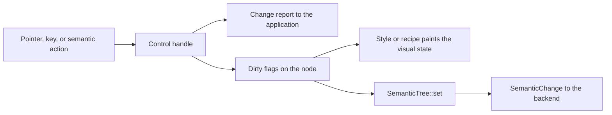

# Controls

A control owns its behavior and its accessibility semantics. It reacts to
pointer, keyboard, and assistive input, keeps its value, and reports
changes. Painting is separate. A style or a recipe reads the control's
visual state and paints it. You can replace the look and keep the behavior
(see [theming.md](theming.md)).

The behavior in this document is public API.
[compatibility.rs](../crates/choscorui/tests/compatibility.rs) and the tests
in [crates/choscorui-controls/tests](../crates/choscorui-controls/tests)
pin it. A change in behavior must update this document in the same change.

All types in this document come from `choscorui::controls`. Roles come from
`SemanticRole` in
[semantics.rs](../crates/choscorui-core/src/semantics.rs). The AppKit role
in parentheses is the role that the macOS backend gives to that
`SemanticRole`.

## Control catalog

| Group | Control | Purpose |
| --- | --- | --- |
| Basic | [`Button`](#button) | Momentary push button that returns a `CommandId`. |
| Basic | [`CommandLink`](#button) | Command-link look for a `Button`: arrow, title, and description. |
| Basic | [`Checkbox`](#checkbox) | Independent on or off value. |
| Basic | [`RadioGroup`](#radiogroup-and-tabs) | One choice from a group of options. |
| Basic | [`Tabs`](#radiogroup-and-tabs) | Tabs that show one panel at a time. |
| Basic | [`ToolButton`](#toolbutton-and-buttongroup) | Toolbar button with an optional check state and menu. |
| Basic | [`ButtonGroup`](#toolbutton-and-buttongroup) | Exclusive or non-exclusive group of checkable commands. |
| Basic | [`CommandRegistry`](#commandregistry-and-shortcuts) | Shared command state and keyboard shortcuts. |
| Basic | [`MnemonicTable`](#mnemonictable-and-parse_mnemonic) | Mnemonic keys for the labels in a window or dialog. |
| Basic | [`Label`](#label-and-separator) | Static text. |
| Basic | [`Separator`](#label-and-separator) | Decorative line. |
| Basic | [`ProgressBar`](#progressbar) | Determinate or indeterminate progress. |
| Basic | [`NumericDisplay`](#numericdisplay) | Seven-segment number display. |
| Basic | [`KeySequenceEdit`](#keysequenceedit) | Records a keyboard shortcut. |
| Basic | [`GroupBox`](#groupbox-and-stackedcontainer) | Titled group of related controls. |
| Basic | [`StackedContainer`](#groupbox-and-stackedcontainer) | Shows one page of a stack at a time. |
| Basic | [`ToolBox`](#toolbox) | Accordion with one open page. |
| Text | [`TextField`](#textfield) | Single-line text input, also for passwords. |
| Text | [`TextEditor`](#texteditor) | Multiline plain-text editor. |
| Text | [`ComboBox`](#combobox-and-fontchooser) | List choice with optional typed text and completion. |
| Text | [`FontChooser`](#combobox-and-fontchooser) | Font family combo box with a fallback. |
| Range | [`Slider`](#slider) | Integer value along a track. |
| Range | [`SpinBox`](#spinbox) | Integer value with step buttons. |
| Range | [`DecimalSpinBox`](#decimalspinbox) | Locale-aware decimal value with text editing. |
| Range | [`Dial`](#dial) | Rotary integer value. |
| Range | [`ScrollBar`](#scrollbar) | Standalone scroll position. |
| Range | [`ScrollArea`](#scrollarea) | Scroll container with overlay scroll bars. |
| Range | [`Splitter`](#splitter) | Movable divider between two panes. |
| Range | [`DateTimeEdit`](#datetimeedit-and-calendar) | Date or time in sections. |
| Range | [`Calendar`](#datetimeedit-and-calendar) | Month grid for date choice. |
| Data and item views | [`ItemView`](#itemview) | Virtualized list, tree, table, or grid. |
| Data and item views | [`HeaderView`](#headerview) | Table header that sorts and resizes columns. |
| Data and item views | [`CellEdit`](#celledit-and-datamapper) | Edits one model cell with a typed editor. |
| Data and item views | [`DataMapper`](#celledit-and-datamapper) | Binds form fields to the current model item. |
| Data and item views | [`ColumnBrowser`](#columnbrowser-and-undo-history) | Column (Miller) browser for a tree model. |
| Data and item views | [`undo_history`](#columnbrowser-and-undo-history) | Rows for an undo history list. |
| Popups and dialogs | [`PopupMenu`](#popupmenu) | Custom-drawn menu backed by commands. |
| Popups and dialogs | [`PopupStack`](#popupstack) | Open popups, dismissal, and focus restore. |
| Popups and dialogs | [`TooltipController`](#tooltipcontroller) | Hover tooltips with delay and grace time. |
| Popups and dialogs | [`DialogStack`](#dialogstack-and-dialogkeys) | Modal and modeless dialogs in a window. |
| Popups and dialogs | [`DialogKeys`](#dialogstack-and-dialogkeys) | Default and cancel keys for a window or dialog. |
| Popups and dialogs | [`MessageDialog`](#messagedialog-and-inputdialog) | Message with ordered buttons. |
| Popups and dialogs | [`InputDialog`](#messagedialog-and-inputdialog) | One validated value. |
| Popups and dialogs | [`ColorPicker`](#colorpicker-and-fontdialog) | Color model with HSV, hex, and alpha. |
| Popups and dialogs | [`FontDialog`](#colorpicker-and-fontdialog) | Font family, size, weight, and slant. |
| Window chrome | [`Toolbar`](#toolbar) | Toolbar with roving focus and overflow. |
| Window chrome | [`StatusBar`](#statusbar) | Status text, timed messages, and sections. |
| Window chrome | [`DockLayout`](#docklayout) | Dockable panels around a central area. |
| Window chrome | [`FocusFrame`](#focusframe-and-sizegrip) | Focus ring outside the focused node. |
| Window chrome | [`SizeGrip`](#focusframe-and-sizegrip) | Window resize grip. |
| Canvas | [`CanvasView`](#canvasview) | Interactive view of a `Scene`. |
| Validators | [`NumberInput`](#numberinput-inputmask-and-dateinput) | Locale-aware number validation. |
| Validators | [`InputMask`](#numberinput-inputmask-and-dateinput) | Fixed-format text mask. |
| Validators | [`DateInput`](#numberinput-inputmask-and-dateinput) | Locale-aware short date validation. |
| Custom controls | [`CustomControl`](#customcontrol-and-controlhost) | Trait for an application-defined control. |
| Custom controls | [`ControlHost`](#customcontrol-and-controlhost) | Mounts custom controls on retained nodes. |

## Shared rules

Some controls take the retained `Tree` and a `NodeId` in `handle`. These
are `Button`, `Checkbox`, `RadioGroup`, `Tabs`, `TextField`,
`TextEditor`, `Slider`, `SpinBox`, `ScrollArea`, and `Splitter`. The rules
below apply to them, unless a section gives a different rule.

`ItemView::handle` also takes the `Tree` and a `NodeId`. For `ItemView`,
only the missing-node rule below applies, with `TreeError`. The
[ItemView](#itemview) section gives its other rules.

- **Missing node.** `handle` returns a missing-node error and does not
  change the value. The error type is `TreeError` for most controls.
  `ScrollArea` uses `LayoutError`, `RadioGroup` and `Tabs` use
  `SelectionError`, and `Splitter` uses `ContainerError`.
- **Primary button only.** Pointer presses and releases act only for
  `PointerButton::Primary`.
- **Keys need focus.** A key event acts only when the control's node has
  focus. For `Splitter`, the handle node must have focus. Semantic actions
  and external setters do not need focus.
- **Change reporting.** `handle` reports a change only when the value
  changed. A selection of the current option, or a step past a bound,
  reports nothing.
- **Invalidation.** A value change invalidates `PAINT` and `SEMANTICS`,
  but not `LAYOUT`. A hover or press change on `Button` and `Checkbox`
  invalidates `PAINT`. A `TextEditor` edit also invalidates `LAYOUT`.
  `Splitter` sets the bounds of its panes and its handle.
- **Disabled.** A disabled control ignores input. On `Button`,
  `Checkbox`, `Slider`, and `ScrollArea`, `set_enabled(false)` cancels a
  press or drag and releases pointer capture. Text controls drop IME
  marked text. `RadioGroup` and `Tabs` disable single options.
- **Cancel.** `Button`, `Checkbox`, `Slider`, and `ScrollArea` accept a
  `Cancel` input. It clears an armed press or drag and releases capture. It
  never activates and never restores an earlier value.

Other controls take a plain `Key` with no key-up event. The host delivers
the key-down event and checks focus. `Label`, `Separator`, and
`ProgressBar` take no input.

## Control sections

Each section gives the behavior, then the semantics of the node that the
control publishes. A dash means that the field is empty.

### Button

| Input | Behavior |
| --- | --- |
| Primary press on the node | Takes focus, captures the pointer, and arms. |
| Pointer move while armed | Shows `pressed` only while the pointer is inside. |
| Primary release | Activates only with capture and inside. A release outside cancels. |
| Enter key-down | Activates at once. Repeats do nothing. |
| Space key-down, then key-up | Key-down arms, and repeats do nothing. Key-up activates if armed and still focused. |
| `Semantic(Activate)` | Activates. |
| `Cancel` | Disarms the pointer and Space, and releases capture. |

- Activation returns the button's `CommandId`.
- `handle_with_commands` reads the enabled state from the
  `CommandRegistry` first. A command that becomes disabled during a press
  cancels the press.
- **Look.** `with_variant` takes a `ButtonVariant`: `Default`,
  `Destructive`, `Outline`, `Secondary`, `Ghost`, or `Link`. `with_size`
  takes a `ControlSize`. `with_icon` and `with_trailing_icon` add icons.
- `paint` resolves the `Button` recipe for the `visual_state` and paints
  the box, the icons, and the label. A recipe reads only the style query and
  the tokens, so a recipe swap does not change behavior.
- `set_expanded` keeps the open look while a popup is open. `set_invalid`
  shows the invalid ring.
- `CommandLink` paints an arrow, a title, and a description in an outline
  item row. A `Button` on the same node gives the behavior.

| Size | Height | Inline padding | Gap | Radius | Icon |
| --- | --- | --- | --- | --- | --- |
| `Xs` | 24 | 8 | 4 | min(md, 8) | 12 |
| `Sm` | 32 | 10 | 4 | min(md, 10) | 16 |
| `Default` | 36 | 10 | 6 | md | 16 |
| `Lg` | 40 | 10 | 6 | md | 16 |
| `IconXs`, `IconSm`, `Icon`, `IconLg` | 24, 32, 36, 40 square | 0 | 0 | as the text size | 12, 16, 16, 16 |

| Variant | Rest | Hover |
| --- | --- | --- |
| `Default` | `primary` fill, `primary-foreground` text | `primary` at 80% |
| `Outline` | `background` fill, `border` edge, extra-small shadow; dark: `input` at 30%, `input` edge | `muted`; dark: `input` at 50% |
| `Secondary` | `secondary` fill | `secondary` mixed with 5% `foreground` |
| `Ghost` | transparent | `muted`; dark: `muted` at 50% |
| `Destructive` | `destructive` at 10% (dark 20%), `destructive` text | 20% (dark 30%) |
| `Link` | `primary` text | underline |

All variants use the small medium text. A pressed button moves down 1 pt.
A disabled button has 50% opacity.

| Field | `semantics(tree, id).shared()` |
| --- | --- |
| Role | `Button` (AXButton) |
| Name / value | label / - |
| State | disabled |
| Actions | `Activate`, `Focus` while enabled |

[button.rs](../crates/choscorui-controls/tests/button.rs),
[commands.rs](../crates/choscorui-controls/tests/commands.rs),
[recipe.rs](../crates/choscorui-controls/tests/recipe.rs), and
[widgets.rs](../crates/choscorui-controls/tests/widgets.rs) pin this behavior.

### Checkbox

- Pointer, Space, and `Cancel` work as on `Button`. Activation toggles the
  value.
- Enter does nothing.
- `Semantic(Activate)` toggles. `Semantic(SetValue(v))` sets `v`.
- `handle` returns `Some(value)` only when the value changed.
- A pointer press focuses without the focus ring. Keyboard focus shows it.
- `set_indeterminate(true)` shows the mixed state. The next activation or
  `SetValue` clears it and reports the value, also when the value is the
  same.
- `set_invalid(true)` shows the invalid ring and sets the invalid
  semantic state.
- **Look.** `paint` draws the box at the start of the bounds and the label
  after it. In right-to-left layouts, the box is at the right.

| Part | Value |
| --- | --- |
| Box | 16 square, radius 4, `input` edge, extra-small shadow; dark: `input` at 30% fill |
| Checked or mixed | `primary` fill and edge, `primary-foreground` check or minus icon at 14 |
| Label | small medium text, 8 after the box |
| Focus ring | `ring` edge and 3 pt ring at 50% |
| Invalid | `destructive` edge and ring at 20% (dark 40%) |
| Disabled | 50% opacity |

| Field | `semantics(tree, id).shared()` |
| --- | --- |
| Role | `Checkbox` (AXCheckBox) |
| Name / value | label / `true`, `false`, or `mixed` |
| State | disabled, invalid, checked (none while mixed) |
| Actions | `Activate`, `SetValue`, `Focus` while enabled |

[checkbox.rs](../crates/choscorui-controls/tests/checkbox.rs) pins this
behavior.

### RadioGroup and Tabs

- **Roving focus.** After `install`, only the selected option is
  focusable.
- **Selection follows focus.** An arrow key selects the target option and
  focuses it.
- ArrowRight and ArrowDown go to the next enabled option. ArrowLeft and
  ArrowUp go to the previous enabled option. Both wrap and skip disabled
  options.
- Home and End select the first and the last enabled option.
- Space or Enter on key-down selects the focused option. The control
  also accepts repeats.
- `Activate` (a host pointer click) and `Semantic(Activate)` select without
  focus. `Semantic(Focus)` focuses the option and does not select it.
- Input on a disabled option does nothing.
- A selection of the current option reports nothing and does not move
  focus.
- Right-to-left layouts do not mirror the arrow keys.
- `new` rejects an empty list, a duplicate node, an unknown selection, and
  a disabled selection.
- `TabSet` is a deprecated alias of `Tabs`.
- **Radio look.** `paint_option` draws a 16 pt circle with the same edge,
  focus, invalid, and disabled values as `Checkbox`. The selected option
  has a `primary` fill and an 8 pt `primary-foreground` dot.
- **Tabs look.** `with_variant` takes a `TabsVariant`: `Default` or
  `Line`. `with_orientation` takes an `Orientation`. Paint the list with
  `paint_list`, then each tab with `paint_tab`.

| Tabs part | `Default` | `Line` |
| --- | --- | --- |
| List | `muted` fill, radius lg, padding 3, height 36 | transparent, gap 4 |
| Tab | small medium text, padding 8 by 4, radius md; `foreground` at 60% (dark: `muted-foreground`) | same |
| Selected tab | `background` fill, small shadow, `foreground` text; dark: `input` at 30% fill and `input` edge | `foreground` text and a 2 pt `foreground` line 5 pt outside the tab |

| Field | Group node | Option or tab node | Tab panel node |
| --- | --- | --- | --- |
| Role | `RadioGroup` or `TabList` (AXGroup) | `RadioButton` or `Tab` (AXRadioButton) | `TabPanel` (AXGroup) |
| Name / value | label / selected label | label / `true` or `false` | tab label / - |
| State | - | disabled; checked (radio) or selected (tab) | hidden when not selected |
| Actions | - | `Activate`, `Focus` while enabled | - |

The group node has a `Controls` relation to each option or tab. A tab has
a `Controls` relation to its panel. A panel has a `LabelledBy` relation to
its tab.

[selection_controls.rs](../crates/choscorui-controls/tests/selection_controls.rs)
pins this behavior.

### ToolButton and ButtonGroup

- **`ToolButton::click`.** An `Instant` menu opens the menu. On a `Split`
  button, a click in the trailing `arrow_width` opens the menu. Any other
  click runs the command.
- **Keys.** Space or Enter runs the command, or opens an `Instant` menu.
  ArrowDown opens the menu of a button that has one.
- The button runs only a known command that is enabled. A checkable button flips
  the command's checked state and returns `Toggled`.
- Menu opening does not read the command state.
- **`ButtonGroup::toggle`.** A member that is not in the group, or that is
  disabled, does nothing. An exclusive group checks only the clicked
  member. A click on the checked member does nothing.
- A non-exclusive group toggles the clicked member.
- **`ButtonGroup::step`.** Moves the check to the next or previous enabled
  member, and wraps. With no checked member, the search starts at the
  first member.

| Field | `ToolButton::semantics` |
| --- | --- |
| Role | `Button` (AXButton), or `Checkbox` (AXCheckBox) when checkable |
| Name / value | label / - |
| State | disabled; checked when checkable |
| Actions | `Activate`, and `ShowMenu` with a menu, while enabled |

`ButtonGroup` has no node of its own. Its members publish their own
semantics.

[widgets.rs](../crates/choscorui-controls/tests/widgets.rs) pins this behavior.

### CommandRegistry and shortcuts

- `insert` fails with `CommandError::DuplicateId` for a known identifier.
  `state`, `set_enabled`, and `set_checked` fail with `UnknownId` for an
  unknown identifier.
- `activate` returns `None` for a disabled command. A disabled command
  never runs.
- `bind_shortcut` rejects a second binding of a chord in the same scope.
  Different scopes can bind the same chord.
- `resolve_shortcut` tries the focused scope, then the window scope, then
  the application scope.
- If the winning binding has a disabled command, the chord resolves to
  `None`. A less specific binding does not run.
- `unbind_scope` removes the bindings of one scope. `unbind_window` removes
  the window and focused bindings of a window.

The registry has no semantic node. Controls that use it show the command
state in their own semantics.

[commands.rs](../crates/choscorui-controls/tests/commands.rs) and
[shortcuts.rs](../crates/choscorui-controls/tests/shortcuts.rs) pin this
behavior.

### MnemonicTable and parse_mnemonic

- **`parse_mnemonic`** removes the `&` markers from a label and returns the
  display text and the mnemonic. `&Save` gives `Save` and `s`.
- The first `&` before a letter or a digit gives the mnemonic, in
  lowercase. `&&` gives a literal `&`. A trailing `&` stays in the text.
- **`MnemonicTable::register`** parses a label, records the mnemonic for a
  node, and returns the display text. It replaces the earlier entry of that
  node.
- `remove` deletes the entry of a node. `conflicts` returns the nodes that
  share a character, in registration order.
- **`resolve`** ignores case. It skips each node for which `available`
  returns `false`, for example a hidden or disabled node.
- If one node remains, the `MnemonicHit` has `activate` set to `true`.
- If more nodes share the character, the hit gives the node after
  the focused node, and `activate` is `false`. A second press then reaches
  the next node.
- The table does not choose the key chord. The application decides which
  chord sends the mnemonic character.

The table and the parser publish no semantic node.

The `mnemonics_parse_escape_and_cycle_on_conflict` test in
[navigation.rs](../crates/choscorui-controls/tests/navigation.rs) pins this
behavior.

### Label and Separator

- `Label` takes no input. `Label::set_text` invalidates `LAYOUT`, `PAINT`,
  and `SEMANTICS`, and returns whether the text changed. It fails when the
  node is not in the tree.
- `Separator` takes no input and publishes no semantic node, because it is
  decorative. `paint` centers a 1 pt `border` line in either orientation.
- `Label::paint` draws the small medium text at the start of the bounds.
  A `DISABLED` state in the context gives 50% opacity.

| Field | `Label::semantics` |
| --- | --- |
| Role | `StaticText` (AXStaticText) |
| Name / value | text / - |
| State | - |
| Actions | - |

[static_controls.rs](../crates/choscorui-controls/tests/static_controls.rs) pins
this behavior.

### ProgressBar

- `new` fails with `RangeError::InvalidMaximum` when the maximum is zero.
  The value clamps to the maximum.
- `set_value` and `set_indeterminate` invalidate `PAINT` and `SEMANTICS`
  only when the value changed.
- `needs_frame(visible)` is true only for a visible indeterminate bar.
  `ProgressStyle::paint_indeterminate` repeats every `INDETERMINATE_PERIOD`
  seconds.

| Field | `ProgressBar::semantics` |
| --- | --- |
| Role | `ProgressIndicator` (AXProgressIndicator) |
| Name / value | label / whole percent, for example `30%`; none when indeterminate |
| State | - |
| Actions | - |

[range_controls.rs](../crates/choscorui-controls/tests/range_controls.rs) and
[widgets.rs](../crates/choscorui-controls/tests/widgets.rs) pin this behavior.

### NumericDisplay

- The display shows a value in decimal, hexadecimal, octal, or binary
  `NumberBase`.
- `text` aligns the number to the right. A value with more characters than
  `digits` shows as dashes, and `overflow` is true.

| Field | `NumericDisplay::semantics` |
| --- | --- |
| Role | `StaticText` (AXStaticText) |
| Name / value | name / the plain number |
| State | description "Value too large to display" on overflow |
| Actions | - |

[widgets.rs](../crates/choscorui-controls/tests/widgets.rs) pins this behavior.

### KeySequenceEdit

- Recording starts only after `start`. Each `press` adds one chord.
- Recording finishes at `max_chords` (1 to 4), or on `finish`. Call
  `finish` after a pause or on focus loss.
- Plain Escape cancels and keeps the old sequence.
- Plain Backspace or Delete as the first key clears the sequence.
- `finish` with nothing recorded cancels.
- A `Key::Other` key does nothing. This includes a press of a modifier key
  only.

| Field | `KeySequenceEdit::semantics` |
| --- | --- |
| Role | `TextField` (AXTextField) |
| Name / value | name / the sequence, for example `⌘K, ⇧⌘S` |
| State | read-only; a description while it records |
| Actions | `Activate`, `Focus` |

[widgets.rs](../crates/choscorui-controls/tests/widgets.rs) pins this behavior.

### GroupBox and StackedContainer

- **`GroupBox`.** `new` rejects an empty member list and duplicate nodes.
  `install` checks that the members and the title are descendants of the
  container.
- **`StackedContainer`.** `install` shows the current page and hides the
  others.
- `select(panel)` hides the old page and shows the new page. It fails for
  a node that is not a page.
- If focus was in the old page, `select` remembers that focus. It then
  focuses the remembered node of the new page, or its `initial_focus`.
- If focus was not in the old page, `select` does not move focus.
- A detached focus target makes `select` fail. The page and focus then
  stay as they were.

| Field | `GroupBox` | `StackedContainer` | Page |
| --- | --- | --- | --- |
| Role | `Group` (AXGroup) | `Group` (AXGroup) | `Group` (AXGroup) |
| Name / value | label / - | label / page number, from 1 | - / - |
| State | - | - | hidden when not current |
| Actions | - | - | - |

A group box has a `LabelledBy` relation to its title and a `Controls`
relation to each member. A stack has a `Controls` relation to each page.

[containers.rs](../crates/choscorui-controls/tests/containers.rs) pins this
behavior.

### ToolBox

- One page is open at a time. `open(page)` opens a page and focuses its
  header.
- ArrowUp and ArrowDown move the header focus and stop at the ends. Home
  and End go to the first and the last header.
- Space or Enter opens the focused page.

| Field | `ToolBox::header_semantics`, one node per header |
| --- | --- |
| Role | `Button` (AXButton) |
| Name / value | page title / - |
| State | expanded for the open page |
| Actions | `Activate`, `Expand` |

`ToolBox` has no handler for these actions. The host maps them to `open`.

[widgets.rs](../crates/choscorui-controls/tests/widgets.rs) pins this behavior.

### TextField

- **Focus.** Editing needs focus. `SetValue` and `SetValidation` do not.
- **Disabled.** All input except `SetValidation` does nothing.
- **Pointer.** The field has no pointer input. The host hit-tests the
  layout and sends `SetCaret`.
- **Keys (key-down).** Backspace and Delete remove one grapheme cluster.
  ArrowLeft and ArrowRight move one grapheme, or one word with
  `word: true`.
- `extend: true` extends the selection. Home and End go to the start and
  the end of the text. The arrow keys are logical, not mirrored.
- **Line breaks.** The field removes `\n` and `\r` from all incoming text.
- **Commit.** The application sets the validation. Enter (not a repeat) returns
  `Committed` only when the state is `Valid`, else `CommitRejected`.
- **IME.** Marked text does not change the value. `CommitMarkedText` is
  one undoable edit. `CancelMarkedText` discards the marked text with no
  edit. `UnmarkMarkedText` keeps the marked text.
- **Edit commands.** `Undo`, `Redo`, `SelectAll`, and `Cut` need focus.
- **Password.** `TextField::password` masks the value. `Cut` does
  nothing, and `selected_text` is empty.
- The field has no `Cancel` input and no Escape behavior.

| Field | `semantics(tree, id).shared()` |
| --- | --- |
| Role | `TextField` (AXTextField), or `PasswordField` (AXTextField, AXSecureTextField subrole) |
| Name / value | label / text, masked for a password |
| State | disabled, invalid; the error message is the description |
| Actions | `SetValue`, `Focus` while enabled |

The node also carries the UTF-16 length and selection of the text.

[text_field.rs](../crates/choscorui-controls/tests/text_field.rs) pins this
behavior.

### TextEditor

- Focus and disabled rules are the same as on `TextField`. `SetValue`
  works without focus and on a read-only editor.
- **Pointer.** The host sends `PointerDown { clicks, extend }`,
  `PointerDrag`, and `PointerUp`. The editor does not capture the pointer.
- One click places the caret. Two clicks select a word, and three or more
  select a paragraph. A drag extends the selection by that unit.
- A press while IME text is marked only commits the marked text.
- **Keys (key-down, repeats accepted).** Enter inserts a newline. Tab
  inserts a tab only after `set_tab_inserts(true)`.
- ArrowUp and ArrowDown move by visual line and keep the column. PageUp
  and PageDown move by `page_height`.
- Home and End go to the ends of the visual line. With `word: true`, they
  go to the ends of the text.
- **Read-only.** Typing, marked text, Enter, Tab, Backspace, Delete, `Cut`,
  `Undo`, `Redo`, and semantic `SetValue` do nothing. Navigation works.
- Undo and redo skip marked text. Typed `\r\n` becomes `\n`.

| Field | `TextEditor::semantics` |
| --- | --- |
| Role | `TextField` with multiline text (AXTextArea) |
| Name / value | label / text |
| State | disabled, read-only |
| Actions | `SetValue`, `Focus`; only `Focus` when read-only; none when disabled |

The node also carries the UTF-16 length and selection of the text.

[text_editor.rs](../crates/choscorui-controls/tests/text_editor.rs) pins this
behavior.

### ComboBox and FontChooser

- **Press** toggles the popup. **`Choose(index)`** commits that
  suggestion.
- **Closed, not editable.** ArrowUp and ArrowDown select and commit the
  previous or the next item. Space or Alt+ArrowDown opens the popup.
- **Closed, editable.** ArrowDown opens the popup. Enter commits the typed
  text and selects the item with the same text, or no item.
- **Open.** ArrowUp and ArrowDown move the highlight and stop at the ends.
  PageUp and Home go to the first suggestion. PageDown and End go to the
  last suggestion.
- When open, Enter commits the highlight. Space also commits it when the
  combo box is not editable.
- **Typing** (editable) filters the items by prefix or by substring
  (`CompletionMode`). Matches ignore case and diacritics.
- Typing opens the popup when an item matches, and closes it when no item
  matches. **Tab** accepts the inline completion in `Prefix` mode.
- **Escape** (open) closes the popup and restores the text from when the
  popup opened.
- **`Dismiss`** (an outside press or window deactivation) closes the popup.
  It keeps the edited text and commits nothing.
- **Semantic actions.** `ShowMenu` and `Expand` open the popup.
  `Collapse` and `Dismiss` close it.
- Semantic `SetValue` commits the item with the same text. Only an
  editable combo box accepts free text.
- **Disabled.** All input does nothing, and `set_enabled(false)` closes
  the popup.
- `set_items` keeps the selection and the highlight by `ItemKey`.
- **`FontChooser`** is an editable combo box named "Font". A family that
  the system does not have resolves to the fallback family.

| Field | `ComboBox::semantics` | Suggestion |
| --- | --- | --- |
| Role | `ComboBox` (AXComboBox) | `ListItem` (AXGroup) |
| Name / value | label / text | item text / - |
| State | disabled, expanded | selected when highlighted |
| Actions | `ShowMenu`, `SetValue`, `Focus` while enabled | `Activate` |

For a missing family, `FontChooser::semantics` adds the invalid state and
the description "Not installed; using" with the fallback name.

[popup.rs](../crates/choscorui-controls/tests/popup.rs) pins this behavior.

### Slider

| Input | Behavior |
| --- | --- |
| Primary press on the node | Takes focus, captures the pointer, starts a drag, and jumps to the pointer. |
| Pointer move during a drag | The value follows the pointer and clamps. |
| Primary release | Sets the value at the release point. A release outside does not cancel. |
| ArrowRight or ArrowUp | Steps up. Repeats are accepted. |
| ArrowLeft or ArrowDown | Steps down. Repeats are accepted. |
| Home, End | Goes to the minimum or the maximum. |
| `Semantic(SetValue(v))`, `Increment`, `Decrement` | Sets or steps the value. |
| `Cancel` | Ends the drag and releases capture. The value stays. |

- PageUp and PageDown do nothing. Right-to-left layouts do not mirror
  the arrow keys.
- A vertical slider has its minimum at the bottom.

| Field | `Slider::semantics` |
| --- | --- |
| Role | `Slider` (AXSlider) |
| Name / value | label / the integer value |
| State | disabled; the description is "Range min to max" |
| Actions | `SetValue`, `Increment`, `Decrement`, `Focus` while enabled |

[range_controls.rs](../crates/choscorui-controls/tests/range_controls.rs) pins
this behavior.

### SpinBox

- A primary press focuses the spin box. A press in the trailing quarter
  increments in the top half or decrements in the bottom half. It steps once, on
  the press.
- ArrowUp and ArrowDown step. Home and End go to the bounds. PageUp and
  PageDown do nothing.
- Values clamp and do not wrap.
- Semantic `SetValue(v)`, `Increment`, and `Decrement` set or step the
  value.
- The spin box has no `Cancel` input, and `set_enabled` has no press to
  cancel.

| Field | `SpinBox::semantics` |
| --- | --- |
| Role | `SpinButton` (AXIncrementor) |
| Name / value | label / the integer value |
| State | disabled; the description is "Range min to max" |
| Actions | `SetValue`, `Increment`, `Decrement`, `Focus` while enabled |

[range_controls.rs](../crates/choscorui-controls/tests/range_controls.rs) pins
this behavior.

### DecimalSpinBox

- ArrowUp and ArrowDown step. PageUp and PageDown step ten times. Home and
  End go to the bounds.
- Results clamp and round to `fraction_digits`.
- A step starts from the committed value and replaces the edited text.
- `set_text` changes only the text. Enter, or `commit`, applies the text
  only when it is valid. Invalid text stays for correction.
- Escape restores the text of the committed value.
- `handle_semantic` maps `Increment` and `Decrement` to the arrow keys.
  `SetValue` replaces the text, then commits.
- `set_locale` formats the text again and keeps the value.
- The control has no disabled state.

| Field | `DecimalSpinBox::semantics` |
| --- | --- |
| Role | `SpinButton` (AXIncrementor) |
| Name / value | name / the text |
| State | invalid; the error message is the description |
| Actions | `Increment`, `Decrement`, `SetValue`, `Focus` |

[widgets.rs](../crates/choscorui-controls/tests/widgets.rs) pins this behavior.

### Dial

- `point_to` sets the value from the angle, clockwise from up.
- A wrapping dial uses a full turn. A dial that does not wrap uses 270
  degrees, and a point in the dead zone snaps to the nearer end.
- ArrowUp and ArrowRight increment. ArrowDown and ArrowLeft decrement. A
  wrapping dial wraps at the ends.
- PageUp and PageDown step by `page_step`. Home and End go to the bounds.
- The dial has no disabled state.

| Field | `Dial::semantics` |
| --- | --- |
| Role | `Slider` (AXSlider) |
| Name / value | name / the integer value; the description is "Dial" |
| State | - |
| Actions | `Increment`, `Decrement`, `SetValue`, `Focus` |

`Dial` has no handler for these actions. The host maps them to
`handle_key` and `point_to`.

[widgets.rs](../crates/choscorui-controls/tests/widgets.rs) pins this behavior.

### ScrollBar

- A press on the thumb starts a drag. A press on the track pages one
  viewport toward the press.
- A drag follows the thumb travel. `Release` ends the drag. The scroll bar
  has no capture and no cancel.
- The arrow keys on the bar's axis step `line_step` (default 16 points).
  PageUp and PageDown page one viewport. Home and End go to the ends.
- Semantic `Increment` and `Decrement` page one viewport.
- The value stays in `0..=content - viewport`. The scroll bar has no focus
  and no disabled state.

| Field | `ScrollBar::semantics` |
| --- | --- |
| Role | `ScrollBar` (AXScrollBar) |
| Name / value | name / position in whole percent |
| State | hidden when the content fits |
| Actions | `Increment`, `Decrement` |

[widgets.rs](../crates/choscorui-controls/tests/widgets.rs) pins this behavior.

### ScrollArea

- A press on a thumb captures the pointer. The drag works outside the
  area.
- A press on the vertical track pages. A press on the horizontal track
  scrolls one line.
- A press does not focus the area.
- The wheel scrolls only over the area, or while the area holds capture.
- **Keys (focused).** The arrow keys scroll one line. PageUp and PageDown
  scroll one page, and Space pages down. Home and End go to the top and
  the bottom.
- A page keeps one line of overlap.
- Semantic `Increment` pages down, and `Decrement` pages up. Semantic
  `Focus` focuses the area.
- `Cancel`, a primary release, and `set_enabled(false)` end the drag.

| Field | `ScrollArea::semantics` |
| --- | --- |
| Role | `ScrollArea` (AXScrollArea) |
| Name / value | name / vertical position in whole percent |
| State | disabled |
| Actions | `Increment`, `Decrement`, `Focus` while enabled |

[navigation.rs](../crates/choscorui-controls/tests/navigation.rs) pins this
behavior.

### Splitter

- After `install`, the handle is focusable. The splitter has no pointer
  input.
- The arrow keys along the split axis move the handle by 10 points.
- Home and End go to the smallest and the largest position that both pane
  minimums allow.
- Positions clamp to that range. `set_position` outside the range fails
  with `InvalidPosition` and changes nothing.
- Semantic `Increment` and `Decrement` use the same step. Semantic `Focus`
  focuses the handle.
- The splitter has no disabled state.

| Field | `Splitter::semantics` |
| --- | --- |
| Role | `Slider` (AXSlider) |
| Name / value | label / position in points |
| State | - |
| Actions | `Increment`, `Decrement`, `Focus` |

The node has a `Controls` relation to each pane.

[containers.rs](../crates/choscorui-controls/tests/containers.rs) pins this
behavior.

### DateTimeEdit and Calendar

**DateTimeEdit:**

- The locale sets the order of the date sections. A time has an hour and a
  minute section.
- ArrowLeft and ArrowRight move between sections and stop at the ends.
- The locale's date separator and the characters `/ . - :` and space go to
  the next section.
- ArrowUp and ArrowDown step by 1, and PageUp and PageDown step by 10.
  Each field wraps, but the year clamps to 1..9999.
- Home and End set the field to its bounds.
- Digits type into the section. The section advances when it is full, or
  when no more digits can fit. A year applies after four digits.
- The day clamps to the month, so the value is always a real date.
- A value outside the range is `Intermediate`. Enter (or `commit`) clamps
  it into the range.
- `set_locale` keeps the focused field.

**Calendar:**

- ArrowLeft and ArrowRight move one day. ArrowUp and ArrowDown move one
  week. PageUp and PageDown move one month.
- Home and End go to the start and the end of the week. The locale sets
  the first weekday.
- A move to a date outside the range does nothing. The arrow keys are not
  mirrored in right-to-left layouts.
- The host chooses the date, for example on Enter. `show_month` changes the
  shown month and keeps the selection.

| Field | `DateTimeEdit::semantics` | `Calendar::semantics` | `Calendar::cell_semantics` |
| --- | --- | --- | --- |
| Role | `SpinButton` (AXIncrementor) | `Table` (AXTable) | `Cell` (AXCell) |
| Name / value | name / long date, short time, or both | name / selected long date | long date / day number |
| State | invalid when out of range; the description names the focused field | the description is the month title | selected; disabled outside the range |
| Actions | `Increment`, `Decrement`, `Focus` | `Focus` | `Activate` when enabled |

`DateTimeEdit` has no handler for these actions. The host maps them to
`handle_key`.

[widgets.rs](../crates/choscorui-controls/tests/widgets.rs) pins this behavior.

### ItemView

- Only rows in the viewport, plus a small overscan, own retained nodes.
  Scrolling reuses them.
- **Press** focuses the view. One click on the disclosure area of a tree
  row toggles expansion.
- Any other press changes the selection. A plain press replaces it, Shift
  extends it, and Command toggles the row. `clicks >= 2` also activates.
- **Context menu** focuses the view and selects the row alone if it is not
  selected. It reports `context_menu`.
- **Wheel** scrolls, clamps, and requests more rows near the end.
- **Keys.** The host checks focus. The arrow keys move the current item;
  in a grid, ArrowUp and ArrowDown move by a row.
- PageUp and PageDown move one page, and Home and End go to the ends.
  Moves clamp at the ends.
- With no current item, forward keys go to the first item and backward keys
  go to the last item.
- Shift extends the selection. Command moves only the current item. In
  single mode, neither modifier has an effect.
- Enter activates. Space selects, or toggles with Command or in multi mode.
  Command+A selects all, except in single mode.
- **Tree keys (list layout).** ArrowRight expands the item, or moves to the
  first child if expanded. ArrowLeft collapses the item, or moves to the
  parent.
- Right-to-left layouts do not mirror the tree keys.
- **Type-ahead.** Characters build a prefix that resets after
  `TYPE_AHEAD_TIMEOUT` (1 second). Matches ignore case and diacritics, and
  the search wraps.
- A new search starts after the current item.
- **Semantic actions.** `Activate` selects the item and activates it.
  `Focus` focuses the view and moves only the current item. `Expand`,
  `Collapse`, and `ShowMenu` act on the item.
- The view keeps the selection by `ItemKey` across sort and filter. It has
  no disabled state.

| Field | `ItemView::semantics` | `ItemView::item_semantics` |
| --- | --- | --- |
| Role | `List` (AXList), `Tree` (AXOutline), or `Table` (AXTable) | `ListItem` (AXGroup), `TreeItem` (AXRow), or `Row` (AXRow) |
| Name / value | name / - | accessibility or display text of column 0 / other columns, joined |
| State | - | selected; expanded when the item has children |
| Actions | `Focus` | `Activate`, `Focus`, `Expand` or `Collapse`, `ShowMenu` |

`sync_semantics` publishes the container and the realized items. It also
declares the full item count and the index of each realized item (see
[Virtualized content](#virtualized-content)).

[item_view.rs](../crates/choscorui-controls/tests/item_view.rs) pins this
behavior.

### HeaderView

- **Press** within 4 points of a column edge starts a resize.
- Any other press focuses the column and toggles its sort, on the press. A
  new column sorts ascending, then descending.
- **Drag** resizes the column, never below `min_width`. **Release** ends the
  resize.
- **Keys.** ArrowLeft and ArrowRight move the focused column and stop at
  the ends. Space or Enter toggles the sort of the focused column.
- `+` or `=` widens the focused column by 10 points, and `-` narrows it.

| Field | `HeaderView::column_semantics` |
| --- | --- |
| Role | `ColumnHeader` (AXButton) |
| Name / value | title / `ascending` or `descending` on the sorted column |
| State | selected for the focused column; the width is the description |
| Actions | `Activate`, `Focus` |

[item_view.rs](../crates/choscorui-controls/tests/item_view.rs) pins this
behavior.

### CellEdit and DataMapper

- `CellEdit::begin` asks an `EditorFactory` for an `EditorKind`. It returns
  `None` for a cell that the model cannot edit.
- `DefaultEditorFactory` chooses the editor from the cell's `Role::Edit`
  value type.
- `parse` validates the text for the editor kind and the locale. `commit`
  writes only a valid value. On an error, the edit stays open.
- `DataMapper` binds form fields to columns of the current item. `edit`
  keeps pending text for each item and column.
- `values` returns the pending text, or the model value. `submit` writes
  the valid fields and keeps the invalid fields pending with their
  messages.
- `retain_existing` drops pending text for items that the model removed.

These types have no semantic node. The form fields publish their own
semantics.

[item_view.rs](../crates/choscorui-controls/tests/item_view.rs) pins this
behavior.

### ColumnBrowser and undo history

- `ColumnBrowser::columns` lists the root, then one column for each item
  on the path that has children.
- `select(column, key)` removes the deeper columns.
- ArrowRight moves into the first child. ArrowLeft moves to the previous
  column. ArrowUp and ArrowDown move in the column and stop at the ends.
- `retain_existing` cuts the path at the first item that the model
  removed.
- `undo_history` returns one row for the initial state, then one row for
  each undo group. Each row has `current` and `redoable` flags.
- `undo_steps_to` returns the signed number of undo or redo steps to a
  row.

These types have no semantic node. Show the rows in an `ItemView`.

[item_view.rs](../crates/choscorui-controls/tests/item_view.rs) pins this
behavior.

### PopupMenu

- Hover highlights an enabled item. Hover on a submenu opens it at once.
  A release over an enabled action activates it.
- ArrowDown and ArrowUp move between enabled items and wrap. Home and End
  go to the first and the last enabled item.
- ArrowRight, Enter, or Space on a submenu opens it. Enter or Space on an
  action activates it.
- ArrowLeft or Escape closes one submenu level. At the root, they return
  `Closed`.
- A character highlights the next enabled item that starts with it.
- The menu skips disabled or unknown commands, separators, and empty
  submenus. These items never activate.
- Right-to-left layouts do not mirror ArrowLeft and ArrowRight.

| Field | `PopupMenu::semantics(level, commands)`, one node per item |
| --- | --- |
| Role | `MenuItem` (AXMenuItem) |
| Name / value | label / -; the shortcut text is the description |
| State | disabled, checked, selected when highlighted, expanded for an open submenu |
| Actions | `Activate` while enabled |

Separators have no node.

[popup.rs](../crates/choscorui-controls/tests/popup.rs) pins this behavior.

### PopupStack

- `open` saves the current focus. `close(id)` closes that popup and all
  later popups. It restores the saved focus if the node still exists.
- `escape` closes only the topmost popup.
- A press in a popup routes to the topmost popup that contains it. A press
  outside all popups closes them all, and the press goes no further.
- `window_deactivated` closes all popups. `prune` closes the popups whose
  owner left the tree.
- `place_popup` puts a popup on the preferred side of its anchor. It flips
  to the other side when only that side fits.
- `place_popup` then moves the popup into the bounds, and does not resize
  it. In right-to-left layouts, `After` means to the left.

`PopupStack` has no semantic node.

[popup.rs](../crates/choscorui-controls/tests/popup.rs) pins this behavior.

### TooltipController

- A tooltip shows `TOOLTIP_DELAY` (600 ms) after the pointer enters a
  target. `poll` returns the absolute time of the next check.
- While a tooltip shows, or within `TOOLTIP_GRACE` (400 ms) after it
  hides, a new target shows at once.
- A hover on the same target does not start the delay again. Empty text
  counts as a leave.
- `interrupt` (a press, a key, or a scroll) hides the tooltip until the
  pointer goes to another target.

| Field | `TooltipController::semantics`, while visible |
| --- | --- |
| Role | `Tooltip` (AXHelpTag) |
| Name / value | text / - |
| State | - |
| Actions | - |

The node has a `DescribedBy` relation to its target.

[popup.rs](../crates/choscorui-controls/tests/popup.rs) pins this behavior.

### DialogStack and DialogKeys

- **`DialogStack::open`** saves the focus and focuses `initial`.
- While a modal dialog is open, `accepts_input` allows only the subtree of
  the topmost modal dialog. `focus_next` cycles in that subtree.
- A modeless dialog does not restrict input.
- `close` restores the saved focus if the node still exists.
- **`DialogKeys::route`** acts on key-down only, with no repeats. A key is
  plain when Command, Control, and Option are up.
- Plain Enter runs the default command, unless the focused control uses
  Enter (`focus_uses_enter`).
- Plain Escape and Command+period run the cancel command. A disabled
  command consumes the key and does not run.

| Field | `DialogStack::semantics(id, title)` |
| --- | --- |
| Role | `Dialog` (AXGroup) |
| Name / value | title / -; the description is "Modal" for a modal dialog |
| State | - |
| Actions | `Dismiss` |

[dialogs.rs](../crates/choscorui-controls/tests/dialogs.rs) and
[navigation.rs](../crates/choscorui-controls/tests/navigation.rs) pin this
behavior.

### MessageDialog and InputDialog

- **Button keys.** Enter triggers the `Accept` button and Escape triggers
  the `Reject` button (`dialog_key_button`). Enter never triggers a
  `Destructive` button.
- **Button order.** `order_dialog_buttons` follows macOS. Help is at the
  far left, then Discard, a flexible gap, other actions, Reject, and the
  default button.
- In right-to-left layouts, `order_dialog_buttons` mirrors the whole row.
- **`InputDialog`.** Enter returns the value only when it is valid. Escape
  returns `Err(())`. `can_accept` is true only for a valid value.
- For the text, integer, and decimal kinds, empty text is `Intermediate`.
  A lone `-` in an integer field is also `Intermediate`.
- The text kind accepts empty text only with `allow_empty`.
- An integer outside the range is `Invalid`. A choice must match one
  option exactly.

| Field | `MessageDialog::semantics` |
| --- | --- |
| Role | `Dialog` (AXGroup) |
| Name / value | title / -; the message and the detail are the description |
| State | - |
| Actions | `Dismiss` |

`InputDialog` has no semantic node. Its field and buttons publish their
own semantics.

[dialogs.rs](../crates/choscorui-controls/tests/dialogs.rs) pins this behavior.

### ColorPicker and FontDialog

- **`ColorPicker::set_hex`** accepts `#RGB`, `#RRGGBB`, and `#RRGGBBAA`.
  The `#` is optional.
- A shorter run of hex digits is `Intermediate`. Any other text is
  `Invalid` and changes nothing.
- A gray keeps the previous hue. `accept` puts the color at the front of
  the recent list.
- **`FontDialog::set_size`** accepts 1 to 4096 points. Other sizes are
  `Invalid`.
- `FontDialog` uses a `FontChooser`. A missing family resolves to
  Helvetica.

| Field | `ColorPicker::semantics` |
| --- | --- |
| Role | `Group` (AXGroup) |
| Name / value | name / hex value |
| State | the description gives red, green, blue, and opacity |
| Actions | `SetValue`, `Focus` |

`FontDialog` has no semantic node. Its family combo box publishes the
`FontChooser` semantics.

[dialogs.rs](../crates/choscorui-controls/tests/dialogs.rs) pins this behavior.

### Toolbar

- **Focus** roves over placed (not overflowed) embedded controls and
  enabled commands.
- A horizontal toolbar uses ArrowRight for next and ArrowLeft for previous.
  Right-to-left layouts swap them.
- A vertical toolbar uses ArrowDown and ArrowUp. Focus wraps, and Home and
  End go to the ends.
- When Tab enters the toolbar, the host sends Home.
- Enter or Space on a focused enabled command returns the command. On an
  embedded control, it returns nothing.
- **Layout.** Items that do not fit go to an overflow chevron.
  `overflow_menu` lists them. Right-to-left layouts mirror a horizontal
  toolbar.
- `save` and `restore` keep the area, the order, and the item visibility.
- `compose_main_window` places the toolbars, the status bar, and the
  content area.

| Field | `Toolbar::semantics` |
| --- | --- |
| Role | `Toolbar` (AXToolbar) |
| Name / value | name / - |
| State | - |
| Actions | - |

The items publish their own semantics.

[shell.rs](../crates/choscorui-controls/tests/shell.rs) pins this behavior.

### StatusBar

- `show_message` shows a message and queues one announcement.
  `take_announcement` returns that announcement once.
- A timed message expires on `poll`. `poll` returns the time that remains,
  not an absolute time.
- A message with no timeout stays until a new message replaces it or
  `clear_message` removes it.
- Permanent sections sit on the trailing side. Right-to-left layouts mirror
  them.

| Field | `StatusBar::semantics` |
| --- | --- |
| Role | `StatusBar` (AXGroup) |
| Name / value | "Status" / the message and the sections, joined |
| State | - |
| Actions | `Focus` |

[shell.rs](../crates/choscorui-controls/tests/shell.rs) pins this behavior.

### DockLayout

- `close` hides a closable panel and remembers its place. It returns the
  panel that gets focus next. A panel that is not closable fails.
- `show` restores a hidden panel at its place and makes it active.
- `dock` moves a panel and makes it visible and active.
- **Splitter keys.** The arrow keys move the area's edge by 10 points in
  the arrow's direction. For example, ArrowRight grows the left area.
- Home shrinks the area to 80 points. End does nothing.
- `arrange` keeps the center at least 80 points wide and high.
- `save` and `restore` keep the layout as text. `restore` reports unknown
  keys and changes nothing on an error.

| Field | `DockLayout::panel_semantics` | `DockLayout::splitter_semantics` |
| --- | --- | --- |
| Role | `TabPanel` (AXGroup) | `Slider` (AXSlider) |
| Name / value | panel title / - | area name and "panel size" / extent in points |
| State | selected when active; the description is "Floating" for a floating panel | - |
| Actions | `Focus`, and `Dismiss` when closable | `Increment`, `Decrement` |

[shell.rs](../crates/choscorui-controls/tests/shell.rs) pins this behavior.

### FocusFrame and SizeGrip

- `FocusFrame::rect` returns the bounds of the focused node, grown by
  `outset`. It returns `None` when nothing has focus or the focused node
  is hidden.
- `FocusFrame` paints outside the node, so a container that clips its
  children still shows focus.
- `SizeGrip::press` records the start. `drag` returns a new content size,
  clamped to the minimum and the maximum. `release` ends the drag.
- In right-to-left layouts, the grip sits at the bottom-left and grows to
  the left.

These types have no semantic node.

[widgets.rs](../crates/choscorui-controls/tests/widgets.rs) pins this behavior.

### CanvasView

- **Press on an item.** A plain press selects the item alone, unless it is
  already selected. `extend` toggles it.
- The item becomes the focus. If the item is selected, a drag moves all
  selected movable items.
- **Press on empty space.** A plain press clears the selection, then starts
  a rubber band. With `extend`, the band toggles items against the old
  selection.
- **Drag** moves items at once, with no threshold, or changes the band.
  **Release** ends it. A move has no cancel.
- **Wheel** pans. With `zoom`, it zooms about the pointer. **Magnify**
  zooms about the pointer.
- Zoom clamps to `MIN_ZOOM`..`MAX_ZOOM`.
- **Keys.** The arrow keys nudge selected movable items by 1 point, or 10
  with Shift. With no movable selection, they pan the view.
- Tab and Shift+Tab move focus and selection through the visible
  selectable items, and wrap.
- Space toggles the focused item. Enter activates it. Escape clears the
  selection, and does not undo a move.
- Delete and Backspace request deletion of the selection. `+` or `=` increases
  the zoom, `-` decreases the zoom, and `0` sets the zoom to 100%.
- The view has no disabled state. The host checks focus.
- **Semantic actions.** `perform` with `Focus` focuses the item and
  scrolls it into view. `Activate` focuses the item and selects it alone.

| Field | `CanvasView::semantics` | `CanvasView::item_semantics` |
| --- | --- | --- |
| Role | `List` (AXList) | the item's role |
| Name / value | name / -; the description is the zoom, for example "Zoom 100%" | item name / - |
| State | - | selected |
| Actions | `Focus` | `Focus`, and `Activate` when selectable |

The container declares the count of accessible items. Only items in view
get a node, with their index among all accessible items.

[canvas.rs](../crates/choscorui-controls/tests/canvas.rs) pins this behavior.

### NumberInput, InputMask, and DateInput

These types validate text. They hold no focus and no value, and have no
semantic node. A `TextField` shows their `ValidationState`.

- **`NumberInput`** uses the locale separators. Empty or partial numeric
  text is `Intermediate`.
- Too many fraction digits, or a value above the maximum, is `Invalid`.
- A value below the minimum is `Invalid`, with one exception. For a
  positive minimum, a non-negative value with no decimal separator is
  `Intermediate`.
- **`InputMask`** inserts literals. It skips an optional slot when the
  next character fits only a later slot.
- A rejected character makes the text `Invalid`. An empty required slot
  makes it `Intermediate`.
- **`DateInput`** uses the locale's short date order. Empty or partial
  dates are `Intermediate`. A date outside the range is `Invalid`.

| Mask symbol | Accepts | Required |
| --- | --- | --- |
| `0` / `9` | digit | yes / no |
| `A` / `a` | letter | yes / no |
| `N` / `n` | letter or digit | yes / no |
| `X` / `x` | any character | yes / no |
| `\c` | the literal `c` | - |

[input_rules.rs](../crates/choscorui-controls/tests/input_rules.rs) and
[properties.rs](../crates/choscorui-controls/tests/properties.rs) pin this
behavior.

### CustomControl and ControlHost

- `ControlHost::mount` creates a child node for the control. The node is
  focusable when the control's `focusable` returns true.
- `dispatch_pointer` routes a pointer event through the capture, target,
  and bubble phases. A press on a focusable control focuses it.
- `dispatch_key` routes a key event through the tree. `dispatch_text` gives
  committed text to the focused control.
- `move_focus` sends `FocusChanged` to the old and the new control.
- The host sends `Hover(true)` and `Hover(false)` to each control on the
  path under the pointer when the path changes.
- An open overlay gets pointer events inside its rectangle first. A press
  outside the overlay sends `Dismiss` to its control.
- While a control is modal, pointer events outside its subtree go to it,
  and focus traversal stays inside its subtree.
- A disabled control gets no input, leaves keyboard traversal, paints with
  `DISABLED`, and publishes no actions.
- `paint` clips each control to its bounds in tree order. Then it paints
  each open overlay without a clip.
- `layout` runs the layout engine with the controls as leaves, then calls
  `arrange` on each control.
- `take_messages` returns the `ControlMessage` values that controls
  emitted, in order.
- `sync_semantics` publishes the semantics of controls with a `SEMANTICS`
  flag, or of all controls with `force`.
- `perform` routes an assistive action only when the control's
  `semantics()` lists that action.

The semantics come from the control's own `semantics`. The
[guide](guide.md) shows how to write a custom control.

[custom.rs](../crates/choscorui-controls/tests/custom.rs) pins this behavior.

## Accessibility semantics

These rules are platform-independent. A backend reads the semantic tree
and gives it to the platform accessibility API.

### Semantic tree

- `SemanticTree` keeps one `SemanticNode` for each retained `NodeId`. A
  node has a role, a name, a description, a value, a state, relations,
  actions, and text metrics.
- The `NodeId` is stable across updates, so a backend keeps the same native
  element for the node.
- `set(id, node, tree)` fails for a node that is not in the tree. It also
  fails for a relation to a missing node.
- `sync_focus` compares the tree focus with the last focus and reports a
  change. `prune` removes the nodes of detached tree nodes.
- `snapshot` walks the retained tree in order. Each entry has its semantic
  parent, layout bounds, focus, collection size, and item index.
- `supports(id, action)` is true only when the node lists the action.

### Notifications

`set`, `set_collection`, `set_item_index`, and `sync_focus` return a
`SemanticChange`. The macOS backend maps each kind to an AppKit
notification (see [platform-macos.md](platform-macos.md)).

| `SemanticChange` | Cause |
| --- | --- |
| `None` | Nothing changed. |
| `Tree` | A new node, or a change of role, relations, or actions. A name change together with a value or state change. A change of collection size or item index. |
| `Label(id)` | Only the name or the description changed. |
| `Value(id)` | The value or the text metrics changed. |
| `State(id)` | The state changed. |
| `ValueAndState(id)` | The value and the state changed. |
| `Focus { old, new }` | Focus moved or cleared. |

For a live message with no focused element, the application uses an announcement.
`AnnouncementPriority::High` interrupts current speech.

### Assistive actions

Each node lists the actions that it supports. On macOS, the backend queues
an assistive action only when the node lists it.
`Window::take_accessibility_actions` returns the queued requests (see
[platform-macos.md](platform-macos.md)). Route each request into the same
control input that the keyboard or the pointer uses, for example
`ButtonInput::Semantic`.

### Virtualized content

Only realized items exist as semantic nodes. The container declares the
full size with `set_collection(id, Some(SemanticCollection { .. }))`. Each
realized item declares its absolute position with `set_item_index`. When
scrolling reuses a row, the application updates its index. `prune` also drops the
collection data of a removed node. Assistive technology can then read
"row 4,001 of 10,000" without a node for each row.

The `virtualized_collections_report_total_size_and_absolute_item_index` test in
[semantics.rs](../crates/choscorui-core/tests/semantics.rs) pins this behavior.

### Reading order in right-to-left layouts

`snapshot` follows the logical order of the retained tree, not the painted
geometry. A mirrored row still reads from the first item to the last item.
Names, descriptions, and values are application strings. The toolkit
keeps them unchanged as UTF-8.

The `rtl_snapshot_keeps_logical_reading_order_after_mirrored_layout` test in
[semantics.rs](../crates/choscorui-core/tests/semantics.rs) pins this behavior.

### Preferences

`AccessibilityPreferences` has `high_contrast`, `reduced_motion`, and
`text_scale`. `ThemeResolver::set_accessibility_preferences` applies them
after all other theme values:

- `high_contrast` sets `Contrast::High`.
- `reduced_motion` sets reduced motion with a duration of zero.
- `text_scale` multiplies the font size. A scale that is not finite and
  positive fails with `ThemeError::InvalidPreferences`.

On macOS, `system_accessibility_preferences` reads Increase Contrast and
Reduce Motion from the system. See [theming.md](theming.md) and
[platform-macos.md](platform-macos.md).
