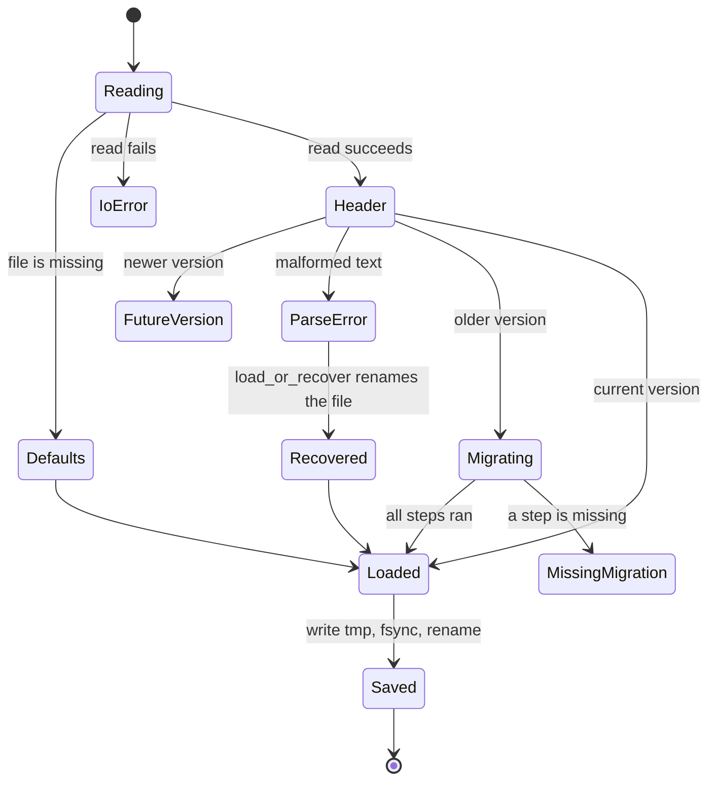

# Build an application

This guide tells how to build a desktop application with ChoscorUI. You describe each window as a tree of views, and the toolkit updates only what the changed state affects. Each section names the types to use and links to a working example. The [gallery](../gallery/src/main.rs) is a complete application that uses only the facade. To learn how the toolkit works inside, read [architecture.md](architecture.md). The generated [API reference](../api-docs/README.md) gives the signature, the documentation, and an example for each item of the application API.

## Requirements

| Requirement | Version | Check or install |
| --- | --- | --- |
| macOS | 15 or later, Apple silicon or Intel | `sw_vers -productVersion` |
| Xcode Command Line Tools | a release with the macOS 15 SDK | `xcode-select --install` |
| Rust | 1.88 or later, edition 2024 | `rustup toolchain install 1.88` |

The toolkit links only system frameworks and one Rust crate, `unicode-segmentation`. The application API is the same on every operating system. On a target without a backend, `App::start` and `App::run` return `AppError::Unsupported`. [platform-macos.md](platform-macos.md) describes the supported backend.

To run the gallery, use these commands from the repository root:

```sh
cargo run -p choscorui-gallery                       # opens the last page
cargo run -p choscorui-gallery -- canvas             # opens one page
cargo run -p choscorui-gallery -- --list             # shows the page ids
```

## Depend on the facade

Add a path dependency on the `choscorui` crate:

```toml
[dependencies]
choscorui = { path = "../choscorui-v2/crates/choscorui" }
```

Depend only on `choscorui`. The other crates are internal and can change in any release. The facade has these modules:

| Module | Contents |
| --- | --- |
| `choscorui::prelude` | `App`, `Scene`, `AppContext`, the views, the modifiers, state, the services, and the types that views use |
| `choscorui::core` | Geometry, text, models, themes, semantics, settings, locale, and resources |
| `choscorui::controls` | The controls that the views host, and the hosted control types |
| `choscorui::compose` | The view runtime, reactive state, and state machines |
| `choscorui::platform` | The backend of the current operating system, for code that the portable API does not cover. On macOS it is `choscorui-macos` and the `NativeAccess` trait. Code that uses it is not portable |
| `choscorui::capabilities()` | What the current backend supports |

[versioning.md](versioning.md) tells which parts are stable.

## Your first application

An application is a `View` tree in a window. `App` opens the windows, runs the event loop, sends input to the views, and draws a frame when something changed:

```rust,no_run
use choscorui::prelude::*;

struct Counter;

impl View for Counter {
    fn body(&self, cx: &mut Cx) -> impl View {
        let count = cx.state(0);
        VStack::new((
            Text::new(move || format!("Count: {}", count.get())),
            Button::new("Increment", move || count.update(|n| *n += 1)),
        ))
        .spacing(Space::S4)
        .padding(Space::S6)
    }
}

fn main() -> Result<(), choscorui::AppError> {
    App::new()
        .window(WindowOptions::new("Counter", 400.0, 300.0), || Counter)
        .run()
}
```

- `App::window` opens a window with the view that the closure makes. The closure runs again for each new window of that scene.
- `App::run` returns when the last window closes.
- `App::start` returns an `AppContext` instead, and you call `AppContext::pump` in your own loop. The [app smoke test](../crates/choscorui/tests/app_smoke.rs) uses it.

## Views and components

A view describes a part of the screen. A component is your own type that implements `View::body` and returns other views. `body` runs once, when the component mounts. It does not run again when state changes. Instead, each value that reads state is a closure, and the toolkit runs that closure again when the state changes.

The toolkit gives these views:

| Group | Views |
| --- | --- |
| Layout | `VStack`, `HStack`, `LazyVStack`, `LazyHStack`, `ZStack`, `Grid`, `Form`, `FormRow`, `Group`, `ScrollView`, `Spacer`, `Divider`, `Resizable` |
| Fields | `Field`, `FieldSet`, `FieldGroup`, `FieldContent`, `FieldTitle`, `FieldSeparator` |
| Text | `Text`, `Label`, `Kbd`, `Badge` |
| Structure | `Dynamic`, `Branch`, `ForEach`, `Either`, `AnyView`, `Empty` |
| Controls | `Button`, `CommandLink`, `ButtonGroup`, `ToolButton`, `Checkbox`, `Switch`, `Toggle`, `ToggleGroup`, `Slider`, `RangeSlider`, `SpinBox`, `Progress`, `ScrollBar`, `Input`, `InputGroup`, `TextField`, `Textarea`, `TextEditor`, `InputOtp`, `Select`, `Combobox`, `FontChooser`, `RadioGroup`, `Tabs`, `Calendar`, `DatePicker`, `DateTimeEdit`, `DecimalSpinBox`, `KeySequenceEdit`, `ColorPicker`, `Dial`, `NumericDisplay` |
| Dialogs | `Dialog`, `AlertDialog`, `InputDialog`, `FontDialog`, `DropdownMenu` |
| Content | `Card`, `Alert`, `Avatar`, `AvatarGroup`, `Accordion`, `Collapsible`, `ToolBox`, `GroupBox`, `StackedContainer`, `Carousel`, `Chart`, `DataTable`, `List`, `HeaderView`, `ColumnBrowser`, `ItemGroup`, `EmptyState`, `Skeleton`, `Spinner`, `Toaster` |
| Chat | `Message`, `MessageScroller`, `Marker`, `Attachment`, `Questionnaire` |
| Window parts | `Toolbar`, `StatusBar`, `Dock`, `SizeGrip` |
| Navigation | `Breadcrumb`, `Pagination`, `NavigationMenu`, `Menubar`, `Sidebar`, `Command` |
| Drawing | `Canvas`, `FocusFrame`, `ControlView`, `Configured` |

A tuple of views is one view, so a stack takes a tuple of its children. To keep two branches of different types in one place, use `Either` or `.into_any()`. [controls.md](controls.md) gives the behavior and accessibility semantics of each control.

Each hosted control of `choscorui::controls` has a view. Some views have more than one constructor. `Select::native` gives the native-select look, `Input::masked` fits the text into an `InputMask`, and `List::table` shows the rows as a table. `Command::dialog` opens the command search in a dialog, and `Checkbox::mixed` has a mixed state. `Kbd::keys` shows a key combination, and `NumericDisplay::counter` edits its value from the keyboard. A bubble is content of a `Message`, and an item is content of an `ItemGroup`.

A control view changes its control with `.with(change)` after each build. For example, `.with(move |checkbox| checkbox.with_invalid(invalid.get()))` marks a `Checkbox` invalid while `invalid` is true. The view builds the control again when `invalid` changes, and keeps its value. Only fields take `with_invalid`: `Checkbox`, `RadioGroup`, `Combobox`, and `DatePicker`. A button, a switch, or a toggle has no invalid state. Use `.with_env(change)` when the change needs the environment, for example a placeholder from the catalog.

The range views set their limits with builders, so they need no `IntegerRange`:

- `Slider`, `SpinBox`, and `Dial` take `.range(0..=100)`, `.step(1)`, and `.page(10)`. These are also the defaults. `Dial` also takes `.wrapping(true)`.
- `RangeSlider` takes `.range(0.0..=100.0)` and `.step(1.0)`.
- `Progress` takes `.maximum(100)`.

A builder never panics. An invalid option, such as a reversed range or a zero step, becomes the nearest valid value. A bound value outside the range shows the nearest bound. A `.disabled_option` or `.disabled_tab` that cannot apply keeps the option enabled. The view reports each of these as `ViewError::Clamped`, through `ViewHost::take_errors` and `App::on_error`. The fallible constructors, such as `IntegerRange::new`, stay for code that wants the `Result`.

## State and bindings

State lives in the reactive runtime. A view reads it in a closure, and the toolkit records what each closure read:

- `cx.state(initial)` makes a `State<T>` that belongs to the component. It is `Copy`, and it ends when the component unmounts.
- `cx.memo(compute)` makes a `Memo<T>`, a value that the toolkit computes again only when its inputs change.
- `cx.effect(run)` runs a closure now and again after each change to what it read.
- `Runtime::property(initial)` makes a `Property<T>` that is not part of one component. Use it for state that several windows share.
- `Binding<T>` gives a control read and write access to a value. `State::binding` makes one, and `Binding::new(get, set)` makes one from two closures. `Binding::map` focuses on one field.

A view argument accepts a plain value or a closure. A plain value never changes. A closure is live: when state that it read changes, only that one property updates. The rest of the tree stays as it is.

```rust
use choscorui::prelude::*;

struct Settings;

impl View for Settings {
    fn body(&self, cx: &mut Cx) -> impl View {
        let wifi = cx.state(true);
        let volume = cx.state(40);
        VStack::new((
            Switch::new("Wi-Fi", wifi.binding()),
            Slider::new("Volume", volume.binding()).range(0..=100).step(1).page(10),
            Text::new(move || format!("Volume {}", volume.get())).hidden(move || !wifi.get()),
        ))
        .alignment(HorizontalAlignment::Leading)
        .spacing(Space::S3)
    }
}
```

To change the structure of the tree, use these views:

- `Dynamic::new(choose)` mounts the view that `choose` returns. When state that `choose` read changes, it unmounts the old view and mounts the new one.
- `Branch::new(key, view)` mounts the view that `view` makes from the value of `key`. When state that `key` read changes, `key` runs again. The view changes only when the key changes. While the key stays, the view keeps its nodes, focus, semantics, and state.
- `ForEach::new(items, key, view)` mounts one view for each item. Items keep their nodes, focus, and semantics by key, so an insert mounts only the new item. An item whose value changes under the same key mounts again. A duplicate key reports `ViewError::DuplicateKey`, and only the first item with that key stays.
- `Either::Left` and `Either::Right` give one type to two branches.

## Layout

Stacks place their children along one axis:

| View or modifier | Use |
| --- | --- |
| `VStack`, `HStack` | A column or a row, with `.spacing`, `.alignment`, and `.distribution` |
| `ZStack` | Children on top of each other, with an `Alignment` |
| `Grid` | Columns of `GridItem::Fixed`, `GridItem::Flexible`, or `GridItem::Fit` |
| `Form`, `FormRow` | Labels in one column beside their fields in another |
| `Spacer` | Flexible space that pushes its siblings apart |
| `ScrollView` | Content that scrolls when it is larger than the space, with a scroll bar in the `ScrollArea` look |
| `Divider` | A line across its stack in the `Separator` look |
| `LazyVStack`, `LazyHStack` | A column or a row that mounts only the items in view, with `.spacing` and `.alignment` |
| `List` | The rows of an `ItemModel`, painted only while they show, with a selection binding |
| `.padding(edges)` | Space around the view, from a `Space` token or `Edges` |
| `.frame(Frame)` | A fixed, minimum, or maximum size, with the content aligned in it |
| `.layout_priority(share)` | A share of the leftover space along the stack |

A view is as large as its content. A `Spacer`, a `ScrollView`, a `Divider`, or a frame with an infinite maximum is flexible. A stack that holds a flexible view becomes flexible too, so it takes the space that its parent offers. A fixed width or height stops this along that axis. Layout mirrors in a right-to-left locale: leading is on the right.

A `Form` takes `FormRow` views. Each row has a label and a field. The label column is as wide as its widest label, and the field column takes the remaining width. Labels sit against their fields by default. Change this with `.label_alignment`, and change the field width with `.field_alignment`. The row and column spacing come from the `Field` recipe.

```rust
use choscorui::prelude::*;

struct Account;

impl View for Account {
    fn body(&self, cx: &mut Cx) -> impl View {
        let name = cx.state(String::new());
        let alerts = cx.state(true);
        Form::new((
            FormRow::new(t!("account.name"), Input::new(t!("account.name"), name.binding())),
            FormRow::new(t!("account.alerts"), Switch::new(t!("account.alerts"), alerts.binding())),
        ))
    }
}
```

When a row has too little width, a wrapping `Text` becomes narrower and takes more lines. Use `Text::single_line` or `.fixed_size()` to keep the text on one line. A row that still cannot fit reports a layout error.

```rust
use choscorui::prelude::*;

fn toolbar() -> impl View {
    HStack::new((
        Text::new("Inbox").text_style(TextPreset::H4),
        Spacer::new(),
        Button::new("Compose", || {}).size(ControlSize::Sm),
    ))
    .padding(Space::S3)
    .frame(Frame::new().max_width(f64::INFINITY))
}
```

### Long lists

A stack mounts all of its children. For a long list, use a lazy stack or a `List`. Then layout, paint, and input do not grow with the item count:

- `LazyVStack::new(count, item_extent, view)` makes `count` items. Each item is `item_extent` points high. `view` takes the index of an item and returns its view.
- `LazyHStack::new(count, item_extent, view)` makes a row of items, each `item_extent` points wide. It mirrors in a right-to-left locale.
- `List::new(name, model, selection)` shows the rows of an `ItemModel` as text. `selection` is a `Binding<Vec<usize>>` of the selected row positions. The [ItemView](controls.md#itemview) control gives its keys and semantics.

A lazy stack mounts an item only while the item shows in the scroll view around it, or in the window. When an item goes out of view, it unmounts, and its state ends. When it comes back, it mounts again with new state. Keep the data in state outside the items, and read it in live properties.

All items of a lazy stack have the same extent. Tab cannot move focus to an item that does not show. An item with focus loses the focus when it unmounts.

```rust
use choscorui::prelude::*;

struct Inbox;

impl View for Inbox {
    fn body(&self, cx: &mut Cx) -> impl View {
        let count = cx.state(10_000_usize);
        ScrollView::new(
            LazyVStack::new(move || count.get(), 32.0, |index| {
                Text::new(format!("Message {index}"))
            })
            .alignment(HorizontalAlignment::Leading),
        )
    }
}
```

### Form fields

A `Field` shows a label, a control, and optional help text. The field takes the width that it gets, and its text wraps to it:

- `Field::new(label, control)` stacks the label above the control.
- `.description(text)` adds muted help text below the control.
- `.error(message, shown)` shows `message` while `shown` is true. The control then shows its invalid look, and the label uses the destructive color. A switch or a toggle has no invalid look, so only the message and the label change.
- While the error shows, the control gets a `DescribedBy` relation to it. Its accessibility description gives the error and then the help text.
- A click on the label focuses the control. On a checkbox or a switch, it also toggles the control.
- `.disabled(true)` on a field disables its control and dims its label.
- `.orientation(FieldOrientation::Horizontal)` puts the label at the leading edge, and the other parts beside it.
- `FieldOrientation::Responsive` is horizontal when the field gets 448 points or more, and vertical when it gets less. A window resize can change it.

The control gets a `LabelledBy` relation to the label and a `DescribedBy` relation to the description. Side-by-side parts mirror in a right-to-left locale.

Use these views to group fields:

- `FieldSet::new(legend, content)` puts a legend above the content. `.description(text)` adds text below the legend. The set is a group that its legend names.
- `FieldGroup::new(fields)` stacks whole fields.
- `FieldContent::new(parts)` stacks text parts, for example a `FieldTitle` above a description.
- `FieldSeparator::new()` draws a rule between groups. `.text(text)` puts text in its middle.

The gaps come from the `Field` recipe. [Field and FieldText](controls.md#field-and-fieldtext) gives the values.

```rust
use choscorui::prelude::*;

struct Profile;

impl View for Profile {
    fn body(&self, cx: &mut Cx) -> impl View {
        let name = cx.state(String::new());
        let news = cx.state(false);
        FieldSet::new(
            t!("profile.title"),
            FieldGroup::new((
                Field::new(t!("profile.name"), Input::new(t!("profile.name"), name.binding()))
                    .orientation(FieldOrientation::Responsive)
                    .error(t!("profile.name_needed"), move || name.get().is_empty()),
                FieldSeparator::new(),
                Field::new(t!("profile.news"), Switch::new(t!("profile.news"), news.binding()))
                    .description(t!("profile.news_help"))
                    .orientation(FieldOrientation::Horizontal),
            )),
        )
    }
}
```

### Panel groups

`Resizable::new(name, orientation, panes, sizes)` puts each view of the `panes` tuple in a pane, with a handle between each two neighbors:

- `sizes` is a `Binding<Vec<f64>>` with the size of each pane but the last. The last pane takes the rest.
- A drag on a handle changes only the two panes next to it, and writes `sizes`. A change to `sizes` moves the panes.
- `.minimums(values)` gives the smallest size of each pane. `.grip(true)` shows a grip on each handle.
- The group takes the space that it gets. A horizontal group mirrors in a right-to-left locale.

A group of two panes is one slider control. The arrow keys move its handle. In a group of three or more panes, each handle is a slider node of its own. Tab goes to each handle before the panes, and the arrow keys move the focused handle. Each handle gives the size of the pane before it and the range of that size. [Resizable](controls.md#resizable) gives the keys and the semantics.

```rust
use choscorui::prelude::*;

struct Workspace;

impl View for Workspace {
    fn body(&self, cx: &mut Cx) -> impl View {
        let sizes = cx.state(vec![200.0, 400.0]);
        Resizable::new(
            t!("workspace.panels"),
            SplitOrientation::Horizontal,
            (
                Text::new(t!("workspace.files")),
                Text::new(t!("workspace.editor")),
                Text::new(t!("workspace.outline")),
            ),
            sizes.binding(),
        )
        .minimums(vec![120.0, 200.0, 120.0])
        .grip(true)
    }
}
```

## Styling and theming

Visual values come from the design tokens. Modifiers take a token role or a token scale, so the view follows the theme:

- Color: `.foreground`, `.background`, `.border`, `.ring`, and `.tint` take a `ColorRole` or a `Color`.
- Shape: `.corner_radius`, `.shadow`, `.opacity`, and `.clip_shape`.
- Text: `.text_style(TextPreset)`, `.font_weight`, and `.tracking`.
- Controls: `.button_variant` and `.control_size` set a default for the controls inside the view. A control's own `.variant` or `.size` wins.
- Theme: `.theme((BaseColor, ColorScheme))`, `.color_scheme`, and `.token(role, fill)` change the tokens of a subtree.
- Recipes: `.recipe(kind, recipe)` paints the controls of one kind in the subtree with your recipe.

`App::tokens` sets the tokens of every window. Give it a closure to change the theme at run time. [theming.md](theming.md) describes the tokens, the recipes, and the precedence of the styling modifiers.

## Text and localization

`Text::new` shows a plain string, a closure, or a catalog string. A catalog string updates when the locale changes:

- `Localized::new("id")` reads the translation of `id`.
- `.arg(name, value)` gives an argument, and `.count(n)` selects the plural form.
- `t!("id", name = value)` is the short form.

`App::env(Env::new(catalog, locale))` gives every window its catalog and locale. Give `Env::new` a closure for the locale to change the language at run time. `.locale(...)` changes the locale of one subtree. [localization.md](localization.md) describes catalogs, plural forms, and right-to-left layout. [text.md](text.md) describes text shaping and editing.

```rust
use choscorui::prelude::*;
use std::rc::Rc;

let mut catalog = Catalog::new();
let english = Locale::parse("en").expect("valid tag");
catalog.insert(&english, "greeting", "Hello, {name}");
let env = Env::new(Rc::new(catalog), english);
assert_eq!(env.text("greeting", &[("name", "Linh")]), "Hello, Linh");
let greeting = Text::new(t!("greeting", name = "Linh"));
```

## Dialogs, sheets, popovers, and menus

A presentation modifier shows content while a `Binding<bool>` is true:

- `.dialog(presented, title, content)` and `.alert_dialog(presented, title, content)` show a centered dialog.
- `.sheet(presented, side, title, content)` and `.drawer(presented, side, title, content)` show a panel along an edge.
- `.popover(presented, content)` shows a popover next to the view.

The `title` takes literal text or a catalog string. It is the accessible name of the panel, and it follows the locale. Escape or a press outside the dialog sets the binding to false. A drag on a drawer toward its edge, past a quarter of its size, also sets it to false. Focus moves into the dialog and returns to the view after it closes.

A dialog fades in and zooms from 95%. A sheet or a drawer slides in from its edge, and the scrim fades with the panel. The motion uses the duration of the recipe of the panel. A closed panel takes no input and has no accessibility node, and it unmounts when its motion ends. With reduced motion, panels show and close at once.

```rust
use choscorui::prelude::*;

struct Delete;

impl View for Delete {
    fn body(&self, cx: &mut Cx) -> impl View {
        let asking = cx.state(false);
        Button::new("Delete", move || asking.set(true))
            .variant(ButtonVariant::Destructive)
            .alert_dialog(asking.binding(), "Delete this file?", move || {
                VStack::new((
                    Text::new("Delete this file?"),
                    Button::new("Cancel", move || asking.set(false)),
                ))
                .spacing(Space::S4)
            })
    }
}
```

### Tooltips

`.tooltip(text)` shows `text` in a tooltip next to the view. The tooltip shows after the pointer rests on the view for the delay of the controls. It also shows after keyboard focus moves into the view. It hides when the pointer leaves, on a press, a key, or a scroll, and when focus moves away. Escape hides it and goes no further. The text also becomes the accessibility description of the view, unless `.accessibility_hint` gives one. While the tooltip shows, a `Tooltip` accessibility node holds the text, with a `DescribedBy` relation to the view. The tooltip fades, zooms, and slides in and out, and shows and hides at once with reduced motion.

### Hover cards

`.hover_card(content)` shows `content` in a hover card below the view, or above it when only that side fits. The card opens after the pointer rests on the view for `HOVER_CARD_OPEN_DELAY`. It also opens after keyboard focus moves into the view, after the same delay. It closes `HOVER_CARD_CLOSE_DELAY` after the pointer leaves the view and the card. It closes at once when focus leaves the view, on a press outside, or on Escape while focus is in the view. Escape goes no further.

The card is not modal. It takes no focus, Tab skips its content, and the pointer on the card only keeps it open. Thus, put preview content in a hover card, not controls. The card uses the `HoverCard` recipe. It fades, zooms, and slides in and out like a popover, and shows and closes at once with reduced motion.

```rust
use choscorui::prelude::*;

fn profile() -> impl View {
    Text::new("@nextjs").hover_card(|| Text::new("The React Framework"))
}
```

### Menus

A menu shows `MenuChoice` rows. `MenuChoice::action(label, action)` runs `action` and closes the menu. `MenuChoice::checkbox(label, checked)` shows a check mark while the `Binding<bool>` is true, and a choice flips it. `MenuChoice::radio(label, selection, value)` shows a dot while `selection` is `value`, and a choice sets it. The radio rows of one binding make a group. A check row closes the menu as an action does. `MenuChoice::submenu` and `MenuChoice::separator` make the other rows. `.shortcut`, `.destructive`, and `.disabled` change one row. Labels take literal text or a catalog string, and follow the locale.

- `.context_menu(items)` opens a menu at the pointer on a secondary click or a Control-click on the view. When focus is in the view, Shift-F10 or the Menu key opens it at the center of the focused view. A focused view that uses the key keeps it. The `ShowMenu` action of assistive technology opens it at the center of the view. A menu that the keyboard or `ShowMenu` opens highlights the first row. Of nested context menus, the innermost one opens.
- `.dropdown_menu(presented, items)` shows a menu below the view while `presented` is true. A chosen row or Escape sets `presented` to false.

Focus moves into an open menu. The menu keys, hover, and type-ahead of [DropdownMenu](controls.md#dropdownmenu) apply. Escape or a press outside closes the menu, and focus returns to where it was.

```rust
use choscorui::prelude::*;

struct File;

impl View for File {
    fn body(&self, cx: &mut Cx) -> impl View {
        let options = cx.state(false);
        let rows = move || {
            vec![
                MenuChoice::action(t!("file.rename"), || {}),
                MenuChoice::separator(),
                MenuChoice::action(t!("file.delete"), || {}).destructive(),
            ]
        };
        Button::new(t!("file.options"), move || options.set(true))
            .tooltip(t!("file.options_hint"))
            .dropdown_menu(options.binding(), rows())
            .context_menu(rows())
    }
}
```

### Toasts

`.toaster(position, name, close)` puts a toast queue in the environment of the view, and shows its toasts at `position` in the window. A descendant posts a toast in one of two ways:

- `cx.env().toasts()` gives the `Toasts` queue. Call `push` with a `Toast`.
- `.toast(presented, make)` posts the toast that `make` returns when `presented` becomes true. Then it sets `presented` to false.

A toast closes after its duration, and the timers stop while the pointer rests on the stack. With reduced motion, toasts show and close without motion. A `.toast` without a `.toaster` above it reports `ViewError::NoToaster`.

```rust
use choscorui::prelude::*;

struct Editor;

impl View for Editor {
    fn body(&self, cx: &mut Cx) -> impl View {
        let saved = cx.state(false);
        Button::new(t!("editor.save"), move || saved.set(true))
            .toast(saved.binding(), |env| Toast::new(env.text("editor.saved", &[])))
            .toaster(ToastPosition::BottomEnd, t!("editor.notifications"), t!("editor.close"))
    }
}
```

## Accessibility

Each control publishes its role, name, value, state, and actions. You do not build the semantic tree. A static text node is named by its text. Use these modifiers when the default is not enough:

- `.accessibility_label`, `.accessibility_value`, and `.accessibility_hint` replace what assistive technology reads.
- `.accessibility_hidden(true)` hides decoration.
- `.focusable(false)` takes a view out of the keyboard order, and `.focused(binding)` moves focus.
- `.tooltip(text)` gives the description, and `.context_menu(items)` adds the `ShowMenu` action.

Tab and Shift-Tab move focus in the order of the tree. `.disabled(true)` disables every control in a subtree, and a disabled control leaves the keyboard order.

## Commands, shortcuts, and menus

`App::commands(menus)` installs the menu bar. Each menu is a `CommandMenu` with the `MenuChoice` rows that menus in views use: actions, checkbox and radio rows, submenus, and separators.

- Each row runs its own action when the user chooses it. You do not give command ids. The toolkit makes an id for each row.
- `MenuChoice::keyboard_shortcut(key, modifiers)` chooses the row from any window. A Command-key chord that no menu item takes goes to the focused view.
- Labels, check marks, and disabled states can read state. When that state changes, the toolkit makes the menu bar again. Use this for check marks and for a new language.
- A panic in an action stops at the menu boundary. The toolkit counts it in `AppContext::menu_panic_count`, and the row stays usable.

An action does not get the `AppContext`. To open or close a window or to quit, put a request in shared state, and act on it in `App::on_tick`.

`.keyboard_shortcut(key, modifiers, action)` runs an action while focus is in the view, or anywhere when no closer view declares the same keys. `.on_submit(action)` runs when a control commits its input, for example Return in a text input.

```rust,no_run
use choscorui::prelude::*;
use std::cell::Cell;
use std::rc::Rc;

fn main() -> Result<(), choscorui::AppError> {
    let app = App::new();
    let wrap = app.runtime().property(false);
    let (read, write) = (wrap.clone(), wrap.clone());
    let quit = Rc::new(Cell::new(false));
    let asked = quit.clone();
    let command = ShortcutModifiers {
        command: true,
        ..ShortcutModifiers::default()
    };
    let menus = [
        CommandMenu::new(
            "Notes",
            vec![MenuChoice::action("Quit Notes", move || asked.set(true))
                .keyboard_shortcut('q', command)],
        ),
        CommandMenu::new(
            "View",
            vec![MenuChoice::checkbox(
                "Wrap Lines",
                Binding::new(move || read.get(), move |on| write.set(on)),
            )],
        ),
    ];
    app.window(WindowOptions::new("Notes", 640.0, 480.0), || Text::new("Notes"))
        .commands(menus)
        .on_tick(move |cx| {
            if quit.get() {
                cx.quit();
            }
        })
        .run()
}
```

## Windows

A `Scene` is a window description: the options, a closure that makes the root view, and an optional live title. `App::scene` opens one at launch. During the run, `AppContext` manages the windows:

- `AppContext::open(scene)` opens a window and returns its `WindowId`. `AppContext::close(id)` closes it.
- `AppContext::active` gives the key window, and `AppContext::windows` lists the open windows.
- `AppContext::title(id)` gives the title of a window.
- `AppContext::host(id)` gives the `ViewHost` of the window.
- `AppContext::menu_bar` gives the installed menu model, and `AppContext::choose(id)` chooses an item as the user does.

Windows share the runtime, so a `Property` from `App::runtime` updates every window that reads it. `App::on_tick` runs a closure once on each turn of the event loop. Use it for work that is not part of a view.

`App::on_error(handler)` gets each `ViewError`. The first argument is the `WindowId` of the window that reported it. It is `None` for an error of the application, for example a settings file that did not load.

`choscorui::platform::NativeAccess` gives the native application, window, and menu of an `AppContext` on macOS. Use it only for features that the portable API does not have.

### Threads and timers

The UI types work only on the main thread. They are not `Send`.

- **Work from other threads.** On macOS, call `Application::poster` on `NativeAccess::native_application` to get a `Poster`, which is `Send`. Call `Poster::post` with a closure, and the main loop runs it.
- **Timers.** `Application::schedule_once` and `Application::schedule_repeating` return a `Timer`. When you drop the `Timer`, the timer stops.
- **Panics.** A panic in a posted task, a timer, or a menu callback does not unwind into AppKit. The toolkit counts each such panic.

[architecture.md](architecture.md#threading-model) gives the full threading model.

## Desktop services

`Env::services` and `AppContext::services` give the `Services` of the backend:

| Service | Methods |
| --- | --- |
| Clipboard | `clipboard_text`, `set_clipboard_text` |
| Notifications | `notification_permission`, `request_notification_permission`, `post_notification` |
| Status item | `set_status_item`, `status_item` |
| URL handlers | `url_handler` |
| File dialogs | `choose_files` |

Each method checks the capability first. When the backend does not have the service, the method returns `ServiceError::Unsupported`. When the service needs a condition, it returns `ServiceError::Unavailable` with the condition. A method never panics. `Services::none` has no services; use it in tests.

In a view, `.file_importer(presented, types, on_result)` shows an open dialog while `presented` is true. `.file_exporter(presented, name, on_result)` shows a save dialog. Each sets `presented` to false and gives the result to `on_result`.

## Stored state

`App::id(app_id)` names the settings file of the application. `App::settings_path(path)` gives an explicit path instead, for example from an environment variable. `App::settings_schema(schema)` gives the defaults and the migrations. Without an id or a path, the settings stay in memory.

`cx.stored(key, default)` is a `State` that loads from the settings file and writes each change back. The application saves the file at most once on each turn of the event loop, and when it stops.

```rust,no_run
use choscorui::prelude::*;

struct Counter;

impl View for Counter {
    fn body(&self, cx: &mut Cx) -> impl View {
        let count = cx.stored("counter.count", 0_i64);
        Button::new("Add", move || count.update(|n| *n += 1))
    }
}

fn main() -> Result<(), choscorui::AppError> {
    let scene = Scene::new(WindowOptions::new("Counter", 320.0, 200.0), || Counter)
        .restore_geometry("window.main");
    App::new().id("com.example.counter").scene(scene).run()
}
```

- A corrupt file moves aside, and the application uses the defaults. `App::on_error` gets `StorageError::Recovered` with `None` as the window.
- A stored value of the wrong type gives the default, and the view reports `StorageError::TypeMismatch`.
- `Scene::restore_geometry(key)` stores the frame of the window under `key` when it closes. At the next launch, the window opens at that frame, fitted to the screens.

## Settings

`choscorui::core::Settings` keeps settings for one user in a versioned text file. A `SettingsSchema` gives the current version, the default values, and the migrations.

```rust
use choscorui::core::{SettingValue, Settings, SettingsError, SettingsSchema};
use std::collections::BTreeMap;
use std::path::PathBuf;

fn upgrade_v1(values: &mut BTreeMap<String, SettingValue>) {
    if let Some(value) = values.remove("font") {
        values.insert("editor.font".into(), value);
    }
}

fn load(path: PathBuf) -> Result<Settings, SettingsError> {
    let schema = SettingsSchema::new(2)
        .with_default("editor.font", SettingValue::Text("Menlo".into()))
        .with_migration(1, upgrade_v1);
    let (mut settings, report) = Settings::load_or_recover(schema, path)?;
    if let Some(aside) = &report.recovered_to {
        eprintln!("the settings file was damaged; it moved to {}", aside.display());
    }
    settings.set("editor.font", SettingValue::Text("SF Mono".into()))?;
    settings.save()?;
    Ok(settings)
}
```

- `user_settings_path(app_id)` returns the path of the settings file. The `app_id` is a reverse-DNS identifier, for example `com.example.editor`. [platform-macos.md](platform-macos.md) gives the location on macOS.
- A key uses ASCII letters, digits, `.`, `_`, `-`, and `/`. `is_valid_setting_key` checks a key.
- A value is a `SettingValue`: `Bool`, `Integer`, `Float`, `Text`, `List`, or `Rect`.
- `Settings::to_text` does not write a value that is equal to its default. Thus a changed default reaches the existing users.

### Load lifecycle

`Settings::load` and `Settings::load_or_recover` read the file as follows:

| Condition | Result |
| --- | --- |
| The file does not exist | The default values, and `LoadReport.created` is `true` |
| The file has an older version | Each migration runs, one version at a time. `LoadReport.migrated_from` gives the old version, and the settings are dirty |
| A migration step is missing | `SettingsError::MissingMigration` |
| The file has a newer version | `SettingsError::FutureVersion`. The file does not change, so an older application cannot destroy newer data |
| The file is not valid UTF-8, or a line is malformed | `SettingsError::Parse`. `load_or_recover` renames the file to `settings.txt.corrupt`, uses the defaults, and sets `LoadReport.recovered_to` |
| The file cannot be read | `SettingsError::Io`. Neither function replaces the file with defaults |

`Settings::save` creates the parent directories and writes the text to a `.tmp` file. Then it syncs that file to disk with `File::sync_all` (fsync) and renames it over the original file. Thus a crash leaves the old file or the new file, never a partial file.



[settings.rs](../crates/choscorui-core/tests/settings.rs) pins each of these paths.

### Window geometry

`Scene::restore_geometry(key)` keeps the window position and size between launches. To do the same steps with your own `Settings`, use these functions:

1. When the window closes, call `geometry.store(&mut settings, "window.main")`.
2. At launch, call `WindowGeometry::restore(&settings, "window.main")`.
3. Call `fit_to_screens` on the result with the visible frames of the screens and a minimum size.

```rust
use choscorui::core::{Point, Rect, Settings, SettingsSchema, Size, WindowGeometry};

let mut settings = Settings::new(SettingsSchema::new(1));
let saved = WindowGeometry {
    frame: Rect::new(Point::new(-5000.0, 40.0), Size::new(800.0, 600.0)),
    zoomed: false,
    full_screen: false,
};
saved.store(&mut settings, "window.main")?;
let screens = [Rect::new(Point::new(0.0, 0.0), Size::new(1440.0, 900.0))];
let restored = WindowGeometry::restore(&settings, "window.main").unwrap();
let frame = restored.fit_to_screens(&screens, Size::new(320.0, 240.0));
assert!(screens[0].intersection(frame).is_some());
# Ok::<(), choscorui::core::SettingsError>(())
```

`fit_to_screens` handles a change of screens between launches:

- If no screen shows enough of the title strip of the saved frame, the window moves to the center of the main screen.
- If the frame is larger than its screen, the window becomes smaller, but not smaller than the minimum size.

The window applies the frame first, then the zoom and full-screen state. Thus, when the user leaves zoom, the window returns to the saved size.

### Dock and toolbar state

`DockLayout::save` and `Toolbar::save` each return a `String`. Keep it as a `Text` setting, for example `dock.main` or `toolbar.main`.

To restore the state at launch:

1. Register the dock panels.
2. Register the toolbar items.
3. Call `DockLayout::restore` and `Toolbar::restore` with the saved text.

`DockLayout::restore` handles changes between versions of your application:

- It skips saved keys that no registered panel has, and lists them in `DockRestoreReport.unknown_keys`.
- Registered panels that the saved text does not mention keep their registered location. `DockRestoreReport.unplaced` lists them.
- If the text is malformed, it returns `DockError::Parse` and does not change the layout.

`Toolbar::restore` ignores unknown item keys and returns `false` when the text is malformed.

## Test your UI without a window

Only the native window needs the operating system. `ViewHost` mounts a view tree with no window, so most UI tests run anywhere:

1. Make a `ViewHost` with a size, tokens, an environment, a runtime, and a text measurement.
2. Mount the view and call `layout`.
3. Find nodes by their accessible name with `find`, and drive them with `perform`, `key`, `text`, or `pointer`.
4. Examine `semantics`, `paint`, and `take_errors`.

```rust
use choscorui::controls::EstimatedText;
use choscorui::core::SemanticAction;
use choscorui::prelude::*;
use std::rc::Rc;

struct Counter;

impl View for Counter {
    fn body(&self, cx: &mut Cx) -> impl View {
        let count = cx.state(0);
        VStack::new((
            Text::new(move || format!("Count: {}", count.get())),
            Button::new("Increment", move || count.update(|n| *n += 1)),
        ))
    }
}

let env = Env::new(Rc::new(Catalog::new()), Locale::parse("en").expect("valid tag"));
let mut host = ViewHost::new(
    Size::new(400.0, 300.0),
    DesignTokens::light(),
    env,
    Runtime::new(),
    Rc::new(EstimatedText),
);
host.mount(Counter);
host.layout();
let button = host.find("Increment").expect("the button is named");
assert!(host.perform(button, SemanticAction::Activate, None));
host.layout();
assert!(host.find("Count: 1").is_some());
assert!(host.take_errors().is_empty());
```

[views.rs](../crates/choscorui-compose/tests/views.rs) has more examples. To check native behavior, use a scripted run, as `CHOSCORUI_GALLERY_AUTOPILOT=1` does for the gallery.

## Draw and write custom controls

`Canvas::new(draw)` draws with display-list commands in the space that the canvas gets. It fills the space it is offered, so give it a size with `.frame`. Give it a name with `.label` for assistive technology.

A `Canvas` wraps a `CanvasView`. The `draw` closure draws in canvas coordinates, and the point (0, 0) is the top-left corner of the node. The `size` argument is the size of the node in points. These `CanvasContext` fields help you draw:

- `bounds` is the part of the canvas in view, in canvas coordinates. Draw only what touches it.
- `zoom` is the scale from canvas coordinates to points.
- `tokens` and `rtl` give the theme tokens and the layout direction.

`.zoomable(true)` lets the user pan and zoom the drawing. A drag, the wheel, or the arrow keys pan it. Command with the wheel zooms about the pointer, and `+`, `-`, and `0` zoom about the center. A zoomable canvas takes focus.

```rust
use choscorui::prelude::*;

fn swatch() -> impl View {
    Canvas::new(|ctx, size| {
        let color = Fill::Role(ColorRole::Primary).resolve(ctx.tokens);
        ctx.list.fill_rect(Rect::new(Point::new(0.0, 0.0), size), color);
    })
    .label("Primary color")
    .frame(Frame::size(48.0, 48.0))
}
```

For a new interactive control, implement the `CustomControl` trait in safe Rust and mount it with `ControlView::new`. You need no platform code or FFI. `ControlView::value` and `ControlView::on_message` connect the control to state. `Configured::custom(kind, build)` mounts your own `CustomControl` with the options, bindings, and actions of the toolkit views. `Configured::bind(binding, to, from)` connects the value of that control to a `Binding` in both directions.

| Method | When the toolkit calls it | Contract |
| --- | --- | --- |
| `measure(cx)` | During layout | Returns a `Measured` size and an optional baseline. The toolkit clamps the size to `cx.constraints` |
| `arrange(cx, bounds)` | After layout and theme changes | Records the geometry of the parts, so that input hits the same parts that paint draws. The default does nothing |
| `event(context, event)` | When input goes to the control | Returns `EventReply::Stop` to consume the event. `context.phase()` gives the dispatch phase |
| `paint(cx)` | When the window draws | Draws into `cx.list` inside `cx.bounds`. The toolkit clips the control to its bounds |
| `overlay()` | During routing and painting | Returns the rectangle of an open popup, or `None`. The default is `None` |
| `paint_overlay(cx)` | After every control paints, for each control with an overlay | Draws the popup without a clip |
| `modal()` | During routing | Returns `true` while a modal overlay is open. The default is `false` |
| `semantics()` | When the control asked for a semantics update | Returns the role, name, value, state, and supported actions as a `SemanticNode` |
| `semantics_in(strings)` | As `semantics()`, with the `Localizer` of the host | Override it when the semantics show text: take the text from `strings`. The default calls `semantics()` |
| `perform(context, action, value)` | When assistive technology asks for an action | Runs only for an action that `semantics()` lists. Returns `true` when it applied the action |
| `focusable()` | At mount time | Defaults to `true`. A focusable control takes focus when the user presses it |
| `set_enabled(enabled)` | When `.disabled` changes | Updates the control state. A disabled control gets no input |
| `animating(time)` | On each frame | Returns `true` while the control needs another frame |

`Reveal` gives the open and close motion of the built-in popups. `progress` gives the eased share at a time, and `paint` or `transform` zooms from 95% and slides. Reduced motion skips the motion.

`MeasureContext` and `PaintContext` give the resolved `DesignTokens` of the node, the `Styles` registry, the text measurement, and the direction. `cx.style(query)` resolves a recipe slot. In `paint`, `cx.state` holds the `HOVERED`, `FOCUSED`, `FOCUS_VISIBLE`, and `DISABLED` flags. `cx.focus_ring(rect, radius)` paints the theme focus ring just inside `rect` while focus is visible, so the clip of the node does not cut it. `cx.ring_inside(rect, &style)` paints the ring of a resolved style in the same way.

The `ControlContext` lets the control do these things during `event` and `perform`:

- Request paint, layout, or semantics updates with `request_paint`, `request_layout`, and `request_semantics`.
- Take focus with `request_focus`.
- Capture the pointer for a drag with `capture_pointer(true)`.
- Read the time with `time`.
- Report a `ControlMessage` to the view with `emit`.
- Play the system alert sound with `beep`, for example when the control refuses a key.

[custom.rs](../crates/choscorui-controls/tests/custom.rs) is a complete control. It is a star-rating control that handles pointer, key, and text input, focus, painting, semantics, messages, and the `Increment` and `Decrement` actions.
