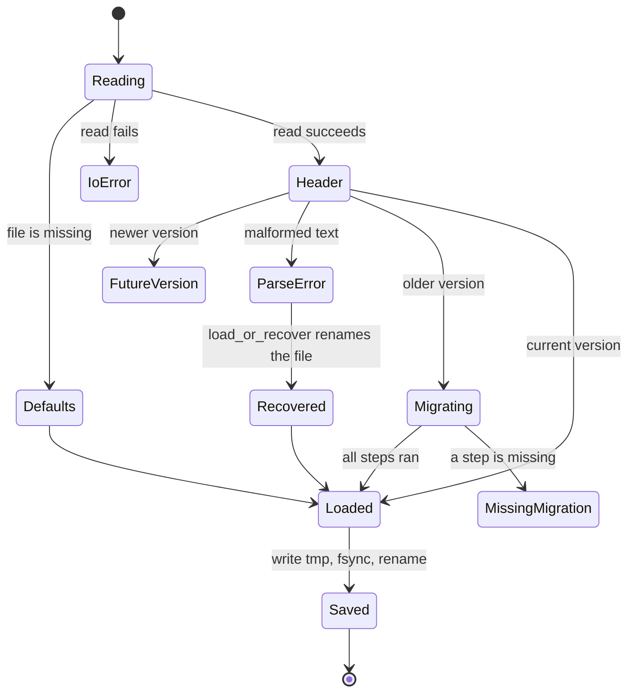

# Build an application

This guide tells how to build a desktop application with ChoscorUI. Each section names the types to use and links to a working example. [`samples/notes`](../samples/notes/README.md) is a complete small application that uses only the facade. To learn how the toolkit works inside, read [architecture.md](architecture.md).

## Requirements

| Requirement | Version | Check or install |
| --- | --- | --- |
| macOS | 15 or later, Apple silicon or Intel | `sw_vers -productVersion` |
| Xcode Command Line Tools | a release with the macOS 15 SDK | `xcode-select --install` |
| Rust | 1.88 or later, edition 2024 | `rustup toolchain install 1.88` |

The toolkit links only system frameworks and one Rust crate, `unicode-segmentation`. On other operating systems the facade compiles, but `choscorui::platform` does not exist. [platform-macos.md](platform-macos.md) describes the supported backend.

To run the examples, use these commands from the repository root:

```sh
cargo run -p choscorui-gallery                       # control gallery
cargo run -p choscorui-stress                        # large data, canvas, docking
cd samples/notes && cargo run                        # sample application
```

## Depend on the facade

Add a path dependency on the `choscorui` crate:

```toml
[dependencies]
choscorui = { path = "../choscorui-v2/crates/choscorui" }
```

Depend only on `choscorui`. The other crates are internal and can change in any release. The facade has these modules:

| Module | Contents |
| --- | --- |
| `choscorui::prelude` | The types that most applications use first |
| `choscorui::core` | Geometry, retained tree, layout, text, models, themes, semantics, settings, locale, and resources |
| `choscorui::controls` | Controls, item views, dialogs, popups, toolbar, status bar, and docking |
| `choscorui::compose` | Declarative composition, reactive bindings, and state machines |
| `choscorui::platform` | The macOS backend: application, windows, menus, dialogs, clipboard, and desktop integration |
| `choscorui::capabilities()` | What the current backend supports |

[versioning.md](versioning.md) tells which parts are stable.

## The application loop

ChoscorUI does not own your main loop. You make an `Application` on the main thread, open windows, and read events:

```rust
use choscorui::prelude::*;
use std::time::Duration;

fn paint(size: Size) -> DisplayList {
    let tokens = DesignTokens::light();
    let mut list = DisplayList::new();
    list.fill_rect(Rect::new(Point::new(0.0, 0.0), size), tokens.background);
    list.draw_text(Point::new(24.0, 48.0), "Xin chào", "Helvetica", 24.0, tokens.content)
        .expect("valid text command");
    list
}

fn main() {
    let app = Application::new().expect("call on the main thread");
    let mut window = app
        .create_window(WindowOptions::new("Hello", 640.0, 400.0))
        .expect("create the window");
    window.set_display_list(paint(window.content_size()));
    window.show();
    app.activate();
    'run: loop {
        app.dispatch_next_event(Duration::from_millis(250));
        for event in window.take_events() {
            match event {
                WindowEvent::Closing => break 'run,
                WindowEvent::Resized { size, .. } => window.set_display_list(paint(size)),
                _ => {}
            }
        }
    }
}
```

- `Application::dispatch_next_event(timeout)` waits for one native event and dispatches it. It returns `false` when no event arrived before the timeout.
- `Window::take_events` drains the queue of `WindowEvent` values: resize, scale change, focus, pointer, key, text, IME, occlusion, drag, and close.
- `Window::set_display_list` replaces the content of the window. It repaints only the region that changed.
- `Window::last_paint` tells when the last paint finished and how long it took.
- `Application::window_count` counts the native windows that are open or not yet released. Leak checks use it.

Each `Window` is independent. Usually each window has its own `Tree`, and the windows share the models, commands, themes, and localizer. In the notes sample, `Notes::pump` reads the events of each window and sends them to the view of that window.

### Threads and timers

The UI types work only on the main thread. They are not `Send`.

- **Work from other threads.** Call `Application::poster` to get a `Poster`, which is `Send`. Call `Poster::post` with a closure, and the main loop runs it.
- **Timers.** `Application::schedule_once` and `Application::schedule_repeating` return a `Timer`. When you drop the `Timer`, the timer stops.
- **Panics.** A panic in a posted task, a timer, or a menu callback does not unwind into AppKit. The toolkit counts each such panic.

```rust
let poster = app.poster();
std::thread::spawn(move || {
    let total = 6 * 7; // slow work on a worker thread
    let _ = poster.post(move || println!("result: {total}"));
});
let tick = app.schedule_repeating(Duration::from_secs(1), || println!("tick"))?;
drop(tick); // stops the timer
```

[architecture.md](architecture.md#threading-model) gives the full threading model.

## Retained tree and identity

`Tree` owns the structure of the UI. `Tree::attach(parent, bounds)` returns a `NodeId`. A `NodeId` keeps its identity until you detach the node, and the tree never uses it again. The tree gives:

- **Bounds** in absolute logical points.
- **Hit testing.** `hit_test(point)` returns the deepest visible node and tests the last child first.
- **Focus.** `set_focusable` lets a node take focus, and `set_focus` moves focus to a node.
- **Focus order.** `focus_next(reverse)` moves focus in depth-first order and wraps at the ends. Connect Tab and Shift-Tab to it.
- **Pointer capture** for drags, with `set_pointer_capture`.
- **Dirty flags.** `invalidate(id, Dirty::PAINT)` marks work for a node. The flags are `Dirty::LAYOUT`, `Dirty::PAINT`, and `Dirty::SEMANTICS`.
- **Dispatch.** `dispatch_pointer` and `dispatch_key` visit the capture, target, and bubble phases. A handler returns `EventReply::Stop` to end dispatch.

Controls do not own nodes. You attach a node, keep the state object of the control next to it, and give both to the control.

## Layout

| Type | Use |
| --- | --- |
| `LinearLayout` | Rows or columns with fixed and weighted children, padding, spacing, cross alignment, and right-to-left order |
| `GridLayout` | Fixed and flexible tracks, spans, and right-to-left columns |
| `FormLayout` | Label and field pairs, with the labels aligned next to the field column |
| `ScrollViewport` | Scrolling of a content subtree, with `scroll_by`, `scroll_to`, and `reveal` |
| `LayoutEngine` | Measure and arrange with `LayoutStyle` and `Constraints`, with a cache for each node |
| `compose_main_window` | Toolbar areas, status bar, and central content |
| `DockLayout` | Docked, tabbed, and floating panels |

`LinearLayout::apply(&mut tree, bounds)` writes bounds into the tree. If the layout cannot give each child its minimum size, it returns `LayoutError::InsufficientSpace` and moves no node. Your application then decides what to hide. The notes sample hides its toolbar in a very narrow window.

`LayoutEngine` asks a `LeafMeasure` for the size of each leaf node. A closure with the signature `FnMut(NodeId, Constraints, LayoutDirection) -> Measured` is a `LeafMeasure`. Text sizes come from the text layout, which [text.md](text.md) describes. For custom controls, see [Write a custom control](#write-a-custom-control).

## Use a control

Each control has the same shape. It handles input, it gives a visual state to a style or recipe, and it gives its semantics:

```rust
use choscorui::controls::{PillButtonRecipe, paint_button};
use choscorui::prelude::*;

const SAVE: CommandId = CommandId(1);

let node = tree.attach(tree.root(), Rect::new(Point::new(16.0, 16.0), Size::new(96.0, 28.0)))?;
tree.set_focusable(node, true)?;
let mut button = Button::new("Save", SAVE);

// Input: the method returns the command to run, if any.
if let Some(command) =
    button.handle_with_commands(&mut tree, node, ButtonInput::Pointer(event), &commands)?
{
    run(command);
}

// Paint: a recipe draws the visual state.
let state = button.visual_state_with_commands(&tree, node, &commands)?;
let bounds = tree.bounds(node).unwrap_or_default();
paint_button(&PillButtonRecipe::default(), &mut list, bounds, state, &tokens, |list, slots| {
    let _ = list.draw_text(
        Point::new(slots.content.origin.x, slots.content.origin.y + 18.0),
        "Save",
        "Helvetica",
        13.0,
        slots.content_color,
    );
});

// Semantics: the node goes into the semantic tree.
let semantic = button.semantics_with_commands(&tree, node, &commands)?.shared();
semantics.set(node, semantic, &tree)?;
```

The control owns its behavior: input, focus, value, validation, and semantics. Painting is separate, so you can replace it. [controls.md](controls.md) lists each control and gives its behavior and accessibility semantics.

### Publish semantics

Keep one `SemanticTree` for each window:

1. Call `SemanticTree::set` for each node that changed.
2. Keep the `SemanticChange` values that `set` returns.
3. Call `SemanticTree::sync_focus` to update the focus.
4. Give `SemanticTree::snapshot` and the changes to `Window::set_accessibility`.
5. Read `Window::take_accessibility_actions` after each event.
6. Send each request to the control that owns the node.

## Commands, shortcuts, and menus

`CommandRegistry` holds the enabled and checked state of each command:

- `CommandRegistry::activate(id)` returns the id only while the command is enabled.
- A button with a command follows the command state, through `handle_with_commands` and `visual_state_with_commands`.
- `CommandRegistry::bind_shortcut(scope, shortcut, command)` registers a key chord. Two bindings of one chord in the same scope return `CommandError::DuplicateShortcut`.
- `CommandRegistry::resolve_shortcut` finds the command for a chord. The focused scope wins first, then the window scope, then the application scope.
- A disabled command that wins a chord consumes it, so a less specific binding does not run.

```rust
let mut commands = CommandRegistry::new();
commands.insert(SAVE, CommandState::default())?;
let save = Shortcut {
    key: Key::Character('s'),
    modifiers: ShortcutModifiers { command: true, ..ShortcutModifiers::default() },
};
commands.bind_shortcut(ShortcutScope::Application, save, SAVE)?;
if let Some(command) = commands.resolve_shortcut(save, window_id, tree.focus()) {
    run(command);
}
```

[shortcuts.rs](../crates/choscorui-controls/tests/shortcuts.rs) and [commands.rs](../crates/choscorui-controls/tests/commands.rs) pin this behavior.

On macOS, the menu bar is native:

1. Build a `MenuBarModel` from a list of `MenuSpec` values. AppKit shows the first menu as the application menu.
2. Call `Application::install_main_menu` with the model. It returns a `MainMenu`.
3. Read `MainMenu::take_activations` after each event.
4. Run each command that it returns.
5. Call `MainMenu::set_state` when the enabled or checked state of a command changes.

A new call to `install_main_menu` replaces the old menu bar. Do this when the language changes. For a context menu, make a `ContextMenu` and call `Window::show_context_menu`. [platform-macos.md](platform-macos.md) describes menus, dialogs, and the clipboard.

## Painting and theming

You paint into a `DisplayList`. It holds rectangles, rounded rectangles, paths, text, images, shadows, clips, transforms, and opacity groups. The macOS backend replays it with Core Graphics and Core Text.

Colors and metrics come from `DesignTokens`. `ThemeResolver` resolves them from the application theme, scoped overrides, node overrides, and the accessibility preferences of the user. `choscorui::platform::system_prefers_dark` reads the system appearance. `choscorui::platform::system_accessibility_preferences` reads the system accessibility display settings. [theming.md](theming.md) describes the resolution order, recipes, and customization.

## Text and localization

- [text.md](text.md) describes text shaping, text layout, editing, input methods, and rich text.
- [localization.md](localization.md) describes locales, string catalogs, plural forms, number and date formats, resources, and right-to-left layout.

## Settings

`choscorui::core::Settings` keeps settings for one user in a versioned text file. A `SettingsSchema` gives the current version, the default values, and the migrations.

```rust
use choscorui::core::{SettingValue, Settings, SettingsSchema, user_settings_path};
use std::collections::BTreeMap;

fn upgrade_v1(values: &mut BTreeMap<String, SettingValue>) {
    if let Some(value) = values.remove("font") {
        values.insert("editor.font".into(), value);
    }
}

let schema = SettingsSchema::new(2)
    .with_default("editor.font", SettingValue::Text("Menlo".into()))
    .with_migration(1, upgrade_v1);
let path = user_settings_path("com.example.editor").ok_or("no home directory")?;
let (mut settings, report) = Settings::load_or_recover(schema, path)?;
if let Some(aside) = &report.recovered_to {
    eprintln!("the settings file was damaged; it moved to {}", aside.display());
}
settings.set("editor.font", SettingValue::Text("SF Mono".into()))?;
settings.save()?;
```

- `user_settings_path(app_id)` returns the path of the settings file. The `app_id` is a reverse-DNS identifier, for example `com.example.editor`. [platform-macos.md](platform-macos.md) gives the location on macOS.
- A key uses ASCII letters, digits, `.`, `_`, `-`, and `/`. `is_valid_setting_key` checks a key.
- A value is a `SettingValue`: `Bool`, `Integer`, `Float`, `Text`, `List`, or `Rect`.
- `Settings::to_text` does not write a value that is equal to its default. Thus a changed default reaches the existing users.

### Load lifecycle

`Settings::load` and `Settings::load_or_recover` read the file as follows:

| Condition | Result |
| --- | --- |
| The file does not exist | The default values, and `LoadReport.created` is `true` |
| The file has an older version | Each migration runs, one version at a time. `LoadReport.migrated_from` gives the old version, and the settings are dirty |
| A migration step is missing | `SettingsError::MissingMigration` |
| The file has a newer version | `SettingsError::FutureVersion`. The file does not change, so an older application cannot destroy newer data |
| The file is not valid UTF-8, or a line is malformed | `SettingsError::Parse`. `load_or_recover` renames the file to `settings.txt.corrupt`, uses the defaults, and sets `LoadReport.recovered_to` |
| The file cannot be read | `SettingsError::Io`. Neither function replaces the file with defaults |

`Settings::save` creates the parent directories and writes the text to a `.tmp` file. Then it syncs that file to disk with `File::sync_all` (fsync) and renames it over the original file. Thus a crash leaves the old file or the new file, never a partial file.



[settings.rs](../crates/choscorui-core/tests/settings.rs) pins each of these paths.

### Window geometry

To keep the window position and size between launches, do these steps:

1. When the window closes, call `window.geometry().store(&mut settings, "window.main")`.
2. At launch, call `WindowGeometry::restore(&settings, "window.main")`.
3. Call `fit_to_screens` on the result with `screen_visible_frames()` and a minimum size.
4. Call `Window::set_geometry` with the fitted frame.

```rust
use choscorui::core::{Size, WindowGeometry};
use choscorui::platform::screen_visible_frames;

if let Some(saved) = WindowGeometry::restore(&settings, "window.main") {
    let frame = saved.fit_to_screens(&screen_visible_frames()?, Size::new(320.0, 240.0));
    window.set_geometry(&WindowGeometry { frame, ..saved })?;
}
```

`fit_to_screens` handles a change of screens between launches:

- If no screen shows enough of the title strip of the saved frame, the window moves to the center of the main screen.
- If the frame is larger than its screen, the window becomes smaller, but not smaller than the minimum size.

`set_geometry` applies the frame first, then the zoom and full-screen state. Thus, when the user leaves zoom, the window returns to the saved size.

### Dock and toolbar state

`DockLayout::save` and `Toolbar::save` each return a `String`. Keep it as a `Text` setting, for example `dock.main` or `toolbar.main`.

To restore the state at launch:

1. Register the dock panels.
2. Register the toolbar items.
3. Call `DockLayout::restore` and `Toolbar::restore` with the saved text.

`DockLayout::restore` handles changes between versions of your application:

- It skips saved keys that no registered panel has, and lists them in `DockRestoreReport.unknown_keys`.
- Registered panels that the saved text does not mention keep their registered location. `DockRestoreReport.unplaced` lists them.
- If the text is malformed, it returns `DockError::Parse` and does not change the layout.

`Toolbar::restore` ignores unknown item keys and returns `false` when the text is malformed.

## Test your UI without a window

Only the native window needs the operating system. The tree, layout, controls, semantics, display lists, themes, and locales are plain Rust values, so most UI tests run without a window.

1. Put the platform-independent state of each window in one struct, as `ui::NoteView` does in the notes sample.
2. Send synthetic events to the struct in a test.
3. Examine its `DisplayList` and its `SemanticTree::snapshot`.

The facade test [external_app.rs](../crates/choscorui/tests/external_app.rs) builds a control tree through the facade with no window. To check native behavior, use a scripted run, as `NOTES_AUTOPILOT=1` does for the notes sample.

## Write a custom control

You can write a control in safe Rust. Implement the `CustomControl` trait, and mount the control in a `ControlHost`. You need no platform code or FFI.

| Method | When the host calls it | Contract |
| --- | --- | --- |
| `measure(constraints, direction)` | During layout, through `ControlHost::measure` | Returns a `Measured` size and an optional baseline. The host clamps the size to the constraints |
| `event(context, event)` | When the host routes a `ControlEvent`: `Pointer`, `Key`, `Text`, or `FocusChanged` | Returns `EventReply::Stop` to consume the event. `context.phase()` gives the dispatch phase |
| `paint(list, bounds, tokens, focused)` | When `ControlHost::paint` walks the visible mounted nodes in tree order | Draws only into the `DisplayList`, with the resolved `DesignTokens`. The host clips it to its bounds |
| `semantics()` | When `ControlHost::sync_semantics` finds the node dirty for semantics, or when `force` is `true` | Returns the role, name, value, state, and supported actions as a `SemanticNode` |
| `perform(context, action, value)` | When `ControlHost::perform` routes an action from assistive technology | Runs only for an action that `semantics()` lists. Returns `true` when it applied the action |
| `focusable()` | At mount time | Defaults to `true`. A focusable control takes focus when the user presses it |

The `ControlContext` lets the control do these things during `event` and `perform`:

- Request paint, layout, or semantics updates with `request_paint`, `request_layout`, and `request_semantics`.
- Take focus with `request_focus`.
- Capture the pointer for a drag with `capture_pointer(true)`.

`ControlHost` owns the controls by `NodeId`:

- `mount` attaches a new child node and `unmount` detaches it.
- `prune` drops the controls whose nodes another part of the application detached.
- `dispatch_pointer`, `dispatch_key`, and `dispatch_text` route input. A press on a focusable control moves focus to it, and the host sends `FocusChanged` to the old and new controls.
- `sync_semantics` keeps the paint and layout requests on the node for your frame loop.

To use `ControlHost::measure` with the layout engine, give `LayoutEngine::layout` a closure:

```rust
engine.layout(&mut tree, root, bounds, &mut |node, constraints, direction| {
    host.measure(node, constraints, direction)
        .unwrap_or(Measured::new(Size::default()))
})?;
```

[custom.rs](../crates/choscorui-controls/tests/custom.rs) is a complete example. It is a star-rating control that handles pointer, key, and text input, focus, painting, semantics, and the `Increment` and `Decrement` actions.
