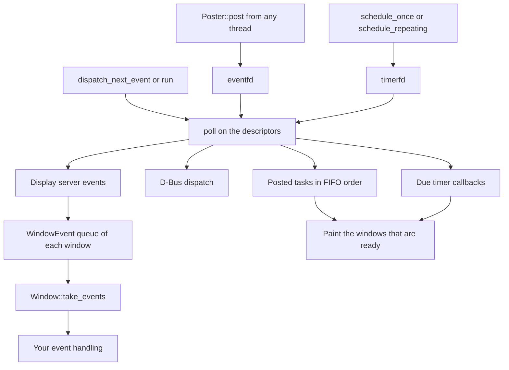
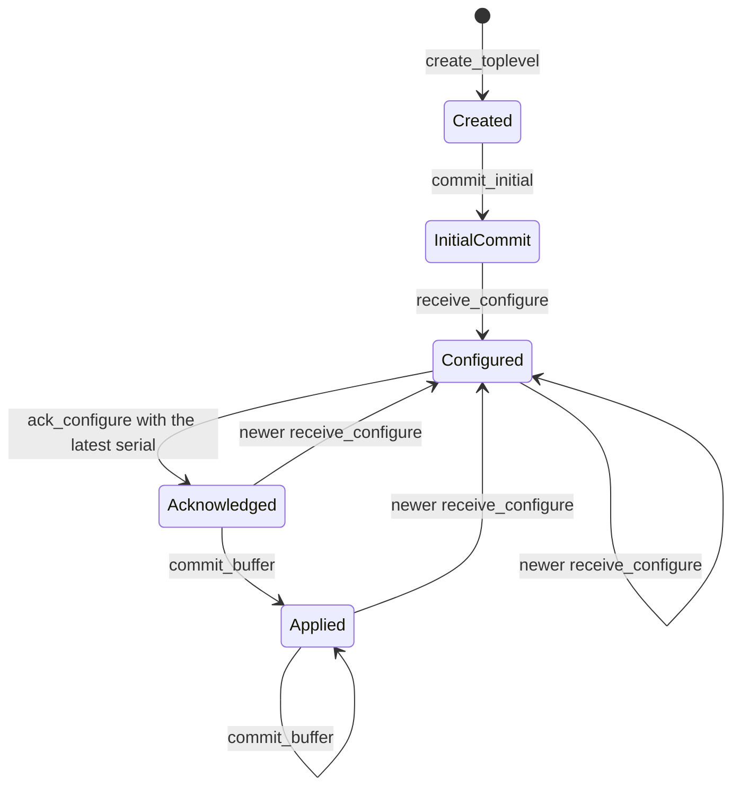

# Linux backend

The `choscorui-linux` crate is the Linux backend. It supports Wayland and X11. The facade uses it through `backend/linux.rs`, behind the portable `App`, `AppContext`, and `Services`. On Linux, the facade also re-exports the crate as `choscorui::platform`, with the `NativeAccess` and `DrawnDialogs` traits. Applications use the portable API first, use `choscorui::platform` only for what it does not cover, and do not depend on the backend crate.

The crate also has platform-neutral state machines for the Wayland and X11 protocols. They compile and run on every host, and the native backend uses them. [`tests/protocol_contracts.rs`](../crates/choscorui-linux/tests/protocol_contracts.rs) pins their rules. [Protocol state machines](#protocol-state-machines) describes them.

## Requirements

| Requirement | Version |
| --- | --- |
| Display server | A Wayland compositor with the [required globals](#wayland-protocols), or an X11 server |
| Rust | 1.88 or later, edition 2024 |
| System libraries | The libraries in the next table, from the Linux distribution |

The release gallery links only `libc`, `libm`, and `libgcc_s` (`ldd target/release/choscorui-gallery`). The backend loads every other library at run time with `dlopen`, so a build needs no system library packages. A library that does not load disables only the features that need it:

| Library | Soname | Use | When it does not load |
| --- | --- | --- | --- |
| libwayland-client | `libwayland-client.so.0` | The Wayland connection | No Wayland windows |
| libxcb | `libxcb.so.1` | The X11 connection | No X11 windows |
| libxkbcommon | `libxkbcommon.so.0` | Keymaps, key state, and compose sequences | No windows on either display server |
| libcairo | `libcairo.so.2` | The Cairo painter, captures, and the masks and glyphs of the GLES painter | Windows open, but each paint fails and leaves the region clear |
| libfreetype, libharfbuzz, libfontconfig | `libfreetype.so.6`, `libharfbuzz.so.0`, `libfontconfig.so.1` | [Text](#text) | `text_shaping` is `Unsupported`, and the controls use estimated text metrics |
| libEGL, libGLESv2, libwayland-egl | `libEGL.so.1`, `libGLESv2.so.2`, `libwayland-egl.so.1` | The [GLES painter](#painters). X11 does not use libwayland-egl. | Windows paint with Cairo |
| libwayland-cursor | `libwayland-cursor.so.0` | Xcursor themes on Wayland | Without `wp_cursor_shape_v1`, only custom cursor images show |
| libxkbcommon-x11 | `libxkbcommon-x11.so.0` | The X11 keymap from XKB | The X11 keyboard has no keymap |
| libxcb-xkb, libxcb-xinput, libxcb-shm, libxcb-randr, libxcb-render, libxcb-cursor | `.so.1` for xcb-xkb, `.so.0` for the others | The [X11 extensions](#x11-extensions) | The client uses the fallback of each extension |
| libX11 | `libX11.so.6` | XIM input methods, and the EGL display on X11 without `EGL_EXT_platform_xcb` | No input method on X11 |
| libxcb-xtest | `libxcb-xtest.so.0` | `Window::simulate_pointer`, for tests | The call returns `Error::Library` |
| libdbus-1 | `libdbus-1.so.3` | [Desktop services](#desktop-integration) and [accessibility](#accessibility) | No D-Bus services and no AT-SPI bridge |
| libcanberra | `libcanberra.so.0` | The [alert sound](#alert-sound) when the display server has no bell | No sound |
| libpng16, libturbojpeg | `libpng16.so.16`, `libturbojpeg.so.0` | PNG and JPEG [images](#image-codecs) | `image_codecs` is `Unsupported` |
| giflib, libtiff, libwebp, libheif | `libgif.so.7`, `libtiff.so.6` or `libtiff.so.5`, `libwebp.so.7`, `libheif.so.1` | GIF, TIFF, WebP, and HEIF images | That format returns `ImageError::UnsupportedFormat` |

[CONTRIBUTING.md](../CONTRIBUTING.md#linux-checks) lists the `-dev` packages that the binding check needs. [licenses.md](licenses.md) records the licenses of the loaded libraries.

### Wayland protocols

The compositor must have `wl_compositor` version 4 or later, `wl_shm`, `xdg_wm_base`, and `wl_seat`. Without one of them, `Application::new` returns `Error::MissingProtocol`. The other protocols are optional:

| Protocol | Use | Without it |
| --- | --- | --- |
| `zxdg_decoration_manager_v1` | Server-side decorations | The toolkit draws the [title bar](#decorations) |
| `wp_fractional_scale_manager_v1` with `wp_viewporter` | Fractional scale | The integer scale of `preferred_buffer_scale`, or the largest scale of the outputs of the window |
| `wp_cursor_shape_manager_v1` | Cursor shapes that the compositor draws | Cursors of the Xcursor theme |
| `xdg_activation_v1` | Focus for a new window | The compositor decides the focus |
| `zwp_text_input_manager_v3` | [Input methods](#input-methods) | `input_methods` is `Unsupported` |
| `wl_data_device_manager` | [Clipboard and drag and drop](#clipboard-and-drag-and-drop) | `clipboard` and `drag_and_drop` are `Unsupported` |
| `xdg_wm_dialog_v1` | Modal [dialogs](#dialogs) | The dialog is a child window without the modal hint |
| `xdg_system_bell_v1` | The [alert sound](#alert-sound) | libcanberra plays the sound |
| `zxdg_output_manager_v1` | Logical screen rectangles | The rectangles come from the output mode and scale |
| `zxdg_exporter_v2` | The parent window of portal dialogs | Portal dialogs have no parent window |
| `zwp_pointer_gestures_v1` | Touchpad pinches as [`Gesture` events](#wayland) | The windows send no `Gesture` events |

### X11 extensions

The X11 client needs only the core protocol. It uses these extensions when the server has them:

| Extension | Use | Without it |
| --- | --- | --- |
| XKB | The keymap, the modifier state, detectable auto-repeat, and the bell | No keymap and no XKB bell |
| XInput 2.2 | Pointer events and smooth scroll valuators | Core pointer events |
| MIT-SHM | Shared images for the paint | `PutImage` in parts |
| RandR | The rectangles of the monitors | The root window is the only screen |
| RENDER | Cursors from images | The arrow shows |
| XTEST | `Window::simulate_pointer`, for tests | The call fails |

The xcb-cursor library loads the cursors of the cursor theme. Without it, the cursors come from the core cursor font.

## Application lifecycle and run loop

`Application`, `Window`, and the other native handles are neither `Send` nor `Sync`. The compiler keeps them on the thread that made them, which is the UI thread.

`Application::new` connects to the display server that [Backend selection](#backend-selection) chooses. It fails with `Error::NoDisplay` without a display server, and with `Error::Library` when a required library does not load. `Application::set_app_id` sets the Wayland `app_id` and the X11 `WM_CLASS` of the windows that open after the call. The facade gives it the identifier of `App::id`.

The application does not take control of your main loop. Use one of these models:

- **Your own loop.** Call `Application::dispatch_next_event(timeout)` in a loop. It paints the windows that are ready, waits up to `timeout`, and handles what arrived. It returns `true` when it handled an event.
- **The blocking loop.** Call `Application::run`. It blocks until `Application::stop` or `Poster::request_stop`.

One `poll` call waits on these descriptors:

- the socket of the display server
- the eventfd of `Poster`
- the timerfd of the earliest timer
- the descriptors of each attached D-Bus connection

`Application::attach_bus(connection)` adds a D-Bus connection to the loop. The facade attaches the session bus of the desktop services and the accessibility bus. A lost bus ends its services, but the application continues.

When the display connection is lost, `dispatch_next_event` returns `Error::Connection`, and each window gets `WindowEvent::Closing`.

The diagram shows the path of events, posted tasks, and timers in one turn of the loop.

### Threads, posted tasks, and timers

- `Application::poster` returns a `Poster`. A `Poster` is `Send` and `Clone`. `Poster::post` queues a closure on the UI thread, in FIFO order.
- After the `Application` drops, `Poster::post` returns `PostError::Stopped` and drops the closure. The closures that wait in the queue also drop without a call.
- `Application::schedule_once` and `Application::schedule_repeating` create a `Timer`. A repeating interval of zero returns `Error::InvalidInterval`.
- A repeating timer skips missed ticks. It does not fire a burst of ticks.
- `Timer::cancel` or a drop of the `Timer` stops further calls, also from inside the timer callback.

A panic in a posted task or a timer stops at the loop. The loop counts it in `Application::posted_panic_count` or `Application::timer_panic_count`, and it continues. `MainMenu::callback_panic_count` is always 0, because the menus run no native callbacks on Linux.

A panic in a C callback does not unwind into the C library. The callback writes the boundary name to standard error and returns its fallback value. [ffi.md](ffi.md) lists each boundary and its fallback.

## Windows

1. Create a window with `Application::create_window(WindowOptions::new(title, width, height))`. The size is in logical points.
2. Give it content with `Window::set_display_list`.
3. Call `Window::show`.
4. Call `Window::take_events` after each event pump.
5. Handle each `WindowEvent` that it returns.

`create_window` returns `Error::InvalidSize` for a size that is not positive and finite, and `Error::InvalidTitle` for a title with a NUL character. `WindowEvent` has these variants on Linux:

| Variant | Meaning |
| --- | --- |
| `Resized { size, scale }` | The content size or the scale changed. The first configure or map of a window also sends it. |
| `ScaleChanged { scale }` | The buffer scale changed. A `Resized` event with the same size follows. |
| `Focused(bool)` | The window got or lost the keyboard focus. On Wayland, this is the `activated` state of `xdg_toplevel`. |
| `Closing` | The user asked to close the window, or the display connection is lost. |
| `Pointer { event, modifiers, details }` | Pointer, button, and wheel input in logical points. `details.click_count` counts presses of the same button within 400 ms and 4 points. |
| `Key { event, modifiers }` | Key down and key up. |
| `Text { text }` | Committed text from an ordinary key press or a compose sequence. |
| `Ime(ImeEvent)` | Input method composition. See [Input methods](#input-methods). |
| `Occluded(bool)` | X11 only: the window became fully hidden, or partly visible again. |
| `Drag(DragEvent)` | A drag over the content. See [Clipboard and drag and drop](#clipboard-and-drag-and-drop). |
| `DragEnded(DragOperation)` | A drag that the window started has ended. |
| `Gesture { event, modifiers }` | Wayland only: a touchpad pinch over the content, as `GestureEvent::Magnify` about the pointer. See [Wayland](#wayland). |

In `Modifiers`, `control` is Ctrl, `option` is Alt, and `command` is the Super key. `capabilities().keyboard` is `KeyConvention::Pc`, so the controls run a `command` shortcut with Ctrl.

A `Key` event names the navigation and editing keys, F1 to F20, and the Menu key (`Key::ContextMenu`). Another key is a lowercase `Key::Character` from the active keymap, or `Key::Other` with the key code. A compose sequence comes from the compose table of the locale: the first of `LC_ALL`, `LC_CTYPE`, and `LANG`.

On Wayland, the client repeats a held key at the rate and delay of `wl_keyboard.repeat_info`. On X11, the server repeats the key, and detectable auto-repeat sends repeated presses.

Wheel events have two units:

- A wheel detent gives `WheelUnit::Lines`. On Wayland, a step is 120 units of `axis_value120` or one `axis_discrete` step.
- Smooth scroll gives `WheelUnit::Points`. On X11, one valuator increment is 15 points.

Positive deltas scroll down and to the right, as on macOS.

### Painters

`set_display_list` with an identical display list schedules no paint. A changed list paints only the region whose drawing changed. `Window::painter()` returns the painter of the window:

- `Painter::Gles` paints with OpenGL ES 3.0 through EGL, on a `wl_egl_window` or on the X11 window.
- `Painter::Cairo` paints with Cairo on the CPU. On Wayland, it paints into double-buffered `wl_shm` buffers. On X11, see [X11 painting](#x11-painting).

#### Fallback

- New windows use GLES. They use Cairo when `CHOSCORUI_PAINTER=cairo` is set, or when libEGL or libGLESv2 does not load. On Wayland, they also use Cairo when libwayland-egl does not load.
- On X11, the EGL display uses `EGL_EXT_platform_xcb` when EGL has it, else `EGL_KHR_platform_x11` with libX11. Without both, new windows use Cairo.
- New windows also use Cairo when no EGL config has RGBA8 and OpenGL ES 3.0, or when the shaders do not compile. On X11, the config must have the visual of the root window instead of RGBA8.
- The shaders compile when the application connects, before a window opens. A compile or link failure is a `GlesError`, not a panic.
- A GPU failure during a paint switches that window to Cairo for the rest of its life. The window then repaints all of its content.
- A lost context, a failed swap, and an OpenGL ES error during a paint are GPU failures. The other GLES windows switch to Cairo at their next paint.
- `capabilities().gpu_painting` is `Supported` when the GLES painter started and no GPU failure occurred. Else it is `Unsupported`.
- `Window::capture()` renders the display list with Cairo for both painters. `render_offscreen` is the Cairo export.
- `render_offscreen_gles` renders with GLES on the Mesa surfaceless EGL platform. The parity test uses it.

#### GLES frames

- The swap interval is 0. On Wayland, the `wl_surface.frame` callback and `FrameScheduler` pace the paints, as they do for Cairo. On X11, a window paints when its content changes or an `Expose` event arrives.
- On Wayland, the window sends the viewport, the window geometry, and the frame request before the swap. The swap attaches the buffer and commits the surface.
- With `EGL_EXT_buffer_age`, a paint repaints the damage of each frame since the back buffer was on the screen. Without it, a paint repaints the whole window.
- With `EGL_KHR_swap_buffers_with_damage` or `EGL_EXT_swap_buffers_with_damage`, the swap gives the damage to the display server.

#### GLES drawing

The painter draws each command in the order of the display list, as the Cairo painter does. One shader program multiplies a paint, a coverage, and a clip.

- A rectangle under an axis-aligned transform gets exact area coverage in the shader.
- Cairo rasterizes the coverage of other fills and strokes into a mask in device pixels. The painter keeps the masks that repeat from frame to frame.
- Glyphs come from one atlas texture. Cairo rasterizes each glyph with the faces of the Cairo painter, at the quarter-pixel phase of its position.
- Thus, both painters cover the same pixels, and they put glyphs at the same positions.
- A clip on whole pixels is a scissor rectangle. Another clip renders its coverage, times the outer clip, into a coverage texture.
- An opacity group draws into a layer texture. The pop of the group composites the layer with the opacity.
- Backdrop blur reads the base target back, blurs it with `blur_pixels`, and draws it in the rounded rectangle.

#### X11 painting

With the GLES painter, an X11 window paints through EGL on a connection of its own. The EGL requests and errors then stay out of the event loop. With Cairo, the window paints into a client-side image and sends only the pending region. It uses MIT-SHM when the server shares memory with the client. A shared image stays busy until its completion event. Otherwise `PutImage` sends the pixels in parts that fit the maximum request length.

### Other window operations

- `set_title`, `title`, `content_size`, `set_content_size`, and `backing_scale_factor` read or change the title and the size. The window manager can refuse a size, and a `Resized` event reports the size that applies.
- `set_cursor` sets the pointer shape over the content. A custom image must be at most 256 pixels on each side, with the hotspot inside it. Else the call returns `Error::InvalidCursor`.
- `capture` renders the display list with Cairo at the content size and the backing scale. It never reads GPU memory.
- `paint_count`, `first_paint`, `last_paint`, and `last_damage` tell when and where the window painted. The bench and the smoke tests use them.
- `geometry` and `set_geometry` save and restore the window placement. See [Window geometry](#window-geometry).
- `has_server_decorations`, `begin_move`, `begin_resize`, `show_window_menu`, `set_maximized`, and `minimize` serve the [drawn title bar](#decorations).

`Window::close` closes the window. A drop of the `Window` does not close it. `Application::window_count` returns the number of open native windows, without the popups.

### Window geometry

- **Wayland.** A Wayland client cannot read or set the position of its window. `geometry` gives the content size, the maximized state, and the full-screen state, and its origin is always zero. `set_geometry` applies the size and the two states, and it ignores the origin.
- **X11.** `geometry` reads the position with `TranslateCoordinates`, removes `_NET_FRAME_EXTENTS`, and reads `_NET_WM_STATE`. `set_geometry` configures the window. Before the window shows, it writes `_NET_WM_STATE`. After that, it sends client messages to the window manager.

`Application::screens` gives the logical rectangles of the screens. On Wayland, they come from `zxdg_output_manager_v1`, or else from the mode and the scale of each output. On X11, they are the RandR monitors, or the root window without RandR.

## Backend selection

Wayland and X11 are separate backends. `select_backend(requested, wayland_display, x11_display)` chooses one `BackendKind`:

- With no request, it chooses Wayland when `WAYLAND_DISPLAY` is set and not empty. Otherwise it chooses X11 when `DISPLAY` is set and not empty.
- With an explicit request, it returns that backend only when its display is available. It never uses the other display server. The error is `BackendSelectionError::RequestedUnavailable`.
- With no display, it returns `BackendSelectionError::NoDisplayServer`.

`Application::new` reads the request from `CHOSCORUI_BACKEND`, which is `wayland` or `x11`. Another value is no request. Without a request, a failed Wayland connection falls back to X11 when `DISPLAY` is set. `Application::backend` tells which display server is in use.

The facade maps a selection failure, a missing protocol, and a library that does not load to `AppError::Unsupported`.

`LinuxCapabilities::for_backend` gives the optional features of each backend, as the protocol state machines see them:

| Feature | Wayland | X11 |
| --- | --- | --- |
| Frame callbacks | Available | Unavailable: X11 uses expose and presentation events |
| Clipboard | Depends on `wl_data_device` | Available |
| Input method | Depends on `text-input-v3` | Depends on XIM |
| Touch | Depends on the `wl_touch` seat capability | Depends on XInput2 |
| Tablet | Depends on `tablet-v2` | Depends on XInput2 |
| Gestures | Depends on `pointer-gestures-v1` | Unavailable: core X11 has no portable gesture protocol |
| Drag and drop | Depends on `wl_data_device` | Depends on XDND |

## Wayland

- **Windows.** Each window is an `xdg_toplevel` with the title, the `app_id`, and the minimum size of `WindowOptions`. The first commit has no buffer, and the window paints after it acknowledges the latest configure.
- **Events.** `xdg_toplevel.close` gives `Closing`. A configure gives `Resized` when the size changes, and `Focused` when the `activated` state changes. A configure size of zero keeps the current size.
- **Scale.** With `wp_fractional_scale_v1` and `wp_viewporter`, the scale is the preferred fractional scale. Else it is the `preferred_buffer_scale` of `wl_surface` version 6. Else it is the largest scale of the outputs of the window.
- **Activation.** When a window shows, it asks for the focus through `xdg_activation_v1`. The first window uses the token of `XDG_ACTIVATION_TOKEN`. A later window uses a new token with the serial of the latest button press.
- **Portal parent.** Each window exports its toplevel with `zxdg_exporter_v2`. The handle gives the parent `wayland:HANDLE` of portal dialogs.
- **Gestures.** With `zwp_pointer_gestures_v1`, the seat pointer gets a `zwp_pointer_gesture_pinch_v1`. Each pinch update gives `GestureEvent::Magnify` at the pointer position.
- **Gesture scale.** The protocol gives the scale since the start of the pinch. The event scale is the change since the previous update, as on macOS. Thus, the product of the event scales is the scale of the pinch.
- **Ignored gestures.** An update without a change of scale gives no event. The end or the cancel of a pinch gives no event, and the backend ignores swipe and hold gestures.
- **Fake input.** `Window::simulate_pointer` returns `Error::MissingProtocol`, because Wayland has no protocol for fake input of a client.

### Wayland cursors

The cursor of a window comes from the first source that the compositor allows:

1. A custom image goes in a `wl_shm` buffer on a cursor surface.
2. With `wp_cursor_shape_v1`, the compositor draws the cursor of the shape.
3. Else, libwayland-cursor loads the Xcursor theme of `XCURSOR_THEME` at the size of `XCURSOR_SIZE`. The default size is 24 pixels.

The theme loads at the integer scale of the window under the pointer, and the cursor surface has that buffer scale. When the theme has no cursor of the shape, the cursors that libwayland-cursor has built in show.

## X11

On Linux, `Application::new` connects to the X server of `DISPLAY` when the selection gives X11. Without `DISPLAY`, or when the server refuses the connection, it returns `Error::NoDisplay`.

- **Windows.** Each window has `WM_DELETE_WINDOW`, `_NET_WM_NAME`, `WM_NAME`, `WM_CLASS` from the application id, and `_NET_WM_PID`. `WM_NORMAL_HINTS` holds the minimum size and north-west gravity. The window manager draws the frame, so `has_server_decorations` is true.
- **Events.** `WM_DELETE_WINDOW` gives `Closing`. `ConfigureNotify` gives `Resized`, and the first `MapNotify` gives `Resized` and activates the window. Focus events give `Focused`, and `VisibilityNotify` gives `Occluded`.
- **Activation.** A window that maps sends `_NET_ACTIVE_WINDOW` to the window manager. When no window manager runs, as on Xvfb, the window takes the input focus itself.
- **Scale.** The scale is `Xft.dpi` over 96, from `RESOURCE_MANAGER` on the root window. A change of the property gives `ScaleChanged` and `Resized`, and the window keeps its logical size.
- **Keyboard.** xkbcommon-x11 reads the keymap and the state of the core keyboard. XKB state events update the modifiers. With detectable auto-repeat, a held key arrives as repeated presses, and the keyboard does not repeat keys itself.
- **Pointer.** XInput 2.2 gives the pointer events of the master devices. A scroll valuator gives `WheelUnit::Points`: one increment is 15 points. The wheel buttons 4 to 7 give `WheelUnit::Lines` when the server does not emulate them from a valuator. Without XInput 2.2, core events give the same events.
- **Window manager requests.** `begin_move` and `begin_resize` send `_NET_WM_MOVERESIZE`. `show_window_menu` sends `_GTK_SHOW_WINDOW_MENU`, which some window managers ignore. `minimize` sends `WM_CHANGE_STATE` with `IconicState`.
- **Cursors.** A cursor comes from the cursor theme through xcb-cursor, or else from the core cursor font. A custom image becomes a RENDER cursor. Without RENDER, the arrow shows.
- **Portal parent.** The parent of portal dialogs is `x11:XID`, with the window id in hexadecimal.

When no window manager runs, the `_NET_WM_STATE` client messages have no effect. Thus the geometry smoke test uses a window that does not show.

## Menus, popups, and decorations

Linux has no global menu bar. The facade draws the menus and the title bar in each window. The policy is in the controls, and `backend/linux/chrome.rs` connects the controls to the native window.

### Menus

- **Menu bar.** `Application::install_main_menu(model)` returns a `MainMenu`. It keeps the model and the queue of chosen commands. Each window that opens after the installation shows a `Menubar` control at its top, above the content. A new model replaces the titles and the items in each bar.
- `perform_action(command)` queues an enabled command and returns `Ok(true)`. A disabled command returns `Ok(false)`. An unknown command returns `MenuError::UnknownCommand`.
- **Shortcuts.** The window gives a key press with Ctrl or Super to the menus before the views get it. `perform_key_equivalent(key, modifiers)` runs it. In the model, `command` is Ctrl. The items show the PC labels, such as `Ctrl+K`.
- **Menu keys.** F10 moves the focus to the menu bar. Alt with the mnemonic of a menu opens that menu with its first row highlighted. The mnemonic is the first letter or digit of the title (`menu_mnemonic`). The arrow keys, Enter, and Escape then work as in the `Menubar` control.
- A click, a shortcut, and a key choice all queue the command in the same `MainMenu`. `AppContext` runs the action after it delivers the input.
- The open menus of the bar show inside the window, so a menu that is longer than the window is cut off.

### Popups and context menus

- **Popups.** `Window::open_popup(anchor, size)` opens a popup below the bottom-left corner of `anchor`. At the screen edges, the popup flips, then slides. A click outside the popup sends `WindowEvent::Closing`. `Application::window_count` does not count popups.
- **Wayland popups.** The popup is an `xdg_popup`. The `xdg_positioner` flips it, slides it, and makes it smaller when it does not fit. The popup grabs the pointer and the keyboard with the serial of the latest key or button event. `popup_done` gives `Closing`.
- **X11 popups.** The popup is an override-redirect window with `_NET_WM_WINDOW_TYPE_POPUP_MENU` and `WM_TRANSIENT_FOR`. The backend flips and slides it in the RandR monitor that holds the anchor. When the popup maps, it grabs the pointer and the keyboard. A press outside the popup ends the grabs and gives `Closing`, and the parent window does not get the press.
- **Context menus.** `NativeAccess::show_context_menu(window, menu, at)` shows a `ContextMenu` in a popup at `at`. It runs a nested event loop until the popup closes, as on macOS. It returns the chosen command, and the command also waits in `menu.take_activations()`. Escape, a click outside the popup, or a press in the parent window returns `None`. During the loop, the keys of the parent window go to the menu, because a compositor can keep the keyboard focus on the parent.
- Submenus of a context menu show inside the popup.
- A context menu is not taller than the smallest screen. When the popup has less height than the rows, the rows scroll.
- `native_menus` and `context_menus` are `Supported` on Wayland and X11.

### Decorations

- When the compositor does not grant server-side decorations, `Window::has_server_decorations` is false. Then the facade puts a `TitleBar` control above the menu bar. `CHOSCORUI_DECORATIONS=client` refuses the server-side decorations, for tests.
- A drag on the title bar starts `xdg_toplevel.move`. A double click maximizes or restores the window. A secondary click shows the compositor's window menu. The buttons minimize, maximize, and close the window.
- A primary press in the resize band starts `xdg_toplevel.resize` from that edge. The band is two spacing units outside the frame and one unit inside it. The pointer shows a resize cursor over the band.
- **Shadow.** The surface has a margin around the frame for the `Panel` shadow and the outer band. `xdg_surface.set_window_geometry` gives the frame. The input region is the frame and the outer band.
- A maximized, full-screen, or tiled window has no margin. Windows with server-side decorations, and X11 windows, also have no margin.
- The facade gives the title, the maximized state, and the focus state of the window to the title bar through its `TitleBarHandle`.

## Dialogs

Linux has no alert service, and a file chooser needs a portal. The toolkit draws these dialogs in modal windows of their own.

`Application::begin_modal(window)` makes `window` the modal window of the application until the `ModalSession` drops:

- The window becomes a dialog of its parent. Give the parent with `Window::set_modal_parent`. Without one, the parent is the focused window, or else the newest visible window.
- On Wayland, the window calls `xdg_toplevel.set_parent`. With `xdg_wm_dialog_v1`, it also gets an `xdg_dialog_v1` and calls `set_modal`.
- On X11, the window gets `WM_TRANSIENT_FOR` and the `_NET_WM_STATE_MODAL` state.
- The other windows drop their pointer, key, text, input method, and drag events. They keep their last frame. A close request waits in their queue.

**Alerts.** `choscorui::platform::DrawnDialogs::show_alert(spec)` shows an `AlertSpec` over the active window of an `AppContext`. The contract and the validation of `AlertSpec` are the same as on macOS.

- The window shows `AlertDialog::window`, at the size that the alert measures. The message is the title, and the detail is the text under it.
- The first button is the default button: Enter runs it. Escape runs a button titled Cancel, in English or in the locale of the application.
- A button gives `AlertResponse::Button(index)`. Escape without a Cancel button, or a close of the window, gives `AlertResponse::Cancelled`.
- `AlertStyle` does not change the drawn alert.
- `DialogError::Unavailable` tells that the display server could not open the window.

**File dialogs.** `Services::choose_files` uses the `org.freedesktop.portal.FileChooser` portal. Without a portal, or without a backend for its file chooser, the services open the drawn `FileDialog` control.

- The portal call waits for the `Response` signal in a nested loop. The parent of the dialog is the handle of the focused window.
- The drawn dialog starts in the folder of the request, or else in `HOME`. It shows the title, the accept label, the extensions, and the suggested name of the request.
- Accept gives the chosen paths. Cancel, Escape, or a close of the window gives `FileDialogResponse::Cancelled`.
- `native_dialogs` is always `Supported` while a display server is connected.

Each modal window runs a nested event loop until it has a result. `DrawnDialogs::set_modal_driver` gives a test harness each turn of that loop: the view host, the native window, and its focus.

## Clipboard and drag and drop

`Application::clipboard()` gives a `SystemClipboard` for the selection of the display server. `SystemClipboard::temporary()` gives a private board that no other process sees. The API is the same as the macOS `Clipboard`: `write_text`, `read_text`, `write`, `formats`, and `read`. The name is different because `Clipboard` is the [state machine](#clipboard-states).

Each `DragItem` uses these MIME types:

| Format | Offered types | Also read |
| --- | --- | --- |
| `Text` | `text/plain;charset=utf-8`, `text/plain`, and `UTF8_STRING` | |
| `Files` | `text/uri-list` with `file://` URIs | |
| `Image` | `image/png` | JPEG, TIFF, GIF, WebP, and HEIF, converted to PNG |
| `Url` | `text/x-moz-url`, and `text/uri-list` when there are no files | |
| `Custom(name)` | none | |

- Custom data stays in the process. Other processes never see it.
- Text with a NUL character, and a relative file path, return `Error::InvalidClipboardText`. An image that is not PNG, and a custom name that is not valid, return `Error::UnsupportedFormat`.
- While the application owns the selection, it reads its own data. It does not ask the display server.
- A read from another client stops after 2 seconds without data.

`Window::accept_drops(formats, operations)` makes a window a drop target. An empty format list, or no operations, stops drops. `Window::begin_drag(items, allowed, preview)` starts a drag:

- Call `begin_drag` while the left button is down on the window. Otherwise it returns `Error::NoDragEvent`, because the drag needs the serial of that press.
- The center of `preview` follows the pointer.
- The target window gets `WindowEvent::Drag` events. The source window gets `WindowEvent::DragEnded` with the operation.
- Wayland has copy and move actions, but no link action.
- X11 has copy, move, and link actions. The pointer shows no preview.
- The modifiers follow the PC convention: Ctrl copies, Shift moves, and Ctrl+Shift links. Without a modifier, a drag in the same application moves, and a drag from another application copies.

### Wayland data transfer

`wl_data_device` carries the selection and the drags. The compositor accepts a selection only from a client with recent input. Thus the backend sends the serial of the last key, button, or focus event. `clipboard` and `drag_and_drop` are `Supported` when the compositor has `wl_data_device_manager`.

### X11 data transfer

The selections of the ICCCM carry the clipboard, and XDND version 5 carries the drags. `clipboard` and `drag_and_drop` are always `Supported` on X11.

- **Clipboard.** A hidden window owns `CLIPBOARD`. It answers `TARGETS`, `TIMESTAMP`, `MULTIPLE`, each MIME type, `UTF8_STRING`, and `TEXT`. It also answers `STRING` with Latin-1 text. `SelectionClear` ends the ownership.
- **Reads.** A read asks the owner to convert the selection into a property of the hidden window. While it waits, the client answers requests for its own selections and keeps the other events for the event loop. When the other owner offers only `STRING`, the text reads as `text/plain`.
- **Large data.** Data larger than 256 KiB, or than a quarter of the maximum request length, goes with INCR in chunks. Reads accept INCR too. Each step of a read stops after 2 seconds without data.
- **Drop targets.** Each window has `XdndAware`. At the first `XdndPosition`, the window decides if it takes the drag, and sends `Enter`. Each `XdndStatus` asks for all positions. On `XdndDrop`, the window reads `XdndSelection` at the time of the drop, and sends `XdndFinished`.
- **Drag sources.** `begin_drag` needs the left button down on the window. The hidden window owns `XdndSelection` and holds `XdndTypeList` and `XdndActionList`. The client grabs the pointer and sends the messages to the aware window under it. It sends one position at a time, and waits for the status. The source gets `DragEnded` on `XdndFinished`, or `DragOperation::None` after 5 seconds without it.
- **Tests.** `Window::simulate_pointer` is hidden test support. On X11 it moves the pointer and presses or releases the left button through XTEST.

## Alert sound

`Application::beep()` plays the alert sound of the controls. It uses the first source that works:

1. On Wayland, `xdg_system_bell_v1` rings the bell for the focused window. On X11, the XKB bell of the core keyboard rings for the focused window.
2. The libcanberra event sound `bell` plays from the sound theme.
3. Else, the application makes no sound.

The facade gives each window's view host a `Feedback` that calls `beep()`. Thus a control that refuses a key or a paste plays the sound.

## Input methods

`Window::set_text_input_state` tells the input method about the focused text control with a `TextInputState`. `active` is true while a text control has the focus. `text` is the committed text of the control, and the UTF-16 ranges count in it. `caret` is the caret rectangle in logical window coordinates. Set `captures_keys` while the focused control records keys, as on macOS. Composition arrives as `WindowEvent::Ime` with the `ImeEvent` values `SetMarkedText`, `CommitText`, and `Unmark`.

### Wayland text input

On Wayland, `zwp_text_input_v3` connects the window to the input method:

1. When `active` becomes true, the backend enables the text input.
2. Each state change sends the surrounding text, the cursor rectangle, and a commit. The surrounding text goes only while nothing is marked, because it does not contain the marked text.
3. The protocol uses byte offsets. The backend converts them to and from UTF-16 offsets.
4. A text longer than 4000 bytes sends a part of 4000 bytes or less around the selection.

The changes of the input method come in a group that ends with `done`. Each group gives these `ImeEvent`s, in this order:

- A commit or a deletion gives `CommitText`. A deletion around the cursor gives a `replacement_utf16` range.
- New marked text gives `SetMarkedText`. When the input method clears its marked text without a commit, the event has empty text.

`input_methods` is `Supported` when the compositor has `zwp_text_input_manager_v3`.

### XIM

On X11, XIM connects the window to the input method, on-the-spot:

1. The client opens the input method of `XMODIFIERS` on a second Xlib connection. It uses the input method only when it takes preedit callbacks. The local input method of Xlib does not, so without `XMODIFIERS` there is no input method. Keys then type their text through xkbcommon and compose.
2. When `active` becomes true, the window gets an input context. The context has the focus while the window has it. Its spot is the bottom-left corner of the caret. When `active` becomes false, the context closes, and marked text gives `Unmark`.
3. Each key of a window with a focused context goes to the input method first. The keys that the input method does not use come back, and the window gets them as usual.
4. The preedit draw callback gives `SetMarkedText`, with the caret as an empty selection in UTF-16 units. The preedit done callback gives `Unmark`. Committed text gives `CommitText` without a replacement range.

XIM has no surrounding text, so the X11 backend does not send `text`. `input_methods` is `Supported` on X11 when such an input method opens.

## Desktop integration

`NativeServices` in `choscorui::platform::services` implements the services of `choscorui`. It uses a private connection to the session bus. Without a session bus, each D-Bus service is `Unsupported`, and `open_url` uses `xdg-open`. The facade attaches the connection to the event loop and gives the application events to `Services::listen` as `DesktopEvent` values.

| Feature | Linux service | Behavior |
| --- | --- | --- |
| Activation | Window focus | `Activated` when a window of the application gets the keyboard focus, and `Deactivated` when no window has it. An activation also reads the appearance settings again. |
| Reopen | `org.freedesktop.Application.Activate` | `Reopen { has_visible_windows }`. `has_visible_windows` tells if a window of the application shows. |
| Open documents and URLs | The command line, and `org.freedesktop.Application.Open` | `OpenFiles` for paths and `file:` URIs, and `OpenUrls` for other URLs. |
| Open a URL | `NativeServices::open_url` | The `OpenURI` portal opens the URL, or else `xdg-open`. |
| Default handler | `Services::url_handler` | The `Name` of the desktop entry of the default application, from `mimeapps.list` and the XDG data directories. |
| Status item | `StatusNotifierItem` and `com.canonical.dbusmenu` | See the list below. |
| Notifications | `org.freedesktop.Notifications`, or the `Notification` portal in Flatpak | See the list below. |

At launch, the files and URLs in the command-line arguments give `OpenFiles` and `OpenUrls`. An argument that starts with `-` is an option, until the argument `--`. A relative path is relative to the current directory.

The application owns its `App::id` as a name on the session bus, and it exports `org.freedesktop.Application` at the matching object path. For example, `org.example.App` has the path `/org/example/App`. When another instance owns the name, `NativeServices::is_primary_instance` returns `Some(false)`.

D-Bus activation and some notification servers find the application through its desktop entry. Install a `.desktop` file and a D-Bus service file named after the `App::id`. The toolkit does not install them.

URLs follow these rules:

- `open_url` and `url_handler` return `DesktopError::InvalidUrl` or `ServiceError::InvalidUrl` for text that is not a URL with a scheme.
- The `OpenURI` portal does not open `file:` URIs, so they go to `xdg-open`.
- Before `xdg-open` runs, `open_url` returns `DesktopError::NoHandler` when no installed application handles the URL. A `file:` URI uses the MIME type of the file.

A status item registers with `org.kde.StatusNotifierWatcher`:

- Each item owns a name `org.kde.StatusNotifierItem-PID-N` and exports `/StatusNotifierItem` and the menu at `/MenuBar`.
- The title, the tooltip, and the visibility map to the item properties. A hidden item has the `Passive` status.
- A menu choice sends `DesktopEvent::StatusMenu` with the command.
- When a new watcher starts, the item registers again. A drop of the item removes it.

Notifications follow these rules:

- Inside a Flatpak sandbox, which has `/.flatpak-info`, notifications go through the `Notification` portal. Elsewhere they go to `org.freedesktop.Notifications`.
- The desktop has no permission step, so `notification_permission` is always `Granted` while a notification service runs.
- A notification with an existing identifier replaces the old one.
- A click on a notification sends `DesktopEvent::NotificationActivated { identifier, action }`. The action of a click on the notification itself is `default`.

## System appearance and accessibility preferences

`NativeServices` reads the `org.freedesktop.portal.Settings` portal. It reads the settings again on each `SettingChanged` signal and when a window of the application gets the focus.

| Setting | Field |
| --- | --- |
| `org.freedesktop.appearance` `color-scheme` is 1 | `SystemAppearance::prefers_dark` |
| `org.freedesktop.appearance` `contrast` is 1 | `AccessibilityPreferences::high_contrast` |
| `org.gnome.desktop.interface` `enable-animations` is false | `AccessibilityPreferences::reduced_motion` |
| `org.gnome.desktop.interface` `text-scaling-factor` | `AccessibilityPreferences::text_scale`, 1.0 when the value is not positive |
| `org.gnome.desktop.interface` `font-name` | `SystemAppearance::font_name`, such as `Cantarell 11` |

- `NativeServices::appearance`, `system_prefers_dark`, and `accessibility_preferences` return the current values. Without the portal, the appearance is light with the default preferences.
- `take_appearance_changed` returns `true` one time after a setting changed.
- `system_appearance` is `Supported` when the portal answers.

The facade does not apply the color and accessibility values itself. Read them, and give the result to your token closure, as on macOS. The facade applies the font name. See [Text](#text). [theming.md](theming.md) describes how `ThemeResolver` applies the preferences.

## Settings storage

`user_settings_path(app_id)` in `choscorui::core` returns the path of the settings file. On Linux, the path is `$XDG_CONFIG_HOME/<app_id>/settings.txt`. When `XDG_CONFIG_HOME` is not set or empty, the path is `$HOME/.config/<app_id>/settings.txt`.

- `app_id` is a reverse-DNS identifier, for example `com.example.editor`.
- The function returns `None` for an identifier that is not a valid setting key, that has a `/`, or that starts with a `.`. It also returns `None` when the path needs `HOME` and `HOME` is not set.

`App::id(app_id)` keeps the stored state and the restored window frames of an application in this file. On Wayland, `Scene::restore_geometry` restores the size and the states, but not the position. [Window geometry](#window-geometry) gives the reason. [guide.md](guide.md) describes the `Settings` API and the file format.

## Text

`LinuxTextShaper` shapes text with HarfBuzz on FreeType faces, and fontconfig chooses the faces. It implements the `TextShaper` contract of core.

- `system-ui` is the family that `set_desktop_font` gives, or else `sans-serif`. The family of `Inter 10` is `Inter`: the size and the style words go.
- `NativeServices::update_desktop_font` gives `SystemAppearance::font_name` to `set_desktop_font`. The facade calls it at the start and after each native event, so a `SettingChanged` signal changes `system-ui`.
- After a font change, only text that lays out again uses the new family.
- The settings portal also runs in X11 sessions, so the backend does not read the XSETTINGS `Gtk/FontName`. Without the portal, `system-ui` is `sans-serif`.
- Each grapheme cluster uses the first face that has all its characters.
- `available_font_families` lists the fontconfig families, without hidden families.
- `text_shaping_support` is `Supported` when FreeType, HarfBuzz, and fontconfig load. Without them, the facade measures text with estimated metrics.

Both painters draw each glyph run with the face that shaped it. [text.md](text.md#linux) describes the families, the fallback, the line breaks, and the direction rules.

## Image codecs

On Linux, `decode_image(bytes)` gives straight-alpha sRGB RGBA8 pixels, as the macOS backend does. The first bytes select the format and its library:

| Format | Signature | Library |
| --- | --- | --- |
| PNG | `\x89PNG\r\n\x1a\n` | libpng16 (`libpng16.so.16`) |
| JPEG | `FF D8 FF` | libturbojpeg (`libturbojpeg.so.0`) |
| GIF, first frame | `GIF87a` or `GIF89a` | giflib (`libgif.so.7`) |
| TIFF | `II*\0`, `MM\0*`, or BigTIFF | libtiff (`libtiff.so.6` or `libtiff.so.5`) |
| WebP, still images | `RIFF` and `WEBP` | libwebp (`libwebp.so.7`) |
| HEIC and HEIF | an `ftyp` box with a HEIF brand | libheif (`libheif.so.1`) |

- A JPEG file turns as its EXIF `Orientation` tag tells. libheif applies the rotation and mirror properties of a HEIF file. libtiff applies the orientation tag of a TIFF file.
- A GIF frame shows on its logical screen. The pixels outside the frame, and the transparent index, are transparent.
- Unknown bytes, and a format whose library does not load, return `ImageError::UnsupportedFormat`. Damaged data returns `ImageError::DecodeFailed`.
- An image of more than 64 Mpx returns `ImageError::InvalidDimensions`.
- An animated WebP file returns `ImageError::DecodeFailed`, because the simple libwebp API decodes only still images.
- The decoders do not convert embedded ICC profiles. libpng converts the PNG gamma to sRGB.
- `encode_png(image)` writes an sRGB PNG file with libpng.
- `image_codecs_support()` is `Supported` when libpng and libturbojpeg load.

## Capabilities

`choscorui::capabilities()` returns `BackendCapabilities` with one `Support` value for each optional feature. Query capabilities instead of the OS version. The backend probes the display server one time for each process, and it probes the session bus services one time. The values are:

| Capability | Wayland | X11 | Headless |
| --- | --- | --- | --- |
| `backend` | `"wayland"` | `"x11"` | `"headless"` |
| `multiple_windows` | `Supported` | `Supported` | `Unsupported` |
| `native_menus` | `Supported` | `Supported` | `Unsupported` |
| `context_menus` | `Supported` | `Supported` | `Unsupported` |
| `native_dialogs` | `Supported` | `Supported` | `Unsupported` |
| `clipboard`, `drag_and_drop` | `Supported` with `wl_data_device_manager` | `Supported` | `Unsupported` |
| `input_methods` | `Supported` with `zwp_text_input_manager_v3` | `Supported` when an XIM input method opens | `Unsupported` |
| `accessibility` | `Supported` while the accessibility bus accepts a connection | Same as Wayland | `Unsupported` |
| `status_items` | `Supported` with a watcher and a host. `Conditional(Condition::StatusNotifierHost)` without them. `Unsupported` without a session bus | Same as Wayland | `Unsupported` |
| `notifications` | `Supported` when the notification service runs | Same as Wayland | `Unsupported` |
| `open_urls` | `Supported` | `Supported` | `Unsupported` |
| `system_appearance` | `Supported` when the settings portal answers | Same as Wayland | `Unsupported` |
| `text_shaping` | `Supported` when FreeType, HarfBuzz, and fontconfig load | Same as Wayland | `Unsupported` |
| `image_codecs` | `Supported` when libpng and libturbojpeg load | Same as Wayland | `Unsupported` |
| `gpu_painting` | `Supported` when the GLES painter started and no GPU failure occurred | Same as Wayland | `Unsupported` |
| `keyboard` | `KeyConvention::Pc` | `KeyConvention::Pc` | `KeyConvention::Pc` |

- **Headless** is `BackendCapabilities::none("headless")`. It applies without a display server, when the server refuses the connection, or when a required library does not load. `App::start` then returns `AppError::Unsupported`.
- A compositor without a required global gives `BackendCapabilities::none("wayland")`. Each field is then `Unsupported`.
- `accessibility` asks the bus again on each call. A GPU failure changes `gpu_painting` to `Unsupported` for the rest of the process.

The services of `Services` follow these values. An `Unsupported` service returns `ServiceError::Unsupported`. A `Conditional` service returns `ServiceError::Unavailable` with the condition.

## Accessibility

The `atspi` module puts the semantic tree of each window on the AT-SPI2 accessibility bus. It uses the D-Bus binding of the crate. It uses no ATK and no GLib.

### Registration

`Bridge::connect(app_name)` does these steps:

1. It reads `AT_SPI_BUS_ADDRESS`, or calls `org.a11y.Bus.GetAddress` on the session bus.
2. It opens a private connection to that address.
3. It exports every accessible object under `/org/a11y/atspi` with one fallback handler.
4. It calls `org.a11y.atspi.Socket.Embed` on the registry with the root object `/org/a11y/atspi/accessible/root`.

The event loop serves the connection after `Application::attach_bus`. The loop serves the session bus and the accessibility bus together, and it drops a connection that it loses. The facade connects the bridge when the platform starts. The name of the application is its `App::id`, or else `ChoscorUI application`. Without the accessibility bus, the application runs without the bridge.

`capabilities().accessibility` is `Supported` when the accessibility bus accepts a connection now, and `Unsupported` otherwise. Each call asks the bus again, because the bus can start or stop at any time.

### Objects

The root object is the application. It has the `Accessible` and `Application` interfaces, and its children are the windows. A window is a `frame` with the window title as its name. The nodes of the semantic snapshot are under the window.

- A node keeps one object path while it stays in the snapshot. A removed node loses its path, and a call to that path returns `org.freedesktop.DBus.Error.UnknownObject`.
- A path is never given to another node.
- `org.a11y.atspi.Cache.GetItems` returns an empty list, so clients read each object directly.

Each node has `Accessible` and `Component`. A node also has these interfaces when its semantics need them:

| Interface | When the node has it |
| --- | --- |
| `Action` | It declares `Activate`, `Increment`, `Decrement`, `Expand`, `Collapse`, `ShowMenu`, or `Dismiss` |
| `Text` | It has `SemanticText`, or its role is `StaticText` |
| `EditableText` | It has `SemanticText`, declares `SetValue`, and is not read-only |
| `Value` | It has a `SemanticRange` |
| `Selection` | Its role is `List`, `Tree`, `Table`, `TabList`, `Menu`, or `MenuBar` |
| `Table` | Its role is `Table` |

The `Action` names are `click`, `increment`, `decrement`, `expand`, `collapse`, `show-menu`, and `dismiss`. `Text` counts offsets in characters, and the semantic tree counts UTF-16 code units. The bridge converts between them.

### Role mapping

| `SemanticRole` | AT-SPI role | `xml-roles` attribute |
| --- | --- | --- |
| `Application` | `application` | |
| `Window` | `window` | |
| `Group` | `panel` | |
| `Button` | `push button` | |
| `Checkbox` | `check box` | |
| `RadioButton` | `radio button` | |
| `RadioGroup` | `panel` | `radiogroup` |
| `TextField` | `entry`, or `text` when it is multi-line | |
| `PasswordField` | `password text` | |
| `SearchField` | `entry` | `searchbox` |
| `StaticText` | `label` | |
| `List` | `list` | |
| `ListItem` | `list item` | |
| `ScrollArea` | `scroll pane` | |
| `Slider` | `slider` | |
| `SpinButton` | `spin button` | |
| `ProgressIndicator` | `progress bar` | |
| `Tab` | `page tab` | |
| `TabList` | `page tab list` | |
| `TabPanel` | `panel` | `tabpanel` |
| `Table` | `table` | |
| `Row` | `table row` | |
| `Cell` | `table cell` | |
| `ColumnHeader` | `column header` | |
| `Tree` | `tree` | |
| `TreeItem` | `tree item` | |
| `Menu` | `menu` | |
| `MenuItem` | `menu item` | |
| `ComboBox` | `combo box` | |
| `PopUpButton` | `combo box` | `button` |
| `Tooltip` | `tool tip` | |
| `Dialog` | `dialog` | |
| `Toolbar` | `tool bar` | |
| `StatusBar` | `status bar` | |
| `Image` | `image` | |
| `Link` | `link` | |
| `ScrollBar` | `scroll bar` | |
| `MenuBar` | `menu bar` | |
| `MenuBarItem` | `menu` | `menuitem` |
| `Switch` | `toggle button` | `switch` |

AT-SPI 2.44 has no `switch` role, so a `Switch` is a `toggle button` with the `checked` and `pressed` states when it is on. A realized item of a collection has the `posinset` and `setsize` attributes.

### States and events

The states come from `SemanticState`, the focus, and the declared actions. For example, `checked: Some(true)` gives `checkable` and `checked`, and `expanded: Some(false)` gives `expandable` and `collapsed`.

`AccessibleWindow::publish(snapshot)` compares the snapshot with the previous one. It sends these events from `org.a11y.atspi.Event.Object`:

- `ChildrenChanged` with `add` or `remove`, for each node that a live parent gains or loses.
- `StateChanged` for each state that changed, such as `focused`, `checked`, `expanded`, `selected`, or `enabled`.
- `PropertyChange` for `accessible-name`, `accessible-description`, `accessible-role`, and `accessible-value`.
- `TextChanged` with `delete` and `insert`, `TextCaretMoved`, and `TextSelectionChanged` for a node with text.

A new focus also sends `org.a11y.atspi.Event.Focus`. A change of the active window sends `Activate` or `Deactivate` from `org.a11y.atspi.Event.Window`.

### Announcements

`AccessibleWindow::announce(text, priority)` sends the `Announcement` event of `org.a11y.atspi.Event.Object`. The text is in the event data, and the politeness is in the first detail: 1 for polite, 2 for assertive.

- When a listener of the registry asked for `object:announcement`, the event comes from the window. AT-SPI 2.46 and later screen readers ask for it.
- Otherwise, the event comes from the focused node, which older screen readers follow. Without a focused node, it comes from the window.

### Actions

A call such as `Action.DoAction`, `Component.GrabFocus`, a write of `Value.CurrentValue`, or `EditableText.SetTextContents` queues an `AccessibilityActionRequest`. A request queues only when the node declares the action. `AccessibleWindow::take_actions` returns the queue. The facade gives each request to `ViewHost::perform` or `ViewHost::perform_part`, the same path as on macOS.

### Coordinates

`Component` and `Text` give extents in logical points.

- `COORD_TYPE_WINDOW` gives coordinates relative to the content of the window.
- `COORD_TYPE_SCREEN` adds the screen position of the content. X11 gives this position. Wayland does not, so the bridge adds 0,0 there.
- `COORD_TYPE_PARENT` gives coordinates relative to the parent node.

On Wayland, screen coordinates are therefore relative to the window. A screen magnifier that follows the focus by screen coordinates cannot find the window on Wayland.

## Protocol state machines

These types compile on every host. The native backend uses them, and [`tests/protocol_contracts.rs`](../crates/choscorui-linux/tests/protocol_contracts.rs) pins each rule.

### Wayland lifecycle

`WaylandConnection` models the connection and the globals:

1. Call `connect`.
2. Call `advertise(global, version)` for each global that the compositor announces. A version of 0 is an error.
3. Call `bind_required_globals`. It returns `WaylandError::MissingGlobal` when the compositor or `xdg_wm_base` is missing.
4. Call `create_toplevel` to get a `WaylandSurface`.

`WaylandSurface` models the `wl_surface` and `xdg_surface` configure handshake:

- The first commit has no buffer. `receive_configure` before `commit_initial` returns `WaylandError::InitialCommitRequired`.
- A configure gives a serial, a logical size, and a buffer scale. A size or a scale of 0 is an error.
- A newer configure replaces the latest one and clears the acknowledgement. The older serial becomes superseded.
- `ack_configure` accepts only the latest serial. It returns `SupersededConfigure` for an older serial and `UnknownConfigure` for a serial that the surface never received.
- `commit_buffer` returns `ConfigureNotAcknowledged` until `ack_configure` accepts the latest serial. After a commit, `logical_size` and `buffer_scale` give the applied configure.

`FrameScheduler` keeps at most one frame callback outstanding. `request` returns `FrameError::AlreadyPending` while a callback is outstanding. `presented` accepts only the token of the outstanding callback and returns `FrameError::UnknownCallback` for a stale token.

### X11 lifecycle

`X11Window` models the X11 window:

1. Call `connect`.
2. Call `create(width, height)`. A size of 0 is an error.
3. Call `map`.

`configure_notify(width, height, scale)` applies the new size and scale at once. X11 has no configure acknowledgement and no frame callback.

### Seat input

`LinuxInput::update_seat(keyboard, pointer, touch)` records the capabilities of the seat. `dispatch` accepts an `InputEvent` only from a device that the seat has:

- A key event without a keyboard returns `InputState::KeyboardUnavailable`.
- A pointer event without a pointer returns `InputState::PointerUnavailable`.
- A touch event without touch returns `InputState::TouchUnavailable`.

When the seat loses the keyboard, the input clears the pressed keys. A removed device then cannot leave a modifier pressed.

### Clipboard states

`Clipboard` keeps two states: the remote offer and the local ownership.

- `receive_offer(mime_types)` records the MIME types that another client offers. `read(mime_type)` returns `ClipboardError::NoOffer` without an offer, and `ClipboardError::MimeUnavailable` for a type that the offer does not have.
- `claim(mime_types)` takes ownership of the selection with the given types. An empty list returns `ClipboardError::EmptySource`.
- `owns_selection` tells you if the application owns the selection. `ownership_lost` clears the ownership when another client claims the selection.

## Limitations

- **Wayland position.** A Wayland client cannot read or set its window position. `geometry` has a zero origin, and AT-SPI screen coordinates are relative to the window.
- **Long menus.** A menu of the menu bar shows inside the window, so a menu that is longer than the window is cut off.
- **Gestures.** X11 has no portable gesture protocol, so X11 windows send no `Gesture` events. Wayland windows send only pinches. The tests do not use a real touchpad.
- **Occlusion.** Wayland windows send no `Occluded` events.
- **Timing budgets.** No Linux reference machine is named, so the Linux bench has no timing budgets. [performance.md](performance.md#linux-budgets) gives the details.

## Tests

The smoke tests open native windows, so each test runs alone. [`scripts/linux/jobs.sh`](../scripts/linux/jobs.sh) `native` runs each one in [`scripts/linux/headless-session.sh`](../scripts/linux/headless-session.sh). It runs them on Wayland and on X11, with `CHOSCORUI_PAINTER` set to `gles` and to `cairo`.

The session has these parts:

- a private D-Bus session bus and the AT-SPI registry
- headless sway with one 1280x800 output, and Xvfb on `:99` with RandR
- a virtual keyboard and pointer for sway, which a test drives through the FIFO in `CHOSCORUI_VIRTUAL_INPUT`
- XTEST on Xvfb, which a test drives through `Window::simulate_pointer`

| Test | What it checks |
| --- | --- |
| [`window_smoke.rs`](../crates/choscorui-linux/tests/window_smoke.rs) | Windows open, paint, and close. The painter follows `CHOSCORUI_PAINTER`. The X11 geometry round-trips. |
| [`clipboard_smoke.rs`](../crates/choscorui-linux/tests/clipboard_smoke.rs) | The clipboard with a second process, INCR on X11, and drags between two windows |
| [`ime_smoke.rs`](../crates/choscorui-linux/tests/ime_smoke.rs) | Wayland composition through a test input method. The XIM test needs an XIM server in `XMODIFIERS`. |
| [`lifetime_smoke.rs`](../crates/choscorui-linux/tests/lifetime_smoke.rs) | Window churn, timers, posted work, and the footprint |
| [`modal_smoke.rs`](../crates/choscorui-linux/tests/modal_smoke.rs) and [`dialog_smoke.rs`](../crates/choscorui/tests/dialog_smoke.rs) | Modal windows, drawn alerts, and drawn file dialogs |
| [`menu_smoke.rs`](../crates/choscorui-linux/tests/menu_smoke.rs) | The menu queue, and popups that open, flip, and close at a click outside |
| [`chrome_smoke.rs`](../crates/choscorui/tests/chrome_smoke.rs) | The drawn menu bar and title bar on Wayland, and context menus on both display servers |
| [`atspi_smoke.rs`](../crates/choscorui-linux/tests/atspi_smoke.rs) | Roles, names, actions, events, and announcements on the accessibility bus |
| [`gallery_atspi_smoke.rs`](../crates/choscorui-linux/tests/gallery_atspi_smoke.rs) | The roles and names of the gallery pages, and the effect of the actions that a client invokes |
| [`app_smoke.rs`](../crates/choscorui/tests/app_smoke.rs) and [`errors_and_capabilities.rs`](../crates/choscorui/tests/errors_and_capabilities.rs) | The facade on Linux and the capability values |
| [`gles_parity_smoke.rs`](../crates/choscorui/tests/gles_parity_smoke.rs) | GLES renders against the software renderer, and text against Cairo |

The `native` job also opens the gallery, runs the gallery autopilot on each display server, and runs the bench. Without a display server, it checks that the application reports `Unsupported`.

[`services.rs`](../crates/choscorui-linux/tests/services.rs) runs the desktop services against test fakes of the portal, the notification server, and the status watcher. [`codecs.rs`](../crates/choscorui-linux/tests/codecs.rs) and [`text_shaping.rs`](../crates/choscorui-linux/tests/text_shaping.rs) need no display server.

The tests do not verify a real input method, a screen reader, GNOME or KDE, real GPU drivers, or HiDPI monitors.
