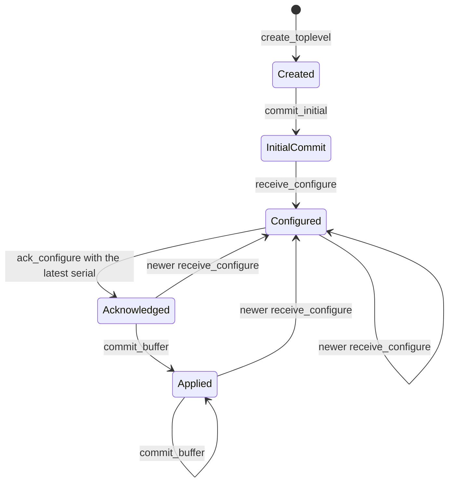

# Linux backend

In development. The backend opens and paints windows on Wayland. The full rewrite of this document comes with the last milestone of the [Linux backend spec](specs/2026-10-15-linux-backend.md).

The `choscorui-linux` crate has platform-neutral state machines for the Wayland and X11 protocols. On Linux, it also has the native backend, and the facade uses it through `backend/linux.rs`:

- `Application`, `Window`, and `Poster` on Wayland: windows, keyboard and pointer input, scale, and timers.
- Image decoding and encoding with the system codec libraries.

`choscorui::capabilities()` reports `backend: "wayland"` and `multiple_windows: Supported` when a compositor accepts the connection. Without a display server, it returns `BackendCapabilities::none("headless")`. The `keyboard` field is always `KeyConvention::Pc`. The other capabilities are `Unsupported` until their milestone lands.

The state machines compile and run on every host. [`tests/protocol_contracts.rs`](../crates/choscorui-linux/tests/protocol_contracts.rs) pins each rule in this document.

## Backend selection

Wayland and X11 are separate backends. `select_backend(requested, wayland_display, x11_display)` chooses one `BackendKind`:

- With no request, it chooses Wayland when `WAYLAND_DISPLAY` is set and not empty. Otherwise it chooses X11 when `DISPLAY` is set and not empty.
- With an explicit request, it returns that backend only when its display is available. It never uses the other display server. The error is `BackendSelectionError::RequestedUnavailable`.
- With no display, it returns `BackendSelectionError::NoDisplayServer`.

`LinuxCapabilities::for_backend` gives the optional features of each backend:

| Feature | Wayland | X11 |
| --- | --- | --- |
| Frame callbacks | Available | Unavailable: X11 uses expose and presentation events |
| Clipboard | Depends on `wl_data_device` | Available |
| Input method | Depends on `text-input-v3` | Depends on XIM |
| Touch | Depends on the `wl_touch` seat capability | Depends on XInput2 |
| Tablet | Depends on `tablet-v2` | Depends on XInput2 |
| Gestures | Depends on `pointer-gestures-v1` | Unavailable: core X11 has no portable gesture protocol |
| Drag and drop | Depends on `wl_data_device` | Depends on XDND |

## Wayland lifecycle

`WaylandConnection` models the connection and the globals:

1. Call `connect`.
2. Call `advertise(global, version)` for each global that the compositor announces. A version of 0 is an error.
3. Call `bind_required_globals`. It returns `WaylandError::MissingGlobal` when the compositor or `xdg_wm_base` is missing.
4. Call `create_toplevel` to get a `WaylandSurface`.

`WaylandSurface` models the `wl_surface` and `xdg_surface` configure handshake:

- The first commit has no buffer. `receive_configure` before `commit_initial` returns `WaylandError::InitialCommitRequired`.
- A configure gives a serial, a logical size, and a buffer scale. A size or a scale of 0 is an error.
- A newer configure replaces the latest one and clears the acknowledgement. The older serial becomes superseded.
- `ack_configure` accepts only the latest serial. It returns `SupersededConfigure` for an older serial and `UnknownConfigure` for a serial that the surface never received.
- `commit_buffer` returns `ConfigureNotAcknowledged` until `ack_configure` accepts the latest serial. After a commit, `logical_size` and `buffer_scale` give the applied configure.

`FrameScheduler` keeps at most one frame callback outstanding. `request` returns `FrameError::AlreadyPending` while a callback is outstanding. `presented` accepts only the token of the outstanding callback and returns `FrameError::UnknownCallback` for a stale token.

## X11 lifecycle

`X11Window` models the X11 window:

1. Call `connect`.
2. Call `create(width, height)`. A size of 0 is an error.
3. Call `map`.

`configure_notify(width, height, scale)` applies the new size and scale at once. X11 has no configure acknowledgement and no frame callback.

## X11 display server

On Linux, `Application::new` connects to the X server of `DISPLAY` when the selection gives X11. It loads libxcb and its extensions with `dlopen`. Without `DISPLAY`, or when the server refuses the connection, it returns `Error::NoDisplay`.

- **Windows.** Each window has `WM_DELETE_WINDOW`, `_NET_WM_NAME`, `WM_NAME`, `WM_CLASS` from the application id, and `_NET_WM_PID`. `WM_NORMAL_HINTS` holds the minimum size and north-west gravity. The window manager draws the frame, so `has_server_decorations` is true.
- **Events.** `WM_DELETE_WINDOW` gives `Closing`. `ConfigureNotify` gives `Resized`, and the first `MapNotify` gives `Resized` and activates the window. Focus events give `Focused`, and `VisibilityNotify` gives `Occluded`.
- **Scale.** The scale is `Xft.dpi` over 96, from `RESOURCE_MANAGER` on the root window. A change of the property gives `ScaleChanged` and `Resized`, and the window keeps its logical size.
- **Painting.** The window paints into a client-side image and sends only the pending region. It uses MIT-SHM when the server shares memory with the client. A shared image stays busy until its completion event. Otherwise `PutImage` sends the pixels in parts that fit the maximum request length.
- **Keyboard.** xkbcommon-x11 reads the keymap and the state of the core keyboard. XKB state events update the modifiers. With detectable auto-repeat, a held key arrives as repeated presses, and the keyboard does not repeat keys itself.
- **Pointer.** XInput 2.2 gives the pointer events of the master devices. A scroll valuator gives `WheelUnit::Points`: one increment is 15 points. The wheel buttons 4 to 7 give `WheelUnit::Lines` when the server does not emulate them from a valuator. Without XInput 2.2, core events give the same events.
- **Geometry.** `geometry` reads the position with `TranslateCoordinates`, removes `_NET_FRAME_EXTENTS`, and reads `_NET_WM_STATE`. `set_geometry` configures the window. Before the window shows, it writes `_NET_WM_STATE`. After that, it sends client messages to the window manager.
- **Window manager requests.** `begin_move` and `begin_resize` send `_NET_WM_MOVERESIZE`. `show_window_menu` sends `_GTK_SHOW_WINDOW_MENU`, which some window managers ignore. `minimize` sends `WM_CHANGE_STATE` with `IconicState`.
- **Cursors.** A cursor comes from the cursor theme through xcb-cursor, or else from the core cursor font. A custom image becomes a RENDER cursor. Without RENDER, the arrow shows.
- **Screens.** `screens` gives the RandR monitors in logical units. Without RandR, it gives the root window.

When no window manager runs, as on Xvfb, a mapped window takes the input focus itself. The `_NET_WM_STATE` client messages then have no effect, so the geometry smoke test uses a window that does not show.

## Seat input

`LinuxInput::update_seat(keyboard, pointer, touch)` records the capabilities of the seat. `dispatch` accepts an `InputEvent` only from a device that the seat has:

- A key event without a keyboard returns `InputState::KeyboardUnavailable`.
- A pointer event without a pointer returns `InputState::PointerUnavailable`.
- A touch event without touch returns `InputState::TouchUnavailable`.

When the seat loses the keyboard, the input clears the pressed keys. A removed device then cannot leave a modifier pressed.

## Clipboard states

`Clipboard` keeps two states: the remote offer and the local ownership.

- `receive_offer(mime_types)` records the MIME types that another client offers. `read(mime_type)` returns `ClipboardError::NoOffer` without an offer, and `ClipboardError::MimeUnavailable` for a type that the offer does not have.
- `claim(mime_types)` takes ownership of the selection with the given types. An empty list returns `ClipboardError::EmptySource`.
- `owns_selection` tells you if the application owns the selection. `ownership_lost` clears the ownership when another client claims the selection.

## Clipboard and drag and drop

`Application::clipboard()` gives a `SystemClipboard` for the selection of the display server. `SystemClipboard::temporary()` gives a private board that no other process sees. The API is the same as the macOS `Clipboard`: `write_text`, `read_text`, `write`, `formats`, and `read`. The name is different because `Clipboard` is the state machine above.

Each `DragItem` uses these MIME types:

| Format | Offered types | Also read |
| --- | --- | --- |
| `Text` | `text/plain;charset=utf-8`, `text/plain`, and `UTF8_STRING` | |
| `Files` | `text/uri-list` with `file://` URIs | |
| `Image` | `image/png` | JPEG, TIFF, GIF, WebP, and HEIF, converted to PNG |
| `Url` | `text/x-moz-url`, and `text/uri-list` when there are no files | |
| `Custom(name)` | none | |

- Custom data stays in the process. Other processes never see it.
- Text with a NUL character, and a relative file path, return `Error::InvalidClipboardText`. An image that is not PNG, and a custom name that is not valid, return `Error::UnsupportedFormat`.
- While the application owns the selection, it reads its own data. It does not ask the display server.
- A read from another client stops after 2 seconds without data.

On Wayland, `wl_data_device` carries the selection and the drags. The compositor accepts a selection only from a client with recent input. Thus the backend sends the serial of the last key, button, or focus event. `clipboard` and `drag_and_drop` are `Supported` when the compositor has `wl_data_device_manager`.

`Window::accept_drops(formats, operations)` makes a window a drop target. `Window::begin_drag(items, allowed, preview)` starts a drag:

- Call `begin_drag` while the left button is down on the window. Otherwise it returns `Error::NoDragEvent`, because the drag needs the serial of that press.
- The center of `preview` follows the pointer.
- The target window gets `WindowEvent::Drag` events. The source window gets `WindowEvent::DragEnded` with the operation.
- Wayland has copy and move actions, but no link action.
- The modifiers follow the PC convention: Ctrl copies, Shift moves, and Ctrl+Shift links. Without a modifier, a drag in the same application moves, and a drag from another application copies.

## Menus, popups, and decorations

Linux has no global menu bar. The facade draws the menus and the title bar in each window. The policy is in the controls, and `backend/linux/chrome.rs` connects the controls to the native window.

- **Menu bar.** `Application::install_main_menu(model)` returns a `MainMenu`. It keeps the model and the queue of chosen commands. Each window that opens after the installation shows a `Menubar` control at its top, above the content. A new model replaces the titles and the items in each bar.
- `perform_action(command)` queues an enabled command and returns `Ok(true)`. A disabled command returns `Ok(false)`. An unknown command returns `MenuError::UnknownCommand`.
- **Shortcuts.** The window gives a key press with Ctrl or Super to the menus before the views get it. `perform_key_equivalent(key, modifiers)` runs it. In the model, `command` is Ctrl. The items show the PC labels, such as `Ctrl+K`.
- **Menu keys.** F10 moves the focus to the menu bar. Alt with the mnemonic of a menu opens that menu with its first row highlighted. The mnemonic is the first letter or digit of the title (`menu_mnemonic`). The arrow keys, Enter, and Escape then work as in the `Menubar` control.
- A click, a shortcut, and a key choice all queue the command in the same `MainMenu`. `AppContext` runs the action after it delivers the input.
- The open menus of the bar show inside the window, so a menu that is longer than the window is cut off.
- **Popups.** `Window::open_popup(anchor, size)` opens an `xdg_popup` below `anchor`. The `xdg_positioner` flips the popup, then slides it, at the screen edges. The popup grabs the pointer and the keyboard with the serial of the latest key or button event. A click outside the popup sends `WindowEvent::Closing` (`popup_done`). `Application::window_count` does not count popups.
- **Context menus.** `NativeAccess::show_context_menu(window, menu, at)` shows a `ContextMenu` in a popup at `at`. It runs a nested event loop until the popup closes, as on macOS. It returns the chosen command, and the command also waits in `menu.take_activations()`. Escape, a click outside the popup, or a press in the parent window returns `None`. During the loop, the keys of the parent window go to the menu, because a compositor can keep the keyboard focus on the parent.
- Submenus of a context menu show inside the popup.
- **Decorations.** When the compositor does not grant server-side decorations, `Window::has_server_decorations` is false. Then the facade puts a `TitleBar` control above the menu bar. `CHOSCORUI_DECORATIONS=client` refuses the server-side decorations, for tests.
- A drag on the title bar starts `xdg_toplevel.move`. A double click maximizes or restores the window. A secondary click shows the compositor's window menu. The buttons minimize, maximize, and close the window.
- A primary press in the resize band starts `xdg_toplevel.resize` from that edge. The band is `DesignTokens::spacing` wide, inside the window. The pointer shows a resize cursor over the band.
- The facade gives the title, the maximized state, and the focus state of the window to the title bar through its `TitleBarHandle`.
- `native_menus` is `Supported` on Wayland and X11. `context_menus` is `Supported` on Wayland. On X11, `open_popup` returns `Error::PopupUnavailable`, and `show_context_menu` returns `None`.

## Image codecs

On Linux, `decode_image(bytes)` gives straight-alpha sRGB RGBA8 pixels, as the macOS backend does. The first bytes select the format and its library:

| Format | Signature | Library |
| --- | --- | --- |
| PNG | `\x89PNG\r\n\x1a\n` | libpng16 (`libpng16.so.16`) |
| JPEG | `FF D8 FF` | libturbojpeg (`libturbojpeg.so.0`) |
| GIF, first frame | `GIF87a` or `GIF89a` | giflib (`libgif.so.7`) |
| TIFF | `II*\0`, `MM\0*`, or BigTIFF | libtiff (`libtiff.so.6` or `libtiff.so.5`) |
| WebP, still images | `RIFF` and `WEBP` | libwebp (`libwebp.so.7`) |
| HEIC and HEIF | an `ftyp` box with a HEIF brand | libheif (`libheif.so.1`) |

- A JPEG file turns as its EXIF `Orientation` tag tells. libheif applies the rotation and mirror properties of a HEIF file. libtiff applies the orientation tag of a TIFF file.
- A GIF frame shows on its logical screen. The pixels outside the frame, and the transparent index, are transparent.
- Unknown bytes, and a format whose library does not load, return `ImageError::UnsupportedFormat`. Damaged data returns `ImageError::DecodeFailed`.
- An image of more than 64 Mpx returns `ImageError::InvalidDimensions`.
- An animated WebP file returns `ImageError::DecodeFailed`, because the simple libwebp API decodes only still images.
- The decoders do not convert embedded ICC profiles. libpng converts the PNG gamma to sRGB.
- `encode_png(image)` writes an sRGB PNG file with libpng.
- `image_codecs_support()` is `Supported` when libpng and libturbojpeg load.

## Not implemented

- A connection to a Wayland compositor
- Native event loops
- Windows on the screen and painting
- Text shaping and fonts
- Clipboard and drag-and-drop data transfer on X11
- Popups and context menus on X11 (override-redirect windows)
- A drawn shadow and an outer resize band for client-side decorations
- Input method composition
- Accessibility
- Desktop portals
- The `choscorui::platform` module and capability values for Linux
