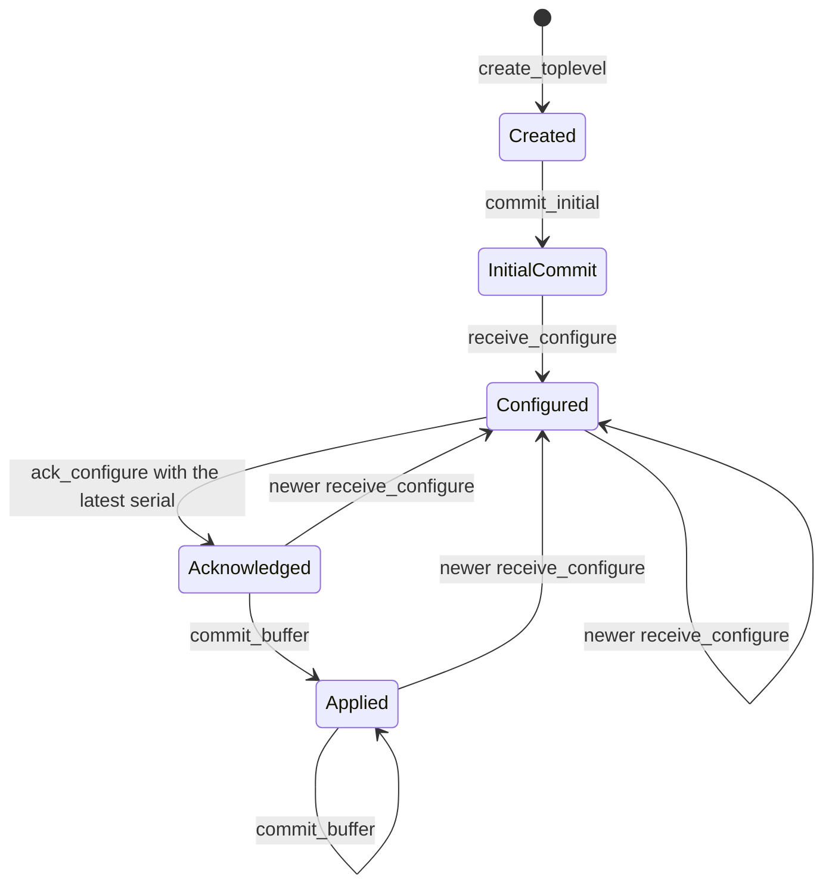

# Linux backend

In development. The backend opens and paints windows on Wayland. The full rewrite of this document comes with the last milestone of the [Linux backend spec](specs/2026-10-15-linux-backend.md).

The `choscorui-linux` crate has platform-neutral state machines for the Wayland and X11 protocols. On Linux, it also has the native backend, and the facade uses it through `backend/linux.rs`:

- `Application`, `Window`, and `Poster` on Wayland: windows, keyboard and pointer input, scale, and timers.
- Image decoding and encoding with the system codec libraries.

`choscorui::capabilities()` reports `backend: "wayland"` and `multiple_windows: Supported` when a compositor accepts the connection. Without a display server, it returns `BackendCapabilities::none("headless")`. The `keyboard` field is always `KeyConvention::Pc`. [Painters](#painters) gives the `gpu_painting` rule. The other capabilities are `Unsupported` until their milestone lands.

The state machines compile and run on every host. [`tests/protocol_contracts.rs`](../crates/choscorui-linux/tests/protocol_contracts.rs) pins each rule in this document.

## Backend selection

Wayland and X11 are separate backends. `select_backend(requested, wayland_display, x11_display)` chooses one `BackendKind`:

- With no request, it chooses Wayland when `WAYLAND_DISPLAY` is set and not empty. Otherwise it chooses X11 when `DISPLAY` is set and not empty.
- With an explicit request, it returns that backend only when its display is available. It never uses the other display server. The error is `BackendSelectionError::RequestedUnavailable`.
- With no display, it returns `BackendSelectionError::NoDisplayServer`.

`LinuxCapabilities::for_backend` gives the optional features of each backend:

| Feature | Wayland | X11 |
| --- | --- | --- |
| Frame callbacks | Available | Unavailable: X11 uses expose and presentation events |
| Clipboard | Depends on `wl_data_device` | Available |
| Input method | Depends on `text-input-v3` | Depends on XIM |
| Touch | Depends on the `wl_touch` seat capability | Depends on XInput2 |
| Tablet | Depends on `tablet-v2` | Depends on XInput2 |
| Gestures | Depends on `pointer-gestures-v1` | Unavailable: core X11 has no portable gesture protocol |
| Drag and drop | Depends on `wl_data_device` | Depends on XDND |

## Wayland lifecycle

`WaylandConnection` models the connection and the globals:

1. Call `connect`.
2. Call `advertise(global, version)` for each global that the compositor announces. A version of 0 is an error.
3. Call `bind_required_globals`. It returns `WaylandError::MissingGlobal` when the compositor or `xdg_wm_base` is missing.
4. Call `create_toplevel` to get a `WaylandSurface`.

`WaylandSurface` models the `wl_surface` and `xdg_surface` configure handshake:

- The first commit has no buffer. `receive_configure` before `commit_initial` returns `WaylandError::InitialCommitRequired`.
- A configure gives a serial, a logical size, and a buffer scale. A size or a scale of 0 is an error.
- A newer configure replaces the latest one and clears the acknowledgement. The older serial becomes superseded.
- `ack_configure` accepts only the latest serial. It returns `SupersededConfigure` for an older serial and `UnknownConfigure` for a serial that the surface never received.
- `commit_buffer` returns `ConfigureNotAcknowledged` until `ack_configure` accepts the latest serial. After a commit, `logical_size` and `buffer_scale` give the applied configure.

`FrameScheduler` keeps at most one frame callback outstanding. `request` returns `FrameError::AlreadyPending` while a callback is outstanding. `presented` accepts only the token of the outstanding callback and returns `FrameError::UnknownCallback` for a stale token.

## X11 lifecycle

`X11Window` models the X11 window:

1. Call `connect`.
2. Call `create(width, height)`. A size of 0 is an error.
3. Call `map`.

`configure_notify(width, height, scale)` applies the new size and scale at once. X11 has no configure acknowledgement and no frame callback.

## Seat input

`LinuxInput::update_seat(keyboard, pointer, touch)` records the capabilities of the seat. `dispatch` accepts an `InputEvent` only from a device that the seat has:

- A key event without a keyboard returns `InputState::KeyboardUnavailable`.
- A pointer event without a pointer returns `InputState::PointerUnavailable`.
- A touch event without touch returns `InputState::TouchUnavailable`.

When the seat loses the keyboard, the input clears the pressed keys. A removed device then cannot leave a modifier pressed.

## Clipboard states

`Clipboard` keeps two states: the remote offer and the local ownership.

- `receive_offer(mime_types)` records the MIME types that another client offers. `read(mime_type)` returns `ClipboardError::NoOffer` without an offer, and `ClipboardError::MimeUnavailable` for a type that the offer does not have.
- `claim(mime_types)` takes ownership of the selection with the given types. An empty list returns `ClipboardError::EmptySource`.
- `owns_selection` tells you if the application owns the selection. `ownership_lost` clears the ownership when another client claims the selection.

## Image codecs

On Linux, `decode_image(bytes)` gives straight-alpha sRGB RGBA8 pixels, as the macOS backend does. The first bytes select the format and its library:

| Format | Signature | Library |
| --- | --- | --- |
| PNG | `\x89PNG\r\n\x1a\n` | libpng16 (`libpng16.so.16`) |
| JPEG | `FF D8 FF` | libturbojpeg (`libturbojpeg.so.0`) |
| GIF, first frame | `GIF87a` or `GIF89a` | giflib (`libgif.so.7`) |
| TIFF | `II*\0`, `MM\0*`, or BigTIFF | libtiff (`libtiff.so.6` or `libtiff.so.5`) |
| WebP, still images | `RIFF` and `WEBP` | libwebp (`libwebp.so.7`) |
| HEIC and HEIF | an `ftyp` box with a HEIF brand | libheif (`libheif.so.1`) |

- A JPEG file turns as its EXIF `Orientation` tag tells. libheif applies the rotation and mirror properties of a HEIF file. libtiff applies the orientation tag of a TIFF file.
- A GIF frame shows on its logical screen. The pixels outside the frame, and the transparent index, are transparent.
- Unknown bytes, and a format whose library does not load, return `ImageError::UnsupportedFormat`. Damaged data returns `ImageError::DecodeFailed`.
- An image of more than 64 Mpx returns `ImageError::InvalidDimensions`.
- An animated WebP file returns `ImageError::DecodeFailed`, because the simple libwebp API decodes only still images.
- The decoders do not convert embedded ICC profiles. libpng converts the PNG gamma to sRGB.
- `encode_png(image)` writes an sRGB PNG file with libpng.
- `image_codecs_support()` is `Supported` when libpng and libturbojpeg load.

## Painters

A window paints with one of two painters, and `Window::painter()` tells which:

- `Painter::Gles` paints with OpenGL ES 3.0 through EGL on a `wl_egl_window`.
- `Painter::Cairo` paints with Cairo into double-buffered `wl_shm` buffers.

### Fallback

- New windows use GLES. They use Cairo when `CHOSCORUI_PAINTER=cairo` is set, or when libEGL, libGLESv2, or libwayland-egl does not load.
- New windows also use Cairo when no EGL config has RGBA8 and OpenGL ES 3.0, or when the shaders do not compile.
- The shaders compile when the application connects, before a window opens. A compile or link failure is a `GlesError`, not a panic.
- A GPU failure during a paint switches that window to Cairo for the rest of its life. The window then repaints all of its content.
- A lost context, a failed swap, and an OpenGL ES error during a paint are GPU failures. The other GLES windows switch to Cairo at their next paint.
- `capabilities().gpu_painting` is `Supported` when the GLES painter started and no GPU failure occurred. Else it is `Unsupported`.
- `Window::capture()` renders the display list with Cairo for both painters. `render_offscreen` is the Cairo export.
- `render_offscreen_gles` renders with GLES on the Mesa surfaceless EGL platform. The parity test uses it.

### GLES frames

- The swap interval is 0. The `wl_surface.frame` callback and `FrameScheduler` pace the paints, as they do for Cairo.
- The window sends the viewport, the window geometry, and the frame request before the swap. The swap attaches the buffer and commits the surface.
- With `EGL_EXT_buffer_age`, a paint repaints the damage of each frame since the back buffer was on the screen. Without it, a paint repaints the whole window.
- With `EGL_KHR_swap_buffers_with_damage` or `EGL_EXT_swap_buffers_with_damage`, the swap gives the damage to the compositor.

### GLES drawing

The painter draws each command in the order of the display list, as the Cairo painter does. One shader program multiplies a paint, a coverage, and a clip.

- A rectangle under an axis-aligned transform gets exact area coverage in the shader.
- Cairo rasterizes the coverage of other fills and strokes into a mask in device pixels. The painter keeps the masks that repeat from frame to frame.
- Glyphs come from one atlas texture. Cairo rasterizes each glyph with the faces of the Cairo painter, at the quarter-pixel phase of its position.
- Thus, both painters cover the same pixels, and they put glyphs at the same positions.
- A clip on whole pixels is a scissor rectangle. Another clip renders its coverage, times the outer clip, into a coverage texture.
- An opacity group draws into a layer texture. The pop of the group composites the layer with the opacity.
- Backdrop blur reads the base target back, blurs it with `blur_pixels`, and draws it in the rounded rectangle.

## Not implemented

- A connection to a Wayland compositor or an X server
- Native event loops
- Windows on the screen and painting
- Text shaping and fonts
- Clipboard and drag-and-drop data transfer
- Input method composition
- Accessibility
- Desktop portals
- The `choscorui::platform` module and capability values for Linux
