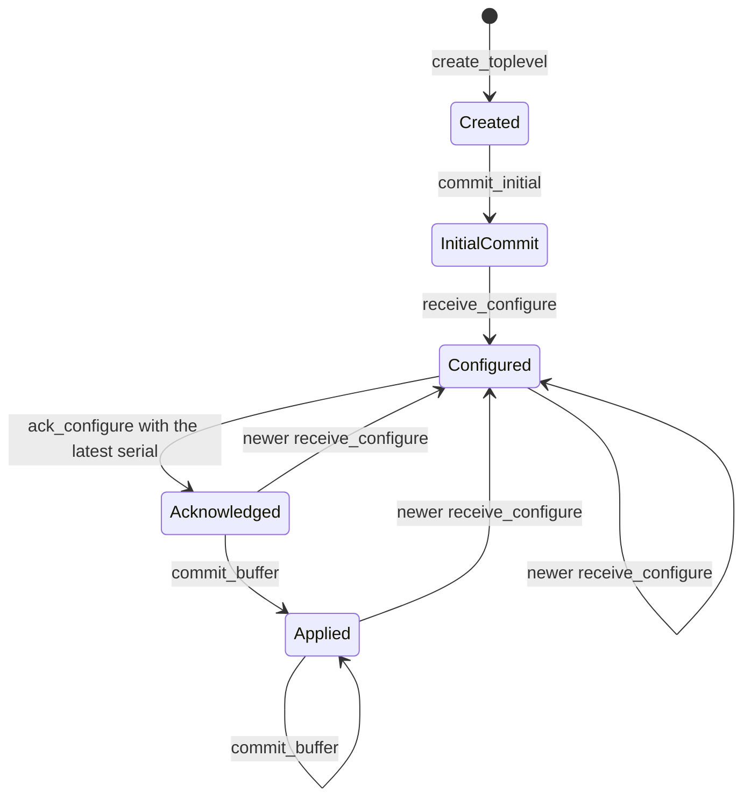

# Linux backend

In development. The backend opens and paints windows on Wayland. The full rewrite of this document comes with the last milestone of the [Linux backend spec](specs/2026-10-15-linux-backend.md).

The `choscorui-linux` crate has platform-neutral state machines for the Wayland and X11 protocols. On Linux, it also has the native backend, and the facade uses it through `backend/linux.rs`:

- `Application`, `Window`, and `Poster` on Wayland: windows, keyboard and pointer input, scale, and timers.
- Image decoding and encoding with the system codec libraries.

`choscorui::capabilities()` reports `backend: "wayland"` and `multiple_windows: Supported` when a compositor accepts the connection. Without a display server, it returns `BackendCapabilities::none("headless")`. The `keyboard` field is always `KeyConvention::Pc`. [Painters](#painters) gives the `gpu_painting` rule, and [Accessibility](#accessibility) gives the `accessibility` rule. The other capabilities are `Unsupported` until their milestone lands.

The state machines compile and run on every host. [`tests/protocol_contracts.rs`](../crates/choscorui-linux/tests/protocol_contracts.rs) pins each rule in this document.

## Backend selection

Wayland and X11 are separate backends. `select_backend(requested, wayland_display, x11_display)` chooses one `BackendKind`:

- With no request, it chooses Wayland when `WAYLAND_DISPLAY` is set and not empty. Otherwise it chooses X11 when `DISPLAY` is set and not empty.
- With an explicit request, it returns that backend only when its display is available. It never uses the other display server. The error is `BackendSelectionError::RequestedUnavailable`.
- With no display, it returns `BackendSelectionError::NoDisplayServer`.

`LinuxCapabilities::for_backend` gives the optional features of each backend:

| Feature | Wayland | X11 |
| --- | --- | --- |
| Frame callbacks | Available | Unavailable: X11 uses expose and presentation events |
| Clipboard | Depends on `wl_data_device` | Available |
| Input method | Depends on `text-input-v3` | Depends on XIM |
| Touch | Depends on the `wl_touch` seat capability | Depends on XInput2 |
| Tablet | Depends on `tablet-v2` | Depends on XInput2 |
| Gestures | Depends on `pointer-gestures-v1` | Unavailable: core X11 has no portable gesture protocol |
| Drag and drop | Depends on `wl_data_device` | Depends on XDND |

## Wayland lifecycle

`WaylandConnection` models the connection and the globals:

1. Call `connect`.
2. Call `advertise(global, version)` for each global that the compositor announces. A version of 0 is an error.
3. Call `bind_required_globals`. It returns `WaylandError::MissingGlobal` when the compositor or `xdg_wm_base` is missing.
4. Call `create_toplevel` to get a `WaylandSurface`.

`WaylandSurface` models the `wl_surface` and `xdg_surface` configure handshake:

- The first commit has no buffer. `receive_configure` before `commit_initial` returns `WaylandError::InitialCommitRequired`.
- A configure gives a serial, a logical size, and a buffer scale. A size or a scale of 0 is an error.
- A newer configure replaces the latest one and clears the acknowledgement. The older serial becomes superseded.
- `ack_configure` accepts only the latest serial. It returns `SupersededConfigure` for an older serial and `UnknownConfigure` for a serial that the surface never received.
- `commit_buffer` returns `ConfigureNotAcknowledged` until `ack_configure` accepts the latest serial. After a commit, `logical_size` and `buffer_scale` give the applied configure.

`FrameScheduler` keeps at most one frame callback outstanding. `request` returns `FrameError::AlreadyPending` while a callback is outstanding. `presented` accepts only the token of the outstanding callback and returns `FrameError::UnknownCallback` for a stale token.

## X11 lifecycle

`X11Window` models the X11 window:

1. Call `connect`.
2. Call `create(width, height)`. A size of 0 is an error.
3. Call `map`.

`configure_notify(width, height, scale)` applies the new size and scale at once. X11 has no configure acknowledgement and no frame callback.

## X11 display server

On Linux, `Application::new` connects to the X server of `DISPLAY` when the selection gives X11. It loads libxcb and its extensions with `dlopen`. Without `DISPLAY`, or when the server refuses the connection, it returns `Error::NoDisplay`.

- **Windows.** Each window has `WM_DELETE_WINDOW`, `_NET_WM_NAME`, `WM_NAME`, `WM_CLASS` from the application id, and `_NET_WM_PID`. `WM_NORMAL_HINTS` holds the minimum size and north-west gravity. The window manager draws the frame, so `has_server_decorations` is true.
- **Events.** `WM_DELETE_WINDOW` gives `Closing`. `ConfigureNotify` gives `Resized`, and the first `MapNotify` gives `Resized` and activates the window. Focus events give `Focused`, and `VisibilityNotify` gives `Occluded`.
- **Scale.** The scale is `Xft.dpi` over 96, from `RESOURCE_MANAGER` on the root window. A change of the property gives `ScaleChanged` and `Resized`, and the window keeps its logical size.
- **Painting.** The window paints into a client-side image and sends only the pending region. It uses MIT-SHM when the server shares memory with the client. A shared image stays busy until its completion event. Otherwise `PutImage` sends the pixels in parts that fit the maximum request length.
- **Keyboard.** xkbcommon-x11 reads the keymap and the state of the core keyboard. XKB state events update the modifiers. With detectable auto-repeat, a held key arrives as repeated presses, and the keyboard does not repeat keys itself.
- **Pointer.** XInput 2.2 gives the pointer events of the master devices. A scroll valuator gives `WheelUnit::Points`: one increment is 15 points. The wheel buttons 4 to 7 give `WheelUnit::Lines` when the server does not emulate them from a valuator. Without XInput 2.2, core events give the same events.
- **Geometry.** `geometry` reads the position with `TranslateCoordinates`, removes `_NET_FRAME_EXTENTS`, and reads `_NET_WM_STATE`. `set_geometry` configures the window. Before the window shows, it writes `_NET_WM_STATE`. After that, it sends client messages to the window manager.
- **Window manager requests.** `begin_move` and `begin_resize` send `_NET_WM_MOVERESIZE`. `show_window_menu` sends `_GTK_SHOW_WINDOW_MENU`, which some window managers ignore. `minimize` sends `WM_CHANGE_STATE` with `IconicState`.
- **Cursors.** A cursor comes from the cursor theme through xcb-cursor, or else from the core cursor font. A custom image becomes a RENDER cursor. Without RENDER, the arrow shows.
- **Screens.** `screens` gives the RandR monitors in logical units. Without RandR, it gives the root window.

When no window manager runs, as on Xvfb, a mapped window takes the input focus itself. The `_NET_WM_STATE` client messages then have no effect, so the geometry smoke test uses a window that does not show.

## Seat input

`LinuxInput::update_seat(keyboard, pointer, touch)` records the capabilities of the seat. `dispatch` accepts an `InputEvent` only from a device that the seat has:

- A key event without a keyboard returns `InputState::KeyboardUnavailable`.
- A pointer event without a pointer returns `InputState::PointerUnavailable`.
- A touch event without touch returns `InputState::TouchUnavailable`.

When the seat loses the keyboard, the input clears the pressed keys. A removed device then cannot leave a modifier pressed.

## Clipboard states

`Clipboard` keeps two states: the remote offer and the local ownership.

- `receive_offer(mime_types)` records the MIME types that another client offers. `read(mime_type)` returns `ClipboardError::NoOffer` without an offer, and `ClipboardError::MimeUnavailable` for a type that the offer does not have.
- `claim(mime_types)` takes ownership of the selection with the given types. An empty list returns `ClipboardError::EmptySource`.
- `owns_selection` tells you if the application owns the selection. `ownership_lost` clears the ownership when another client claims the selection.

## Clipboard and drag and drop

`Application::clipboard()` gives a `SystemClipboard` for the selection of the display server. `SystemClipboard::temporary()` gives a private board that no other process sees. The API is the same as the macOS `Clipboard`: `write_text`, `read_text`, `write`, `formats`, and `read`. The name is different because `Clipboard` is the state machine above.

Each `DragItem` uses these MIME types:

| Format | Offered types | Also read |
| --- | --- | --- |
| `Text` | `text/plain;charset=utf-8`, `text/plain`, and `UTF8_STRING` | |
| `Files` | `text/uri-list` with `file://` URIs | |
| `Image` | `image/png` | JPEG, TIFF, GIF, WebP, and HEIF, converted to PNG |
| `Url` | `text/x-moz-url`, and `text/uri-list` when there are no files | |
| `Custom(name)` | none | |

- Custom data stays in the process. Other processes never see it.
- Text with a NUL character, and a relative file path, return `Error::InvalidClipboardText`. An image that is not PNG, and a custom name that is not valid, return `Error::UnsupportedFormat`.
- While the application owns the selection, it reads its own data. It does not ask the display server.
- A read from another client stops after 2 seconds without data.

On Wayland, `wl_data_device` carries the selection and the drags. The compositor accepts a selection only from a client with recent input. Thus the backend sends the serial of the last key, button, or focus event. `clipboard` and `drag_and_drop` are `Supported` when the compositor has `wl_data_device_manager`.

`Window::accept_drops(formats, operations)` makes a window a drop target. `Window::begin_drag(items, allowed, preview)` starts a drag:

- Call `begin_drag` while the left button is down on the window. Otherwise it returns `Error::NoDragEvent`, because the drag needs the serial of that press.
- The center of `preview` follows the pointer.
- The target window gets `WindowEvent::Drag` events. The source window gets `WindowEvent::DragEnded` with the operation.
- Wayland has copy and move actions, but no link action.
- The modifiers follow the PC convention: Ctrl copies, Shift moves, and Ctrl+Shift links. Without a modifier, a drag in the same application moves, and a drag from another application copies.

## Input methods

`TextInputState` tells the input method about the focused text control. `active` is true while a text control has the focus. `text` is the committed text of the control, and the UTF-16 ranges count in it.

On Wayland, `zwp_text_input_v3` connects the window to the input method:

1. When `active` becomes true, the backend enables the text input.
2. Each state change sends the surrounding text, the cursor rectangle, and a commit. The surrounding text goes only while nothing is marked, because it does not contain the marked text.
3. The protocol uses byte offsets. The backend converts them to and from UTF-16 offsets.
4. A text longer than 4000 bytes sends a part of 4000 bytes or less around the selection.

The changes of the input method come in a group that ends with `done`. Each group gives these `ImeEvent`s, in this order:

- A commit or a deletion gives `CommitText`. A deletion around the cursor gives a `replacement_utf16` range.
- New marked text gives `SetMarkedText`. When the input method clears its marked text without a commit, the event has empty text.

`input_methods` is `Supported` when the compositor has `zwp_text_input_manager_v3`.

## Alert sound

`Application::beep()` plays the alert sound of the controls. It uses the first source that works:

1. On Wayland, `xdg_system_bell_v1` rings the bell for the focused window.
2. The libcanberra event sound `bell` plays from the sound theme.
3. Else, the application makes no sound.

The facade `Feedback` of the application calls `beep()`.

## Accessibility

The `atspi` module puts the semantic tree of each window on the AT-SPI2 accessibility bus. It uses the D-Bus binding of the crate. It uses no ATK and no GLib.

### Registration

`Bridge::connect(app_name)` does these steps:

1. It reads `AT_SPI_BUS_ADDRESS`, or calls `org.a11y.Bus.GetAddress` on the session bus.
2. It opens a private connection to that address.
3. It exports every accessible object under `/org/a11y/atspi` with one fallback handler.
4. It calls `org.a11y.atspi.Socket.Embed` on the registry with the root object `/org/a11y/atspi/accessible/root`.

The event loop serves the connection after `Application::attach_bus`. The loop serves the session bus and the accessibility bus together, and it drops a connection that it loses. The facade connects the bridge in `App::start`. Without the accessibility bus, the application runs without the bridge.

`capabilities().accessibility` is `Supported` when the accessibility bus accepts a connection now, and `Unsupported` otherwise. Each call asks the bus again, because the bus can start or stop at any time.

### Objects

The root object is the application. It has the `Accessible` and `Application` interfaces, and its children are the windows. A window is a `frame` with the window title as its name. The nodes of the semantic snapshot are under the window.

- A node keeps one object path while it stays in the snapshot. A removed node loses its path, and a call to that path returns `org.freedesktop.DBus.Error.UnknownObject`.
- A path is never given to another node.
- `org.a11y.atspi.Cache.GetItems` returns an empty list, so clients read each object directly.

Each node has `Accessible` and `Component`. A node also has these interfaces when its semantics need them:

| Interface | When the node has it |
| --- | --- |
| `Action` | It declares `Activate`, `Increment`, `Decrement`, `Expand`, `Collapse`, `ShowMenu`, or `Dismiss` |
| `Text` | It has `SemanticText`, or its role is `StaticText` |
| `EditableText` | It has `SemanticText`, declares `SetValue`, and is not read-only |
| `Value` | It has a `SemanticRange` |
| `Selection` | Its role is `List`, `Tree`, `Table`, `TabList`, `Menu`, or `MenuBar` |
| `Table` | Its role is `Table` |

The `Action` names are `click`, `increment`, `decrement`, `expand`, `collapse`, `show-menu`, and `dismiss`. `Text` counts offsets in characters, and the semantic tree counts UTF-16 code units. The bridge converts between them.

### Role mapping

| `SemanticRole` | AT-SPI role | `xml-roles` attribute |
| --- | --- | --- |
| `Application` | `application` | |
| `Window` | `window` | |
| `Group` | `panel` | |
| `Button` | `push button` | |
| `Checkbox` | `check box` | |
| `RadioButton` | `radio button` | |
| `RadioGroup` | `panel` | `radiogroup` |
| `TextField` | `entry`, or `text` when it is multi-line | |
| `PasswordField` | `password text` | |
| `SearchField` | `entry` | `searchbox` |
| `StaticText` | `label` | |
| `List` | `list` | |
| `ListItem` | `list item` | |
| `ScrollArea` | `scroll pane` | |
| `Slider` | `slider` | |
| `SpinButton` | `spin button` | |
| `ProgressIndicator` | `progress bar` | |
| `Tab` | `page tab` | |
| `TabList` | `page tab list` | |
| `TabPanel` | `panel` | `tabpanel` |
| `Table` | `table` | |
| `Row` | `table row` | |
| `Cell` | `table cell` | |
| `ColumnHeader` | `column header` | |
| `Tree` | `tree` | |
| `TreeItem` | `tree item` | |
| `Menu` | `menu` | |
| `MenuItem` | `menu item` | |
| `ComboBox` | `combo box` | |
| `PopUpButton` | `combo box` | `button` |
| `Tooltip` | `tool tip` | |
| `Dialog` | `dialog` | |
| `Toolbar` | `tool bar` | |
| `StatusBar` | `status bar` | |
| `Image` | `image` | |
| `Link` | `link` | |
| `ScrollBar` | `scroll bar` | |
| `MenuBar` | `menu bar` | |
| `MenuBarItem` | `menu` | `menuitem` |
| `Switch` | `toggle button` | `switch` |

AT-SPI 2.44 has no `switch` role, so a `Switch` is a `toggle button` with the `checked` and `pressed` states when it is on. A realized item of a collection has the `posinset` and `setsize` attributes.

### States and events

The states come from `SemanticState`, the focus, and the declared actions. For example, `checked: Some(true)` gives `checkable` and `checked`, and `expanded: Some(false)` gives `expandable` and `collapsed`.

`AccessibleWindow::publish(snapshot)` compares the snapshot with the previous one. It sends these events from `org.a11y.atspi.Event.Object`:

- `ChildrenChanged` with `add` or `remove`, for each node that a live parent gains or loses.
- `StateChanged` for each state that changed, such as `focused`, `checked`, `expanded`, `selected`, or `enabled`.
- `PropertyChange` for `accessible-name`, `accessible-description`, `accessible-role`, and `accessible-value`.
- `TextChanged` with `delete` and `insert`, `TextCaretMoved`, and `TextSelectionChanged` for a node with text.

A new focus also sends `org.a11y.atspi.Event.Focus`. A change of the active window sends `Activate` or `Deactivate` from `org.a11y.atspi.Event.Window`.

### Announcements

`AccessibleWindow::announce(text, priority)` sends the `Announcement` event of `org.a11y.atspi.Event.Object`. The text is in the event data, and the politeness is in the first detail: 1 for polite, 2 for assertive.

- When a listener of the registry asked for `object:announcement`, the event comes from the window. AT-SPI 2.46 and later screen readers ask for it.
- Otherwise, the event comes from the focused node, which older screen readers follow. Without a focused node, it comes from the window.

### Actions

A call such as `Action.DoAction`, `Component.GrabFocus`, a write of `Value.CurrentValue`, or `EditableText.SetTextContents` queues an `AccessibilityActionRequest`. A request queues only when the node declares the action. `AccessibleWindow::take_actions` returns the queue. The facade gives each request to `ViewHost::perform` or `ViewHost::perform_part`, the same path as on macOS.

### Coordinates

`Component` and `Text` give extents in logical points.

- `COORD_TYPE_WINDOW` gives coordinates relative to the content of the window.
- `COORD_TYPE_SCREEN` adds the screen position of the content. X11 gives this position. Wayland does not, so the bridge adds 0,0 there.
- `COORD_TYPE_PARENT` gives coordinates relative to the parent node.

On Wayland, screen coordinates are therefore relative to the window. A screen magnifier that follows the focus by screen coordinates cannot find the window on Wayland.

### Tests

[`tests/atspi_smoke.rs`](../crates/choscorui-linux/tests/atspi_smoke.rs) runs under `at-spi2-registryd` in `scripts/linux/headless-session.sh`. A test client walks a window with every `SemanticRole` and checks the roles and the names. It invokes a declared action and finds it in the queue. It also receives the events and both kinds of announcement. The test does not verify a screen reader.

## Image codecs

On Linux, `decode_image(bytes)` gives straight-alpha sRGB RGBA8 pixels, as the macOS backend does. The first bytes select the format and its library:

| Format | Signature | Library |
| --- | --- | --- |
| PNG | `\x89PNG\r\n\x1a\n` | libpng16 (`libpng16.so.16`) |
| JPEG | `FF D8 FF` | libturbojpeg (`libturbojpeg.so.0`) |
| GIF, first frame | `GIF87a` or `GIF89a` | giflib (`libgif.so.7`) |
| TIFF | `II*\0`, `MM\0*`, or BigTIFF | libtiff (`libtiff.so.6` or `libtiff.so.5`) |
| WebP, still images | `RIFF` and `WEBP` | libwebp (`libwebp.so.7`) |
| HEIC and HEIF | an `ftyp` box with a HEIF brand | libheif (`libheif.so.1`) |

- A JPEG file turns as its EXIF `Orientation` tag tells. libheif applies the rotation and mirror properties of a HEIF file. libtiff applies the orientation tag of a TIFF file.
- A GIF frame shows on its logical screen. The pixels outside the frame, and the transparent index, are transparent.
- Unknown bytes, and a format whose library does not load, return `ImageError::UnsupportedFormat`. Damaged data returns `ImageError::DecodeFailed`.
- An image of more than 64 Mpx returns `ImageError::InvalidDimensions`.
- An animated WebP file returns `ImageError::DecodeFailed`, because the simple libwebp API decodes only still images.
- The decoders do not convert embedded ICC profiles. libpng converts the PNG gamma to sRGB.
- `encode_png(image)` writes an sRGB PNG file with libpng.
- `image_codecs_support()` is `Supported` when libpng and libturbojpeg load.

## Painters

A window paints with one of two painters, and `Window::painter()` tells which:

- `Painter::Gles` paints with OpenGL ES 3.0 through EGL on a `wl_egl_window`.
- `Painter::Cairo` paints with Cairo into double-buffered `wl_shm` buffers.

### Fallback

- New windows use GLES. They use Cairo when `CHOSCORUI_PAINTER=cairo` is set, or when libEGL, libGLESv2, or libwayland-egl does not load.
- New windows also use Cairo when no EGL config has RGBA8 and OpenGL ES 3.0, or when the shaders do not compile.
- The shaders compile when the application connects, before a window opens. A compile or link failure is a `GlesError`, not a panic.
- A GPU failure during a paint switches that window to Cairo for the rest of its life. The window then repaints all of its content.
- A lost context, a failed swap, and an OpenGL ES error during a paint are GPU failures. The other GLES windows switch to Cairo at their next paint.
- `capabilities().gpu_painting` is `Supported` when the GLES painter started and no GPU failure occurred. Else it is `Unsupported`.
- `Window::capture()` renders the display list with Cairo for both painters. `render_offscreen` is the Cairo export.
- `render_offscreen_gles` renders with GLES on the Mesa surfaceless EGL platform. The parity test uses it.

### GLES frames

- The swap interval is 0. The `wl_surface.frame` callback and `FrameScheduler` pace the paints, as they do for Cairo.
- The window sends the viewport, the window geometry, and the frame request before the swap. The swap attaches the buffer and commits the surface.
- With `EGL_EXT_buffer_age`, a paint repaints the damage of each frame since the back buffer was on the screen. Without it, a paint repaints the whole window.
- With `EGL_KHR_swap_buffers_with_damage` or `EGL_EXT_swap_buffers_with_damage`, the swap gives the damage to the compositor.

### GLES drawing

The painter draws each command in the order of the display list, as the Cairo painter does. One shader program multiplies a paint, a coverage, and a clip.

- A rectangle under an axis-aligned transform gets exact area coverage in the shader.
- Cairo rasterizes the coverage of other fills and strokes into a mask in device pixels. The painter keeps the masks that repeat from frame to frame.
- Glyphs come from one atlas texture. Cairo rasterizes each glyph with the faces of the Cairo painter, at the quarter-pixel phase of its position.
- Thus, both painters cover the same pixels, and they put glyphs at the same positions.
- A clip on whole pixels is a scissor rectangle. Another clip renders its coverage, times the outer clip, into a coverage texture.
- An opacity group draws into a layer texture. The pop of the group composites the layer with the opacity.
- Backdrop blur reads the base target back, blurs it with `blur_pixels`, and draws it in the rounded rectangle.

## Not implemented

- A connection to a Wayland compositor
- Native event loops
- Windows on the screen and painting
- Text shaping and fonts
- Clipboard and drag-and-drop data transfer on X11
- Input method composition on X11
- Desktop portals
- The `choscorui::platform` module and capability values for Linux
