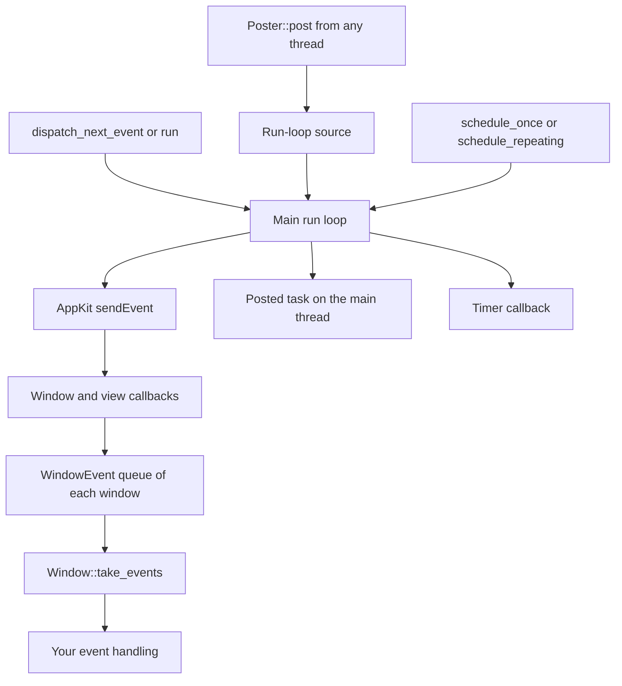

# macOS backend

macOS is the supported platform. The `choscorui-macos` crate is the backend. The facade uses it behind the portable `App`, `AppContext`, and `Services`, and also re-exports it as `choscorui::platform` with the `NativeAccess` trait. Applications use the portable API first, use `choscorui::platform` only for what it does not cover, and do not depend on the backend crate.

## Requirements

| Requirement | Version |
| --- | --- |
| macOS | 15 or later, Apple silicon or Intel |
| Xcode Command Line Tools | A release that supports macOS 15 (`xcode-select --install`) |
| Rust | 1.88 or later, edition 2024 |

The backend links only system frameworks: AppKit, Foundation, Core Foundation, Core Graphics, Core Text, ImageIO, and UserNotifications. [`scripts/macos/package.sh`](../scripts/macos/package.sh) builds a universal archive for Apple silicon and Intel when `CHOSCORUI_UNIVERSAL=1` is set.

## Application lifecycle and run loop

`Application`, `Window`, and the other native handles are neither `Send` nor `Sync`. Use them on the main thread only. `Application::new` returns `Error::WrongThread` on another thread.

`Application::new` makes the process a regular application and installs the application delegate. Then it calls `finishLaunching`, so the application keeps the open-document events at launch. The application does not take control of your main loop. Use one of these models:

- **Your own loop.** Call `Application::dispatch_next_event(timeout)` in a loop. It waits for one AppKit event, dispatches it, and returns `true` when an event arrived. The run loop also runs timers and posted tasks while it waits.
- **The AppKit loop.** Call `Application::run`. It blocks until `Application::stop` or `Poster::request_stop`.

`Application::pump_once(timeout)` runs at most one run-loop source or timer. Tests use it to let queued native work complete.

The diagram shows the path of events, posted tasks, and timers in the main run loop.

### Threads, posted tasks, and timers

- `Application::poster` returns a `Poster`. A `Poster` is `Send` and `Clone`. `Poster::post` queues a closure on the main run loop, in FIFO order.
- After the `Application` drops, `Poster::post` returns `PostError::Stopped`.
- `Application::schedule_once` and `Application::schedule_repeating` create a `Timer` on the main thread. Timers fire in all common run-loop modes, which include live resize and menu tracking.
- A repeating timer skips missed ticks. It does not fire a burst of ticks.
- `Timer::cancel` or a drop of the `Timer` stops further calls, also from inside the timer callback.

A panic in a native callback does not unwind into AppKit. The backend catches it, writes the callback to standard error, and returns a fallback value. For a posted task, a timer, or a menu callback, it also increments a counter: `Application::posted_panic_count`, `Application::timer_panic_count`, or `MainMenu::callback_panic_count`.

## Windows

1. Create a window with `Application::create_window(WindowOptions::new(title, width, height))`. The size is in logical points.
2. Give it content with `Window::set_display_list`.
3. Call `Window::show`.
4. Call `Window::take_events` after each event pump.
5. Handle each `WindowEvent` that it returns.

`WindowEvent` has these variants:

| Variant | Meaning |
| --- | --- |
| `Resized { size, scale }` | The window changed size. The event has the content size and the backing scale. |
| `ScaleChanged { scale }` | The backing scale changed, for example after a move to a different display. |
| `Focused(bool)` | The window became key or stopped being key. |
| `Closing` | The window is about to close. |
| `Pointer { event, modifiers, details }` | Pointer, button, and wheel input in logical points. `details.click_count` is the AppKit click count of a button press or release, and 1 for other events. |
| `Key { event, modifiers }` | Key down and key up. A key-down while text is marked goes only to the input method, so it sends no `Key` event. |
| `Text { text }` | Committed text from an ordinary key press. |
| `Ime(ImeEvent)` | Input method composition. See [Input methods](#input-methods). |
| `Occluded(bool)` | The window became fully hidden, or partly visible again. |
| `Drag(DragEvent)` | A drag over the content view. See [Clipboard and drag and drop](#clipboard-and-drag-and-drop). |
| `DragEnded(DragOperation)` | A drag that the window started has ended. |

A `Key` event names the navigation and editing keys, F1 to F20, and the Menu key of a PC keyboard (`Key::ContextMenu`). Another key is a lowercase `Key::Character` from the active keyboard layout, or `Key::Other` with the virtual keycode.

`Window::set_display_list` invalidates only the region that changed. An identical display list schedules no frame. Core Graphics paints the display list on the CPU in `drawRect:`.

Other window operations:

- `set_title`, `title`, `content_size`, `set_content_size`, and `backing_scale_factor` read or change the window frame and title.
- `set_cursor` sets the pointer shape over the content.
- `is_occluded` tells you when no part of the window is visible. Pause animations in that case.
- `capture` renders the content view to an `Image` at the backing scale.
- `geometry`, `set_geometry`, and `screen_visible_frames` save and restore the window placement. See [Settings storage](#settings-storage).

`Window::close` closes the window but keeps the native object. A drop of the `Window` closes it if necessary and releases the native object once. `Application::window_count` returns the number of native windows that AppKit still has.

## Menus and context menus

An application declares the menu bar with `CommandMenu` views, and the facade lowers them to a `MenuBarModel` from `choscorui-core`. A model is a list of `MenuSpec` values. Each `MenuSpec` has a title and a list of `MenuEntry` values: commands, submenus, and separators. The backend uses the model directly:

1. Give each command a unique `MenuCommandId`. `MenuBarModel::new` returns `MenuError::DuplicateCommand` for a repeated identifier.
2. Install the model with `Application::install_main_menu`. Keep the returned `MainMenu`.
3. After each event pump, read the chosen commands with `MainMenu::take_activations`.
4. Change the title, enabled state, checked state, or shortcut of a command with `MainMenu::set_state`.

`MainMenu::perform_action` sends a command through the same target and action path as a menu click. `MainMenu::perform_key_equivalent` sends a key-down event to the menu bar, as a keyboard shortcut does. Automation and smoke tests use them.

A `ContextMenu` is a native `NSMenu` built from one `MenuSpec`. `Window::show_context_menu(&menu, at)` shows it at a point in content coordinates. The call runs the AppKit menu loop until the menu closes. It returns the chosen command and also queues the command in `ContextMenu::take_activations`.

## Native dialogs

The file and alert dialogs are AppKit panels. Their appearance, accessibility, and sandbox behavior come from the system.

| Dialog | API | AppKit class |
| --- | --- | --- |
| Open one file | `FileDialogSpec::open_file` | `NSOpenPanel` |
| Open more than one file | `FileDialogSpec::open_files` | `NSOpenPanel` |
| Select a directory | `FileDialogSpec::select_directory` | `NSOpenPanel` |
| Save a file | `FileDialogSpec::save_file` | `NSSavePanel` |
| Alert or confirmation | `AlertSpec` with `AlertStyle` and `AlertButton` values | `NSAlert` |

- `FileDialogSpec` has builder methods for the title, the prompt, the initial directory, the suggested name, the allowed extensions, and hidden files.
- `Application::show_file_dialog` runs the panel as an application-modal dialog. It returns `FileDialogResponse::Selected(paths)` or `FileDialogResponse::Cancelled`. A cancel is not an error.
- `AlertSpec::new(message, buttons)` returns `DialogError::EmptyMessage` for an empty message and `DialogError::NoButtons` for no buttons.
- `Application::show_alert` returns `AlertResponse::Button(index)` for the chosen button.

Use the native file panels in sandboxed applications. The panel gives the application access to the file that the user selects.

[`docs/controls.md`](controls.md) describes the dialogs that ChoscorUI draws itself, for example `AlertDialog` and `ColorPicker`.

## Clipboard and drag and drop

`Clipboard::general` opens the system pasteboard. `Clipboard::temporary` opens a private pasteboard for drag data or isolated tests.

- `write_text` and `read_text` copy plain text.
- `write` puts typed `DragItem` values on the pasteboard: text, files, a PNG image, a URL, or private data. Other applications see the standard types.
- `formats` returns the formats that the pasteboard has now.
- `read` returns the items for the formats that you ask for, in that order. It converts TIFF images from other applications to PNG.

`DragFormat::Custom` data is private to the application. The backend never gives it to other processes.

To receive drops:

1. Call `Window::accept_drops(formats, operations)`.
2. Route each `WindowEvent::Drag` through `DropRouter` in `choscorui::core`.

An empty format list, or no operations, stops drops.

To start a drag:

1. Handle the pointer-down or pointer-move event that starts the gesture.
2. In that handler, call `Window::begin_drag`.
3. When the drag ends, handle `WindowEvent::DragEnded`.

A call to `Window::begin_drag` outside that handler returns `Error::NoDragEvent`.

## Alert sound

`SystemFeedback` implements the `Feedback` trait of core. Its `beep` plays the system alert sound with `NSBeep`. The `App` of the facade gives it to each window's view host. Thus a control that refuses a key or a paste beeps. A view host without it plays no sound.

## Input methods

The content view implements the `NSTextInputClient` methods, for example `setMarkedText:selectedRange:replacementRange:` and `firstRectForCharacterRange:actualRange:`. Composition arrives as `WindowEvent::Ime` with these `ImeEvent` values:

- `SetMarkedText` gives the marked text, its selection, and an optional replacement range.
- `CommitText` gives the final text and an optional replacement range.
- `Unmark` ends the composition.

Ranges are in UTF-16 units. After each edit, call `Window::set_text_input_state` with the selection, the marked range, and the caret rectangle. The input method uses the caret rectangle to place its candidate window. [text.md](text.md) describes the marked-text flow in the text controls.

## Desktop integration

`Application::take_app_events` returns the application events in AppKit callback order.

| Feature | API | Behavior |
| --- | --- | --- |
| Activation | `AppEvent::Activated`, `AppEvent::Deactivated` | Sent when the application becomes frontmost, or stops being frontmost. |
| Reopen | `AppEvent::Reopen { has_visible_windows }` | Sent when the user clicks the Dock icon of a running application. AppKit does nothing more. Show the main window when `has_visible_windows` is `false`. |
| Open documents | `AppEvent::OpenFiles(paths)` | Sent for files from Finder, the Dock, or `open -a`, also at launch. Finder routes files to the application only when its `Info.plist` declares `CFBundleDocumentTypes`. |
| Custom URL schemes | `AppEvent::OpenUrls(urls)` | Sent for non-file URLs. Declare the schemes in `CFBundleURLTypes` in `Info.plist`. |
| Open a URL | `open_url(url)`, `url_handler(url)` | `open_url` opens the URL with the default application. `url_handler` returns the path of that application and does not open the URL. |
| Status item | `StatusItem::new(title)` | Adds an item to the menu bar. See the list below. |
| Notifications | `request_notification_permission`, `notification_permission`, `post_notification(id, title, body)` | See the list below. |

`open_url` and `url_handler` return `DesktopError::InvalidUrl` for text that is not a URL with a scheme. `open_url` returns `DesktopError::NoHandler` when no application opens the scheme.

A `StatusItem` has `set_title`, `set_tooltip`, `set_visible`, and `set_menu(Option<ContextMenu>)`. The item owns its menu, and you read the choices with `item.menu()` and `ContextMenu::take_activations`. A drop of the `StatusItem` removes it from the menu bar.

Notifications work only when the process runs from an app bundle with a `CFBundleIdentifier`:

- `has_bundle_identifier` tells you if the process has a bundle identifier.
- Without one, the notification functions return `DesktopError::RequiresAppBundle`.
- `request_notification_permission` asks for alert, sound, and badge permission. The answer arrives later, so read it with `notification_permission`.
- `post_notification` returns `DesktopError::PermissionDenied` after the user denies permission.
- A notification with an existing identifier replaces the old one. Notifications also show while the application is frontmost.
- A click on a notification sends `AppEvent::NotificationActivated { identifier, action }`.

## System appearance and accessibility preferences

- `system_prefers_dark` returns `true` when the effective appearance of the application is a dark variant.
- `system_accessibility_preferences` returns `AccessibilityPreferences` with the Increase Contrast and Reduce Motion settings.

AppKit has no global text size, so `text_scale` is always 1.0. Give the application its own text size setting if it needs one. Read the preferences again when the window becomes key. [theming.md](theming.md) describes how `ThemeResolver` applies them.

## Settings storage

`user_settings_path(app_id)` in `choscorui::core` returns the path of the settings file. On macOS, the path is `~/Library/Application Support/<app_id>/settings.txt`.

- `app_id` is a reverse-DNS identifier, for example `com.example.editor`.
- The function returns `None` for an identifier with a `/` or a leading `.`, or when `HOME` is not set.
- The path comes from `HOME`. In a sandboxed application, `HOME` is the container of the application, so the file is in the container.

`App::id(app_id)` keeps the stored state and the restored window frames of an application in this file. `Scene::restore_geometry(key)` restores the window placement. It does these steps:

1. On close, it stores the frame of the window with `WindowGeometry::store`.
2. On launch, it reads the frame with `WindowGeometry::restore`.
3. It fits the frame to the current displays with `fit_to_screens(&screen_visible_frames()?, minimum)`.
4. It applies the result with `Window::set_geometry`.

`set_geometry` applies zoom and full screen after the frame, so the window returns to the saved size when it leaves those states. [guide.md](guide.md) describes the `Settings` API and the file format.

## Capabilities

`choscorui::capabilities()` returns `BackendCapabilities` with one `Support` value for each optional feature. Query capabilities instead of the OS version. On macOS, the values are:

| Capability | Value |
| --- | --- |
| `multiple_windows`, `native_menus`, `context_menus`, `native_dialogs` | `Supported` |
| `clipboard`, `drag_and_drop`, `input_methods`, `accessibility` | `Supported` |
| `status_items`, `open_urls`, `system_appearance`, `text_shaping`, `image_codecs` | `Supported` |
| `notifications` | `Supported` in an app bundle with a bundle identifier, otherwise `Conditional(Condition::AppBundle)` |
| `gpu_painting` | `Unsupported`, because Core Graphics paints on the CPU |

The services of `Services` follow these values. On macOS, `post_notification` from a binary that is not in an app bundle returns `ServiceError::Unavailable` with the condition, and the other services are available.

## Accessibility

`Window::set_accessibility(snapshot, changes)` turns a `SemanticTree` snapshot into native `NSAccessibilityElement` objects. A node keeps its native element while it stays in the snapshot, and the window releases the elements of removed nodes. The window maps each semantic role to an AppKit role and posts the AppKit notifications for each change.

- `Window::announce(message, priority)` asks VoiceOver to speak a message that has no focused element.
- `Window::take_accessibility_actions` returns the actions that an assistive technology asked for. The bridge queues an action only when the node declares it.

The [`choscorui-macos` README](../crates/choscorui-macos/README.md) describes the role mapping, the notifications, the action callbacks, and the collection attributes. [controls.md](controls.md) describes the semantics of each control.

[`scripts/macos/ax-check.sh`](../scripts/macos/ax-check.sh) is an optional diagnostic that reads the accessibility tree from outside the process. It compares the roles and names with the role mapping. No live session has confirmed the expected roles and names in the script. It needs the Accessibility permission for the terminal.
