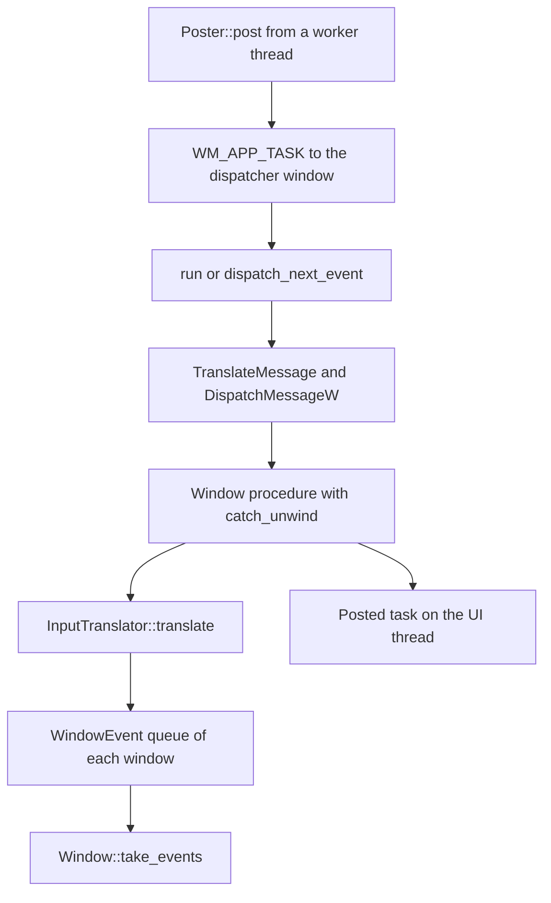

# Windows backend

Not supported. The crate compiles and has tested contracts.

The `choscorui-windows` crate has a Win32 window shell and platform-neutral translation code. The facade does not use it. On Windows, `choscorui::platform` does not exist, and `choscorui::capabilities()` returns `Unsupported` for every capability.

The translation code and the render plan compile on every host. The native types (`Application`, `Window`, `WindowOptions`, `Poster`, and `Error`) compile only for `target_os = "windows"`.

## Threading

`Application` and `Window` are neither `Send` nor `Sync`. Create and use them on one UI thread. `Poster` is the handle that worker threads use. Coordinates in the public API are logical points, and the raw Win32 handles stay private.

## Window shell

- `Application::new` registers the window class and creates a hidden dispatcher window for posted tasks.
- `Application::create_window(WindowOptions::new(title, width, height))` creates a top-level window. It scales the logical size with the system DPI and adjusts the frame with `AdjustWindowRectExForDpi`.
- `create_window` returns `Error::InvalidSize` for a size that is not positive and finite, and `Error::InvalidTitle` for a title with a NUL character.
- `Window::show` shows the window. `Window::content_size` and `Window::backing_scale_factor` read the client size and the DPI scale of the window.
- `Window::close` destroys the window once. A drop of the `Window` also closes it.

`WM_CLOSE` becomes `WindowEvent::Closing` and does not destroy the window. The application decides when to call `Window::close`.

## Message loop and pump

- `Application::run` runs a blocking `GetMessageW` loop until `Application::stop` posts `WM_QUIT`.
- `Application::dispatch_next_event(timeout)` waits up to `timeout` for one message and dispatches it. It returns `false` on a timeout or on `WM_QUIT`.
- `Application::pump_once(timeout)` dispatches at most one message.
- `Window::take_events` returns the translated `WindowEvent` values in arrival order.

The diagram shows the path of messages and posted tasks in the message loop.

## Worker posting

`Application::poster` returns a `Poster`. `Poster::post` sends a closure to the UI thread through the hidden dispatcher window, in FIFO order. After the `Application` drops, `post` returns `Error::Stopped` and drops the closure.

The [window smoke test](../crates/choscorui-windows/tests/window_smoke.rs) runs only on Windows. It creates, pumps, and closes a window, and it checks that a worker post runs on the UI thread.

## DPI handling

`DpiState` converts physical pixels to logical points with a scale of `dpi / 96`. On `WM_DPICHANGED`, the window moves to the suggested frame. Then `DpiState::translate` returns `WindowEvent::ScaleChanged` and a `WindowEvent::Resized` with the new logical size. `DpiState::take_suggested_frame` returns the suggested frame once.

## Event translation

`InputTranslator` turns a `NativeMessage` into `WindowEvent` values:

| Win32 message | `WindowEvent` |
| --- | --- |
| `WM_SIZE` | `Resized` with the logical size |
| `WM_DPICHANGED` | `ScaleChanged`, then `Resized` |
| `WM_SETFOCUS`, `WM_KILLFOCUS` | `Focused(true)`, `Focused(false)` |
| `WM_CLOSE` | `Closing` |
| `WM_MOUSEMOVE` and the left, right, and middle button messages | `Pointer` in logical points |
| `WM_MOUSEWHEEL`, `WM_MOUSEHWHEEL` | `Pointer` with a wheel delta in lines |
| `WM_KEYDOWN`, `WM_SYSKEYDOWN`, `WM_KEYUP`, `WM_SYSKEYUP` | `Key`, with the repeat flag on key down |
| `WM_CHAR` | `Text` |

- The translator maps Tab, Enter, Space, Escape, the arrow keys, Home, End, Backspace, and Delete to `Key` values. Other virtual keys become `Key::Other`.
- A standard wheel delta of 120 is one line. The translator converts a precise delta from pixels to points.
- `WM_CHAR` gives UTF-16 units. The translator keeps a high surrogate until the low surrogate arrives and then sends one `Text` event.
- A focus loss drops a high surrogate that has no low surrogate, so it cannot join text that arrives later.

[`tests/translation.rs`](../crates/choscorui-windows/tests/translation.rs) pins these rules on every host.

## Render plan

`RenderPlan::compile` turns a `DisplayList` into owned `RenderOp` values for a Windows drawing backend. It accepts `FillRect`, `DrawText`, `PushClip`, and `PopClip`, in painter order. It returns `RenderPlanError` for other commands, for geometry that is not finite, and for clips that are not balanced.

`DeviceResources` keeps the state of the render target. A lost target releases the device resources and asks for a new target. [`tests/render_plan.rs`](../crates/choscorui-windows/tests/render_plan.rs) pins this behavior.

## Panic containment

The window procedure runs each message handler and each posted task inside `catch_unwind`. A panic does not unwind into Win32. The window procedure returns 0 for that message and increments `Application::panic_count`.

## Not implemented

- Painting of a display list in a window, and Direct2D or DirectWrite calls
- Text shaping
- Clipboard
- Drag and drop
- Menus and context menus
- Dialogs
- Touch and pen input
- Input method composition
- UI Automation accessibility
- Window titles after creation, window geometry, and cursors
- The `choscorui::platform` module and capability values for Windows
