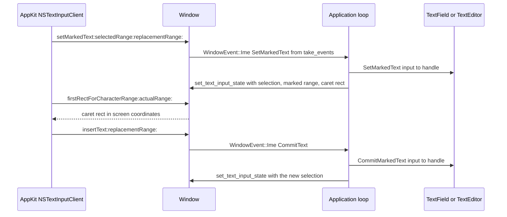

# Text

This document describes how ChoscorUI shapes, arranges, edits, and paints
text. It also describes the IME flow and rich text. The behavior contracts of
`TextField` and `TextEditor` (keys, focus, validation, undo) are in
[controls.md](controls.md).

## Shaping

The `TextShaper` trait in `choscorui-core` is the entry point to a platform
text system. Its one method, `shape`, turns a string and a `TextStyle` into a
`TextLayout`. With a `max_width`, lines wrap at break opportunities. A single
grapheme that is wider than the width gets its own line.

`CoreTextShaper` is the macOS implementation. It is in
`choscorui::platform`. Core Text does the shaping, font fallback,
bidirectional ordering, and line breaking. The shaper copies the result into
owned glyph runs. `CoreTextShaper` has no state, so use it with a
`TextLayoutCache`.

`TextStyle` holds the attributes of one block of text with the same style:

| Field | Purpose |
| --- | --- |
| `family`, `size` | Primary font family and size in points |
| `weight`, `slant` | `FontWeight` (1 to 1000) and `FontSlant` |
| `fallback` | Families to try in order before the system cascade |
| `direction` | `TextDirection`; `Auto` uses the first strong character |
| `locale` | BCP 47 tag for local glyph forms and line breaking rules |
| `line_height` | Multiple of the natural line height of the font |

`DesignTokens::text_style(family)` makes a `TextStyle` from the typography
tokens (see [theming.md](theming.md)). `available_font_families` lists the
installed font families on macOS.

### Linux

`LinuxTextShaper` in `choscorui-linux` is the Linux implementation. It has
no state, so a `static` can hold it. HarfBuzz shapes the text on FreeType
faces, and fontconfig chooses the faces:

- **Families:** fontconfig matches the family, weight, slant, and locale.
  `system-ui` is the desktop font that the backend gives to
  `set_desktop_font`, else `sans-serif`. `ui-monospace` is `monospace`.
- **Fallback:** each grapheme cluster uses the first face that has all its
  characters. The order is the primary face, the `fallback` families, and
  then the fontconfig sort list.
- **Lines:** a line breaks after whitespace, after a hyphen, and around
  ideographs. A word that does not fit breaks between graphemes.
- **Direction:** the shaper uses a reduced bidirectional algorithm. It
  does not apply explicit embeddings or isolates.
- **Rendering:** the Cairo painter draws each glyph run with the font file
  that shaped it. It uses grayscale anti-aliasing and the fontconfig
  hinting, and it does not move glyphs from their shaped positions.

`text_shaping_support` is `Supported` when FreeType, HarfBuzz, and
fontconfig load. `available_font_families` lists the fontconfig families.
The tests in [text_shaping.rs](../crates/choscorui-linux/tests/text_shaping.rs)
pin this behavior.

## Text layout

A `TextLayout` holds shaped, positioned text: glyph runs, lines, caret stops,
and grapheme extents. Measurement, hit testing, selection, and painting all
read the same `TextLayout`. Thus the toolkit paints exactly what it measured.

| Method | Result |
| --- | --- |
| `size`, `first_baseline` | Size for layout measurement and the baseline for alignment |
| `lines` | The `LayoutLine` values in source order |
| `fonts` | Each font that the shaper used, which shows fallback |
| `hit_test` | The nearest caret to a point |
| `caret_rect` | The caret rectangle at a grapheme index |
| `selection_rects` | One rectangle for each contiguous visual span of a selection |
| `move_vertical` | The caret one line up or down at a preferred x |
| `draw` | Glyph commands in a `DisplayList` |

Caret and selection indices are grapheme indices. A caret at a soft wrap
belongs to the later line, where typed text goes. In a right-to-left
paragraph, the line aligns to the right edge.

`TextLayout::from_lines` validates the output of a shaper. It rejects lines
that are out of order, outside the text, or without one caret stop for each
boundary.

The tests in [text_layout.rs](../crates/choscorui-core/tests/text_layout.rs)
pin this behavior with a test shaper. The tests in
[text_layout.rs](../crates/choscorui-macos/tests/text_layout.rs) of the macOS
crate pin `CoreTextShaper`.

## Layout caching

`TextLayoutCache` is a least-recently-used cache of `TextLayout` values. It
has a limit on the number of entries and a limit on the bytes.

- **Key:** each entry uses the text, the full `TextStyle`, and the width as
  its key. The style includes the locale.
- **Scale:** `set_scale` records the display scale. A change of scale removes
  all entries.
- **Fonts:** `invalidate_family` removes each layout that uses a family as
  its primary or fallback font. `invalidate_all` removes all entries.
- **Statistics:** `stats` returns a `TextCacheStats` with hits, misses,
  evictions, entries, and bytes.

Call `invalidate_all` when the installed fonts change. A change to the font
tokens of the theme gives a new `TextStyle`, and thus a new key.

`layout_paragraphs` makes the layout of the text one paragraph at a time. A `\n`
separates two paragraphs. It uses the cached layout of each paragraph that did
not change, and joins the paragraphs into one layout. Thus an edit in a long
document shapes only the changed paragraph again. Make the cache large enough
for the number of paragraphs in the document. The cache does not keep the
joined layout.

## Single lines and wrapped text

`choscorui::platform` also has two Core Text types for simple labels:

- `ShapedLine` is one immutable Core Text line. It gives metrics, caret
  offsets at grapheme indices, and hit testing on the x axis.
- `WrappedText` wraps a string to a width with the line breaks that Core Text
  suggests. It gives hit testing, caret rectangles, selection rectangles, and
  vertical caret motion.

The tests in [text_line.rs](../crates/choscorui-macos/tests/text_line.rs) and
[wrapped_text.rs](../crates/choscorui-macos/tests/wrapped_text.rs) pin these
types.

## Editing

### TextBuffer

`TextBuffer` in `choscorui-core` stores UTF-8 text with a selection. It
converts between grapheme indices, byte offsets, and UTF-16 offsets. The
selection is an anchor and a caret, as grapheme indices. Grapheme methods
accept only whole extended grapheme clusters.

- **Edits:** `replace_selection`, `delete_backward`, `delete_forward`,
  `cut_selection`, and `paste` change the text.
- **Motion:** `move_caret` takes a `TextMotion` (`Left`, `Right`, `WordLeft`,
  `WordRight`, `Start`, `End`) and can extend the selection.
- **Undo:** each edit records a delta, not a copy of the text. `undo` and
  `redo` restore the text and the selection. A new edit clears the redo
  history.
- **Limit:** the undo history keeps `UNDO_LIMIT` steps. It removes the oldest
  edit when it is full.
- **Mask:** `password_display` returns one mask character for each grapheme.

The tests in [text.rs](../crates/choscorui-core/tests/text.rs) pin this
behavior.

### TextField and TextEditor

`TextField` is a single-line editor, and `TextEditor` is a multiline editor.
Both keep a `TextBuffer` and a `TextComposition` for marked text.

The marked text stays outside the buffer and outside the undo history. To get
the text with the marked text in place, call `TextField::display_value` or
`TextEditor::layout_text`. When the editor commits the marked text, the buffer
gets one edit that you can undo.

`TextEditor` does not shape or paint text. To use it, do these steps:

1. Shape `TextEditor::layout_text` with your shaper, for example with
   `TextLayoutCache::layout_paragraphs`.
2. Give the `TextLayout` and the input to `TextEditor::handle`.
3. Shape the text again after a change.
4. Get the caret with `TextEditor::caret_rect`.
5. Show the caret in your scroll area.
6. Paint the selection with `TextEditor::selection_rects`.
7. Paint the text with `TextLayout::draw`.

During composition, `TextEditor::caret_rect` follows the end of the marked
text.

## IME flow

On macOS, the content view of each window implements `NSTextInputClient`.
The backend sends text input to your application as
`WindowEvent::Ime(ImeEvent)` values from `Window::take_events`. An `ImeEvent`
is one of these:

- `SetMarkedText { text, selected_utf16, replacement_utf16 }` replaces the
  marked text.
- `CommitText { text, replacement_utf16 }` inserts final text.
- `Unmark` keeps the marked text as final text.

All ranges are in UTF-16 units, because AppKit uses UTF-16 offsets.

To connect a text control to the IME, do these steps:

1. Read `WindowEvent::Ime` events from `Window::take_events`.
2. Send each event to the focused text control. Map `SetMarkedText` to
   `SetMarkedText`, `CommitText` to `CommitMarkedText`, and `Unmark` to
   `UnmarkMarkedText`.
3. Make a `TextInputState` from the control after each change.
4. Call `Window::set_text_input_state` with that state.

`TextInputState` has three fields:

- `selected_utf16` is the selection. Use `TextEditor::selection_utf16` or the
  `selection_utf16` field of `TextField::semantics`.
- `marked_utf16` is the marked range. Use `marked_range_utf16` on the
  control.
- `caret` is the caret rectangle in window content coordinates.

AppKit reads `caret` to put the IME candidate window next to the text.

An application of the `choscorui` facade does not do these steps. The
facade sends each `ImeEvent` to `ViewHost::composition` as a
`CompositionEvent`. After the events of a turn, it sets the text input state
from `ViewHost::text_input`. The hosted text controls show the marked text
underlined at the caret.

While text is marked, the content view gives each key-down only to the
input method. The window then sends no `Key` event for it.

The backend also commits ordinary typed text as `ImeEvent::CommitText`. It
calls `interpretKeyEvents:` for each key press without Command or Control.
When that call gives no text, the backend uses the characters of the key
event. It removes control characters and the private-use characters of
function keys. The [macOS backend](../crates/choscorui-macos/src/ime.rs)
contains the full routing.

> **Note:** automated tests send marked text through the native view. They do
> not use a real input method.

## Rich text

### Documents

`RichDocument` in `choscorui-core` is a list of `RichBlock` values. A block
has a `BlockKind`: `Paragraph`, `Heading(level)` with a level from 1 to 6,
`Bullet`, `Numbered`, `Quote`, or `Code`. A block also has a
`BlockAlignment`: `Start`, `Center`, or `End`.

A block holds `RichRun` values. Each run has text and a `SpanFormat` with
these fields: `bold`, `italic`, `underline`, `strikethrough`, `code`,
`color`, and `link`.

### Editing a document

- **Positions:** a `RichPosition` is a block index and a byte offset in the
  text of that block. The offset must be on a char boundary.
  `position_from_plain` and `plain_offset` convert to and from offsets in
  `plain_text()`.
- **Insert:** `insert` returns the position after the new text. A `\n` splits
  the block. A new block after a heading is a paragraph, and a list item
  continues the list.
- **Format of new text:** without an explicit format, new text gets
  `format_at` of the position, which is the format of the text before it.
- **Delete:** `delete` removes a range and merges its first and last blocks.
- **Formats:** `format_range` applies a change to the formats in a range.
  `toggle(range, flag)` sets the `FormatFlag` unless the full range has it
  already, as Command-B does.
- **Undo:** a `RichDocument` is cheap to clone. Keep snapshots in an
  `UndoStack<RichDocument>`.

### Interchange

| Format | Read | Write | Notes |
| --- | --- | --- | --- |
| Plain text | `from_plain_text` | `plain_text` | `\n` separates blocks. |
| Markdown subset | `from_markdown` | `to_markdown` | See the list below. |
| HTML | none | `to_html` | Escaped fragment with semantic tags. |

The Markdown subset has headings from `#` to `######`, `-`, `*`, and `1.`
list items, `>` quotes, and fenced code blocks. Inline, it has `**bold**`,
`*italic*` or `_italic_`, `~~strike~~`, `` `code` ``, `[text](url)`, and
backslash escapes. Other text is literal. `from_markdown` reads the output of
`to_markdown` and gives the same blocks and runs again. Markdown has no underline,
color, or alignment, so `to_markdown` does not write them.

`to_html` writes `
`, `<h1>` to `<h6>`, `<ul>`, `<ol>`, `<li>`,
`<blockquote>`, `<pre>`, `<strong>`, `<em>`, `<u>`, `<s>`, `<code>`, and
`<a>`. It writes color and alignment as inline styles. The toolkit does not
read HTML.

### Layout and painting

`RichLayout::build(document, theme, shaper, width)` makes the layout of a
document with any `TextShaper`. It shapes each run in pieces of word size and wraps the
pieces at spaces. Each line aligns to the alignment of its block.

`RichTheme` sets the base `TextStyle`, the code font family, the colors of
text, links, quotes, and code backgrounds, the block spacing, and the indent.
Headings get a fixed size scale and a bold weight.

`RichLayout` gives these methods:

- `hit_test` returns the `RichPosition` at a point.
- `caret_rect` returns the caret rectangle at a position.
- `link_at` returns the link under a point, for pointer activation.
- `paint` draws the glyph runs, underlines, strikethroughs, quote bars, and
  code backgrounds. When the shaper gives no glyphs, it draws text commands.

List markers are layout pieces, not document text.

`RichLayout` has these limits:

- A word that is wider than the width overflows. The layout does not break a
  word.
- Bidirectional ordering applies only inside a piece. A right-to-left block
  puts its pieces from the right edge.

The tests in [rich_text.rs](../crates/choscorui-core/tests/rich_text.rs) pin
editing, interchange, and layout.
