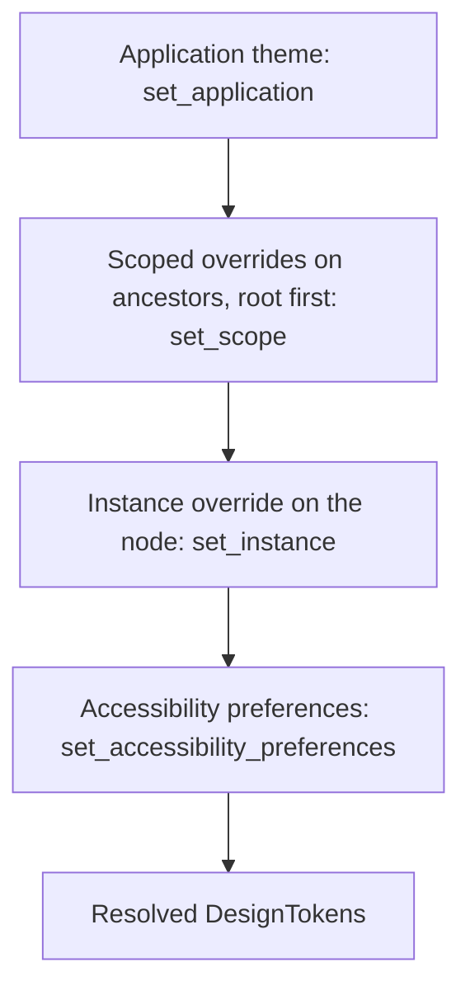

# Theming and customization

This document describes design tokens, theme resolution, visual recipes, and
animation. The second part gives customization recipes with tested code.

The rule behind all theming: **controls own behavior, you own appearance**.
Tokens, recipes, and delegates change what the toolkit paints. They do not
change input handling, focus, or accessibility semantics.

## Design tokens

`DesignTokens` in `choscorui-core` holds each themeable value. The stock token
sets are `DesignTokens::light()` and `DesignTokens::dark()`.

| Group | Fields | Change invalidates |
| --- | --- | --- |
| Color | `background`, `surface`, `content`, `accent`, `danger` | paint |
| Typography | `font_size`, `font_weight`, `line_height` | layout, paint, semantics |
| Spacing and shape | `spacing`, `radius`, `border_width` | layout, paint, semantics |
| Elevation | `elevation` | paint |
| Motion | `motion.duration_ms`, `motion.reduced` | paint |
| Contrast | `contrast` (`Contrast::Normal` or `Contrast::High`) | paint |

`line_height` is a multiple of `font_size`.
`DesignTokens::text_style(family)` makes a `TextStyle` for the shaper from the
typography tokens.

`ThemeResolver` returns a `ThemeInvalidation` for each change: `None`, `Paint`,
or `Layout`. It marks only the changed subtree dirty. A `Layout` change also
marks the subtree paint-dirty and semantics-dirty.

## Resolution order

`ThemeResolver::resolve` computes the tokens for one node. It applies four
layers, from the lowest to the highest precedence.



1. The application theme comes from `set_application`. Light and dark are two
   application themes.
2. Scoped overrides on ancestors apply root first. Use `set_scope` to add one
   and `remove_scope` to remove it.
3. The instance override from `set_instance` applies to the node itself.
   `set_instance` and `set_scope` write the same override slot for a node.
4. The accessibility preferences from `set_accessibility_preferences` always
   apply last.

The accessibility preferences change the tokens as follows:

- `text_scale` multiplies `font_size`.
- `high_contrast` sets `contrast` to `Contrast::High`.
- `reduced_motion` sets `motion.reduced` and sets `motion.duration_ms` to zero.

A change that gives invalid tokens returns `ThemeError`, and the previous theme
stays in effect. Invalid tokens include a negative or non-finite size and a
`font_size` of zero. A `text_scale` that is not positive and finite returns
`ThemeError::InvalidPreferences`.

## Visual recipes and slots

A visual recipe sets the appearance of a control and is separate from its
behavior. A `ButtonRecipe` has two methods. `layout` returns a `SlotLayout`,
and `paint_slot` paints one `Slot`.

`paint_button` paints the slots in the order of `Slot::ORDER`:

1. `Background`
2. `Icon`
3. `Content`
4. `Indicator`, which shows focus
5. `Overlay`, which shows the pressed or disabled state

After the `Content` slot, `paint_button` calls your closure. The closure draws
the label into `SlotLayout::content` with the recipe's alignment and color.

A recipe receives only the `ButtonVisualState` (`enabled`, `hovered`,
`pressed`, `focused`) and the resolved tokens. It cannot read input, focus,
commands, or semantics. Thus a change of recipe at runtime does not change
activation, keyboard handling, focus, or the accessibility tree. The tests in
[recipe.rs](../crates/choscorui-controls/tests/recipe.rs) pin this rule.

The toolkit has two built-in recipes:

- `ButtonStyle` paints a flat, square fill with an optional leading rail. It
  has leading content and focus bars at the top and bottom.
- `PillButtonRecipe` paints a rounded, elevated button with a trailing icon
  badge and centered content. It has an outset focus ring and an overlay for
  the pressed and disabled states.

Other controls take a style struct with one color for each state. Examples
are `CheckboxStyle`, `TextFieldStyle`, `SliderStyle`, and `TabStyle`. Make
these styles from tokens in the same way.

## Animation

`AnimationClock` in `choscorui-core` runs on monotonic time that the caller
supplies. Call `animate` to start an animation on a node and an
`AnimationKey` channel. Call `advance` with the current time to get the
sampled values.

- **Easing:** `Easing::Linear` or `Easing::EaseInOut`. A non-zero
  `motion.duration_ms` token replaces the duration in the `AnimationSpec`.
- **Interruption:** a new animation on the same node and channel starts from
  the current sampled value.
- **Reduced motion:** when `motion.reduced` is set or the duration is zero,
  the animation finishes immediately at its target value.
- **Node removal:** `advance` drops the animations of a removed node.
- **Frame requests:** request an OS frame only while `needs_frame()` returns
  true. An idle clock requests no frames.
- **Time:** `advance` returns `AnimationError::TimeWentBackwards` for a time
  earlier than the previous time.
- **Invalidation:** animations mark nodes paint-dirty only, never
  layout-dirty.

## Native look and system UI

The toolkit draws its controls. They are not AppKit controls, and a theme that
looks native can differ from a given macOS release. These parts use system UI
directly, and tokens do not change them:

- the menu bar and context menus (`NSMenu`)
- open panels, save panels, and alerts (`NSOpenPanel`, `NSSavePanel`,
  `NSAlert`)
- the IME candidate window
- drag images from other applications
- the window title bar and its buttons

## Customization recipes

Each snippet in this part comes from a test in
[cookbook.rs](../crates/choscorui/tests/cookbook.rs). The snippets compile
against the current API, and each test checks the claim of its recipe. Some
snippets show only the relevant lines of the test.

### A brand theme

Start from a stock theme and replace the tokens of your brand:

```rust
fn brand(dark: bool) -> DesignTokens {
    let base = if dark {
        DesignTokens::dark()
    } else {
        DesignTokens::light()
    };
    DesignTokens {
        accent: Color::rgba8(0, 128, 128, 255),
        radius: 8.0,
        ..base
    }
}
```

Change the application theme at runtime with `set_application`:

```rust
let mut themes = ThemeResolver::new(brand(false));
assert_eq!(themes.resolve(&tree, root).unwrap().radius, 8.0);
themes.set_application(&mut tree, brand(true)).unwrap();
```

`set_application` returns the `ThemeInvalidation` that it caused. For more
than one window, keep one `ThemeResolver` for each window tree.

To follow the system settings on macOS, read them at launch:

1. Call `choscorui::platform::system_prefers_dark` and give the result to
   `brand`.
2. Call `choscorui::platform::system_accessibility_preferences`.
3. Give the preferences to `set_accessibility_preferences`.

`system_accessibility_preferences` reads Increase Contrast and Reduce Motion.
AppKit has no global text size, so `text_scale` stays `1.0`. Your application
can offer its own text scale setting.

### Restyle one subtree

Use a scoped override to give part of the UI different tokens. In this
example, the accent of a "danger zone" subtree becomes the danger color:

```rust
let tokens = themes.resolve(&tree, root).unwrap();
themes
    .set_scope(
        &mut tree,
        danger_zone,
        ThemeOverride {
            accent: Some(tokens.danger),
            ..ThemeOverride::default()
        },
    )
    .unwrap();
assert_eq!(themes.resolve(&tree, delete).unwrap().accent, tokens.danger);
assert_eq!(themes.resolve(&tree, root).unwrap().accent, tokens.accent);
```

Descendants of `danger_zone` get the danger accent. The other nodes do not
change. `set_instance` gives an override to one node in the same way.

### A custom button look

Implement `ButtonRecipe` to change how a button paints. The recipe sees only
the visual state and the tokens:

```rust
struct OutlineRecipe;

impl ButtonRecipe for OutlineRecipe {
    fn layout(&self, bounds: Rect, state: ButtonVisualState, tokens: &DesignTokens) -> SlotLayout {
        SlotLayout {
            content: bounds.inset(tokens.spacing),
            alignment: ContentAlignment::Center,
            icon: None,
            content_color: if state.enabled {
                tokens.accent
            } else {
                tokens.content.with_alpha(0.4)
            },
        }
    }

    fn paint_slot(&self, slot: Slot, list: &mut DisplayList, context: &SlotContext<'_>) {
        let tokens = context.tokens;
        match slot {
            Slot::Background if context.state.pressed => {
                let _ = list.fill_rounded_rect(
                    context.bounds,
                    tokens.radius,
                    tokens.accent.with_alpha(0.15),
                );
            }
            Slot::Indicator => {
                let width = if context.state.focused {
                    tokens.border_width * 2.0
                } else {
                    tokens.border_width
                };
                let _ = list.stroke_rounded_rect(
                    context.bounds,
                    tokens.radius,
                    context.layout.content_color,
                    width,
                );
            }
            _ => {}
        }
    }
}
```

Paint the button with `paint_button`. The last argument draws the label:

```rust
let state = button.visual_state(&tree, node);
paint_button(
    &OutlineRecipe,
    &mut outline,
    rect(10.0, 10.0, 120.0, 32.0),
    state,
    &tokens,
    |_, _| {},
);
```

The test paints the same button with `PillButtonRecipe` and gets different
display commands. Then it presses Enter, and the button still returns its
command.

### Custom list, tree, and table cells

`ItemView` virtualizes rows. It calls an `ItemDelegate` to paint each realized
cell:

```rust
struct BadgeDelegate;

impl ItemDelegate for BadgeDelegate {
    fn paint_cell(
        &self,
        list: &mut DisplayList,
        rect: Rect,
        model: &dyn ItemModel,
        key: ItemKey,
        column: usize,
        state: ItemState,
    ) {
        let tokens = DesignTokens::light();
        if state.selected {
            list.fill_rect(rect, tokens.accent.with_alpha(0.2));
        }
        if let Value::Text(text) = model.data(key, column, Role::Display) {
            let _ = list.draw_text(
                Point::new(rect.origin.x + 28.0, rect.origin.y + rect.size.height * 0.7),
                &text,
                "Helvetica",
                13.0,
                tokens.content,
            );
            let badge = rect.size.height - 8.0;
            let _ = list.fill_rounded_rect(
                Rect::new(
                    Point::new(rect.origin.x + 4.0, rect.origin.y + 4.0),
                    Size::new(badge, badge),
                ),
                badge / 2.0,
                tokens.accent,
            );
        }
    }
}
```

Give the delegate to `ItemView::paint`:

```rust
view.paint(&mut list, &model, &BadgeDelegate, &[], false);
```

`ItemState` has the fields `selected`, `current`, `focused`, `depth`,
`has_children`, and `expanded`. Thus the delegate also paints tree disclosure
and focus rings. Accessibility names come from the model's
`Role::Accessibility` and `Role::Display` data, not from the painted cell. For
cell editing, use `EditorFactory` (see [controls.md](controls.md)).

### Custom validation

A text field has three validation states: `Valid`, `Intermediate`, and
`Invalid(message)`. `Intermediate` is for incomplete input, for example while
the user types. Calculate the state with your rule and set it:

```rust
fn validate_amount(
    field: &mut TextField,
    tree: &mut Tree,
    node: choscorui::core::NodeId,
    locale: &Locale,
) {
    let state = match locale.parse_decimal(field.value()) {
        _ if field.value().is_empty() => ValidationState::Intermediate,
        Ok(value) if value > 0.0 => ValidationState::Valid,
        Ok(_) => ValidationState::Invalid("the amount must be positive".into()),
        Err(_) => ValidationState::Invalid("enter a number such as 1.234,50".into()),
    };
    field
        .handle(tree, node, TextFieldInput::SetValidation(state))
        .unwrap();
}
```

- The field paints the indicator for the state through its `TextFieldStyle`.
- The field semantics give an `Invalid` message as `announcement`.
- `Locale::parse_decimal` accepts the decimal format of the user's locale.

`NumberInput`, `InputMask`, and `DateInput` are ready-made rules for usual
cases.

### Context-specific shortcuts

Bind the same chord at different scopes. The innermost scope wins: the focused
node, then the window, then the application.

```rust
commands
    .bind_shortcut(ShortcutScope::Application, command_f, find)
    .unwrap();
commands
    .bind_shortcut(
        ShortcutScope::Focused {
            window: 1,
            node: list,
        },
        command_f,
        find_in_list,
    )
    .unwrap();
assert_eq!(commands.resolve_shortcut(command_f, 1, None), Some(find));
assert_eq!(
    commands.resolve_shortcut(command_f, 1, Some(list)),
    Some(find_in_list)
);
```

A second binding of a chord in the same scope returns
`CommandError::DuplicateShortcut`. `CommandRegistry::set_enabled` disables a
command, and `resolve_shortcut` then returns `None` for its chord.

## More customization points

| You want to | Use | Details |
| --- | --- | --- |
| Write a control (measure, input, paint, semantics) | `CustomControl`, `ControlHost` | [guide.md](guide.md) |
| Animate a property and obey Reduce Motion | `AnimationClock` | [Animation](#animation) |
| Draw shapes or a large zoomable scene | `Scene`, `CanvasView` | [canvas.md](canvas.md) |
| Show styled documents | `RichDocument`, `RichLayout` | [text.md](text.md) |
| Keep window geometry and panel layout | `Settings`, `WindowGeometry`, `DockLayout` | [guide.md](guide.md) |
| Use native or custom dialogs | `FileDialogSpec`, `AlertSpec`, `InputDialog`, `ColorPicker` | [platform-macos.md](platform-macos.md) |
| Translate and mirror the UI | `Localizer`, `LayoutDirection` | [localization.md](localization.md) |
