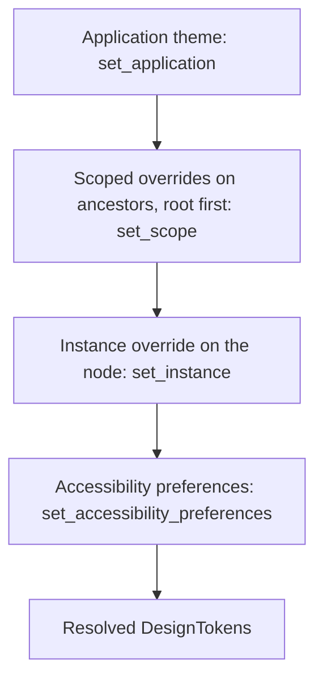
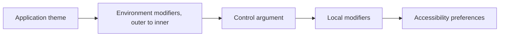

# Theming and customization

This document describes design tokens, theme resolution, visual recipes, and
animation. The second part gives customization recipes with tested code.

The rule behind all theming: **controls own behavior, you own appearance**.
Tokens, recipes, and delegates change what the toolkit paints. They do not
change input handling, focus, or accessibility semantics.

## Design tokens

`DesignTokens` in `choscorui-core` holds each themeable value. A theme is a
`BaseColor` in a `ColorScheme`. `DesignTokens::new(base, scheme)` builds any
of the 7 bases (`Neutral`, `Stone`, `Zinc`, `Mauve`, `Olive`, `Mist`,
`Taupe`) in `Light` or `Dark`. `DesignTokens::light()` and
`DesignTokens::dark()` are the `Neutral` base. The gallery state bar has a
swatch for each base beside its theme buttons.

| Group | Fields and helpers | Change invalidates |
| --- | --- | --- |
| Color | `base`, `scheme`, `palette`, `color(role)` | paint |
| Shape | `radius`, `radius(step)`, `radius_for(step, bounds)`, `border_width` | layout, paint, semantics |
| Spacing | `spacing`, `space(units)` | layout, paint, semantics |
| Typography | `text_scale`, `type_scale`, `font_sans`, `font_mono`, `text(size, weight)`, `preset(preset)`, `typeset(typeset)` | layout, paint, semantics |
| Focus ring | `ring_width`, `ring_alpha`, `ring_color(color)` | `ring_width`: layout; `ring_alpha`: paint |
| Shadows | `shadows`, `shadow(step)` | paint |
| Motion | `motion.duration_ms`, `motion.easing`, `motion.reduced` | paint |
| Contrast | `contrast` (`Contrast::Normal` or `Contrast::High`) | paint |

### Color roles and palettes

A `Palette` holds one `Color` for each `ColorRole`. Controls ask for a role,
not for a raw color, so one control follows each base and scheme. The roles
are `Background`, `Card`, `Popover`, `Primary`, `Secondary`, `Muted`,
`Accent`, `Destructive`, `Border`, `Input`, `Ring`, and `Chart1` to `Chart5`.
The `Sidebar` roles repeat these for a sidebar. Each surface also has a
`…Foreground` role for the content on it.

The palette tables are OKLCH values. `Color::from_oklch` converts them to
sRGB and clips each channel to the sRGB gamut. Some roles keep an alpha
value. For example, the dark `Border` is white at 10%.

### Scales

All sizes are in logical points. One CSS pixel is one point, and one `rem`
is 16 points.

| Scale | Steps |
| --- | --- |
| `RadiusScale` | `Sm`, `Md`, `Lg`, `Xl`, `Xl2`, `Xl3`, `Xl4` are 0.6, 0.8, 1, 1.4, 1.8, 2.2, and 2.6 × `radius` (10). `None` is 0 and `Full` makes a pill. |
| Spacing | `space(n)` is `n` × `spacing` (4). |
| `TextSize` | `Xs` 12/16, `Sm` 14/20, `Base` 16/24, `Lg` 18/28, `Xl` 20/28, `Xl2` 24/32, `Xl3` 30/36, `Xl4` 36/40 (size/line height). |
| `Tracking` | `Tighter` −0.05 em, `Tight` −0.025 em, `Normal`, `Wide` 0.025 em, `Wider` 0.05 em, `Widest` 0.1 em. |
| `ShadowScale` | `Xs2`, `Xs`, `Sm`, `Md`, `Lg`, `Xl`, `Xl2`, and the inset steps `InsetXs2`, `InsetXs`, `InsetSm`. |

The `type_scale` token is a `TypeScale` that holds the size and line height
of each `TextSize` step. `TypeScale::DEFAULT` holds the values above. The
`shadows` token is a `ShadowTable` that holds the layers of each
`ShadowScale` step. `ShadowTable::standard` holds the reference values.

`text` and `preset` return a `TypeSpec`: family, size, line height, weight,
slant, and tracking. `TypeSpec::text_style` makes a `TextStyle` for the
shaper. The `TextPreset` values are the typography rules of the reference:

| Preset | Face | Size / line height | Weight | Tracking | Other | Color role |
| --- | --- | --- | --- | --- | --- | --- |
| `H1` | sans | 36/40 (`Xl4`) | extra bold | `Tight` | - | `Foreground` |
| `H2` | sans | 30/36 (`Xl3`) | semibold | `Tight` | - | `Foreground` |
| `H3` | sans | 24/32 (`Xl2`) | semibold | `Tight` | - | `Foreground` |
| `H4` | sans | 20/28 (`Xl`) | semibold | `Tight` | - | `Foreground` |
| `Paragraph` | sans | 16/28 (leading 7) | normal | `Normal` | - | `Foreground` |
| `Lead` | sans | 20/28 (`Xl`) | normal | `Normal` | - | `MutedForeground` |
| `Large` | sans | 18/28 (`Lg`) | semibold | `Normal` | - | `Foreground` |
| `Small` | sans | 14/14 (leading none) | medium | `Normal` | - | `Foreground` |
| `Muted` | sans | 14/20 (`Sm`) | normal | `Normal` | - | `MutedForeground` |
| `Blockquote` | sans | 16/24 (`Base`) | normal | `Normal` | italic | `Foreground` |
| `List` | sans | 16/28 (leading 7) | normal | `Normal` | - | `Foreground` |
| `InlineCode` | mono | 14/20 (`Sm`) | semibold | `Normal` | - | `Foreground` |

The type steps come from `type_scale`. A preset with a fixed leading keeps
that line height, multiplied by `text_scale`. The test
`every_text_preset_has_its_reference_size_leading_and_weight` in
[theme.rs](../crates/choscorui-core/tests/theme.rs) pins the table.

A `Typeset` gives the body text of long-form content. Its `size` is the body
size in points. The `leading` and the `flow` are multiples of the size: the
line height and the space between blocks. `DesignTokens::typeset`
returns the body `TypeSpec`, and `Typeset::block_gap` returns the space
between blocks.

| Typeset | Size | Leading | Flow |
| --- | --- | --- | --- |
| `Typeset::DEFAULT` | 16 (1 em) | 1.75 | 1.25 em (20) |
| `Typeset::CHAT` | 16 | 1.6 | 1 em (16) |
| `Typeset::COMPACT` | 14 | 1.6 | 1 em (14) |

`font_sans` and `font_mono` are `FontFamily` values. The defaults
`FontFamily::SYSTEM_UI` and `FontFamily::SYSTEM_MONO` select the system faces.
The toolkit bundles no fonts.

A `Shadow` has an offset, a blur radius, a spread, a color, and an `inset`
flag, with the meaning of CSS `box-shadow`. `ShadowLayers` holds up to three
shadows. `DisplayList::draw_shadows` draws them in order.
`DisplayList::draw_shadow_corners` draws one shadow of a shape with a radius
for each corner. `Shadow::mask_corners` makes the shared mask that each painter
draws.

`DisplayList::draw_ring` draws a focus ring. The ring is a stroke of
`ring_width` just outside the shape, and it follows the corner radius.

`DisplayList::backdrop_blur` blurs the painted content inside a rounded
rectangle. `DisplayList::backdrop_blur_corners` does the same inside a
rectangle with a radius for each corner. The blur is a Gaussian with a standard deviation in points, as in
CSS `backdrop-filter: blur()`. A style with a `backdrop_blur` above zero gets
this blur under its background. The modal scrim uses it. Every painter blurs
with `blur_pixels`, so the pixels match.

`ThemeResolver` returns a `ThemeInvalidation` for each change: `None`, `Paint`,
or `Layout`. It marks only the changed subtree dirty. A `Layout` change also
marks the subtree paint-dirty and semantics-dirty.

### Overrides

`ThemeOverride` has an optional value for each token. The resolver applies an
override in this order:

1. A `base` or `scheme` builds the palette of that base and scheme again.
2. A `palette` replaces the full palette.
3. Each entry in `roles` replaces one color role.
4. The other fields replace their tokens.

The scales are overrides too. `radius` and `spacing` change every step of
their scales. `type_scale` replaces the type scale, and `text_scale`
multiplies it. `shadows` replaces the shadow table. A change of `type_scale`
invalidates layout, and a change of `shadows` invalidates paint.

`ThemeOverride::role(role, color)` and `ThemeOverride::theme(base, scheme)`
make the usual overrides.

## Resolution order

`ThemeResolver::resolve` computes the tokens for one node. It applies four
layers, from the lowest to the highest precedence.



1. The application theme comes from `set_application`. Light and dark are two
   application themes.
2. Scoped overrides on ancestors apply root first. Use `set_scope` to add one
   and `remove_scope` to remove it.
3. The instance override from `set_instance` applies to the node itself.
   `set_instance` and `set_scope` write the same override slot for a node.
4. The accessibility preferences from `set_accessibility_preferences` always
   apply last.

The accessibility preferences change the tokens as follows:

- `text_scale` multiplies the `text_scale` token, and thus each type step.
- `high_contrast` sets `contrast` to `Contrast::High`. With high contrast, the
  resolver makes `MutedForeground` reach 4.5:1 against its surfaces. It makes
  `Border`, `Input`, and `Ring` reach 3:1 against `Background`, and sets
  `ring_alpha` to 1. These colors become opaque.
- `reduced_motion` sets `motion.reduced` and sets `motion.duration_ms` to zero.

A change that gives invalid tokens returns `ThemeError`, and the previous theme
stays in effect. Invalid tokens include a negative or non-finite size, a
`text_scale` of zero, an empty font family, and a `ring_alpha` outside
`0..=1`. A type step that is not positive and a shadow with a negative or
non-finite value are also invalid. A `text_scale` that is not positive and finite returns
`ThemeError::InvalidPreferences`.

## Style views

Views take their look from modifiers. A modifier takes a typed token or a raw
value. Typed tokens include `ColorRole`, `Space`, `RadiusScale`, and
`TextPreset`. Raw values include a `Color` or a number of points. Tokens resolve against the theme of
the view, so the same view follows light, dark, and each base color.

There are two kinds of styling modifiers:

- **Local modifiers** change only the view that they wrap: `background`,
  `foreground`, `border`, `corner_radius`, `shadow`, `opacity`, `text_style`,
  `font_weight`, `tracking`, `clip_shape`, and `ring`.
- **Environment modifiers** change every descendant: `theme`,
  `color_scheme`, `tint`, `token`, `recipe`, `button_variant`,
  `control_size`, `disabled`, `locale`, and `layout_direction`.

An environment modifier becomes a scope in the `ThemeResolver`. A change
invalidates only that subtree, for paint or for layout as
`ThemeInvalidation` tells. A modifier argument can be a closure that reads
state, so a theme can change at run time.

### Precedence

One property can come from five layers. The higher layer wins:

1. The application theme, from `App::tokens` or `ViewHost::set_tokens`.
2. Environment modifiers, from the outermost view to the innermost.
3. The control's own argument, such as `Button::variant` or `.size`.
4. Local modifiers on the view.
5. The accessibility preferences, which always apply last.



For example, `.button_variant(ButtonVariant::Outline)` on a stack gives every
button inside it the outline look. A button with its own `.variant(...)`
keeps that variant. With high contrast, the border of each button still
reaches 3:1, whatever the modifiers say. The test
`style_precedence_ends_with_accessibility` in
[views.rs](../crates/choscorui-compose/tests/views.rs) pins this order.

### Reusable styles

There is no separate style language. To reuse a look, write a function that
takes a view and returns it with modifiers, or register a recipe with
`.recipe(kind, recipe)`:

```rust
use choscorui::prelude::*;

fn callout(content: impl View) -> impl View {
    content
        .padding(Space::S4)
        .background(ColorRole::Muted)
        .corner_radius(choscorui::core::RadiusScale::Lg)
}
```

## Style recipes

The `choscorui_controls::style` module holds one recipe system for every
control. A recipe maps a `StyleQuery` and the tokens to a `ResolvedStyle`.

A `StyleQuery` has these keys:

- `kind`: the `ControlKind`, for example `Button` or `Select`.
- `slot`: the part of the control, for example `Root`, `Trigger`, `Thumb`, or
  `Item`.
- `variant`: the control's variant enum, for example `ButtonVariant::Outline`.
- `size`: a `ControlSize`. A control uses the subset that its reference
  defines.
- `state`: a `VisualState` bitset of hovered, pressed, focus-visible,
  disabled, invalid, checked, indeterminate, selected, open, highlighted, and
  focused.

A `ResolvedStyle` holds every visual value of one slot. These include the
background, foreground, border, corner radii, shadows, ring, logical padding,
minimum size, gap, text, icon size, opacity, cursor, and duration.

The background is a `Paint`. The default recipe gives a solid color, and a
recipe can give a linear or radial gradient. The points of a gradient are in
the unit square of the slot box. The point (0, 0) is the top start corner,
and (1, 1) is the bottom end corner, so the gradient mirrors in a
right-to-left layout. A radial radius is a fraction of the longer side of
the box. `fill_shape` places the paint on the box.

`Styles` is the registry and the cache:

- `Styles::resolve` returns the style of a query. It caches the result by the
  token fingerprint and the query, so paint does not compute a style again
  for each node.
- `Styles::set_recipe` registers a `Rc<dyn Recipe>` for one control kind in a
  `RecipeSet`. A scope selects the set with the `recipes` token in a
  `ThemeOverride`. Use `RecipeSet::DEFAULT` to replace a look globally.
- A recipe returns `None` for a query that it does not style. The default
  recipe then styles that query.

A recipe sees only the query and the tokens. It cannot read input, focus,
commands, or semantics. The test
`another_recipe_keeps_messages_focus_and_semantics` in
[contract.rs](../crates/choscorui-controls/tests/contract.rs) plays the same
keys on every hosted control under the default recipe and under another
recipe. The messages, focus, and semantics must be equal. A guard test checks
that these controls paint every `ControlKind`. The guard lists each kind
that no hosted control paints, with the reason.

The default recipe gives each control the reference values. The focus-visible
state sets the border to `ring` and adds a 3 pt ring at the ring alpha. The
disabled state sets the opacity to 50%. With `motion.reduced`, every duration
is zero.

Only fields have an invalid state. The recipe has two invalid looks:

| Helper | Controls | Look |
| --- | --- | --- |
| `field_invalid` | text and select fields, the `DatePicker` trigger, and the `InputGroup` root | `destructive` border at 100% in both schemes; a 3 pt `destructive` ring at 20% (40% in dark) while focus does not show |
| `choice_invalid` | `Checkbox` and `RadioGroup` boxes, and the `Questionnaire` indicator | `destructive` border at 100% in both schemes, also when checked; no ring and no shadow |

While focus shows, an invalid control keeps the focus ring and the
`destructive` border. Thus focus stays visible. The label of an invalid
checkbox or radio option uses `destructive` text.

`paint_slot` is the general slot painter. It paints the drop shadows, the
ring, the backdrop blur, the background, the inset shadows, and the border,
in that order. Then it calls a closure with the box inside the padding. The
shadows, the ring, and the blur follow the radius of each corner. `draw_text` and
`draw_icon` draw the content of a slot.

## State transitions

When the visual state of a control changes, its colors, opacity, and
offset ease. A `ControlHost` blends two resolved styles; the recipes stay
pure.

- **Values that blend.** These `ResolvedStyle` values blend:

  | Value | Reference basis |
  | --- | --- |
  | `background`, `foreground`, `border` | `transition-[color,box-shadow]` |
  | `ring` color and width, `shadow` | `transition-[color,box-shadow]` |
  | `opacity` | `transition-opacity` and `transition-all` with `disabled:opacity-50` |
  | `offset_y` | `transition-all` with the pressed `translate-y-px` |

  Colors mix with premultiplied alpha. A ring that appears grows from zero
  width. A solid background blends into a solid background. A change from
  or to a gradient shows the new background at once.
- **Values that change at once.** The border width and sides, the radius,
  the padding, the sizes, and the gap change at once. The text, the
  underline, the icon size, the cursor, the backdrop blur, and `motion_ms`
  also change at once. The reference state changes do not animate them, or
  they change the layout.
- **Timing.** A blend lasts the target style's `motion_ms`, by default the
  `motion.duration_ms` token of 150 ms. It follows the `motion.easing`
  curve and starts at the first paint after the change.
- **Reduced motion.** With `motion.reduced`, the new style shows at once.
- **Interruption.** A change during a blend starts a new blend from the
  color on the screen. A recipe change during a blend works the same way.
- **Time.** Paint reads the `HostEnv` time. `ControlHost::advance` ends the
  finished blends and marks their nodes for a last paint.
- **Frame requests.** `ControlHost::animating` is true only while a blend
  runs on a visible node.
- **Memory.** The host keeps a record only for a hot node or a node that
  runs a blend. A hot node is under the pointer, has focus, or has pointer
  capture.
  `ControlHost::transition_stats` gives the counts.
- **Scope.** A hover or focus change on any node eases. A change from the
  control, such as press or checked, eases on a node under the pointer or
  with focus. `ControlHost::set_enabled` fades the opacity of a hot node.
  On another node, the disabled look shows at once. Other changes, such as
  `set_value` from the application, show at once. Overlays do not blend.

A control slot is a call of `PaintContext::style` with a kind and a slot.
The host matches the calls of one node by their order in each paint.

## Animation

`AnimationClock` in `choscorui-core` runs on monotonic time that the caller
supplies. Call `animate` to start an animation on a node and an
`AnimationKey` channel. Call `advance` with the current time to get the
sampled values.

- **Easing:** `Easing::Linear`, `Easing::EaseInOut`, `Easing::In`,
  `Easing::Out`, `Easing::Standard`, or `Easing::CubicBezier`. A
  `CubicBezier` has the meaning of CSS `cubic-bezier(x1, y1, x2, y2)`. The
  default curve `CubicBezier::STANDARD` is `(0.4, 0, 0.2, 1)`, and the default
  duration is 150 ms. A non-zero
  `motion.duration_ms` token replaces the duration in the `AnimationSpec`.
- **Interruption:** a new animation on the same node and channel starts from
  the current sampled value.
- **Reduced motion:** when `motion.reduced` is set or the duration is zero,
  the animation finishes immediately at its target value.
- **Node removal:** `advance` drops the animations of a removed node.
- **Frame requests:** request an OS frame only while `needs_frame()` returns
  true. An idle clock requests no frames.
- **Time:** `advance` returns `AnimationError::TimeWentBackwards` for a time
  earlier than the previous time.
- **Invalidation:** animations mark nodes paint-dirty only, never
  layout-dirty.

## Native look and system UI

The toolkit draws its controls. They are not AppKit controls, and a theme that
looks native can differ from a given macOS release. These parts use system UI
directly, and tokens do not change them:

- the menu bar and context menus (`NSMenu`)
- open panels, save panels, and alerts (`NSOpenPanel`, `NSSavePanel`,
  `NSAlert`)
- the IME candidate window
- drag images from other applications
- the window title bar and its buttons

## Customization recipes

Each snippet in this part comes from a test in
[cookbook.rs](../crates/choscorui/tests/cookbook.rs). The snippets compile
against the current API, and each test checks the claim of its recipe. Some
snippets show only the relevant lines of the test.

### A brand theme

Start from a stock theme and replace the tokens of your brand:

```rust
fn brand(dark: bool) -> DesignTokens {
    let base = if dark {
        DesignTokens::dark()
    } else {
        DesignTokens::light()
    };
    DesignTokens {
        palette: base
            .palette
            .with(ColorRole::Primary, Color::rgba8(0, 128, 128, 255)),
        radius: 8.0,
        ..base
    }
}
```

Change the application theme at runtime with `set_application`:

```rust
let mut themes = ThemeResolver::new(brand(false));
assert_eq!(themes.resolve(&tree, root).unwrap().radius, 8.0);
themes.set_application(&mut tree, brand(true)).unwrap();
```

`set_application` returns the `ThemeInvalidation` that it caused. For more
than one window, keep one `ThemeResolver` for each window tree.

To follow the system settings on macOS, read them at launch:

1. Call `choscorui::platform::system_prefers_dark` and give the result to
   `brand`.
2. Call `choscorui::platform::system_accessibility_preferences`.
3. Give the preferences to `set_accessibility_preferences`.

`system_accessibility_preferences` reads Increase Contrast and Reduce Motion.
AppKit has no global text size, so `text_scale` stays `1.0`. Your application
can offer its own text scale setting.

### Restyle one subtree

Use a scoped override to give part of the UI different tokens. In this
example, the primary color of a "danger zone" subtree becomes the
destructive color:

```rust
let tokens = themes.resolve(&tree, root).unwrap();
themes
    .set_scope(
        &mut tree,
        danger_zone,
        ThemeOverride::role(ColorRole::Primary, tokens.color(ColorRole::Destructive)),
    )
    .unwrap();
```

Descendants of `danger_zone` get the destructive primary color. The other nodes do not
change. `set_instance` gives an override to one node in the same way.

### A custom button look

Implement `Recipe` to change how a control paints. The recipe sees only the
style query and the tokens. Return `None` for a slot that the default recipe
must style:

```rust
struct OutlineRecipe;

impl Recipe for OutlineRecipe {
    fn resolve(&self, query: &StyleQuery, tokens: &DesignTokens) -> Option<ResolvedStyle> {
        if query.slot != Slot::Root {
            return None;
        }
        let mut style = ResolvedStyle::new(tokens);
        style.foreground = tokens.color(ColorRole::Primary);
        style.border = tokens.color(ColorRole::Primary);
        style.border_width = if query.state.focus_visible() { 2.0 } else { 1.0 };
        style.radius = Corners::all(tokens.radius);
        style.padding = Edges::axes(tokens.space(3.0), 0.0);
        style.min_height = tokens.space(9.0);
        if query.state.pressed() {
            style.background = tokens.color(ColorRole::Primary).with_alpha(0.15).into();
        }
        if query.state.disabled() {
            style.opacity = 0.5;
        }
        Some(style)
    }
}
```

Register the recipe for the button kind. Then paint the button through a
`PaintContext`:

```rust
styles.set_recipe(RecipeSet::DEFAULT, ControlKind::Button, Rc::new(OutlineRecipe));
let mut cx = PaintContext::new(&mut list, bounds, &tokens, &styles, &EstimatedText);
button.paint(&mut cx, &tree, node);
```

The test paints the same button with the default recipe and gets different
display commands. Then it presses Enter, and the button still returns its
command.

### Custom list, tree, and table cells

`ItemView` virtualizes rows. It calls an `ItemDelegate` to paint each realized
cell:

```rust
struct BadgeDelegate;

impl ItemDelegate for BadgeDelegate {
    fn paint_cell(
        &self,
        cx: &mut PaintContext<'_>,
        model: &dyn ItemModel,
        key: ItemKey,
        column: usize,
        state: ItemState,
    ) {
        let rect = cx.bounds;
        let primary = cx.tokens.color(ColorRole::Primary);
        if state.selected {
            cx.list.fill_rect(rect, primary.with_alpha(0.2));
        }
        if let Value::Text(text) = model.data(key, column, Role::Display) {
            let style = cx.style(StyleQuery::new(ControlKind::Badge, Slot::Root));
            let badge = rect.size.height - 8.0;
            let dot = Rect::from_xywh(rect.origin.x + 4.0, rect.origin.y + 4.0, badge, badge);
            let corners = Corners::all(badge / 2.0);
            fill_shape(cx.list, dot, &corners, cx.rtl, &style.background);
            let label = Rect::from_xywh(
                dot.max_x() + 4.0,
                rect.origin.y,
                rect.size.width - badge - 12.0,
                rect.size.height,
            );
            let body = cx.style(StyleQuery::new(ControlKind::Label, Slot::Root));
            cx.label(label, &text, &body, TextAlign::Start);
        }
    }
}
```

Give the delegate to `ItemView::paint`, with a context for the view and the
view's focus flags:

```rust
view.paint(&mut cx, &model, &BadgeDelegate, &[], VisualState::NONE);
```

`ItemState` has the fields `selected`, `current`, `focused`,
`focus_visible`, `depth`, `indent`, `has_children`, and `expanded`. Thus the
delegate also paints tree disclosure and focus rings. Accessibility names
come from the model's `Role::Accessibility` and `Role::Display` data, not
from the painted cell. For cell editing, use `EditorFactory` (see
[controls.md](controls.md)).

### Custom validation

A text field has three validation states: `Valid`, `Intermediate`, and
`Invalid(message)`. `Intermediate` is for incomplete input, for example while
the user types. Calculate the state with your rule and set it:

```rust
fn validate_amount(
    field: &mut TextField,
    tree: &mut Tree,
    node: choscorui::core::NodeId,
    locale: &Locale,
) {
    let state = match locale.parse_decimal(field.value()) {
        _ if field.value().is_empty() => ValidationState::Intermediate,
        Ok(value) if value > 0.0 => ValidationState::Valid,
        Ok(_) => ValidationState::Invalid("the amount must be positive".into()),
        Err(_) => ValidationState::Invalid("enter a number such as 1.234,50".into()),
    };
    field
        .handle(tree, node, TextFieldInput::SetValidation(state))
        .unwrap();
}
```

- An `Invalid` state paints the invalid look of the `Input` recipe.
- The field semantics give an `Invalid` message as `announcement`.
- `Locale::parse_decimal` accepts the decimal format of the user's locale.

`NumberInput`, `InputMask`, and `DateInput` are ready-made rules for usual
cases.

### Context-specific shortcuts

Bind the same chord at different scopes. The innermost scope wins: the focused
node, then the window, then the application.

```rust
commands
    .bind_shortcut(ShortcutScope::Application, command_f, find)
    .unwrap();
commands
    .bind_shortcut(
        ShortcutScope::Focused {
            window: 1,
            node: list,
        },
        command_f,
        find_in_list,
    )
    .unwrap();
assert_eq!(commands.resolve_shortcut(command_f, 1, None), Some(find));
assert_eq!(
    commands.resolve_shortcut(command_f, 1, Some(list)),
    Some(find_in_list)
);
```

A second binding of a chord in the same scope returns
`CommandError::DuplicateShortcut`. `CommandRegistry::set_enabled` disables a
command, and `resolve_shortcut` then returns `None` for its chord.

## More customization points

| You want to | Use | Details |
| --- | --- | --- |
| Write a control (measure, input, paint, semantics) | `CustomControl`, `ControlHost` | [guide.md](guide.md) |
| Animate a property and obey Reduce Motion | `AnimationClock` | [Animation](#animation) |
| Draw shapes or a large zoomable scene | `Scene`, `CanvasView` | [canvas.md](canvas.md) |
| Show styled documents | `RichDocument`, `RichLayout` | [text.md](text.md) |
| Keep window geometry and panel layout | `Settings`, `WindowGeometry`, `DockLayout` | [guide.md](guide.md) |
| Use native or custom dialogs | `FileDialogSpec`, `AlertSpec`, `InputDialog`, `ColorPicker` | [platform-macos.md](platform-macos.md) |
| Translate and mirror the UI | `Localizer`, `LayoutDirection` | [localization.md](localization.md) |
